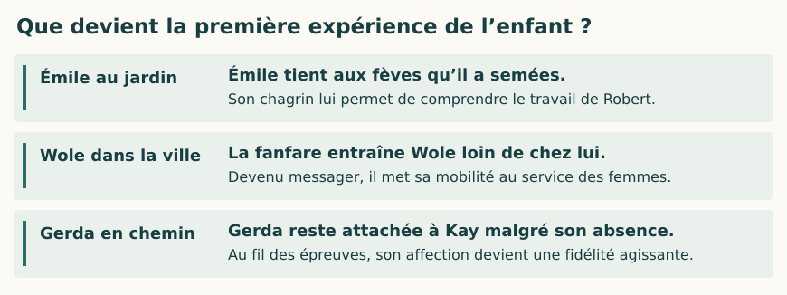

# L’enfance et l’éducation selon Pascal Picq · Agro-Véto 2022 · Corrigé brut

*Corrigé rédigé par IA, non officiel. Signalez toute erreur.*

**Rédaction** · GPT-6.2 Astra Ultra · vitesse non renseignée

**Révision (tour 1)** · GPT-6.2 Astra Ultra · vitesse non renseignée

Épreuve A BCPST 0722 · 3 heures.

## Sujet

« Éduquer, c’est préserver la part d’innocence naturelle de l’enfant, laisser du temps, ne pas brusquer. »

Pascal Picq, *Nouvelle histoire de l’Homme*, Paris, 2005.

En quoi cette affirmation vous permet-elle d’approfondir votre réflexion sur l’enfance et votre lecture des œuvres au programme, Émile ou De l’éducation (livres I et II) de Jean-Jacques Rousseau, les Contes d’Hans Christian Andersen et Aké, les années d’enfance de Wole Soyinka ?

## Dissertation

Dans « Les nouveaux habits de l’empereur », les adultes distinguent aussi bien que l’enfant la nudité du souverain. Pourtant il faut qu’une voix enfantine s’élève pour que tous consentent à voir ce qu’ils voient. Que va apprendre cet enfant en grandissant ? Si son éducation consiste à lui enseigner les convenances de la cour, il finira peut-être par se taire. Pascal Picq propose une autre fin à l’éducation. Il demande de « préserver la part d’innocence naturelle de l’enfant », et indique comment y parvenir, en lui laissant du temps et en ménageant sa sensibilité. Le mot « part » compte. L’innocence peut désigner une disposition à faire confiance ou l’absence de tort intentionnel. Dire qu’elle est naturelle suppose au moins qu’elle précède la leçon de l’adulte. Reste à savoir si elle mérite d’être conservée sous toutes ses formes. Sa confiance peut nourrir une aptitude à découvrir le monde aussi bien que l’exposer à qui voudrait l’abuser. Comment l’aider à acquérir l’expérience qui lui manque tout en sauvegardant la liberté de regard que cette expérience risque d’entamer ? Les deux premiers livres de l’*Émile*, les *Contes* d’Andersen et *Aké, les années d’enfance* font sentir la valeur du délai que réclame Picq. Les épreuves qu’ils racontent conduisent aussi à examiner ce que l’éducateur peut faire de ce temps.

### Qu’est-ce qu’un adulte pressé ferait perdre à l’enfant ?

Le premier préjudice serait de lui ôter le droit de commencer. Au livre I de l’*Émile*, l’emmaillotement offre l’image concrète d’une éducation qui façonne d’avance. L’adulte veut tenir et ordonner les membres du nourrisson au moment même où celui-ci pourrait faire l’expérience de ses mouvements. Le nourrisson n’a encore ni doctrine à défendre ni mérite à acquérir. Préserver son innocence a ici un sens très simple. Il faut lui ménager la possibilité de sentir et d’essayer avant d’exiger de lui le geste qui satisfera le regard d’autrui. Le petit Wole, lui aussi, fait une découverte à la mesure de son corps lorsqu’il se met à suivre une fanfare dans les rues d’Abeokuta. Aux yeux de sa famille, il s’est éloigné au risque de se perdre. Pour l’enfant qui marche, c’est d’abord une musique entendue dans son voisinage qui ouvre une ville entière. L’adulte qui raconte donne à cette exploration sa durée. Il fait comprendre ce qu’un récit réduit à la faute et au rappel à l’ordre aurait laissé de côté.

La franchise dépend de ce délai autant que la curiosité. À la cour d’Andersen, les prétendus tisserands ont associé l’aveu de ne rien voir au soupçon de sottise ou d’inaptitude aux fonctions qu’on occupe. Il a donc suffi que chacun anticipe le jugement de l’autre pour que tout le monde participe à la fiction. L’enfant dont la remarque se transmet dans la foule ignore encore le calcul qui fait taire de grandes personnes raisonnables. Un père demande qu’on entende sa voix. Un instant, le premier mouvement de cet adulte est de laisser parler celui qui sait moins de choses que lui. Rousseau donnerait une raison de ne pas abréger cet instant. Le maître qui demande très tôt à un élève de débiter une maxime lui fait découvrir quel discours mérite des éloges avant même qu’il soit capable d’en juger le sens. Il peut lui enseigner la comédie de la vertu. La lecture du « Corbeau et du Renard » au livre II de l’*Émile* indique à quel point le délai peut compter. L’adulte voit dans la mésaventure du corbeau une mise en garde. Son élève risque de choisir le beau rôle du renard qui gagne le fromage. L’enfant a bien compris qui réussit et sait le reconnaître avec plaisir. Ce qui lui manque encore est la capacité de se mettre à la place de celui qui perd. Répéter la leçon morale à voix plus haute ne lui donnera pas cette expérience. Rousseau formule au même livre une difficulté qui touche au naturel même de l’enfant. Son goût de l’imitation le porte à reproduire le geste généreux qu’on applaudit. Il faut encore qu’il en vienne à vouloir le bien de celui qui reçoit. La leçon prématurée coûte alors quelque chose à l’élève aussi bien qu’à ceux qui auraient pu apprendre de sa surprise.

Enfin, « ne pas brusquer » engage la manière de recevoir cette surprise. Le temps accordé resterait vide si chaque hésitation devenait aussitôt ridicule. Le récit de Soyinka est plein de la distance amusée qui sépare l’écrivain de l’enfant. Pourtant l’écrivain garde à ses parents les noms singuliers que leur attribue le petit garçon, notamment « Chrétienne Sauvage » à sa mère. Cette façon de nommer rapproche la ferveur chrétienne et l’énergie impérieuse que Wole découvre chez une même personne. Si l’adulte la corrigeait d’emblée pour lui substituer un portrait convenu, le lecteur perdrait précisément cette trouvaille. La patience éducative commencerait ainsi par une patience de lecteur ou d’auditeur.

### Que risque un enfant dont on voudrait préserver toute la naïveté ?

L’ignorance peut rendre l’enfant injuste sans qu’il se propose de nuire. Émile, après avoir cultivé ses fèves, s’afflige de les voir arrachées. Le jardinier Robert lui fait entendre une histoire que l’enfant ne pouvait connaître en contemplant la terre nue. Les travaux qu’Émile et son gouverneur ont entrepris avaient détruit des melons déjà semés par autrui. La peine d’Émile est sincère, celle du jardinier aussi. Si le maître n’entendait respecter que la spontanéité de son élève, il approuverait un jugement injuste. Quelqu’un doit faire entrer dans son champ de vision le temps du travail d’un autre. Voilà une intervention qui fait souffrir un enfant et qu’on aurait tort d’ajourner pour qu’il demeure content de lui-même.

Il y a aussi des échéances dont nul maître ne dispose. La mort de la petite Folasade, dans *Aké*, n’attend pas que Wole possède le langage d’un adulte pour faire irruption dans la famille. Le récit laisse sentir l’incrédulité et le chagrin du garçon devant un monde qui poursuit son cours. Une théorie de l’éducation qui promettrait de régler toutes les rencontres sur un calendrier de maturité échouerait ici. Andersen en montre le versant social dans la dernière nuit de la petite fille aux allumettes. Le conte laisse au lecteur le temps d’entrer dans les visions de l’enfant, cependant que les passants ne savent rien de ce qu’elle a vu. Une sensibilité capable de faire naître toute une fête à partir d’une lueur demeure exposée au froid et à l’indifférence. En de telles circonstances, laisser passer du temps peut être la faute de l’adulte. L’enfant a besoin d’une aide assez rapide pour changer ses conditions d’existence.

Enfin le rapport entre innocence et vérité n’est jamais garanti. Dans « La Reine des neiges », un éclat du miroir modifie le regard de Kay. Ce qu’il admirait devient méprisable, jusque dans les roses auxquelles tenait Gerda. La transformation passe pour ainsi dire par la pupille. Comment l’enfant la distinguerait-il de l’aspect véritable des choses ? La fiction donne une forme merveilleuse à une expérience ordinaire. On peut perdre la justesse de son regard avant d’avoir appris qu’un regard peut se déformer. Placer l’enfance hors de toute influence serait dès lors une promesse impossible à tenir. Il reste à se demander quelle relation peut l’aider à traverser de telles épreuves.

### Comment une qualité de l’enfance peut-elle devenir une capacité de l’adulte ?

On peut commencer par donner à l’enfant des interlocuteurs auprès desquels ce qu’il a découvert se prête à discussion. À la fin de l’épisode du jardin, Robert, Émile et le gouverneur en viennent à un arrangement. La possibilité de cultiver ensemble passe par la reconnaissance du premier occupant. Ce que l’élève avait appris en prêtant attention à la croissance de ses fèves lui permet maintenant d’imaginer le soin accordé par Robert à ses graines. Le maître a ménagé une expérience, avec toute la part d’artifice que comporte chez Rousseau cette direction de l’élève. Son intervention trouve ici sa justification dans un résultat vérifiable. Émile peut comprendre une raison étrangère à la sienne et prendre part à la conversation. La vivacité de son premier attachement sert désormais à élargir son jugement.

Un autre modèle de cet élargissement apparaît chez Soyinka. L’enfant qui suivait autrefois une musique sans savoir où elle le mènerait devient capable de porter des messages dans le mouvement des femmes d’Abeokuta. Elles ont leurs réunions, leurs griefs précis contre la taxation, leur expérience de la vie publique. Il n’est pas nécessaire d’attribuer à l’enfant la science politique de l’écrivain pour reconnaître à son rôle une valeur éducative. Les trajets qu’il accomplit importent à d’autres. Il découvre ce qu’on peut faire d’une liberté de mouvement lorsqu’on entre dans une histoire commune. Et l’ironie de la fin d’*Aké*, sur la discipline d’adultes capables eux aussi de déraison, empêche de mesurer le progrès de Wole à sa seule docilité.

Gerda, enfin, a grandi au cours de la recherche qui la ramène à Kay. Ses larmes atteignent l’ami que son savoir glacé isolait. À leur retour, les deux personnages découvrent qu’ils sont grands, tout en conservant dans leur cœur quelque chose des enfants qu’ils étaient. Cette fin importe davantage qu’un simple retour au foyer. La fidélité de Gerda a dû passer par une absence, des rencontres, la décision de poursuivre sa route. Ce qu’elle a de spontané dans l’amitié s’est transformé en constance. Chez Andersen, cette innocence du cœur prend aussi une signification chrétienne. Elle engage le rapport à autrui jusque dans l’âge adulte. L’écrivain qui revient à Aké et le philosophe qui fait dialoguer un enfant avec un jardinier donnent des sens différents à cette continuité. Tous trois la rendent pensable par une opération précise, le changement de point de vue qui conserve la force d’une première expérience.

## Conclusion

L’adulte peut faire gagner des années à un enfant en lui dictant tout de suite les réponses qui seront attendues de lui. Reste à savoir quelles questions l’enfant sera encore capable de poser. Picq a raison de reconnaître une fin éducative dans le soin pris d’une part d’innocence. Le délai a du prix quand il laisse un élève éprouver ce qui l’intéresse, entendre la réponse d’un autre et reprendre sa propre question. Il devient abandon s’il sert à éluder un danger, une injustice ou un deuil. L’innocence que les œuvres nous apprennent à sauvegarder se reconnaît finalement à ce qu’elle peut devenir, chez une personne désormais instruite des difficultés du monde, une aptitude à être encore surprise et à répondre de ce qu’elle a vu.

[Énoncé](https://egpc.fr/pdf/9463/agro-veto-2022-composition-de-francais-enonce-9463.pdf) · [Rapport du jury](https://www.concours-agro-veto.net/IMG/pdf/rapport_a-bcpst_composition_de_francais_2022.pdf)
