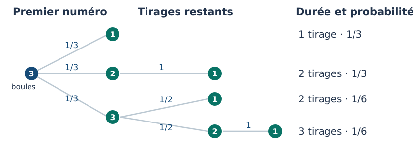
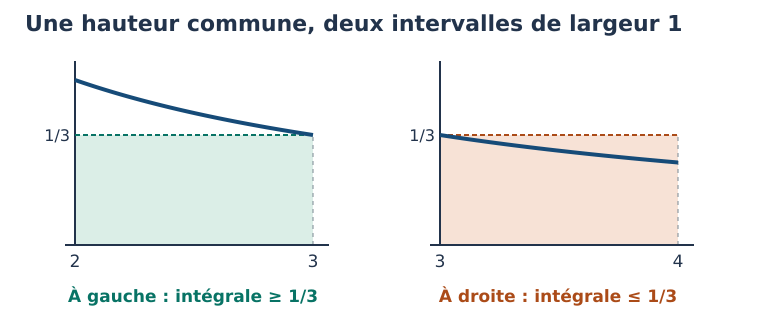
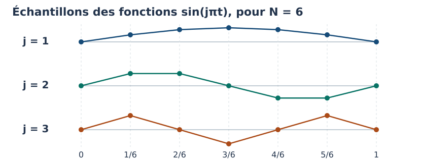
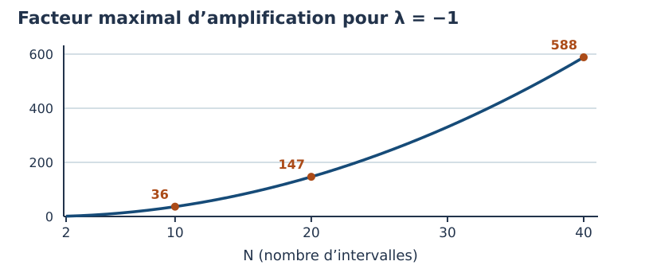

# Agro-Véto BCPST 2022 · Méthodes de calcul et raisonnement · Corrigé brut

*Corrigé rédigé par IA, non officiel. Signalez toute erreur.*

**Rédaction** · GPT-6.2 Astra Ultra · vitesse non renseignée

**Révision (tour 1)** · GPT-6.2 Astra Ultra · vitesse non renseignée

Le sujet donne dix questions sur l’urne et dix-neuf sur l’équation différentielle. Chaque question 8 comporte des sous-questions. [Sujet officiel](https://www.concours-agro-veto.fr/sites/default/files/media/2025-10/sujet2022.pdf) · [Rapport classé en 2022](https://www.concours-agro-veto.fr/sites/default/files/media/2025-10/rapport2022_math_mullaert.pdf)

## Exercice 1. Vider une urne

### 1. Deux boules

Les boules sont indiscernables au toucher. Le premier numéro $N_1$ est donc uniforme sur $\{1,2\}$. Si $N_1=1$, l’urne est vide. Si $N_1=2$, il reste la boule 1. Ainsi $P(X_2=1)=P(X_2=2)=1/2$, d’où $E(X_2)=3/2$ et $V(X_2)=(1+4)/2-(3/2)^2=1/4$.

### 2. Trois boules

Le premier numéro est uniforme sur $\{1,2,3\}$. Le tirage de 1 termine le jeu. Celui de 2 impose un second tirage. Après le tirage de 3, le nombre de tirages supplémentaires a la loi de $X_2$. On obtient
$$
P(X_3=1)=\tfrac13,\qquad P(X_3=2)=\tfrac13+\tfrac16=\tfrac12,\qquad P(X_3=3)=\tfrac16.
$$
L’espérance vaut $1/3+2/2+3/6=11/6$.

### 3. Support

Un tirage retire au moins une boule. Le jeu dure de 1 à $n$ tirages. Pour chaque $k$ dans cet intervalle, la suite des numéros $k,k-1,\ldots,1$ est possible avec une probabilité strictement positive et vide l’urne en $k$ tirages. Le support est $\{1,\ldots,n\}$.

### 4. Événements extrêmes

Un seul tirage suffit exactement lorsque $N_1=1$, de probabilité $1/n$. Pour durer $n$ tirages, il faut retirer une seule boule à chaque étape, donc tirer successivement $n,n-1,\ldots,1$. Les probabilités conditionnelles de ces choix sont $1/n,1/(n-1),\ldots,1$. Leur produit donne $P(X_n=n)=1/n!$.

### 5. Loi après le premier tirage

Posons $X_1=1$ et $X_0=0$ pour les urnes d’une boule et vide. Sachant $N_1=i$, les boules restantes sont exactement $1,\ldots,i-1$. Le nombre de tirages restant suit la loi de $X_{i-1}$. Pour $k\ge2$, le cas $i=1$ contribue zéro. La formule des probabilités totales sur la partition formée par les événements $\{N_1=i\}$ donne
$$
P(X_n=k)=\frac1n\sum_{i=2}^{n}P(X_{i-1}=k-1).
$$

Prenons quatre boules pour contrôler le conditionnement sur le premier tirage. Dans l’ordre des durées $1,2,3,4$, les probabilités sont $1/4,11/24,1/4,1/24$. Elles totalisent un et donnent une espérance $25/12$, égale à $1+1/2+1/3+1/4$.

### 6. Accroissement de l’espérance

Écrivons $m_j=E(X_j)$. Le même conditionnement, en incluant cette fois $i=1$, donne $nm_n=\sum_{i=1}^n(1+m_{i-1})=n+\sum_{j=0}^{n-1}m_j$. À l’ordre $n+1$, le membre de droite gagne $1+m_n$. Ainsi $(n+1)m_{n+1}-nm_n=1+m_n$, soit $m_{n+1}-m_n=1/(n+1)$.

### 7. Somme exacte

En sommant les accroissements depuis $m_1=1$, on obtient $E(X_n)=H_n$, avec $H_n=\sum_{j=1}^n 1/j$.

### 8. Comparaison intégrale

#### 8.a · Les deux rectangles

Pour $k\ge2$, $t\mapsto 1/t$ est décroissante sur les deux intervalles d’intégration, chacun de longueur 1. Elle est minorée par $1/k$ sur $[k-1,k]$ et majorée par $1/k$ sur $[k,k+1]$. Par intégration,
$$
\int_k^{k+1}\frac{dt}{t}\le\frac1k\le\int_{k-1}^k\frac{dt}{t}.
$$

#### 8.b · L’équivalent de la somme harmonique

En sommant de $k=2$ à $n$, on trouve $\log(n+1)-\log 2\le H_n-1\le\log n$. Divisons par $\log n>0$. Comme $\log(n+1)=\log n+\log(1+1/n)$, les deux bornes de $H_n/\log n$ tendent vers 1.

#### 8.c · L’équivalent de l’espérance

Avec la question 7, $E(X_n)\sim\log n$.

### 9. Second moment

Posons $s_n=E(X_n^2)$. Conditionnellement au premier tirage $i$, le second moment vaut $1+2m_{i-1}+s_{i-1}$. Ainsi $ns_n=n+\sum_{j=0}^{n-1}(2m_j+s_j)$. La différence entre deux rangs consécutifs donne $(n+1)s_{n+1}-ns_n=1+2m_n+s_n$. En conséquence,
$$
s_{n+1}-s_n=\frac{2m_n+1}{n+1}.
$$

### 10. Variance

Posons $v_n=s_n-m_n^2$. Pour $h=1/(n+1)$, la question 9 et $m_{n+1}=m_n+h$ donnent $v_{n+1}-v_n=(2m_n+1)h-(2m_nh+h^2)=h-h^2$. Comme $v_1=0$,
$$
V(X_n)=\sum_{j=1}^{n}\left(\frac1j-\frac1{j^2}\right).
$$
Pour $j\ge2$, $1/j^2\le1/[j(j-1)]=1/(j-1)-1/j$. La somme des inverses des carrés est donc bornée par 2. En divisant $H_n-\sum_{j=1}^n1/j^2$ par $\log n$, il vient $V(X_n)\sim\log n$.

## Exercice 2. Équation différentielle avec deux conditions au bord

### I. Problème homogène continu

### 1. Solutions sur la droite réelle

L’équation caractéristique est $r^2=-\lambda$. Avec $a,b\in\mathbb R$ arbitraires et indépendants de $t$, les solutions sont les fonctions suivantes.

- Si $\lambda<0$, $f(t)=a e^{\omega t}+b e^{-\omega t}$, avec $\omega=\sqrt{-\lambda}$.
- Si $\lambda=0$, $f(t)=a+bt$.
- Si $\lambda>0$, $f(t)=a\cos(\omega t)+b\sin(\omega t)$, avec $\omega=\sqrt{\lambda}$.

### 2. Conditions aux deux bords

Pour $\lambda<0$, $b=-a$ puis $a(e^\omega-e^{-\omega})=0$. Comme $\omega>0$, $a=b=0$. Pour $\lambda=0$, les deux conditions imposent également $a=b=0$. Pour $\lambda>0$, $a=0$ puis $b\sin\omega=0$. Si $\lambda=(j\pi)^2$ avec $j\ge1$ entier, les solutions sont toutes les fonctions $t\mapsto b\sin(j\pi t)$. Pour toute autre valeur de $\lambda$, la seule solution est nulle.

### II. Problème homogène sur le maillage

### 3. Matrice intérieure

Imposons $x_0=x_N=0$ avant de former $X=(x_1,\ldots,x_{N-1})^{\mathsf T}$. Soit $A_{N-1}$ la matrice à diagonale nulle et à deux diagonales voisines remplies de 1. Après division de chaque équation par $N^2$, la ligne $k$ est $x_{k-1}+(\lambda/N^2-2)x_k+x_{k+1}=0$. Cela donne $X\in\ker M$, où
$$
M=M_{N-1,\lambda}=A_{N-1}+(\lambda/N^2-2)I_{N-1}.
$$
Pour $N=2$, il ne reste qu’une ligne et $A_1=(0)$. Le noyau porte sur les seules inconnues intérieures.

La note attachée à cette question dans le PDF officiel rappelle les deux conditions $x_0=x_N=0$. Elles sont nécessaires pour la réciproque puisque le vecteur intérieur ne contient aucune information sur les bords.

### 4. Paramètres admissibles

Un vecteur intérieur non nul résout $MX=0$ si et seulement si $A_{N-1}X=(2-\lambda/N^2)X$. Par définition d’une valeur propre,
$$
\Lambda=\{N^2(2-\mu)\mid\mu\in\operatorname{Sp}(A_{N-1})\}.
$$

### 5. Diagonalisation et cardinal

La matrice $A_n$ est réelle symétrique pour tout $n\ge1$. Le théorème spectral fournit une base orthonormée de vecteurs propres réels. La matrice $A_{N-1}$ a au plus $N-1$ valeurs propres distinctes. L’application $\mu\mapsto N^2(2-\mu)$ est injective, donc $|\Lambda|\le N-1$.

### 6. La matrice à trois lignes

Le produit $A_3(a,b,c)^{\mathsf T}=(b,a+c,b)^{\mathsf T}$ permet de vérifier directement les trois colonnes ci-dessous. On pose
$$
P=\begin{pmatrix}1&1&1\\ \sqrt2&0&-\sqrt2\\1&-1&1\end{pmatrix},
\qquad D=\operatorname{diag}(\sqrt2,0,-\sqrt2).
$$
On a $A_3P=PD$. Les trois colonnes étant des vecteurs propres non nuls associés à trois valeurs propres distinctes, $P$ est inversible et $A_3=PDP^{-1}$.

### 7. Formulation par une suite

Si $AV=\mu V$ avec $A=A_{N-1}$ et $V\ne0$, posons $v_0=v_N=0$ et prenons pour $v_1,\ldots,v_{N-1}$ les composantes de $V$. La ligne $k$ s’écrit $v_{k+1}=\mu v_k-v_{k-1}$. La récurrence prolonge la suite au-delà du rang $N$, tandis que $V\ne0$ garantit qu’elle est non nulle. Réciproquement, une suite non nulle vérifiant ces conditions a $v_1\ne0$, car $v_0=v_1=0$ imposerait la suite nulle par récurrence. Les lignes intérieures donnent alors un vecteur propre $(v_1,\ldots,v_{N-1})^{\mathsf T}$.

### 8. Racines caractéristiques

#### 8.a · Deux racines réelles distinctes

Si $|\mu|>2$, les deux racines réelles distinctes $r,s$ de $z^2-\mu z+1$ ont produit 1, donc même signe et modules différents. La condition $u_0=0$ ramène la solution générale à $u_n=a(r^n-s^n)$. Comme $|r|^N\ne|s|^N$, $u_N=0$ impose $a=0$.

#### 8.b · Une racine double

Si $|\mu|=2$, la racine double $r=\mu/2$ vaut $1$ ou $-1$. La formule $u_n=(a+bn)r^n$ donne $a=0$ puis $bNr^N=0$, donc $b=0$.

#### 8.c.i · Deux racines conjuguées

Pour $|\mu|<2$, le discriminant est négatif. Les racines sont conjuguées et leur produit est 1, donc leur module vaut 1. On peut les écrire $e^{\pm i\theta}$ pour l’unique $\theta\in(0,\pi)$ tel que $2\cos\theta=\mu$.

#### 8.c.ii · Les angles admissibles

Une solution réelle s’écrit $a\cos(n\theta)+b\sin(n\theta)$. Le premier bord impose $a=0$. Comme $\sin\theta\ne0$, une solution non nulle existe exactement lorsque $\sin(N\theta)=0$, soit $\theta=j\pi/N$ pour $j=1,\ldots,N-1$.

#### 8.c.iii · Le nombre de valeurs propres

La décroissance stricte de $\cos$ sur $[0,\pi]$ rend les $2\cos(j\pi/N)$ deux à deux distincts. Chacun fournit le vecteur propre de composantes $\sin(kj\pi/N)$ pour $1\le k<N$. On obtient exactement $N-1$ valeurs propres.

### 9. Ensemble discret

Par la question 4,
$$
\Lambda=\left\{\,2N^2\bigl(1-\cos(j\pi/N)\bigr)\ \middle|\ 1\le j\le N-1\,\right\}.
$$

### 10. Limite d’un mode fixé

Pour un entier fixé $k\ne0$, l’identité $2-2\cos t=4\sin^2(t/2)$ donne
$$
N^2(2-2\cos(k\pi/N))=(k\pi)^2\left(\frac{\sin(k\pi/(2N))}{k\pi/(2N)}\right)^2\longrightarrow (k\pi)^2.
$$
Pour $k=0$, l’expression est nulle pour tout $N$.

### 11. Lien avec le continu

Pour tout entier $k\ge1$, le $k$-ième paramètre discret existe dès $N>k$ et tend vers le paramètre continu $(k\pi)^2$ de la question 2. Le vecteur propre associé est constitué des valeurs de $t\mapsto\sin(k\pi t)$ aux points $t=j/N$, $1\le j<N$.

### III. Problème discret avec second membre

Avec la normalisation de la question 3, la discrétisation de $f''+\lambda f=b$ donne $MX=B_{\mathrm{phys}}/N^2$, où $(B_{\mathrm{phys}})_k=b(k/N)$. La page 4 du sujet juxtapose cette matrice normalisée et le second membre sans facteur. Dans les questions 12 à 19, $B$ désigne le second membre du système algébrique $MX=B$, conformément aux valeurs propres $\mu_k$ données. Le facteur commun $1/N^2$ s’élimine dans l’erreur relative du second membre.

### 12. Unicité pour un paramètre négatif

Pour $1\le k<N$, $\mu_k=\lambda/N^2-2+2\cos(k\pi/N)<0$, car $\cos(k\pi/N)<1$. Donc $M$ est inversible. Pour tout $B$, l’unique vecteur intérieur est $M^{-1}B$, et les deux valeurs aux bords sont fixées à zéro.

### 13. Action d’une diagonale

Si $D=\operatorname{diag}(d_1,\ldots,d_{N-1})$, alors $(DX)_k=d_kx_k$. D’où $\|DX\|=\big(\sum_{k=1}^{N-1}d_k^2x_k^2\big)^{1/2}$.

### 14. Majoration de la norme de la donnée

Par le théorème spectral, $M=QDQ^{\mathsf T}$ avec $Q$ orthogonale et $D=\operatorname{diag}(\mu_1,\ldots,\mu_{N-1})$. Le cosinus décroît, donc $0<-\mu_1\le-\mu_k\le-\mu_{N-1}$. Posons $Y=Q^{\mathsf T}X$. Par conservation de la norme sous $Q$ et par la question 13,
$$
\|B\|^2=\sum_k\mu_k^2y_k^2\le\mu_{N-1}^2\|Y\|^2=\mu_{N-1}^2\|X\|^2.
$$
La racine carrée donne $\|B\|\le-\mu_{N-1}\|X\|$.

### 15. Majoration de l’écart entre solutions

Le même calcul donne aussi $\|MZ\|\ge(-\mu_1)\|Z\|$ pour tout $Z$. Appliquons cette borne à $Z=X-\widetilde X$. Comme $MZ=B-\widetilde B$ et $-\mu_1>0$,
$$
\|X-\widetilde X\|\le\frac{-1}{\mu_1}\|B-\widetilde B\|.
$$

### 16. Erreur relative

Si $B\ne0$, alors $X\ne0$ puisque $MX=B$. La question 14 fournit $1/\|X\|\le(-\mu_{N-1})/\|B\|$. En multipliant par la majoration positive de la question 15,
$$
\frac{\|X-\widetilde X\|}{\|X\|}
\le\frac{\mu_{N-1}}{\mu_1}\frac{\|B-\widetilde B\|}{\|B\|}.
$$

### 17. Croissance du facteur

On fixe $\lambda<0$. Comme $\cos((N-1)\pi/N)=-\cos(\pi/N)$, on a $\mu_{N-1}\to-4$. La question 10 donne $N^2\mu_1=\lambda-N^2(2-2\cos(\pi/N))\to\lambda-\pi^2$. Donc
$$
\frac{\mu_{N-1}}{\mu_1}\sim \frac{4N^2}{\pi^2-\lambda}\longrightarrow+\infty.
$$

### 18. Cas d’égalité

Soient $q_1,q_{N-1}$ deux vecteurs propres unitaires pour $\mu_1,\mu_{N-1}$ respectivement (le même vecteur convient si $N=2$). Prenons $X=q_{N-1}$, $\widetilde X=q_{N-1}+\varepsilon q_1$ avec $\varepsilon\ne0$, puis $B=MX$ et $\widetilde B=M\widetilde X$. Alors $B=\mu_{N-1}q_{N-1}\ne0$ et $\widetilde B-B=\varepsilon\mu_1 q_1\ne0$. L’erreur relative de solution est $|\varepsilon|$, celle des données est $|\varepsilon|\,|\mu_1|/|\mu_{N-1}|$. L’inégalité de la question 16 est donc une égalité.

Pour un contrôle chiffré, prenons $N=3$ et $\lambda=-1$. Les valeurs propres extrêmes de $M$ sont $-10/9$ et $-28/9$. Les directions $(1,1)$ et $(1,-1)$ sont orthogonales. Une perturbation selon la première direction, autour d’une solution alignée avec la seconde, donne un rapport exact de $14/5$ entre les deux erreurs relatives.

### 19. Conséquence numérique

Pour les directions de la question 18, une erreur relative de taille $\delta$ sur les données produit une erreur relative de taille $(\mu_{N-1}/\mu_1)\delta$ sur la solution. Ce facteur, le conditionnement euclidien de $M$, croît comme $N^2$. Sur des maillages fins, des données arrondies ou mesurées avec une précision finie peuvent donc conduire à une forte perte de précision relative, même si le système inversible est résolu exactement.

Avec $\lambda=-1$, pour $N=10$ le facteur vaut environ $36{,}26$, et pour $N=100$ environ $3679{,}4$. Il s’agit du pire cas démontré à la question 18. Une perturbation alignée sur une autre direction peut subir une amplification plus faible.

Le rapport classé par la banque avec les documents de 2022 porte « session 2021 » en couverture. Ses commentaires décrivent l’urne, la matrice et les estimations de cette épreuve. La question 19 figure sur la dernière page du sujet. [Sujet, p. 2–5](https://www.concours-agro-veto.fr/sites/default/files/media/2025-10/sujet2022.pdf) · [Rapport, p. 2–4](https://www.concours-agro-veto.fr/sites/default/files/media/2025-10/rapport2022_math_mullaert.pdf)
