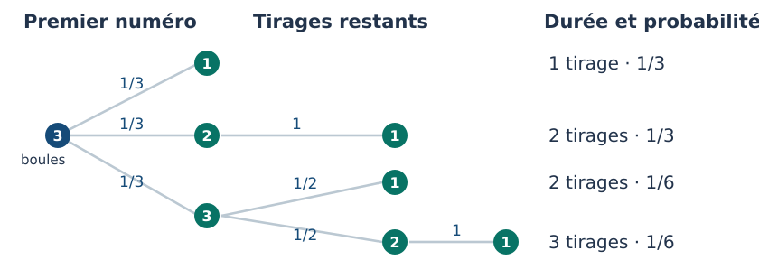
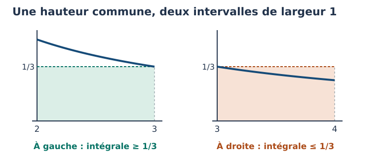
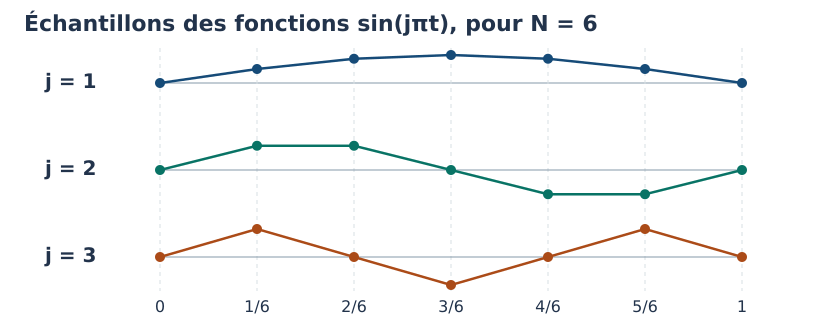
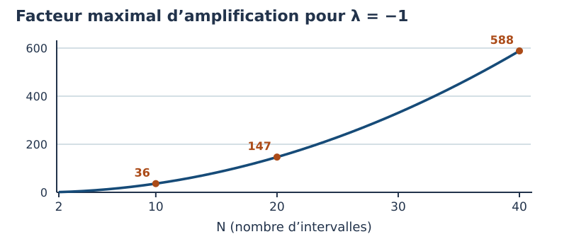

# Agro-Véto BCPST 2022 · Méthodes de calcul et raisonnement · Corrigé guidé

*Corrigé rédigé par IA, non officiel. Signalez toute erreur.*

**Rédaction** · GPT-6.2 Astra Ultra · vitesse non renseignée

**Révision (tour 1)** · GPT-6.2 Astra Ultra · vitesse non renseignée

Le sujet donne dix questions sur l’urne et dix-neuf sur l’équation différentielle. Chaque question 8 comporte des sous-questions. [Sujet officiel](https://www.concours-agro-veto.fr/sites/default/files/media/2025-10/sujet2022.pdf) · [Rapport classé en 2022](https://www.concours-agro-veto.fr/sites/default/files/media/2025-10/rapport2022_math_mullaert.pdf)

## Exercice 1. Un tirage détermine la taille du problème restant

### 1. Commencer par les deux issues possibles

Imaginez les boules 1 et 2. Le numéro 1 fait disparaître tout le contenu, le 2 laisse la boule 1 pour un dernier tirage. L’équiprobabilité des boules physiques donne donc une durée de 1 ou 2 avec poids $1/2$ pour chacune. Le milieu des deux valeurs est $E(X_2)=3/2$. Les écarts à ce milieu sont $-1/2$ et $1/2$, d’où une moyenne des carrés des écarts $V(X_2)=1/4$.

### 2. Lire les feuilles d’un arbre

Sur le dessin, les fractions le long des branches sont conditionnelles. Multipliez-les sur un chemin, puis additionnez les probabilités de tous les chemins de même durée.

Les feuilles de durée 1, 2, 3 ont respectivement pour poids totaux $1/3$, $1/3+(1/3)(1/2)=1/2$, $(1/3)(1/2)(1)=1/6$. La somme vaut 1. Le calcul pondéré donne $E(X_3)=1(1/3)+2(1/2)+3(1/6)=11/6$.

### 3. Prouver qu’une durée est possible

Il y a forcément un premier tirage et chaque coup enlève au moins une boule, donc $1\le X_n\le n$. Pour réaliser exactement quatre coups si $n\ge4$, commencez à 4, puis tirez 3, 2 et 1. Remplacer 4 par tout $k\in\{1,\ldots,n\}$ fournit un chemin de probabilité positive. Ces entiers forment donc tout le support.

### 4. Reconnaître les chemins imposés

À l’extrémité courte, le choix de 1 au premier coup a probabilité $1/n$. À l’extrémité longue, enlever deux boules ensemble ferait perdre toute chance d’atteindre $n$ coups. Il faut donc choisir la plus grande boule présente à chacun des coups. Sachant que les coups précédents ont respecté cette règle, le coup suivant a probabilité de succès $1/j$ lorsqu’il reste $j$ boules. La probabilité totale de la suite imposée est $(1/n)(1/(n-1))\cdots1=1/n!$.

### 5. Changer la taille de l’urne

Écrivez deux nombres au premier embranchement de l’arbre général. Le premier, $i$, est le numéro tiré. Le second, $i-1$, est la taille de l’urne au prochain tour. Conditionnellement à ce choix, la durée totale a la loi de $1+X_{i-1}$. Prenons $X_0=0$ et $X_1=1$. Pour une durée totale $k\ge2$, impossible de commencer par 1. Additionner les probabilités conditionnelles, pondérées par $P(N_1=i)=1/n$, donne
$$
p_n(k)=\frac1n\sum_{i=2}^n p_{i-1}(k-1),\qquad p_m(s)=P(X_m=s).
$$

Prenons quatre boules pour contrôler le conditionnement sur le premier tirage. Dans l’ordre des durées $1,2,3,4$, les probabilités sont $1/4,11/24,1/4,1/24$. Elles totalisent un et donnent une espérance $25/12$, égale à $1+1/2+1/3+1/4$.

### 6. Comparer deux lignes de probabilités

Multipliez la formule précédente par $n$ et écrivez-la ensuite pour $n+1$. Toutes les contributions anciennes s’annulent par soustraction, ce qui donne
$$
(n+1)p_{n+1}(k)-np_n(k)=p_n(k-1)\quad(k\ge2).
$$
Pour $k=1$, le membre de gauche est $1-1=0$ par la question 4, ce qui vaut aussi $p_n(0)$. Cette vérification permet de multiplier la relation par $k$ et de sommer de $1$ à $n+1$. Le changement d’indice $j=k-1$ donne au second membre $\sum_j(j+1)p_n(j)=E(X_n)+1$. Ainsi $(n+1)E(X_{n+1})-nE(X_n)=E(X_n)+1$, puis $E(X_{n+1})-E(X_n)=1/(n+1)$.

### 7. Retrouver le point de départ

Avec $m_n=E(X_n)$, dépliez $m_n=m_2+(m_3-m_2)+\cdots+(m_n-m_{n-1})$. Comme $m_2=1+1/2$, le résultat est $m_n=\sum_{k=1}^n 1/k$. Pour $n=3$, on retrouve $11/6$.

### 8. Mesurer la taille de la somme

#### 8.a · Les deux rectangles

Un intervalle de largeur 1 convertit la hauteur $1/k$ en aire $1/k$. À gauche de $k$ la courbe est au-dessus de cette hauteur, à droite elle est au-dessous, car $t\mapsto1/t$ décroît pour $t>0$. Voilà pourquoi $k\ge2$ garantit les deux comparaisons sur des intervalles positifs.
$$
\int_k^{k+1}\frac{dt}{t}\le\frac1k\le\int_{k-1}^k\frac{dt}{t}.
$$

#### 8.b · L’équivalent de la somme harmonique

Additionnez de $2$ à $n$ pour accoler les intervalles. La somme $H_n=\sum_{k=1}^n1/k$ vérifie $1+\log(n+1)-\log2\le H_n\le1+\log n$. Pour obtenir un équivalent, divisez tout par $\log n$, positif dès $n\ge2$. Le terme constant divisé par $\log n$ s’annule à la limite et $\log(n+1)/\log n=1+\log(1+1/n)/\log n\to1$. Le quotient $H_n/\log n$ tend donc vers 1.

#### 8.c · L’équivalent de l’espérance

La somme comparée est précisément l’espérance calculée à la question 7. Ainsi $E(X_n)\sim\log n$.

### 9. Reprendre le décalage avec un carré

La relation pour $p_n$ établie en 6 s’applique maintenant avec le poids $k^2$. Posons $s_n=E(X_n^2)$. Après changement d’indice, le terme de droite devient $\sum_j(j+1)^2p_n(j)=s_n+2m_n+1$. Vous obtenez $(n+1)s_{n+1}-ns_n=s_n+2m_n+1$, d’où $s_{n+1}=s_n+(2m_n+1)/(n+1)$.

### 10. Éliminer l’espérance du calcul de variance

À quoi sert le terme $2m_n$ qui apparaît en 9 ? Le carré de $m_{n+1}=m_n+1/(n+1)$ contient le même terme après développement. En soustrayant $m_{n+1}^2-m_n^2$ de $s_{n+1}-s_n$, on trouve
$$
V(X_{n+1})-V(X_n)=\frac1{n+1}-\frac1{(n+1)^2}.
$$
Partir de l’urne à une boule, de durée certaine, donne $V(X_n)=\sum_{j=1}^n(1/j-1/j^2)$. Pour vérifier, $n=2$ donne bien $1/4$. La somme des $1/j^2$ reste bornée car les termes de rang $j\ge2$ sont dominés par $1/(j-1)-1/j$. Ainsi $V(X_n)$ diffère de $H_n$ d’une quantité bornée, et $V(X_n)/\log n\to1$.

## Exercice 2. Des conditions aux bords à la sensibilité d’un système

### I. Trouver les vibrations du problème continu

### 1. Partir du signe de l’opposé de lambda

Essayez $e^{rt}$. La condition est $r^2=-\lambda$. Deux racines réelles opposées donnent la famille $a e^{\sqrt{-\lambda}\,t}+b e^{-\sqrt{-\lambda}\,t}$ pour $\lambda<0$. La racine double nulle donne $a+bt$ pour $\lambda=0$. Deux racines imaginaires conjuguées donnent les solutions réelles $a\cos(\sqrt\lambda\,t)+b\sin(\sqrt\lambda\,t)$ pour $\lambda>0$. Dans chaque famille, $a,b$ sont deux constantes réelles.

### 2. Utiliser chaque bord à son tour

Éliminez d’abord une constante avec $t=0$. Pour $\lambda=0$, la droite restante passe par l’origine et sa pente doit être nulle pour s’annuler en 1. Pour $\lambda<0$, il reste $a(e^{\omega t}-e^{-\omega t})$, $\omega=\sqrt{-\lambda}>0$. À $t=1$, le facteur entre parenthèses est strictement positif, donc $a=0$. Pour $\lambda>0$, il reste $b\sin(\sqrt\lambda\,t)$. La condition en 1 laisse $b$ libre précisément si $\sqrt\lambda$ est un multiple entier strictement positif de $\pi$. Les solutions non triviales sont donc les multiples non nuls de $\sin(j\pi t)$ pour $\lambda=(j\pi)^2$, $j\ge1$. La fonction nulle convient toujours.

### II. Transformer les équations sur la grille

### 3. Lire une ligne à la fois

Pour $1\le k<N$, les coefficients des trois inconnues $x_{k-1},x_k,x_{k+1}$ sont $1,\lambda/N^2-2,1$ après division par $N^2$. Aux deux extrémités de la liste, un voisin vaut déjà zéro. Ainsi, en posant $A=A_{N-1}$ et $d=\lambda/N^2-2$, l’équation des inconnues intérieures est $(A+dI)X=0$. Avec $N=3$, par exemple, elle se lit $dx_1+x_2=0$, $x_1+dx_2=0$. Restituez les deux valeurs $x_0=x_N=0$ après le calcul du noyau.

La note attachée à cette question dans le PDF officiel rappelle les deux conditions $x_0=x_N=0$. Elles sont nécessaires pour la réciproque puisque le vecteur intérieur ne contient aucune information sur les bords.

### 4. Faire apparaître la valeur propre

Transférez $dX$ au second membre. Il existe $X\ne0$ exactement lorsque $-d=2-\lambda/N^2$ est valeur propre de $A$. Chaque valeur propre $\mu$ de $A$ donne donc un paramètre $\lambda=N^2(2-\mu)$, et réciproquement.

### 5. Compter avant de calculer

Regardez les entrées de part et d’autre de la diagonale. Elles se correspondent et sont réelles, donc le théorème spectral s’applique à tout $A_n$ et garantit sa diagonalisabilité dans une base orthonormée réelle. La base de $A_{N-1}$ ne comporte que $N-1$ vecteurs. Il y a au plus autant de valeurs propres distinctes et, par la correspondance de la question 4, au plus autant de paramètres dans $\Lambda$.

### 6. Construire les colonnes de la matrice de passage

Appliqué à une colonne $(a,b,c)^{\mathsf T}$, $A_3$ donne $(b,a+c,b)^{\mathsf T}$. Sur la droite $a=-c$, $b=0$, le vecteur $(1,0,-1)^{\mathsf T}$ donne la valeur propre zéro. Cherchez ensuite une colonne $(1,b,1)^{\mathsf T}$, symétrique entre ses deux extrémités. Son image est $(b,2,b)^{\mathsf T}$, colinéaire à la colonne initiale pour $b^2=2$, avec multiplicateur $b$. Rassemblez les vecteurs propres dans le même ordre que les valeurs propres :
$$
P=\begin{pmatrix}1&1&1\\0&\sqrt2&-\sqrt2\\-1&1&1\end{pmatrix},\qquad D=\operatorname{diag}(0,\sqrt2,-\sqrt2).
$$
Leurs valeurs propres distinctes assurent l’indépendance des colonnes. On a bien $A_3P=PD$, puis $A_3=PDP^{-1}$.

### 7. Passer du vecteur fini à la suite

Fixez $v_0=0$. Dès que $v_1$ est donné, la règle $v_{n+2}=\mu v_{n+1}-v_n$ définit toute la suite. Si $V$ est un vecteur propre, les lignes de $AV=\mu V$ imposent cette règle à ses composantes, la dernière ligne donnant le bord $v_N=0$. La suite prolongée est non nulle car $V$ l’est. Dans l’autre sens, une suite admissible non nulle doit vérifier $v_1\ne0$ sous peine d’avoir ses deux premiers termes nuls. Tronquez-la aux indices 1 à $N-1$. Les équations de récurrence et les deux bords garantissent que ce vecteur non nul est propre pour $\mu$.

### 8. Chercher les suites qui s’annulent deux fois

#### 8.a · Deux racines réelles distinctes

Lorsque $|\mu|>2$, le polynôme caractéristique $z^2-\mu z+1$ a deux racines $r,s$ réelles. Elles sont distinctes et de même signe puisque $rs=1$, donc de modules distincts. Le bord initial transforme $a r^n+b s^n$ en $a(r^n-s^n)$. Même si $N$ est pair, les modules distincts empêchent que $r^N=s^N$. Le bord final impose $a=0$.

#### 8.b · Une racine double

Lorsque $\mu=2$ ou $\mu=-2$, la racine double $r=\mu/2$ donne $u_n=(a+bn)r^n$. Testez séparément $n=0$ et $n=N$. Vous trouvez $a=0$, puis $b=0$ puisque $Nr^N\ne0$.

#### 8.c.i · Deux racines conjuguées

Si $|\mu|<2$, le discriminant $\mu^2-4$ est négatif. Les racines sont conjuguées, leur produit est à la fois 1 et le carré de leur module. Choisissez l’angle $\theta\in(0,\pi)$ de la racine de partie imaginaire positive. La somme des racines donne $\mu=2\cos\theta$.

#### 8.c.ii · Les angles admissibles

Le bord $u_0=0$ élimine le cosinus de l’expression réelle $u_n=a\cos(n\theta)+b\sin(n\theta)$. Il reste la possibilité d’un $b\ne0$ lorsque $N\theta$ est un multiple de $\pi$. Cela donne $\theta=j\pi/N$, $1\le j<N$. Pour chacun de ces choix, le premier terme intérieur $b\sin\theta$ est bien non nul.

#### 8.c.iii · Le nombre de valeurs propres

Le cosinus décroît strictement entre 0 et $\pi$. Les valeurs $2\cos(j\pi/N)$ sont donc toutes différentes et la question 5 empêche d’en trouver davantage. Le dessin compare les suites associées, en reliant les nœuds uniquement pour la lecture.

### 9. Revenir au paramètre de départ

Le spectre trouvé en 8 concerne $A$. Remplacez $\mu$ dans la formule $\lambda=N^2(2-\mu)$ de la question 4. Les $N-1$ résultats forment
$$
\Lambda=\{\,2N^2(1-\cos(j\pi/N))\mid j=1,\ldots,N-1\,\}.
$$
Toutes ces valeurs sont strictement positives, comme les valeurs admissibles du problème continu.

### 10. Garder l’indice fixé

Posez $t=k\pi/N$. Pour $k\ne0$, transformez $2-2\cos t$ en $4\sin^2(t/2)$ avant de prendre l’équivalent. Alors $4\sin^2(t/2)\sim t^2$ et $N^2t^2=k^2\pi^2$. Si $k=0$, la quantité vaut déjà zéro, ce qui donne la même limite.

### 11. Interpréter le passage au continu

Choisissez par exemple le mode 1. Quelle que soit la finesse du maillage, ses composantes sont les hauteurs du sinus $\sin(\pi t)$ aux nœuds intérieurs et son paramètre tend vers $\pi^2$. À chaque indice fixé $j\ge1$ correspond de même la limite $(j\pi)^2$, qui est exactement le paramètre sélectionné en I.2 par les deux bords. L’indice appartient au spectre discret dès que $N>j$.

### III. Quantifier la sensibilité aux données

Une précaution de lecture concerne le facteur $N^2$. Dans la discrétisation d’origine, si l’on divise les coefficients de gauche par $N^2$, on divise aussi les valeurs $b(k/N)$ par $N^2$. Employons dans la suite la matrice normalisée $M$ et nommons $B$ le vecteur effectivement placé à droite de $MX=B$. C’est ce choix qui donne les valeurs propres $\mu_k$ imprimées à la page 4. Les erreurs relatives des données sont identiques avant et après cette division commune.

### 12. Repérer la valeur propre interdite

Résoudre $MX=B$ pour tout $B$ de manière unique revient à exclure zéro du spectre. Chaque $\mu_k$ est la somme de $\lambda/N^2<0$ et de $2\cos(k\pi/N)-2<0$, donc est strictement négative. L’inverse existe, l’unique solution est $X=M^{-1}B$.

### 13. Calculer en coordonnées propres

Une matrice diagonale multiplie chaque composante $x_k$ par $d_k$. La longueur euclidienne du résultat vaut donc $\sqrt{\sum_k d_k^2x_k^2}$, pour $k$ de 1 à $N-1$. Le carré sur $d_k$ rend cette expression valable également pour des coefficients négatifs.

### 14. Identifier la direction la plus amplifiée

Les $\mu_k$ décroissent et sont négatifs. Le plus grand module est donc $|\mu_{N-1}|$. Décomposez $X=\sum_k c_k q_k$ dans une base orthonormée propre de $M$, disponible car $M$ est symétrique réelle. Alors $B=\sum_k\mu_k c_kq_k$ et Pythagore donne $\|B\|^2=\sum_k\mu_k^2 c_k^2\le|\mu_{N-1}|^2\sum_kc_k^2$. En prenant la racine, $\|B\|\le(-\mu_{N-1})\|X\|$.

### 15. Examiner le phénomène inverse

Pour remonter d’un écart de données à un écart de solutions, écrivez $\Delta X=M^{-1}\Delta B$. Dans la même base, la valeur propre de l’inverse est $1/\mu_k$. Son module maximal vaut $1/|\mu_1|$, puisque $\mu_1$ est la plus proche de zéro. La majoration de la question précédente appliquée à l’inverse donne
$$
\|\Delta X\|\le\frac1{|\mu_1|}\|\Delta B\|=-\frac1{\mu_1}\|\Delta B\|.
$$
Ici $\Delta X=X-\widetilde X$ et $\Delta B=B-\widetilde B$.

### 16. Passer de l’erreur absolue à l’erreur relative

La question 14 peut se récrire $\|X\|\ge\|B\|/|\mu_{N-1}|$. Parce que $B\ne0$, les deux côtés sont strictement positifs et l’on peut prendre les inverses en changeant le sens de l’inégalité. Multipliez la borne ainsi obtenue sur $1/\|X\|$ par la borne de 15 sur $\|\Delta X\|$. Le résultat est
$$
\frac{\|\Delta X\|}{\|X\|}\le
\frac{|\mu_{N-1}|}{|\mu_1|}\frac{\|\Delta B\|}{\|B\|}.
$$
Les deux valeurs propres ont le même signe, donc le facteur est aussi $\mu_{N-1}/\mu_1$.

### 17. Trouver l’ordre de grandeur

Pour le premier mode, écrivez $\mu_1=[\lambda-N^2(2-2\cos(\pi/N))]/N^2$. Le numérateur entre crochets tend vers $\lambda-\pi^2<0$. Pour le dernier mode, l’angle vaut $\pi-\pi/N$ et son cosinus tend vers $-1$, d’où $\mu_{N-1}\to-4$. Le quotient se comporte comme $4N^2/(\pi^2-\lambda)$ et tend vers $+\infty$ à $\lambda<0$ fixé.

### 18. Choisir deux directions différentes pour saturer les deux bornes

Pour obtenir l’égalité en 14, partez d’un vecteur propre unitaire $X=q_{N-1}$ pour le plus grand module. Pour obtenir l’égalité en 15, choisissez la perturbation des données dans la direction $q_1$ d’un vecteur propre unitaire pour le plus petit module. Concrètement, $B=\mu_{N-1}q_{N-1}$ et $\widetilde B=B+tq_1$ avec $t\ne0$. Alors $\widetilde X=X+(t/\mu_1)q_1$. On lit directement
$$
\frac{\|\Delta X\|}{\|X\|}=\frac{|t|}{|\mu_1|},\qquad
\frac{\|\Delta B\|}{\|B\|}=\frac{|t|}{|\mu_{N-1}|}.
$$
Le rapport des deux erreurs atteint exactement la constante de 16, y compris si $N=2$, où les deux directions coïncident.

Pour un contrôle chiffré, prenons $N=3$ et $\lambda=-1$. Les valeurs propres extrêmes de $M$ sont $-10/9$ et $-28/9$. Les directions $(1,1)$ et $(1,-1)$ sont orthogonales. Une perturbation selon la première direction, autour d’une solution alignée avec la seconde, donne un rapport exact de $14/5$ entre les deux erreurs relatives.

### 19. Expliquer l’enjeu de précision

Supposons qu’on double $N$ dans le régime où l’équivalent est précis. Le facteur maximal d’amplification est alors environ quadruplé. Une perturbation relativement petite des mesures ou des données arrondies peut modifier sensiblement la solution calculée. La question 18 montre qu’il existe des données qui atteignent cette amplification, et la question 11 explique simultanément l’intérêt d’un maillage fin pour approcher les modes continus.

La couverture du rapport de la banque indique 2021. On identifie les commentaires associés à la session 2022 en retrouvant l’arbre des tirages et les questions de stabilité du maillage. [Sujet numérisé, exercices 1 et 2](https://www.concours-agro-veto.fr/sites/default/files/media/2025-10/sujet2022.pdf) · [Rapport associé par la banque](https://www.concours-agro-veto.fr/sites/default/files/media/2025-10/rapport2022_math_mullaert.pdf)

Avec $\lambda=-1$, pour $N=10$ le facteur vaut environ $36{,}26$, et pour $N=100$ environ $3679{,}4$. Il s’agit du pire cas démontré à la question 18. Une perturbation alignée sur une autre direction peut subir une amplification plus faible.
