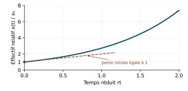
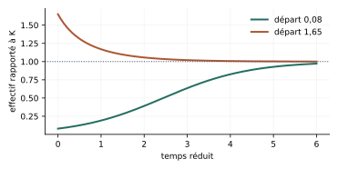
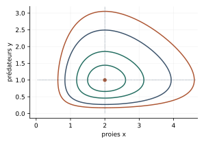
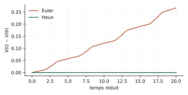

# Agro-Véto · BCPST · Modélisation mathématique et informatique 2022 — corrigé brut

*Corrigé rédigé par IA, non officiel. Signalez toute erreur.*

**Rédaction** · GPT-6.2 Astra Ultra · vitesse non renseignée · 25 novembre 2026

**Révision** · GPT-6.2 Astra Ultra · vitesse non renseignée · 25 novembre 2026

**Révision (tour 2)** · GPT-6.2 Astra Ultra · vitesse non renseignée · 26 novembre 2026

**Lièvres et lynx.** Le sujet compare la croissance isolée des lièvres, le modèle de Lotka–Volterra et une variante à ressources limitées. La partie numérique suit les effectifs et la quantité conservée du modèle sans limitation.

## 1. Croissance d’une population isolée

### Question 1a · Croissance libre

La dérivée de $e^{-rt}x(t)$ est $e^{-rt}(x'-rx)=0$. Avec $x(0)=x_0$, on obtient $x(t)=x_0e^{rt}$.

### Question 1b · Allure de la courbe

La courbe passe par $(0,x_0)$, croît avec une pente initiale $rx_0$ et est strictement convexe, car $x''=r^2x>0$. Elle monte sans borne.



### Question 1c · Portée du premier modèle

La population de lièvres croît exponentiellement. Cette approximation convient à un début de croissance pendant lequel les ressources restent abondantes. À long terme, elle prévoit des effectifs arbitrairement grands malgré la taille finie de l’habitat.

### Question 2a · Ressources encore abondantes

Pour $x\ll K$, le facteur $1-x/K$ est proche de 1 et $x'\simeq rx$. La croissance ressemble localement à celle de 1.

### Question 2b · Signe de la croissance logistique

La dérivée s’annule pour $x=0$ et $x=K$. Elle est strictement positive pour $0<x<K$ et strictement négative pour $x>K$.

| $x$ | $0$ | $]0,K[$ | $K$ | $]K,+\infty[$ |
|---|:---:|:---:|:---:|:---:|
| Signe de $x'$ | $0$ | $+$ | $0$ | $-$ |

### Question 2c · Positivité de la solution

Entre 0 et $K$, la solution croît et ne peut atteindre 0 en avançant. Au-dessus de $K$, elle décroît vers cette barrière. Même si la solution atteignait $K$, elle ne pourrait ensuite descendre jusqu’à 0 : elle devrait traverser un intervalle dans lequel $x$ est strictement croissante. Le départ $x_0=K$ est constant. Ainsi un effectif strictement positif ne peut atteindre 0 à temps fini.

### Question 2d · Linéariser par l’inverse

La positivité autorise $z=1/x$ et $z'=-x'/x^2=-r/x+r/K=r/K-rz$.

### Question 2e · Résoudre l’équation en z

$z-1/K$ vérifie $(z-1/K)'=-r(z-1/K)$. Donc $z(t)=1/K+(z_0-1/K)e^{-rt}$.

### Question 2f · Formule logistique

Comme $z_0=1/x_0$, on trouve

$$
x(t)=\frac{K}{1+(K/x_0-1)e^{-rt}}.
$$

Pour $x_0>0$, le dénominateur est une combinaison convexe de $K/x_0$ et 1, strictement positive.

### Question 2g · Limite

Pour tout $x_0>0$, $x(t)\to K$ lorsque $t\to+\infty$.

### Question 2h · Forme des deux solutions

Depuis un petit $x_0<K/2$, la courbe croît en S. Elle est d’abord convexe, puis concave après $x=K/2$, car $x''=rx'(1-2x/K)$. Depuis $x_0>K$, elle décroît et reste convexe. Les deux courbes approchent horizontalement $K$.



### Question 2i · Capacité du milieu

Dans le modèle exponentiel, le taux $x'/x=r$ est constant. Dans le modèle logistique il est $r(1-x/K)$ et diminue avec l’effectif. $K$ représente ici la capacité d’accueil du milieu en l’absence de prédateurs, équilibre attractif des départs positifs.

## 2. Proies et prédateurs

### Question 3a · Lièvres sans lynx

Pour $y=0$, le système devient $x'=rx$, $y'=0$. Si $x(0)>0$, les lièvres croissent comme $x(0)e^{rt}$.

### Question 3b · Lynx sans lièvres

Pour $x=0$, on a $x'=0$ et $y'=-my$. Les lynx décroissent comme $y(0)e^{-mt}$ vers zéro.

### Question 4 · Variables réduites

Avec $s=rt$, $\bar x=qx/r$ et $\bar y=py/r$, on obtient

$$
\frac{d\bar x}{ds}=\frac{q}{r^2}(rx-pxy)=\bar x(1-\bar y),\qquad
\frac{d\bar y}{ds}=\frac{p}{r^2}(-my+qxy)=\bar y(\bar x-a),\quad a=m/r.
$$

### Question 5a · Équilibres du système réduit

Résoudre simultanément $x(1-y)=0$ et $y(x-a)=0$ donne $(0,0)$ et $(a,1)$ puisque $a>0$.

### Question 5b · Sens d’un équilibre

Un équilibre est un couple d’effectifs qui reste constant au cours du temps lorsque l’on part de ces valeurs. Les gains compensent les pertes de chaque population.

### Question 5c · Les deux équilibres en contexte

L’origine signifie absence des deux espèces. Au point de coexistence, les deux espèces sont présentes à effectifs constants. Dans les unités initiales cela donne $x=m/q$ lièvres et $y=r/p$ lynx, valeurs pour lesquelles chaque taux net s’annule dans le modèle.

### Question 6a · Minimum d’une fonction convexe

$f'_c(u)=1-c/u$ est négative sur $]0,c[$ et positive sur $]c,+\infty[$. Le minimum est donc $f_c(c)=c(1-\ln c)$.

### Question 6b · Quand l’égalité a-t-elle lieu ?

Le seul point de minimum est $u=c$. C’est exactement le cas d’égalité dans 6a.

### Question 6c · Sous-niveaux bornés

$f_c(u)$ tend vers $+\infty$ en $0^+$ et en $+\infty$. Pour $M>f_c(c)$, chacune des deux branches strictement monotones prend la valeur $M$ une seule fois, en $b<c<B$. Le sous-niveau est l’intervalle fermé $[b,B]$. Pour $M=f_c(c)$, on a $b=B=c$.

### Question 7a · Conserver une quantité et borner chaque population

**(i)** La minoration $f_1(y)\ge1$ donne $f_a(x)\le V-1$. De même $f_a(x)\ge a(1-\ln a)$ donne $f_1(y)\le V-a(1-\ln a)$.

**(ii)** Tant que les coordonnées sont positives,

$$
V'=(1-a/x)x(1-y)+(1-1/y)y(x-a)=(x-a)(1-y)+(y-1)(x-a)=0.
$$

Ainsi $V$ garde la valeur $V_0=V(x_0,y_0)$.

**(iii)** En appliquant 6c aux deux bornes de (i), évaluées en $V_0$, on obtient deux intervalles compacts de $]0,+\infty[$ contenant toutes les valeurs de $x$ et $y$. La solution ne peut donc toucher un axe ni partir à l’infini en temps fini. Le champ polynomial permet de prolonger la solution pour tout $s\ge0$.

### Question 7b · Minimum de l’intégrale première

$V\ge a(1-\ln a)+1$. L’égalité impose $x=a$ et $y=1$ simultanément, et ce point la réalise. C’est l’unique minimiseur positif.

### Question 7c · Évolution qualitative des deux espèces

**(i)** Pour un départ strictement positif, les bornes de 7a interdisent l’extinction ainsi qu’une croissance arbitrairement grande. **(ii)** Le point $(a,1)$ donne une solution constante. Pour tout autre départ positif, le niveau conservé est strictement supérieur au minimum, donc la solution n’atteint jamais cet équilibre et les deux dérivées ne s’annulent pas simultanément.

**(iii)** Sur un niveau supérieur au minimum, $V$ est strictement convexe (sa Hessienne est diagonale de coefficients $a/x^2,1/y^2$), avec sous-niveau compact. Sa frontière est une courbe régulière fermée autour de $(a,1)$, car le gradient n’y est pas nul. Le champ, tangent et non nul sur cette courbe compacte, la parcourt périodiquement. Les proies augmentent pour $y<1$ et les prédateurs pour $x>a$, d’où des oscillations décalées.



## 3. Ressources limitées

### Question 8 · Deux simplifications du modèle limité

Pour $K$ très grand devant les effectifs étudiés, $x/K$ est négligeable et on retrouve le système proie-prédateur de la partie 2. Pour $y=0$, il reste $x'=x(1-x/K)$, la croissance logistique des lièvres en temps réduit.

### Question 9 · Équilibres avec capacité limitée

Sur l’axe $y=0$, on trouve $(0,0)$ et $(K,0)$, correspondant à l’absence des deux espèces et à des lièvres seuls à leur capacité d’accueil. Avec $x=a$, on obtient $(a,1-a/K)$. Ce dernier point représente une coexistence positive exactement lorsque $K>a$. Pour $K<a$ sa seconde coordonnée est négative et il ne représente aucun effectif biologique.

### Question 10a · Matrice jacobienne du champ

Pour $g_1=x-x^2/K-xy$ et $g_2=-ay+xy$,

$$
J(x,y)=\begin{pmatrix}1-2x/K-y&-x\\ y&x-a\end{pmatrix}.
$$

### Question 10b · Les trois matrices locales

On trouve respectivement

$$
J_1=\begin{pmatrix}1&0\\0&-a\end{pmatrix},\quad
J_2=\begin{pmatrix}-1&-K\\0&K-a\end{pmatrix},\quad
J_3=\begin{pmatrix}-a/K&-a\\1-a/K&0\end{pmatrix}.
$$

### Question 10c · Valeurs propres

Les valeurs propres de $J_1$ sont $1,-a$, celles de $J_2$ sont $-1,K-a$. Pour $J_3$, le polynôme caractéristique est $X^2+(a/K)X+a(1-a/K)$. Posons $D=(a/K)^2-4a(1-a/K)$. Les deux valeurs sont $(-a/K\pm\sqrt D)/2$ si $D\ge0$ et $(-a/K\pm i\sqrt{-D})/2$ si $D<0$.

### Question 10d · Type des équilibres

L’origine est une selle dans tous les cas. Au point $(K,0)$, si $K>a$ on a une selle. Pour $K<a$, c’est un nœud stable lorsque $K-a\ne-1$, et un nœud dégénéré stable lorsque $K-a=-1$, car $-K\ne0$ laisse un seul vecteur propre indépendant.

Pour $J_3$, si $K<a$, le déterminant est négatif et le point hors du quadrant positif est une selle. Si $K>a$, le déterminant est positif et la trace négative. On obtient alors un nœud stable pour $D>0$, un foyer stable pour $D<0$, et un nœud dégénéré stable pour $D=0$ (l’entrée $-a$ exclut une matrice scalaire).

### Question 10e · Maintien des prédateurs

Près de $(K,0)$, le taux de croissance par lynx vaut environ $K-a$. Pour $K<a$, ce taux est négatif et l’équilibre sans lynx est attractif. Pour $K>a$, il est positif et il existe un équilibre de coexistence attractif. Le critère de maintien des lynx dans ce modèle est donc $K>a$, lorsque les deux espèces sont initialement présentes. Le cas $K=a$ est écarté dans l’énoncé. Une population de lynx déjà nulle reste nulle.

On peut aussi justifier ce critère pour tout départ strictement positif. Pour $K>a$, posons $b=1-a/K$ et $L=x-a\ln x+y-b\ln y$. Le long d’une solution, les termes croisés s’annulent et $L'=-(x-a)^2/K$. Ses sous-niveaux sont compacts dans le quadrant ouvert. L’ensemble des points d’accumulation est invariant et $L$ y est constant, puisqu’il tend vers une limite le long de la trajectoire. Cet ensemble est donc contenu dans $x=a$. Pour y rester, il faut aussi $x'=a(b-y)=0$, donc $y=b$. La solution converge vers $(a,b)$.

Si $K<a$, prenons $L=x-K-K\ln(x/K)+y$. On trouve $L'=-(x-K)^2/K+(K-a)y\le 0$. Les sous-niveaux bornent $y$, ainsi que $x$ par deux bornes strictement positives. Le seul point du demi-plan $y\ge0$ où $L'=0$ est $(K,0)$. Le même argument donne la convergence vers $(K,0)$.

## 4. Méthode d’Euler

### Question 11 · Variation d’une étape d’Euler

Posons $U=1+h(1-y_k)$ et $W=1+h(x_k-a)$. Ainsi $x_{k+1}=x_kU$ et $y_{k+1}=y_kW$. Pour des itérés positifs, donc $U,W>0$,

$$
v_{k+1}-v_k=h(x_k-ay_k)-a\ln U-\ln W
=a(U-1-\ln U)+(W-1-\ln W).
$$

Le paramètre $K$ cité dans la consigne n’intervient pas dans la récurrence (8). Un pas arbitrairement grand ne garantit pas la positivité des deux facteurs.

### Question 12a · Sens de la dérive de V

Pour tout $z>0$, $z-1-\ln z\ge0$ avec égalité seulement en 1. Comme $a>0$, les deux termes de 11 sont positifs ou nuls, d’où $v_{k+1}\ge v_k$.

### Question 12b · Caractériser l’égalité

Pour $h>0$, l’égalité impose $U=W=1$, donc $(x_k,y_k)=(a,1)$. Le pas d’Euler conserve ce point et tous les itérés suivants sont identiques. Si des itérés le précèdent, $v_j\le v_k$ par 12a et $v_k$ est le minimum absolu de $V$ par 7b. Tous les précédents sont donc aussi $(a,1)$. Réciproquement une suite constante à coordonnées positives est l’équilibre et ses variations de $v$ sont nulles.

### Question 13 · Qualité de la méthode d’Euler

Sur les trajectoires positives non constantes, $V$ reste rigoureusement constant en temps continu et augmente à chaque pas d’Euler. Le schéma fait donc dériver la trajectoire vers des courbes de niveau plus éloignées du centre. Même s’il approche la solution sur un horizon fixé lorsque $h$ diminue, il restitue mal l’amplitude des oscillations sur de nombreux cycles.

## 5. Étude informatique

### Question 14a · Charger la fonction exponentielle

```python
import math as m
```

L’appel `m.exp(r*t)` utilise alors la fonction exponentielle réelle de ce module.

### Question 14b · Instants calculés

En arithmétique exacte, les listes sont $[0,0{,}2,0{,}4,0{,}6,0{,}8,1]$ et $[0,0{,}3,0{,}6,0{,}9]$. Python affiche notamment `0.6000000000000001` dans la première et `0.8999999999999999` dans la seconde. Pour $T\ge0$ et $h>0$, la construction ajoute les multiples successifs de $h$ tant que leur valeur calculée reste au plus $T$. En arithmétique exacte le dernier indice est $\lfloor T/h\rfloor$. Les additions flottantes peuvent modifier le dernier test quand la valeur théorique est exactement $T$.

### Question 14c · Tracer une solution exacte

`Ls[k]` contient $\exp(2\,\mathrm{Lt}[k])$, la solution du premier modèle pour $r=2$ et $x_0=1$. La fonction trace ces valeurs en fonction des temps de 0 à 20 avec le pas $10^{-2}$, puis affiche la figure. En Python l’absence de `return` explicite donne la valeur de retour `None`.

### Question 15a · Indices et modification d’une liste

(i) `L[1]` vaut `[7]`. (ii) `L[0][1]` vaut `1`. (iii) `len(L)` vaut `3`. (iv) Après `L.append(9.75)`, la liste vaut `[[3, 1], [7], [1, 9, 8, 0], 9.75]`.

### Question 15b · Programmer le champ de vecteurs

```python
def lapin(x, y):
    return x * (1-y)

def lynx(x, y):
    return y * (x-a)
```

La valeur de `a` est celle de la variable globale annoncée.

### Question 15c · Compléter le pas d’Euler

Dans le corps de la boucle, utiliser l’affectation simultanée suivante, qui évalue d’abord les deux expressions de droite.

```python
x, y = x + h*lapin(x, y), y + h*lynx(x, y)
t += h
Lx.append(x)
Ly.append(y)
Lt.append(t)
```

Au bout de $k$ pas, les trois listes ont $k+1$ éléments et partagent les mêmes instants.

### Question 15d · Lire les tracés d’effectifs

La première ligne de la fonction appelle le solveur avec $x_0=1$, $y_0=0{,}5$, $T=20$ et $h=0{,}01$. `L[0]` contient les temps $t_k$, `L[1]` les valeurs $x_k$, `L[2]` les $y_k$. Le premier appel à `plot` trace les $x_k$ contre les temps, le second superpose les $y_k$ et `show` affiche le graphique.

### Question 15e · Identifier les deux espèces sur la figure 1 du sujet

Le trait plein part de 1 et représente les lièvres $x_k$. Le trait pointillé part de 0,5 et représente les lynx $y_k$. Sur chaque oscillation, le pic des lièvres précède celui des lynx, ce qui correspond au délai avec lequel une abondance de proies favorise les prédateurs.

### Question 15f · Tracer la quantité conservée théorique

```python
def trace_V_1():
    temps, proies, predateurs = resol_1(x0, y0, T, h)
    valeurs = [fonctionV(x, y) for x, y in zip(proies, predateurs)]
    plt.plot(temps, valeurs)
    plt.show()
```

Les logarithmes de `fonctionV` supposent des valeurs strictement positives aux instants utilisés.

### Question 16a · Méthode prédicteur-correcteur de Heun

Pour le système (5), la pente des prédateurs est $-ay+xy$. Dans la formule (9), la ligne du prédicteur $w_k$ imprime un signe moins devant $x_ky_k$. Le prédicteur de Heun cohérent avec (5) et avec le correcteur de (9) utilise $w_k=y_k+h(-ay_k+x_ky_k)$. On obtient

```python
def resol_2(x0, y0, T, h):
    x, y, t = x0, y0, 0
    Lt, Lx, Ly = [t], [x], [y]
    while t+h <= T:
        dx, dy = lapin(x, y), lynx(x, y)
        u, w = x + h*dx, y + h*dy
        x, y = (x + h*(dx + lapin(u, w))/2,
                y + h*(dy + lynx(u, w))/2)
        t += h
        Lt.append(t)
        Lx.append(x)
        Ly.append(y)
    return [Lt, Lx, Ly]
```

Le point prédit sert uniquement à évaluer la deuxième pente. C’est le point corrigé qui est conservé.

### Question 16b · Changer le solveur dans le tracé

Dans une copie appelée `trace_V_2`, remplacer `resol_1(x0, y0, T, h)` par `resol_2(x0, y0, T, h)`. Le reste du calcul de $V$ et du tracé est identique.

### Question 16c · Comparer les deux figures de l’invariant

La valeur exacte est $V_0=1{,}5+\ln 2\simeq2{,}19315$. Sur la gauche de la figure 2 du sujet, Euler passe d’environ 2,19 à 2,45. À droite, Heun varie sur une échelle de quelques millièmes autour de 2,193. Il préserve donc beaucoup mieux l’invariant pour ce pas et cette durée. Pour reproduire numériquement la comparaison, choisissons $a=2$. Le sujet laisse cette constante globale sans valeur chiffrée. Avec le prédicteur corrigé en 16a et le pas imprimé, les 1 999 pas exécutés en Python donnent $V_{\rm final}\simeq 2{,}459862$ pour Euler. Pour Heun, les valeurs restent entre $2{,}193145$ et $2{,}193245$. La variation sur cette dernière trajectoire est d’environ $10^{-4}$.



### Question 17 · Comparer les effectifs simulés

Avec Euler, les maxima augmentent artificiellement de cycle en cycle et les minima s’écartent vers le bas. Avec Heun, les pics successifs restent nettement plus proches en hauteur et en phase au cours de l’intervalle représenté. Cette amélioration est cohérente avec la plus faible dérive de $V$ et avec l’ordre deux de Heun sur un intervalle de temps fixé.

### Question 18 · Interpréter le décalage des oscillations

Quand les lynx sont peu nombreux, les lièvres augmentent. Une fois les lièvres abondants, les lynx se multiplient à leur tour. Leur hausse fait décroître les lièvres, puis le manque de proies entraîne le déclin des lynx. Les lièvres repartent ensuite à la hausse. Le décalage des pics traduit ce cycle dans le modèle sans limitation de ressources. Le modèle avec capacité limitée peut au contraire amortir les oscillations vers un équilibre de coexistence lorsque $K>a$.
