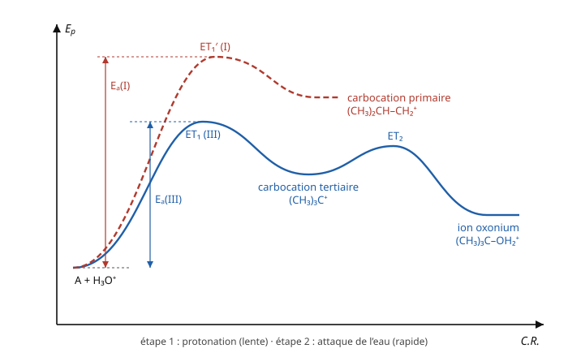
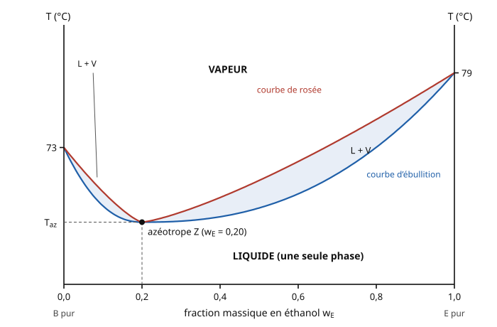
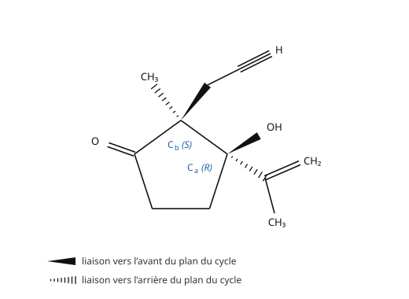
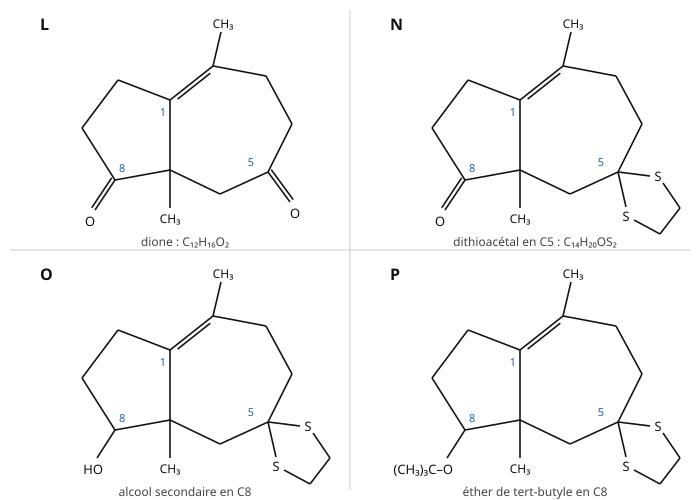
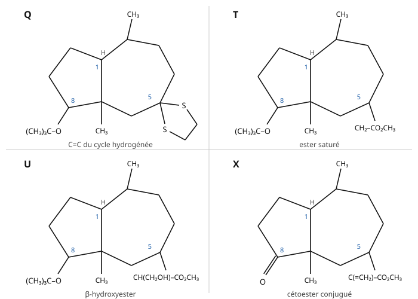

# Agro-Véto BCPST — Physique-chimie, résolution de problème 2022 · Corrigé brut

*Corrigé rédigé par IA, non officiel. Signalez toute erreur.*

**Rédaction** · modèle exact non renseigné (famille Claude) · effort non renseigné · vitesse non renseignée

**Révision (tour 2)** · modèle exact non renseigné (famille Claude) · effort non renseigné · vitesse non renseignée · 28 novembre 2026

**Révision (tour 3)** · modèle exact non renseigné (famille Claude) · effort non renseigné · vitesse non renseignée · 28 novembre 2026

Sujet de chimie « Quelques aspects de la chimie des alcènes », 49 questions, toutes traitées. Les mécanismes sont décrits étape par étape, le mouvement des doublets étant indiqué en toutes lettres ; les formules topologiques des composés bicycliques figurent sur les figures 4 et 5.

## Partie I — L’isobutène, molécule clé des carburants biosourcés · A. Mécanismes de formation

### Question 1 — Équation d’hydratation et conditions

L’hydratation est l’addition d’une molécule d’eau sur la double liaison :

$$\mathrm{(CH_3)_2C{=}CH_2 + H_2O \rightleftharpoons (CH_3)_3C{-}OH}$$

Le produit **D** est le **2-méthylpropan-2-ol** (alcool tert-butylique, d’où le sigle TBA), alcool tertiaire de formule $\mathrm{(CH_3)_3C{-}OH}$.

Conditions opératoires typiques : eau en large excès, qui sert à la fois de réactif et de solvant ; catalyseur acide fort dont l’anion est peu nucléophile, classiquement l’acide sulfurique dilué ; température modérée (de l’ambiante à un chauffage doux, car l’hydratation est exothermique et une température élevée favorise la déshydratation inverse). L’isobutène étant gazeux à température ambiante ($T_{eb}=-7\ \mathrm{°C}$), il est mis à barboter dans la solution acide ou maintenu sous pression.

### Question 2 — Sélectivité et règle associée

L’addition pourrait conduire à deux isomères de constitution : le 2-méthylpropan-2-ol (OH sur le carbone le plus substitué) ou le 2-méthylpropan-1-ol (OH sur le carbone terminal). Seul le premier est obtenu : la réaction est **régiosélective**.

La règle associée est la **règle de Markovnikov** : lors de l’addition d’un composé $\mathrm{H{-}X}$ sur un alcène dissymétrique, l’atome d’hydrogène se fixe sur le carbone le moins substitué, de sorte que la réaction passe par le carbocation le plus stable ; le groupe X se retrouve sur le carbone le plus substitué.

### Question 3 — Mécanisme de l’hydratation

Étape 1 — protonation de la double liaison (étape lente). Le doublet $\pi$ attaque un proton de $\mathrm{H_3O^+}$ ; le proton se fixe sur le carbone terminal $\mathrm{CH_2}$ et il apparaît un carbocation tertiaire, dont le carbone central porte une lacune électronique :

$$\mathrm{(CH_3)_2C{=}CH_2 + H_3O^+ \rightleftharpoons (CH_3)_3C^+ + H_2O}$$

Étape 2 — addition nucléophile. Un doublet non liant de l’oxygène de l’eau attaque le carbone lacunaire :

$$\mathrm{(CH_3)_3C^+ + H_2O \rightleftharpoons (CH_3)_3C{-}\overset{+}{O}H_2}$$

Étape 3 — déprotonation de l’ion oxonium par une molécule d’eau (réaction acido-basique), qui régénère le catalyseur :

$$\mathrm{(CH_3)_3C{-}\overset{+}{O}H_2 + H_2O \rightleftharpoons (CH_3)_3C{-}OH + H_3O^+}$$

La somme des trois étapes redonne l’équation de la question 1 ; $\mathrm{H_3O^+}$, consommé puis régénéré, est bien un catalyseur. Toutes les étapes sont renversables : parcouru en sens inverse, ce mécanisme est celui de la déshydratation de l’alcool.

### Question 4 — Type de contrôle et profil réactionnel

La première étape étant cinétiquement déterminante, la régiosélectivité se décide lors de la protonation : le produit majoritaire est celui qui dérive du carbocation formé le plus vite. La réaction est sous **contrôle cinétique**.

Deux protonations sont en concurrence. Le proton fixé sur $\mathrm{CH_2}$ donne le carbocation tertiaire $\mathrm{(CH_3)_3C^+}$ ; fixé sur le carbone central, il donnerait le carbocation primaire $\mathrm{(CH_3)_2CH{-}CH_2^+}$. Le carbocation tertiaire est nettement plus stable : trois groupes alkyle donneurs (effet inductif, hyperconjugaison) y compensent la lacune, contre un seul pour le primaire.

La protonation d’un alcène est endothermique : d’après le **postulat de Hammond**, chaque état de transition est tardif, proche en structure et donc en énergie du carbocation auquel il conduit. L’ordre des énergies des deux états de transition est alors celui des deux carbocations :

$$E_a(\mathrm{III}) < E_a(\mathrm{I})$$

Le carbocation tertiaire est formé beaucoup plus vite que le primaire, et lui seul conduit, après attaque de l’eau, à l’alcool **D** : c’est la justification de la règle de Markovnikov.

Lecture du profil : les intermédiaires (carbocations) sont des minima locaux d’énergie potentielle, les états de transition des maxima ; les deux courbes partent du même niveau et ne se croisent pas ; la barrière de la deuxième étape est plus petite que celle de la première, conformément à l’énoncé. Le carbocation le plus vite formé étant aussi le plus stable, produit cinétique et produit thermodynamique coïncident ici.

### Question 5 — Formation de l’ETBE et origine du TBA

L’éthanol joue le rôle tenu par l’eau dans l’hydratation et s’additionne sur l’isobutène selon la même régiosélectivité :

$$\mathrm{(CH_3)_2C{=}CH_2 + CH_3CH_2OH \rightleftharpoons (CH_3)_3C{-}O{-}CH_2CH_3}$$

Le TBA **D** est le produit d’hydratation de l’isobutène (question 1). Le milieu n’est pas aqueux, mais il contient un peu d’eau : l’éthanol, surtout d’origine fermentaire, en renferme toujours des traces (il forme un azéotrope avec l’eau et est hygroscopique). Le carbocation tert-butyle, intermédiaire commun, est alors capté soit par l’éthanol (voie principale, vers **B**), soit par l’eau (voie parasite, vers **D**).

### Question 6 — Pourquoi l’ETBE plutôt que l’ETBM

L’ETBE est préparé à partir d’**éthanol**, qui peut être obtenu par fermentation de sucres d’origine végétale (betterave, canne, céréales) : c’est une ressource renouvelable, et l’éther mérite l’appellation de carburant biosourcé. L’ETBM exige du **méthanol**, produit industriellement à partir de ressources fossiles (gaz de synthèse issu du gaz naturel) et de surcroît toxique. Avec un isobutène lui-même issu de la biomasse, l’ETBE est entièrement biosourcé, ce que l’ETBM ne permet pas.

### Question 7 — Structure de F par RMN

Formule brute $\mathrm{C_8H_{16}}$ : le nombre d’insaturations vaut $(2\times 8+2-16)/2=1$. L’infrarouge indique une liaison $\mathrm{C{=}C}$ : **F** est un alcène non cyclique.

Exploitation des trois signaux ($9+6+1=16$ H, le compte est bon) :

- signal ($\gamma$), 5,17 ppm, 1 H : d’après l’encadré 1, proton porté par un carbone trigonal. La double liaison ne porte qu’un seul H : elle est trisubstituée. Ce proton donne un singulet : aucun H sur les carbones voisins liés par liaison simple ;
- signal ($\alpha$), 1,09 ppm, 9 H, singulet : trois groupes méthyle équivalents portés par un carbone sans hydrogène, c’est un groupe tert-butyle $\mathrm{(CH_3)_3C{-}}$ ;
- signal ($\beta$), vers 1,7 ppm, 6 H : deux groupes méthyle portés par un carbone tétraédrique ($\delta<2,5$ ppm) mais déblindés par rapport à ($\alpha$), donc liés directement à un carbone trigonal ; pas de H sur le carbone voisin, d’où un singulet.

L’assemblage est unique : le carbone trigonal qui porte H porte aussi le groupe tert-butyle, l’autre porte les deux méthyles.

$$\boxed{\mathrm{F : (CH_3)_3C{-}CH{=}C(CH_3)_2}\quad\text{(2,4,4-triméthylpent-2-ène)}}$$

Attribution : $\mathrm{(C\underline{H}_3)_3C}$ à 1,09 ppm ($\alpha$) ; $\mathrm{{=}C(C\underline{H}_3)_2}$ vers 1,7 ppm ($\beta$) ; $\mathrm{{=}C\underline{H}}$ à 5,17 ppm ($\gamma$).

Le singulet ($\beta$) est « déformé » parce que les deux méthyles ne sont pas rigoureusement équivalents (l’un est du même côté de la double liaison que le tert-butyle, l’autre du côté opposé) : leurs déplacements sont très proches sans être identiques, et un très faible couplage à longue distance avec le proton éthylénique élargit le signal.

### Question 8 — Mécanisme de formation de F

Étape 1 — protonation régiosélective de l’isobutène, qui donne le carbocation le plus stable, tertiaire (question 4) :

$$\mathrm{(CH_3)_2C{=}CH_2 + H^+ \rightleftharpoons (CH_3)_3C^+}$$

Étape 2 — addition électrophile sur une seconde molécule d’isobutène. Le doublet $\pi$ de l’alcène, nucléophile, attaque le carbone lacunaire par son carbone terminal $\mathrm{CH_2}$ ; la liaison C–C se crée et la charge se retrouve sur le carbone le plus substitué : on obtient à nouveau un carbocation tertiaire (même régiosélectivité de type Markovnikov) :

$$\mathrm{(CH_3)_3C^+ + CH_2{=}C(CH_3)_2 \rightleftharpoons (CH_3)_3C{-}CH_2{-}\overset{+}{C}(CH_3)_2}$$

Étape 3 — élimination d’un proton porté par le groupe $\mathrm{CH_2}$ voisin du carbone lacunaire (une base du milieu le capte, le doublet de la liaison C–H forme la liaison $\pi$) ; le catalyseur est régénéré :

$$\mathrm{(CH_3)_3C{-}CH_2{-}\overset{+}{C}(CH_3)_2 \rightleftharpoons (CH_3)_3C{-}CH{=}C(CH_3)_2 + H^+}$$

Bilan : $2\,\mathrm{C_4H_8} \rightleftharpoons \mathrm{C_8H_{16}}$, catalysé par l’acide.

### Question 9 — Composés à douze atomes de carbone

Le carbocation tertiaire en $\mathrm{C_8}$ de l’étape 2 est lui aussi un électrophile. Au lieu de perdre un proton, il peut additionner une troisième molécule d’isobutène :

$$\mathrm{C_8H_{17}^+ + C_4H_8 \rightleftharpoons C_{12}H_{25}^+ \rightleftharpoons C_{12}H_{24} + H^+}$$

On obtient des trimères en $\mathrm{C_{12}}$, puis, en répétant l’addition, des tétramères en $\mathrm{C_{16}}$ et au-delà : c’est une oligomérisation (polymérisation cationique). De plus, les dimères **F** et **F’** sont eux-mêmes des alcènes qui peuvent être reprotonés et redonner le carbocation en $\mathrm{C_8}$. Une température élevée accélère toutes ces étapes, en particulier les additions successives, d’où l’apparition de produits plus lourds si le chauffage n’est pas maîtrisé.

### Question 10 — Vérification de la structure de F’

La structure fournie est celle du 2,4,4-triméthylpent-1-ène, $\mathrm{(CH_3)_3C{-}CH_2{-}C(CH_3){=}CH_2}$, de formule $\mathrm{C_8H_{16}}$. Elle comporte quatre groupes de protons, ce qui correspond aux quatre signaux ($9+3+2+2=16$ H) :

- $\mathrm{(C\underline{H}_3)_3C}$ : 9 H équivalents sur des carbones tétraédriques, pas de H sur le carbone voisin : singulet à 0,92 ppm ($\alpha$) ;
- $\mathrm{{=}C{-}C\underline{H}_3}$ : 3 H sur un carbone tétraédrique lié à un carbone trigonal sans H, donc singulet déblindé à 1,77 ppm ($\beta$) ;
- $\mathrm{C{-}C\underline{H}_2{-}C{=}}$ : 2 H sur un carbone tétraédrique placé entre un carbone quaternaire et un carbone trigonal sans H, singulet à 1,93 ppm ($\gamma$) ;
- $\mathrm{{=}C\underline{H}_2}$ : 2 H portés par un carbone trigonal, vers 4,7 ppm ($\delta$), dans l’intervalle 4,5–5,5 ppm de l’encadré 1.

Déplacements, intégrations et multiplicités concordent tous : la structure proposée est correcte. Le singulet ($\delta$) est déformé car les deux protons éthyléniques ne sont pas équivalents (l’un est du côté du méthyle, l’autre du côté du $\mathrm{CH_2}$) et sont très faiblement couplés entre eux et avec les protons allyliques.

### Question 11 — Mécanisme de formation de F’ et relation d’isomérie

Les étapes 1 et 2 sont celles de la question 8 : elles conduisent au même carbocation $\mathrm{(CH_3)_3C{-}CH_2{-}\overset{+}{C}(CH_3)_2}$. Seule la dernière étape diffère : le proton éliminé est cette fois porté par l’un des deux groupes méthyle liés au carbone lacunaire, et non par le $\mathrm{CH_2}$ :

$$\mathrm{(CH_3)_3C{-}CH_2{-}\overset{+}{C}(CH_3)_2 \rightleftharpoons (CH_3)_3C{-}CH_2{-}C(CH_3){=}CH_2 + H^+}$$

**F** et **F’** ont la même formule brute et le même squelette carboné ; seule la place de la double liaison change. Ce sont des **isomères de constitution**, plus précisément des **isomères de position** (de la double liaison).

### Question 12 — Passage du mélange au carburant C

Il s’agit d’une **hydrogénation catalytique** (addition de dihydrogène sur la liaison $\mathrm{C{=}C}$, c’est une réduction). Le réactif est le **dihydrogène** $\mathrm{H_2}$ gazeux, en présence d’un catalyseur métallique solide : nickel de Raney, palladium sur charbon ou platine.

$$\mathrm{C_8H_{16} + H_2 \longrightarrow C_8H_{18}}$$

### Question 13 — Le mélange F + F’ suffit

L’hydrogénation fixe un atome d’hydrogène sur chacun des deux carbones de la double liaison, sans modifier le squelette :

$$\mathrm{(CH_3)_3C{-}CH{=}C(CH_3)_2 + H_2 \longrightarrow (CH_3)_3C{-}CH_2{-}CH(CH_3)_2}$$

$$\mathrm{(CH_3)_3C{-}CH_2{-}C(CH_3){=}CH_2 + H_2 \longrightarrow (CH_3)_3C{-}CH_2{-}CH(CH_3)_2}$$

Les deux isomères donnent le même alcane, le **2,2,4-triméthylpentane C**. La proportion de **F** et **F’** est donc sans conséquence, et il est inutile de les séparer.

### Question 14 — Verrerie de l’extraction

Extraction, lavages et séparation des phases se font dans une **ampoule à décanter**.

### Question 15 — Rôle du lavage à l’hydrogénocarbonate

La phase organique a été au contact d’acide sulfurique concentré et en retient des traces. L’ion hydrogénocarbonate, base du couple $\mathrm{(CO_2{,}H_2O)/HCO_3^-}$ de $\mathrm{p}K_A=6,2$, **neutralise cet acide résiduel**, qui passe en phase aqueuse sous forme d’ions :

$$\mathrm{HCO_3^-(aq) + H_3O^+(aq) \longrightarrow CO_2(g) + 2\,H_2O(l)}$$

La réaction est quantitative (constante $10^{6,2}$). L’acide carbonique formé se décompose en eau et en **dioxyde de carbone**, peu soluble : c’est le gaz observé. Le lavage est répété tant que la phase aqueuse reste acide, comme l’indique le contrôle du pH. L’emploi d’une base faible et diluée évite un échauffement brutal.

### Question 16 — Sécurité lors du lavage

Le dégagement de $\mathrm{CO_2}$ (auquel s’ajoutent les vapeurs de diéthyléther, très volatil, $T_{eb}\simeq 34\ \mathrm{°C}$) crée une **surpression** dans l’ampoule bouchée : le bouchon peut sauter et du liquide acide et inflammable être projeté.

Pour l’éviter, on agite d’abord doucement, ampoule ouverte, tant que l’effervescence est vive ; puis, une fois l’ampoule bouchée, on la retourne en maintenant le bouchon, robinet dirigé vers le haut et à l’écart de tout visage, et l’on **dégaze** en ouvrant le robinet après chaque agitation, aussi souvent que nécessaire. Le port de lunettes et de gants et le travail sous hotte, loin de toute flamme, complètent ces précautions.

### Question 17 — Vérifier la composition du mélange

On peut suivre le milieu par **chromatographie sur couche mince (CCM)**.

Mise en œuvre : sur une plaque de silice, on trace au crayon une ligne de dépôt à environ 1 cm du bas ; on y dépose à l’aide de capillaires une goutte du réactif de référence (2-méthylpropan-2-ol en solution), une goutte du brut réactionnel dilué dans un solvant volatil et, si possible, un dépôt mixte ou des échantillons authentiques des produits. La plaque est placée dans une cuve saturée en vapeur d’éluant (ici un éluant peu polaire, cyclohexane additionné d’un peu d’éther), le niveau du liquide restant sous la ligne de dépôt ; on laisse migrer, on repère le front de solvant, on sèche, puis on révèle. Les espèces étudiées n’absorbant pas dans l’ultraviolet, la révélation est chimique : diiode ou solution de permanganate de potassium, qui réagit avec les alcènes et les alcools. On compare les rapports frontaux : la disparition de la tache de l’alcool, très retenu sur la silice polaire, et la présence de taches de rapport frontal élevé pour les alcènes peu polaires renseignent sur la composition. Deux prélèvements successifs donnant la même plaque montrent que le système n’évolue plus.

Les composés étant volatils, la chromatographie en phase gazeuse serait une autre méthode adaptée, qui donnerait en plus les proportions de **F** et **F’**.

### Question 18 — Intérêt de partir de l’alcool

L’isobutène est un **gaz** à température ambiante ($T_{eb}=-7\ \mathrm{°C}$) : pour le faire réagir en phase condensée il faut travailler sous pression (plus de 10 bar, figure 2 de l’énoncé), dans un réacteur adapté. Le 2-méthylpropan-2-ol est un composé **condensé**, facile à mesurer et à manipuler : la réaction se fait à **pression atmosphérique**, par simple chauffage à reflux dans de la verrerie ordinaire, sans risque lié à un gaz inflammable sous pression.

### Question 19 — Même mélange final par les deux voies

En milieu acide concentré et à chaud, l’alcool tertiaire se déshydrate (mécanisme inverse de celui de la question 3) :

$$\mathrm{(CH_3)_3C{-}OH + H^+ \rightleftharpoons (CH_3)_3C{-}\overset{+}{O}H_2}$$

$$\mathrm{(CH_3)_3C{-}\overset{+}{O}H_2 \rightleftharpoons (CH_3)_3C^+ + H_2O}$$

$$\mathrm{(CH_3)_3C^+ \rightleftharpoons (CH_3)_2C{=}CH_2 + H^+}$$

Le milieu contient donc simultanément le carbocation tert-butyle et l’isobutène, exactement comme lorsqu’on protone l’isobutène. La suite est identique à celle des questions 8 et 11 :

$$\mathrm{(CH_3)_3C^+ + CH_2{=}C(CH_3)_2 \rightleftharpoons (CH_3)_3C{-}CH_2{-}\overset{+}{C}(CH_3)_2 \rightleftharpoons F + H^+ \ \text{ou}\ F' + H^+}$$

Les deux voies passent par les **mêmes intermédiaires** et conduisent donc aux mêmes produits. Toutes ces étapes sont renversables : **F** et **F’** s’interconvertissent par reprotonation, via le carbocation commun en $\mathrm{C_8}$. Lorsque le système n’évolue plus, l’équilibre $\mathrm{F \rightleftharpoons F'}$ est atteint, et le rapport des deux isomères est fixé par la constante de cet équilibre, qui ne dépend que de la température, et non du réactif de départ. D’où le même rapport de composition (contrôle thermodynamique).

Bilan de cette voie : $2\,\mathrm{(CH_3)_3COH} \longrightarrow \mathrm{C_8H_{16}} + 2\,\mathrm{H_2O}$. À titre de vérification, 157 mmol d’alcool peuvent fournir au plus 78,5 mmol de dimères, soit $78,5\times10^{-3}\times112,2=8,8$ g ; les 3,4 g isolés correspondent à un rendement d’environ 39 %.

### Question 20 — Règle prévoyant le produit majoritaire

**Règle de Zaïtsev** : lors d’une élimination, l’alcène formé majoritairement est le plus substitué, car c’est en général le plus stable.

Dans **F**, $\mathrm{(CH_3)_3C{-}CH{=}C(CH_3)_2}$, la double liaison porte trois groupes alkyle (trisubstituée). Dans **F’**, $\mathrm{(CH_3)_3C{-}CH_2{-}C(CH_3){=}CH_2}$, elle n’en porte que deux (disubstituée). La règle prévoit donc **F** majoritaire.

### Question 21 — Inversion de la sélectivité

La règle de Zaïtsev repose sur l’idée que l’alcène le plus substitué est le plus stable ; elle tombe en défaut si une contrainte stérique déstabilise cet alcène. C’est le cas ici. Dans **F**, le carbone $\mathrm{{=}C(CH_3)_2}$ porte deux méthyles : l’un d’eux se trouve nécessairement du même côté de la double liaison (en cis) que le très volumineux groupe tert-butyle, et la rigidité de la double liaison les maintient dans le même plan, à courte distance. Cette forte **gêne stérique** déstabilise **F**. Dans **F’**, le groupe tert-butyle est porté par un carbone tétraédrique, autour duquel la libre rotation permet de l’écarter : la molécule n’est pas contrainte.

Comme le mélange est sous contrôle thermodynamique (question 19), c’est l’isomère le plus stable, **F’**, qui domine. Le rapport observé $[\mathrm{F'}]/[\mathrm{F}]=4$ correspond à une constante d’équilibre $K=4$ pour $\mathrm{F \rightleftharpoons F'}$, soit un écart de stabilité modeste, $RT\ln 4\simeq 4\ \mathrm{kJ\,mol^{-1}}$ vers 100 °C.

Remarque : le décompte des hydrogènes éliminables du carbocation en $\mathrm{C_8}$ (six hydrogènes de méthyle menant à **F’**, deux hydrogènes de $\mathrm{CH_2}$ menant à **F**) est un argument de vitesse. Il ne jouerait que sous contrôle cinétique ; il n’explique pas un rapport d’équilibre et n’est donc pas l’explication retenue ici.

## Partie I · B. Étude thermodynamique de la synthèse de l’ETBE

### Question 22 — États physiques et enthalpie standard de réaction à 298 K

À 298 K (25 °C) sous la pression standard : l’isobutène **A** est **gazeux** ($T_{eb}=-7\ \mathrm{°C}<25\ \mathrm{°C}$) ; l’éthanol **E** et l’ETBE **B** sont **liquides** (températures d’ébullition supérieures à 70 °C).

D’après la **loi de Hess** :

$$\Delta_rH^\circ_{298}=\Delta_fH^\circ(\mathrm{B})-\Delta_fH^\circ(\mathrm{A})-\Delta_fH^\circ(\mathrm{E})$$

$$\Delta_rH^\circ_{298}=-351-(-18)-(-276)$$

$$\boxed{\Delta_rH^\circ_{298}=-57\ \mathrm{kJ\,mol^{-1}}}$$

$\Delta_rH^\circ_{298}<0$ : la réaction (1) est **exothermique** dans le sens direct ; à pression constante, elle cède de l’énergie thermique à l’extérieur.

Remarques sur l’énoncé : la légende du tableau 3 parle d’« enthalpies libres », mais les valeurs sont bien des enthalpies standard de formation ; les températures d’ébullition de **E** et **B** y sont données dans l’ordre 73 et 79 °C, alors que le texte précédant la question 32 attribue 73 °C à **B** et 79 °C à **E**. Cela ne change aucune conclusion.

### Question 23 — Conditions compatibles avec une phase liquide homogène

Un corps pur est liquide si la pression qu’il subit est supérieure à sa pression de vapeur saturante à la température considérée.

- **E** et **B** : à 67 °C, on est en dessous de leurs températures d’ébullition sous 1 bar (73 et 79 °C) ; ils sont déjà liquides sous 1 bar, et à plus forte raison sous 15 bar.
- **A** : d’après le tableau 4, sa pression de vapeur saturante à 67 °C est comprise entre 7,7 bar (60 °C) et 9,7 bar (70 °C), soit environ 9 bar. Comme $P_1=15\ \mathrm{bar}>P_{sat}(67\ \mathrm{°C})$, l’isobutène est liquide.

Les trois espèces sont donc liquides à $(T_1, P_1)$ ; ce sont des molécules organiques miscibles, qui forment une seule phase. La pression élevée sert précisément à maintenir l’isobutène à l’état liquide.

### Question 24 — Enthalpie standard de réaction à 67 °C

Entre 298 K et $T_1=340\ \mathrm{K}$, sans changement d’état pris en compte, l’enthalpie standard de réaction varie de $\Delta_rC_p^\circ\,(T_1-298)$, avec :

$$\Delta_rC_p^\circ=c_p^\circ(\mathrm{B})-c_p^\circ(\mathrm{A})-c_p^\circ(\mathrm{E})=218-121-112=-15\ \mathrm{J\,mol^{-1}\,K^{-1}}$$

$$\Delta_rC_p^\circ\,(T_1-298)=-15\times 42=-6,3\times10^{2}\ \mathrm{J\,mol^{-1}}\simeq-0,6\ \mathrm{kJ\,mol^{-1}}$$

Cette correction représente environ 1 % de $|\Delta_rH^\circ_{298}|$ : elle est négligeable devant 57 kJ/mol, compte tenu de la précision des données (deux chiffres significatifs). Les capacités thermiques des réactifs et du produit se compensent presque. On peut donc considérer $\Delta_rH^\circ$ indépendante de la température (approximation d’Ellingham) :

$$\boxed{\Delta_rH^\circ(T_1)\simeq\Delta_rH^\circ_{298}\simeq-57\ \mathrm{kJ\,mol^{-1}}}$$

La réaction reste exothermique à 67 °C.

Limite de ce calcul simplifié : la valeur à 298 K est établie avec **A** gazeux (question 22), alors qu’à $(T_1, P_1)$ l’isobutène est liquide (question 23) et que le tableau 5 donne les capacités thermiques des liquides. En toute rigueur, il faudrait tenir compte de l’enthalpie de vaporisation de **A**, absente des données (de l’ordre de 20 kJ/mol, valeur usuelle hors énoncé) : la réaction entre liquides est moins exothermique, mais le signe, et donc les conclusions qui suivent, sont inchangés.

### Question 25 — Effet d’une élévation isobare de température

Loi de Van ’t Hoff :

$$\frac{\mathrm{d}\ln K^\circ}{\mathrm{d}T}=\frac{\Delta_rH^\circ}{RT^2}$$

Comme $\Delta_rH^\circ<0$, la constante d’équilibre **diminue** quand la température augmente. Pour un système initialement à l’équilibre ($Q=K^\circ$), une élévation de température à pression constante donne $Q>K^\circ$ : le système évolue dans le **sens indirect**, celui de la dissociation de **B** en **A** et **E** (sens endothermique).

Conséquence : le taux de conversion à l’équilibre baisse quand la température s’élève. Du point de vue thermodynamique, il faut travailler à température aussi basse que possible ; mais une température trop basse ralentit la réaction. La température retenue (67 °C) est un compromis entre rendement à l’équilibre et vitesse.

### Question 26 — Influence de la pression

Tous les constituants sont en phase liquide (question 23). Leurs activités, assimilées aux fractions molaires, ne dépendent pas de la pression ; le quotient de réaction $Q$ n’en dépend donc pas, et la constante d’équilibre ne dépend que de la température. À température et composition fixées, une variation de pression ne modifie ni $Q$ ni $K^\circ$ : **la pression n’est pas un facteur d’équilibre**, le système n’évolue pas.

Commentaire : la pression de 15 bar n’a pas pour but de déplacer l’équilibre, mais seulement de maintenir l’isobutène liquide. Si **A** était gazeux, il en irait autrement : la réaction consommerait du gaz et une augmentation de pression la favoriserait.

### Question 27 — Quotient de réaction

Tableau d’avancement (quantités de matière en moles) :

| | A | E | B | total |
|---|---|---|---|---|
| état initial | $n_0$ | $\alpha n_0$ | $0$ | $(1+\alpha)n_0$ |
| avancement $\xi$ | $n_0-\xi$ | $\alpha n_0-\xi$ | $\xi$ | $(1+\alpha)n_0-\xi$ |

Les activités sont les fractions molaires $x_i=n_i/n_{tot}$ :

$$Q=\frac{x_B}{x_A\,x_E}=\frac{n_B\,n_{tot}}{n_A\,n_E}$$

$$\boxed{Q=\frac{\xi\,\big[(1+\alpha)n_0-\xi\big]}{(n_0-\xi)(\alpha n_0-\xi)}}$$

### Question 28 — Équation vérifiée par le taux de conversion

La quantité de **A** ayant réagi est $\xi$, donc $\theta=\xi/n_0$, soit $\xi=\theta n_0$. En reportant dans $Q$ et en simplifiant par $n_0^2$, la condition d’équilibre $Q=K_1$ s’écrit :

$$\boxed{\frac{\theta\,(1+\alpha-\theta)}{(1-\theta)(\alpha-\theta)}=K_1}$$

Proportions stœchiométriques, $\alpha=1$ :

$$\frac{\theta\,(2-\theta)}{(1-\theta)^2}=K_1$$

Avec $u=1-\theta$, le numérateur vaut $(1-u)(1+u)=1-u^2$, d’où $1-u^2=K_1u^2$ et $u=1/\sqrt{1+K_1}$ (seule racine comprise entre 0 et 1) :

$$\theta=1-\frac{1}{\sqrt{1+K_1}}=1-\frac{1}{\sqrt{32,3}}$$

$$\boxed{\theta(\alpha=1)=0,824\quad\text{soit environ 82 \%}}$$

Vérification : $0,824\times1,176/0,176^2=31,3$.

### Question 29 — Effet d’un ajout d’éthanol

Un ajout d’éthanol à l’équilibre revient à augmenter $\alpha$ à $\xi$ (donc $\theta$) fixé. Dans l’expression

$$Q=\frac{\theta}{1-\theta}\times\frac{1+\alpha-\theta}{\alpha-\theta}=\frac{\theta}{1-\theta}\left(1+\frac{1}{\alpha-\theta}\right)$$

le terme $1/(\alpha-\theta)$ diminue quand $\alpha$ augmente : **$Q$ est une fonction décroissante de $\alpha$**. Juste après l’ajout, à température et pression constantes, $K_1$ est inchangée et $Q<K_1$ : le système évolue dans le **sens direct**. De l’isobutène supplémentaire est consommé et $\theta$ augmente jusqu’à ce que $Q$ redevienne égal à $K_1$.

L’excès d’éthanol améliore donc la conversion de l’isobutène. Par exemple, la résolution de l’équation de la question 28 donne $\theta=0,88$ pour $\alpha=1,2$ et $\theta=0,92$ pour $\alpha=1,5$, contre 0,82 pour $\alpha=1$.

### Question 30 — Limite du large excès d’éthanol

Quand $\alpha\to+\infty$, le rapport $(1+\alpha-\theta)/(\alpha-\theta)$ tend vers 1 et la condition d’équilibre devient :

$$\frac{\theta_{max}}{1-\theta_{max}}=K_1$$

$$\theta_{max}=\frac{K_1}{1+K_1}=\frac{31,3}{32,3}$$

$$\boxed{\theta_{max}=0,969\quad\text{soit environ 97 \%}}$$

Même avec un excès infini, la conversion n’est pas totale : dans un milieu constitué presque uniquement d’éthanol, $x_E\simeq1$ et $x_B/x_A=K_1$.

Discussion : le gain est réel (de 82 % à 97 % au mieux), mais il s’obtient pour l’essentiel avec un excès modéré (92 % dès $\alpha=1,5$, 94 % pour $\alpha=2$), puis plafonne. Un large excès présente des inconvénients : volumes à chauffer et à pomper bien plus grands, dilution des réactifs qui ralentit la réaction, et surtout grande quantité d’éthanol à séparer du produit et à recycler, opération rendue difficile par l’azéotrope (questions 32 et 33). Un large excès n’est donc pas intéressant.

### Question 31 — Lecture critique de la figure 3

Lecture de la figure 3 de l’énoncé : chaque courbe passe par un maximum, d’environ 88 % vers 62 °C pour $\alpha=1$ à environ 92 % vers 67 °C pour $\alpha=1,5$ ; à 84 °C les conversions s’échelonnent d’environ 83 % ($\alpha=1$) à 88 % ($\alpha=1,5$).

**Partie en accord avec l’étude précédente : les hautes températures, à droite des maxima (au-delà de $T_1$ environ).** La conversion y diminue quand la température augmente, comme le prévoit la loi de Van ’t Hoff pour une réaction exothermique (question 25). Les courbes y sont rangées dans l’ordre des $\alpha$ croissants : plus l’excès d’éthanol est grand, plus la conversion est élevée (question 29). Les ordres de grandeur concordent aussi, sans plus : à 67 °C le modèle donne 92 % pour $\alpha=1,5$, valeur lue sur la courbe, mais 82 % pour $\alpha=1$ (question 28) là où la figure indique entre 87 et 88 %. Le système de la figure est seulement « semblable » à celui du modèle ; c’est le sens des variations, avec la température et avec $\alpha$, qui est en accord. Dans ce domaine, l’équilibre chimique est atteint en sortie de réacteur : la conversion est sous contrôle thermodynamique.

**Partie a priori incohérente : les basses températures, à gauche des maxima.** La conversion y augmente avec la température, alors que la thermodynamique prévoit l’inverse ; de plus les courbes sont resserrées et ne sont plus rangées selon $\alpha$ (vers 50 °C, la courbe $\alpha=1,1$ est même la plus basse) : l’excès d’éthanol n’apporte plus de bénéfice net.

**Explication : la cinétique.** À basse température la réaction est lente, et le temps de séjour dans le réacteur ne suffit pas pour atteindre l’équilibre. La conversion mesurée est alors fixée par la vitesse de réaction, qui croît avec la température (loi d’Arrhenius), d’où des courbes croissantes. Dans ce régime, ajouter de l’éthanol dilue l’isobutène et n’accélère pas la réaction, ce qui explique que l’ordre des courbes ne suive plus $\alpha$. Le maximum de chaque courbe marque le passage du régime cinétique au régime d’équilibre ; il se décale vers les hautes températures quand $\alpha$ augmente, car la conversion d’équilibre à atteindre est plus élevée. La température $T_1=67\ \mathrm{°C}$ est le meilleur compromis pour les excès les plus grands.

### Question 32 — Diagramme binaire ETBE / éthanol

Données utilisées : sous 1 bar, $T_{eb}(\mathrm{B})=73\ \mathrm{°C}$ (en $w_E=0$) et $T_{eb}(\mathrm{E})=79\ \mathrm{°C}$ (en $w_E=1$) ; le distillat contient au mieux 80 % en masse d’ETBE, ce qui situe l’azéotrope en $w_E=0,20$. L’azéotrope étant à minimum de température, sa température d’ébullition $T_{az}$ est inférieure à 73 °C (elle n’est pas donnée ; la figure la place arbitrairement vers 67 °C).

Ces températures d’ébullition sont celles du texte qui précède la question ; le tableau 3 les attribue en sens inverse (question 22). On retient ici l’attribution du texte, placée juste avant la question. Avec celle du tableau, seules les deux ordonnées extrêmes s’échangeraient : l’allure, la position de l’azéotrope et les conclusions des questions 32 et 33 sont inchangées.

Le diagramme comporte deux fuseaux qui se rejoignent au point azéotrope Z. Sous la courbe d’ébullition, le système est un liquide homogène (les deux espèces sont miscibles) ; au-dessus de la courbe de rosée, c’est une vapeur ; dans chaque fuseau coexistent un liquide et une vapeur de compositions différentes, lues sur les deux courbes à la température considérée. En Z, liquide et vapeur ont la même composition : le mélange azéotrope bout à température constante, comme un corps pur.

Justification : lors d’une distillation fractionnée, la vapeur s’enrichit à chaque équilibre successif dans la colonne en constituant du mélange le plus volatil, c’est-à-dire ici en mélange azéotrope, dont la température d’ébullition est la plus basse du diagramme. Quelle que soit la composition du liquide de départ (de part et d’autre de Z), on recueille en tête de colonne non pas un corps pur mais l’azéotrope, à 20 % d’éthanol : le distillat est donc impur, et sa teneur en ETBE ne peut dépasser 80 % en masse.

### Question 33 — Obtenir de l’ETBE pur dans le résidu

Pendant la distillation, l’azéotrope ($w_E=0,20$) part en tête et le liquide restant s’en éloigne. Si la charge a une fraction massique en éthanol **inférieure à 0,20** (à gauche de Z), le bouilleur s’appauvrit en éthanol et sa composition tend vers $w_E=0$ : le résidu est de l’ETBE quasi pur. Si au contraire $w_E>0,20$, le résidu tend vers l’éthanol pur.

Il faut donc qu’en sortie de réacteur le mélange contienne moins de 20 % en masse d’éthanol : **l’excès initial d’éthanol doit rester faible**.

Estimation. L’isobutène non converti, très volatil, s’élimine en premier ; le liquide à distiller contient $(\alpha-\theta)n_0$ d’éthanol ($M_E=46\ \mathrm{g\,mol^{-1}}$) et $\theta n_0$ d’ETBE ($M_B=102\ \mathrm{g\,mol^{-1}}$). La condition s’écrit :

$$\frac{46\,(\alpha-\theta)}{46\,(\alpha-\theta)+102\,\theta}<0,20$$

$$\alpha-\theta<\frac{0,20\times102}{0,80\times46}\,\theta=0,55\,\theta$$

$$\alpha<1,55\,\theta$$

Avec la valeur de $\theta$ donnée par le modèle de la question 28, cette inégalité est vérifiée jusqu’à $\alpha\simeq1,4$ (pour $\alpha=1,4$ : $\theta=0,91$ et $w_E=0,195$ ; pour $\alpha=1,5$ : $\theta=0,92$ et $w_E=0,22$).

Contrainte supplémentaire pour la synthèse : on ne peut pas déplacer l’équilibre par un large excès d’éthanol. La conversion de l’isobutène est alors plafonnée vers 91 %, loin des 97 % limites ; il faut accepter une conversion incomplète, recycler l’isobutène restant et régler finement température et temps de séjour (question 31). De plus, une partie de l’ETBE est perdue dans le distillat azéotropique, d’autant plus que la charge est riche en éthanol.

## Partie II — Synthèse de l’acide damsinique · A. Élaboration du bicycle

### Question 34 — Formation de I et régiosélectivité

Étape 1 — réaction acido-basique. L’ion carbonate (base du couple $\mathrm{HCO_3^-/CO_3^{2-}}$, $\mathrm{p}K_A=10,3$) arrache l’hydrogène porté par le carbone 2 de **G**, situé en alpha des deux groupes carbonyle ($\mathrm{p}K_A\simeq10$) : un doublet de l’oxygène du carbonate attaque cet hydrogène, et le doublet de la liaison C–H reste sur le carbone. En notant G–H la dione :

$$\mathrm{G{-}H + CO_3^{2-} \rightleftharpoons G^- + HCO_3^-}\qquad K=10^{10,3-10}\simeq2$$

L’anion $\mathrm{G^-}$ est un ion énolate stabilisé par mésomérie : la charge négative est délocalisée sur le carbone 2 et sur les deux atomes d’oxygène.

$$\mathrm{O{=}C{-}\overset{-}{C}(CH_3){-}C{=}O \ \longleftrightarrow\ {}^-O{-}C{=}C(CH_3){-}C{=}O \ \longleftrightarrow\ O{=}C{-}C(CH_3){=}C{-}O^-}$$

Étape 2 — substitution nucléophile bimoléculaire ($\mathrm{S_N2}$). Le carbone 2 de l’énolate, nucléophile, attaque le carbone électrophile de **H** lié au brome (primaire, peu encombré), du côté opposé à la liaison C–Br, qui se rompt en même temps ; l’ion bromure est le groupe partant :

$$\mathrm{G^- + Br{-}CH_2{-}C{\equiv}CH \longrightarrow I + Br^-}$$

**I** est la **2-méthyl-2-(prop-2-yn-1-yl)cyclopentane-1,3-dione**, $\mathrm{C_9H_{10}O_2}$ : le carbone 2 du cycle, devenu quaternaire, porte le méthyle et le groupe $\mathrm{{-}CH_2{-}C{\equiv}CH}$, entre les deux groupes carbonyle. L’équilibre acido-basique, peu avancé, est tiré vers la droite par l’étape de substitution.

Régiosélectivité : elle se joue d’abord à la déprotonation. Avec une base de $\mathrm{p}K_A$ 10,3, seul l’hydrogène en alpha des deux carbonyles est arraché en proportion notable. Les hydrogènes des $\mathrm{CH_2}$ du cycle, en alpha d’un seul carbonyle ($\mathrm{p}K_A$ voisin de 20), et l’hydrogène d’alcyne vrai de **H** ($\mathrm{p}K_A\simeq25$, constante de l’ordre de $10^{-15}$) ne le sont pas. L’alkylation a donc lieu sur le carbone 2 et nulle part ailleurs. Ensuite, l’énolate est un nucléophile ambident (carbone ou oxygène) : c’est le carbone qui réagit, ce que confirme la structure de **K**, où le carbone quaternaire porte la chaîne propargyle ; la C-alkylation conserve les deux liaisons $\mathrm{C{=}O}$, très stables.

### Question 35 — Passage de I à K

L’organolithien **J**, $\mathrm{CH_2{=}C(CH_3){-}Li}$, possède une liaison C–Li fortement polarisée : son carbone est à la fois une base très forte (acide conjugué : le propène, de $\mathrm{p}K_A$ supérieur à 40) et un nucléophile.

Étape 1 — réaction acido-basique, quantitative et très rapide, entre un premier équivalent de **J** et l’hydrogène de l’alcyne vrai de **I**. Le doublet de la liaison C–Li arrache le proton ; il se forme un alcynure de lithium et du propène :

$$\mathrm{R{-}C{\equiv}C{-}H + CH_2{=}C(CH_3){-}Li \longrightarrow R{-}C{\equiv}C^-\,Li^+ + CH_2{=}CH{-}CH_3}$$

où R désigne ici le reste de la molécule **I** (le cycle dione portant le méthyle et le $\mathrm{CH_2}$). Ce premier équivalent est consommé sans créer de liaison C–C : c’est pourquoi il en faut deux.

Étape 2 — addition nucléophile du second équivalent sur l’un des deux groupes carbonyle. Le carbone nucléophile de **J** attaque le carbone électrophile de $\mathrm{C{=}O}$, et le doublet $\pi$ bascule sur l’oxygène : on obtient un alcoolate de lithium tertiaire.

$$\mathrm{{>}C{=}O + CH_2{=}C(CH_3){-}Li \longrightarrow {>}C(O^-\,Li^+){-}C(CH_3){=}CH_2}$$

Étape 3 — hydrolyse acide. L’alcoolate est protoné en alcool et l’alcynure en alcyne vrai (deux réactions acido-basiques) :

$$\mathrm{{>}C(O^-){-} + H_3O^+ \longrightarrow {>}C(OH){-} + H_2O}$$

$$\mathrm{R{-}C{\equiv}C^- + H_3O^+ \longrightarrow R{-}C{\equiv}C{-}H + H_2O}$$

On obtient le cétol **K** : une seule des deux fonctions cétone a réagi, faute de réactif pour la seconde. Les deux groupes carbonyle de **I** étant équivalents (la molécule possède un plan de symétrie), l’attaque de l’un ou de l’autre conduit à deux molécules images l’une de l’autre.

### Question 36 — Stéréochimie du cétol K

**K** possède deux centres stéréogènes : le carbone qui porte le groupe hydroxyle (noté ici $\mathrm{C_a}$) et le carbone quaternaire voisin (noté $\mathrm{C_b}$), qui porte le méthyle et la chaîne propargyle. Il existe donc $2^2=4$ stéréoisomères, groupés en deux couples d’énantiomères. **I** et **J** étant achiraux, chaque couple est obtenu sous forme racémique, d’où l’absence d’activité optique. Les deux couples sont diastéréoisomères l’un de l’autre : ils se forment par des états de transition diastéréoisomères, d’énergies différentes, donc à des vitesses et en proportions différentes.

Justification du racémique majoritaire. Le carbonyle attaqué est plan ; ses deux faces ne sont pas équivalentes, car le carbone quaternaire voisin présente d’un côté du cycle un groupe méthyle et de l’autre la chaîne $\mathrm{{-}CH_2{-}C{\equiv}C^-}$, plus volumineuse. L’organolithien approche préférentiellement par la **face la moins encombrée**, celle du méthyle. Dans le produit majoritaire, le groupe isopropényle se trouve donc du même côté du cycle que le méthyle (cis), et le groupe hydroxyle du même côté que la chaîne propargyle.

Cette attribution repose sur le seul argument d’encombrement, la chaîne $\mathrm{{-}CH_2{-}C{\equiv}C^-}$ étant supposée plus gênante qu’un méthyle : c’est une hypothèse. L’énoncé ne précise pas lequel des deux racémiques domine, et toute réponse justifiée de cette façon et cohérente avec ses descripteurs est recevable.

Structure d’un énantiomère du racémique majoritaire : cycle à cinq atomes dans le plan de la feuille, parcouru dans le sens $\mathrm{C_a}$, $\mathrm{C_b}$, C(=O), $\mathrm{CH_2}$, $\mathrm{CH_2}$ en tournant dans le sens trigonométrique ; sur $\mathrm{C_a}$, OH vers l’avant et isopropényle vers l’arrière ; sur $\mathrm{C_b}$, propargyle vers l’avant et méthyle vers l’arrière (figure 3).

Ordres de priorité (règles de Cahn, Ingold et Prelog) :

- sur $\mathrm{C_a}$ : $\mathrm{OH} > \mathrm{C_b} > \mathrm{C(CH_3){=}CH_2} > \mathrm{CH_2}$ du cycle. Les carbones $\mathrm{C_b}$ et isopropényle portent tous deux (C, C, C) ; on les départage au rang suivant, où $\mathrm{C_b}$ mène à un carbone de carbonyle (O, O, C), prioritaire sur le meilleur embranchement de l’isopropényle (C, H, H) ;
- sur $\mathrm{C_b}$ : $\mathrm{C{=}O}$ (O, O, C) $>$ $\mathrm{C_a}$ (O, C, C) $>$ $\mathrm{CH_2}$ propargylique (C, H, H) $>$ $\mathrm{CH_3}$.

Pour la disposition décrite, en regardant chaque centre du côté opposé à son substituant de plus faible priorité, on trouve :

$$\boxed{\mathrm{C_a}\ (\text{porteur de OH}) : R \qquad \mathrm{C_b}\ (\text{quaternaire}) : S}$$

L’autre énantiomère du même racémique est ($\mathrm{C_a}$ : *S*, $\mathrm{C_b}$ : *R*). Le racémique minoritaire regroupe les isomères (*R*, *R*) et (*S*, *S*).

### Question 37 — Carbocation stabilisé

Dans l’acide méthanoïque, le groupe hydroxyle de **K** est protoné : il devient $\mathrm{{-}OH_2^+}$, bon groupe partant, et le départ d’une molécule d’eau laisse un carbocation :

$$\mathrm{{>}C(OH){-}C(CH_3){=}CH_2 + H^+ \rightleftharpoons {>}C(\overset{+}{O}H_2){-}C(CH_3){=}CH_2}$$

$$\mathrm{{>}C(\overset{+}{O}H_2){-}C(CH_3){=}CH_2 \rightleftharpoons {>}\overset{+}{C}{-}C(CH_3){=}CH_2 + H_2O}$$

Ce carbocation est **tertiaire**, et surtout **allylique** : la lacune est conjuguée avec la double liaison du groupe isopropényle. Le basculement du doublet $\pi$ donne une seconde forme mésomère, dans laquelle la double liaison est engagée avec le carbone du cycle et la lacune portée par le carbone terminal :

$$\mathrm{{>}\overset{+}{C}{-}C(CH_3){=}CH_2 \ \longleftrightarrow\ {>}C{=}C(CH_3){-}\overset{+}{C}H_2}$$

La charge est délocalisée sur deux atomes de carbone : le carbocation est stabilisé par mésomérie. Le solvant, polaire et protique, favorise en outre sa formation, ainsi que le chauffage.

### Question 38 — Fermeture du cycle à sept chaînons et fin du mécanisme

Cyclisation. La triple liaison de la chaîne propargyle, nucléophile comme une double liaison, attaque de façon intramoléculaire le carbocation allylique par son **extrémité $\mathrm{CH_2^+}$** (seconde forme mésomère de la question 37). C’est le carbone terminal de l’alcyne qui crée la liaison, ce qui place la lacune sur le carbone interne, plus substitué (régiosélectivité de type Markovnikov) :

$$\mathrm{{>}C{=}C(CH_3){-}\overset{+}{C}H_2 \ +\ HC{\equiv}C{-}CH_2{-} \ \longrightarrow\ {>}C{=}C(CH_3){-}CH_2{-}CH{=}\overset{+}{C}{-}CH_2{-}}$$

Le cycle ainsi fermé comporte **sept atomes** : le carbone C1 (ancien porteur de OH), le carbone portant le méthyle, l’ancien $\mathrm{CH_2^+}$, les deux carbones de l’ancienne triple liaison, le $\mathrm{CH_2}$ propargylique et le carbone quaternaire. La double liaison $\mathrm{C1{=}C(CH_3)}$ de **L** provient de la forme mésomère allylique. Cette fermeture est favorable : elle est intramoléculaire, forme un cycle à sept chaînons peu tendu accolé au cycle à cinq, alors que l’attaque de l’autre extrémité électrophile (le carbone du cycle) fermerait un cycle à cinq chaînons renfermant un carbocation vinylique, dont la géométrie linéaire est incompatible avec un cycle aussi petit.

Fin du mécanisme. Le carbocation vinylique obtenu est capté par une molécule d’eau du milieu (l’acide est aqueux), puis une déprotonation donne un énol :

$$\mathrm{{-}CH{=}\overset{+}{C}{-} + H_2O \rightleftharpoons {-}CH{=}C(\overset{+}{O}H_2){-} \rightleftharpoons {-}CH{=}C(OH){-} + H^+}$$

L’énol, peu stable, s’isomérise en cétone par tautomérie, catalysée par l’acide (protonation du carbone, puis déprotonation de l’oxygène) :

$$\mathrm{{-}CH{=}C(OH){-} \rightleftharpoons {-}CH_2{-}C({=}O){-}}$$

Le carbonyle apparaît sur l’ancien carbone interne de l’alcyne : c’est le carbone 5 de **L**, voisin du $\mathrm{CH_2}$ lié au carbone quaternaire, tandis que l’ancien carbone terminal est devenu un $\mathrm{CH_2}$. Le carbonyle en position 8 est celui de **K**, resté intact. **L**, isomère de **K**, a pour formule $\mathrm{C_{12}H_{16}O_2}$ (perte puis gain d’une molécule d’eau). Sa formule est rappelée sur la figure 4 (question 42).

## Partie II · B. Aménagement fonctionnel

### Question 39 — Protection d’une cétone : exemple de la propanone

Le réactif habituel est l’**éthane-1,2-diol** (éthylène glycol), en présence d’un catalyseur acide (APTS en quantité catalytique) :

$$\mathrm{(CH_3)_2C{=}O + HO{-}CH_2{-}CH_2{-}OH \rightleftharpoons (CH_3)_2C(O{-}CH_2{-}CH_2{-}O) + H_2O}$$

Le produit est le 2,2-diméthyl-1,3-dioxolane : cycle à cinq atomes dans lequel l’ancien carbone du carbonyle, qui porte toujours ses deux méthyles, est lié aux deux atomes d’oxygène, eux-mêmes reliés par le pont $\mathrm{{-}CH_2{-}CH_2{-}}$. La fonction créée est un **acétal** (cyclique).

La transformation est équilibrée et peu favorable. Pour la rendre efficace, on **élimine l’eau au fur et à mesure** de sa formation, par distillation hétéroazéotropique avec un solvant non miscible à l’eau (toluène ou cyclohexane) dans un appareil de **Dean-Stark** ; on peut aussi employer un excès de diol. Le milieu doit rester anhydre, puisque l’acétal est hydrolysé par l’eau en milieu acide (c’est la réaction de déprotection).

### Question 40 — Structure de N et sélectivité de la protection

Par analogie avec la question 39, une fonction cétone réagit avec l’éthane-1,2-dithiol pour donner un dithioacétal cyclique et de l’eau. Bilan atomique pour **une seule** fonction protégée :

$$\mathrm{C_{12}H_{16}O_2 + C_2H_6S_2 \longrightarrow C_{14}H_{20}OS_2 + H_2O}$$

On retrouve la formule de **N** (une double protection aurait donné $\mathrm{C_{16}H_{24}S_4}$). Un seul carbonyle est donc transformé, et l’énoncé indique qu’il s’agit de celui du carbone 5 : dans **N**, le carbone 5 est lié à deux atomes de soufre reliés par un pont $\mathrm{{-}CH_2{-}CH_2{-}}$ (cycle 1,3-dithiolane spiro), tandis que le carbonyle en 8 et la double liaison C=C sont intacts (figure 4, question 42).

Sélectivité : **L** possède deux fonctions cétone, dont une seule réagit. La réaction distingue deux sites portant la même fonction : c’est une **régiosélectivité** (sélectivité de site ; on parle parfois, par extension, de chimiosélectivité entre les deux carbonyles).

Justification : l’**encombrement stérique**. Le carbonyle en 8 est directement lié au carbone quaternaire de jonction, qui porte un méthyle et deux autres chaînes carbonées : l’approche d’un nucléophile y est gênée, et la formation d’un cycle dithiolane volumineux tout contre ce centre serait défavorable. Le carbonyle en 5 est encadré par deux groupes $\mathrm{CH_2}$, dans le cycle à sept chaînons plus souple : il est beaucoup plus accessible et réagit seul.

### Question 41 — Structure de O et nécessité de la protection

$\mathrm{NaBH_4}$ réduit les cétones en alcools secondaires par addition nucléophile d’un ion hydrure sur le carbone du carbonyle, suivie de la protonation de l’alcoolate lors de l’hydrolyse. Il ne réagit ni avec le dithioacétal ni avec la double liaison C=C.

**O** est donc l’alcool secondaire correspondant : le groupe $\mathrm{C{=}O}$ du carbone 8 est remplacé par $\mathrm{CH{-}OH}$, le reste de la molécule étant inchangé ($\mathrm{C_{14}H_{22}OS_2}$, figure 4). L’hydrolyse est « prudente » pour protoner l’alcoolate et détruire l’excès d’hydrure sans provoquer la déshydratation de l’alcool en milieu acide.

Nécessité de la protection : $\mathrm{NaBH_4}$, utilisé en excès, ne distingue pas deux cétones. Sur la dione **L**, il aurait réduit les deux carbonyles, et en priorité le plus accessible, celui du carbone 5, pour donner un diol. Or le carbonyle en 5 doit être conservé pour construire la chaîne latérale (question 44). Sa transformation préalable en dithioacétal, inerte vis-à-vis des hydrures, permet de ne réduire que le carbonyle en 8.

### Question 42 — Structure de P

En présence d’APTS, l’isobutène est protoné en carbocation tert-butyle (questions 3 et 8), que l’oxygène de l’alcool **O** attaque ; une déprotonation régénère le catalyseur. **P** est l’**éther de tert-butyle** de l’alcool : le carbone 8 porte le groupe $\mathrm{{-}O{-}C(CH_3)_3}$ ($\mathrm{C_{18}H_{30}OS_2}$).

$$\mathrm{R_2CH{-}OH + (CH_3)_2C{=}CH_2 \rightleftharpoons R_2CH{-}O{-}C(CH_3)_3}$$

où $\mathrm{R_2CH{-}OH}$ désigne l’alcool **O**. La fonction alcool est ainsi protégée pour la suite ; la structure de **R** fournie par l’énoncé, qui porte ce groupe en position 8, le confirme.

### Question 43 — Structure de Q

Le dihydrogène en présence de palladium hydrogène la double liaison $\mathrm{C1{=}C(CH_3)}$ du cycle à sept chaînons. **Q** est le composé saturé correspondant ($\mathrm{C_{18}H_{32}OS_2}$) : le carbone 1 et le carbone voisin portant le méthyle sont désormais tétraédriques et portent chacun un hydrogène ; l’éther de tert-butyle en 8 et le dithioacétal en 5 sont inchangés (figure 5, question 49). On retrouve bien le squelette saturé de **R** donné par l’énoncé.

L’addition des deux hydrogènes est syn, sur la face la moins encombrée de la double liaison ; elle crée deux nouveaux centres stéréogènes dont la configuration relative est ainsi contrôlée.

### Question 44 — De R à S en une étape

Le carbonyle du carbone 5 est converti en liaison $\mathrm{C{=}CH{-}CO_2CH_3}$ par une **réaction de Wittig**. Le réactif est un ylure de phosphore portant le groupe ester :

$$\mathrm{(C_6H_5)_3\overset{+}{P}{-}\overset{-}{C}H{-}CO_2CH_3 \ \longleftrightarrow\ (C_6H_5)_3P{=}CH{-}CO_2CH_3}$$

$$\mathrm{{>}C{=}O + (C_6H_5)_3P{=}CH{-}CO_2CH_3 \longrightarrow {>}C{=}CH{-}CO_2CH_3 + (C_6H_5)_3P{=}O}$$

Le carbone de l’ylure, porteur de la charge négative, est nucléophile et attaque le carbone du carbonyle ; l’oxyde de triphénylphosphine est le sous-produit. L’ylure se prépare à partir de triphénylphosphine et de bromoéthanoate de méthyle (formation du sel de phosphonium par $\mathrm{S_N2}$), puis déprotonation par une base. La réaction peut donner les deux configurations *Z* et *E* de la double liaison, ce que traduit la liaison en zigzag.

### Question 45 — Structure de T et rôle de la configuration de S

L’hydrogénation catalytique sature la double liaison de **S** : **T** porte sur le carbone 5 la chaîne $\mathrm{{-}CH_2{-}CO_2CH_3}$, le carbone 5 étant devenu un CH (figure 5, question 49). La fonction ester n’est pas réduite dans ces conditions, non plus que l’éther.

La configuration *Z* ou *E* de **S** est **sans importance** : la double liaison disparaît, et les deux isomères conduisent au même enchaînement d’atomes. Le carbone voisin de l’ester devient un $\mathrm{CH_2}$, qui n’est pas stéréogène ; le seul centre créé est le carbone 5, dont la configuration dépend de la face du bicycle par laquelle le dihydrogène s’additionne, et non de la géométrie *Z* ou *E*. Il était donc inutile de contrôler cette configuration lors de la réaction de Wittig, ou de séparer les deux isomères.

### Question 46 — Structure de U et rôle des réactifs

1) Le **LDA** (diisopropylamidure de lithium) est une base très forte ($\mathrm{p}K_A$ de l’amine conjuguée voisin de 36), encombrée, donc non nucléophile. Il arrache quantitativement un hydrogène du $\mathrm{CH_2}$ en alpha de la fonction ester ($\mathrm{p}K_A\simeq25$) sans attaquer le carbonyle de l’ester : on obtient l’**énolate de lithium** de l’ester, nucléophile carboné stabilisé par mésomérie.

$$\mathrm{R{-}CH_2{-}CO_2CH_3 + LDA \longrightarrow R{-}\overset{-}{C}H{-}CO_2CH_3\ Li^+ + HN(CH(CH_3)_2)_2}$$

2) Le **méthanal** est l’électrophile : le carbone de l’énolate s’additionne sur son groupe carbonyle (addition de type aldolisation), ce qui crée une liaison C–C, apporte un atome de carbone et donne un alcoolate.

$$\mathrm{R{-}\overset{-}{C}H{-}CO_2CH_3 + H_2C{=}O \longrightarrow R{-}CH(CH_2O^-){-}CO_2CH_3}$$

3) L’**hydrolyse acide** protone l’alcoolate en alcool et neutralise le milieu.

**U** est donc un β-hydroxyester : le carbone 5 du bicycle porte la chaîne

$$\boxed{\mathrm{{-}CH(CH_2OH){-}CO_2CH_3}}$$

le reste de la molécule (éther de tert-butyle en 8, méthyles, bicycle saturé) étant celui de **T**. Dans ces équations, R désigne le bicycle de **T** lié par son carbone 5. La structure est représentée sur la figure 5 (question 49).

### Question 47 — Structure de U’ et rôle de la pyridine

L’oxygène de l’alcool primaire de **U**, nucléophile, attaque l’atome de soufre électrophile du chlorure de mésyle ; l’ion chlorure est expulsé et l’intermédiaire, protoné sur l’oxygène, cède son proton à la pyridine. Bilan :

$$\mathrm{R{-}CH_2{-}OH + CH_3SO_2Cl + C_5H_5N \longrightarrow R{-}CH_2{-}O{-}SO_2CH_3 + C_5H_5NH^+ + Cl^-}$$

**U’** est le **mésylate** (méthanesulfonate) de **U** : le carbone 5 porte la chaîne

$$\boxed{\mathrm{{-}CH(CH_2{-}O{-}SO_2{-}CH_3){-}CO_2CH_3}}$$

Rôle de la pyridine : c’est une **base** qui capte le proton libéré lors de la substitution, sous forme de chlorure de pyridinium. Sans elle, il se formerait du chlorure d’hydrogène, acide fort qui dégraderait la molécule : coupure de l’éther de tert-butyle (question 48), substitution de l’alcool. Elle sert aussi de solvant.

Intérêt de l’étape : le groupe hydroxyle est un mauvais groupe partant, l’ion mésylate en est un excellent (base très faible, stabilisée par mésomérie). Le DBU, base forte, encombrée et non nucléophile, arrache ensuite l’hydrogène en alpha de l’ester, rendu acide par le carbonyle, et l’ion mésylate est éliminé : cette β-élimination donne la double liaison conjuguée $\mathrm{C{=}CH_2}$ de **V**.

### Question 48 — Passage de V à W : mécanisme et sélectivité

Mécanisme (inverse de celui de la question 42), en notant $\mathrm{R_2CH}$ le carbone 8 et ses deux voisins du cycle.

Étape 1 — protonation de l’oxygène de l’éther par l’APTS :

$$\mathrm{R_2CH{-}O{-}C(CH_3)_3 + H^+ \rightleftharpoons R_2CH{-}\overset{+}{O}H{-}C(CH_3)_3}$$

Étape 2 — rupture de la liaison entre l’oxygène et le groupe tert-butyle : l’alcool **W** est libéré, avec un carbocation tert-butyle, tertiaire et stabilisé :

$$\mathrm{R_2CH{-}\overset{+}{O}H{-}C(CH_3)_3 \rightleftharpoons R_2CH{-}OH + (CH_3)_3C^+}$$

Étape 3 — le carbocation perd un proton et donne l’isobutène, ce qui régénère le catalyseur :

$$\mathrm{(CH_3)_3C^+ \rightleftharpoons (CH_3)_2C{=}CH_2 + H^+}$$

L’isobutène, gazeux, s’échappe du milieu : l’équilibre est déplacé vers **W**, alors que la réaction inverse avait été réalisée à la question 42 en présence d’un excès d’isobutène.

Sélectivité. La réaction est **chimiosélective** : seule la fonction éther réagit. La fonction ester n’est pas touchée (ni hydrolyse ni transestérification, le milieu ne contenant ni eau ni alcool en excès), et la double liaison conjuguée n’est pas modifiée : appauvrie par l’ester, elle est peu basique et sa protonation conduirait à un carbocation déstabilisé. En outre, des deux liaisons C–O de l’éther, seule se rompt celle du côté tert-butyle, qui conduit au carbocation tertiaire, et non celle du côté du cycle, qui donnerait un carbocation secondaire : la liaison C8–O est conservée, donc la configuration du carbone 8 aussi.

### Question 49 — Structure de X et obtention de l’acide damsinique

L’oxydation de l’alcool secondaire du carbone 8 de **W** donne une cétone. **X** est le cétoester : carbonyle en position 8, chaîne $\mathrm{{-}C({=}CH_2){-}CO_2CH_3}$ en position 5. C’est l’ester méthylique de l’acide damsinique.

Passage de **X** à l’acide damsinique : il reste à transformer l’ester méthylique en acide carboxylique.

1) **Saponification** : hydroxyde de sodium (ou de lithium) aqueux, éventuellement avec un cosolvant comme le méthanol ou le tétrahydrofurane pour dissoudre **X**, à température modérée. La réaction est totale et donne l’ion carboxylate et du méthanol :

$$\mathrm{R{-}CO_2CH_3 + HO^- \longrightarrow R{-}CO_2^- + CH_3OH}$$

2) **Acidification** : après refroidissement, ajout d’acide chlorhydrique dilué jusqu’à pH nettement inférieur au $\mathrm{p}K_A$ de l’acide (pH de 1 à 2) :

$$\mathrm{R{-}CO_2^- + H_3O^+ \longrightarrow R{-}CO_2H + H_2O}$$

L’acide damsinique, peu soluble dans l’eau, est extrait par un solvant organique (ou filtré s’il précipite), puis la phase organique est séchée et le solvant évaporé. Des conditions douces (base diluée, pas de chauffage prolongé) sont préférables, car la molécule porte une double liaison conjuguée, sensible à l’addition de nucléophiles, et une cétone. On obtient l’acide racémique, les réactifs utilisés tout au long de la synthèse étant achiraux.
