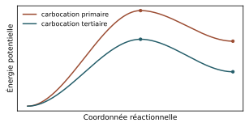
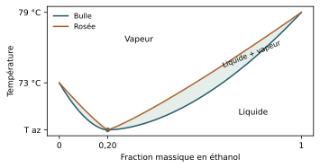

# Agro-Véto BCPST 2022 — Physique-chimie – résolution de problème · Corrigé guidé partiel

*Corrigé rédigé par IA, non officiel. Signalez toute erreur.*

**Lecture du rapport du jury** · GPT-6.2 Astra Ultra · vitesse non renseignée

**Rédaction** · GPT-6.2 Astra Ultra · vitesse non renseignée

## Alcènes, spectres et équilibres de phase

Cette édition résout 24 rubriques. Les rubriques suivantes restent à traiter dans ce corrigé : 1, 8, 11, 12, 16, 17, 30, 31, 33, 34, 35, 36, 37, 38, 39, 40, 41, 42, 43, 44, 45, 46, 47, 48, 49.

## I.A. Sélectivité et identification des molécules

### Question 2 — Orientation de l’hydratation

**Indication.** Comparer les positions possibles des deux atomes ajoutés.

L’hydrogène et le groupe hydroxyle peuvent a priori occuper deux orientations. La préférence pour le tert-butanol manifeste une **régiosélectivité**. La règle de Markovnikov place H sur le carbone de la double liaison déjà le plus hydrogéné et OH sur le carbone le plus substitué.

### Question 3 — Addition de l’eau et bilan des charges

**Indication.** Suivre les doublets, puis restituer le proton.

Le doublet de la liaison $\pi$ de $\mathrm{CH_2=C(CH_3)_2}$ capte un proton de l’ion oxonium, dont la liaison O–H restitue ses électrons à O. Il se forme le carbocation tertiaire $(\mathrm{CH_3})_3\mathrm C^+$, à sextet électronique. Un doublet libre de l’eau se lie à ce carbone et forme $(\mathrm{CH_3})_3\mathrm{COH_2^+}$. L’échange d’un proton avec une autre molécule d’eau donne $(\mathrm{CH_3})_3\mathrm{COH}$ et régénère l’oxonium. La charge globale reste positive à chaque étape.

### Question 4 — Régiosélectivité sous contrôle cinétique

**Indication.** Distinguer le maximum du profil et le minimum de l’intermédiaire.

La première protonation détermine la vitesse. Les deux orientations partent des mêmes réactifs. Le carbocation tertiaire est stabilisé par l’effet donneur et l’hyperconjugaison des trois groupes méthyle, le carbocation primaire l’est moins. Pour cette étape endoénergétique, le postulat de Hammond rapproche la structure de l’état de transition de celle du carbocation. La barrière de la voie tertiaire est donc plus basse et cette voie est plus rapide. Les deux maxima et les deux minima qui les suivent figurent sur le schéma.

### Question 5 — Bilan moléculaire et sous-produit

**Indication.** Distinguer l’alcool apporté et l’eau éventuellement présente.

Le bilan est $\mathrm{CH_2=C(CH_3)_2+C_2H_5OH\rightleftharpoons (CH_3)_3COC_2H_5}$. Les deux membres comptent six carbones, quatorze hydrogènes et un oxygène. L’eau résiduelle peut concurrencer l’éthanol et conduire au tert-butanol par l’hydratation de la question 3.

### Question 6 — Origine du carbone de l’éther

**Indication.** Comparer la provenance des deux alcools dans les filières considérées.

L’éthanol peut provenir de la fermentation de sucres issus de végétaux. Dans la filière conventionnelle décrite, le méthanol provient souvent de gaz de synthèse d’origine fossile. La fraction éthyle de l’ETBE offre donc une voie établie d’incorporation de carbone renouvelable. L’origine effective dépend de la matière première des deux partenaires.

### Question 7 — Attribuer le spectre de F

**Indication.** Commencer par la seule insaturation puis utiliser les intégrales.

$\mathrm{C_8H_{16}}$ a une insaturation et l’IR établit la présence de C=C. Le signal de 9 H à 1,09 ppm indique trois méthyles équivalents d’un tert-butyle. Les 6 H vers 1,7 ppm correspondent à deux méthyles portés par un même carbone de l’alcène (déplacements voisins, massif déformé), et le dernier H à 5,17 ppm est vinylique. On obtient $(\mathrm{CH_3})_3\mathrm C{-}CH{=}C(CH_3)_2$. Le carbone tétraédrique quaternaire et le carbone vinylique substitué ne portent pas de proton voisin qui imposerait une grande scission.

### Question 9 — Comprendre les espèces à douze carbones

**Indication.** Compter les carbones à chaque prolongement de chaîne.

L’intermédiaire carboné issu de deux unités à quatre carbones peut fixer une troisième unité avant de perdre un proton. On obtient alors un squelette à douze carbones. Des additions concurrentes supplémentaires expliquent les homologues à seize carbones ou plus. C’est une oligomérisation.

### Question 10 — Attribuer le spectre de F′

**Indication.** Chercher le groupement méthylène en bout de double liaison.

Dans $\mathrm{(CH_3)_3C{-}CH_2{-}C(CH_3){=}CH_2}$, le tert-butyle donne 9 H à 0,92 ppm. Le méthyle lié au carbone trigonal donne 3 H à 1,77 ppm. Le méthylène entre deux carbones sans hydrogène donne 2 H à 1,93 ppm. Le $\mathrm{{=}CH_2}$ donne les 2 H vers 4,7 ppm. Ces protons vinyliques peuvent avoir des déplacements proches sans être strictement équivalents. Les intégrales donnent bien seize protons.

### Question 13 — Comparer les deux squelettes

**Indication.** Transformer formellement le double trait en simple trait.

La saturation de F et de F′ déplace seulement les hydrogènes qui complètent les valences. Dans les deux cas le squelette saturé est $\mathrm{(CH_3)_3C{-}CH_2{-}CH(CH_3)_2}$, soit le 2,2,4-triméthylpentane. La position initiale de la double liaison ne crée ici aucune différence de connectivité finale.

### Question 14 — Identifier la verrerie

**Indication.** Il s’agit de séparer deux liquides non miscibles.

La pièce est une **ampoule à décanter**. Elle permet de distinguer puis de séparer deux phases liquides superposées.

### Question 15 — Interpréter le dégagement gazeux

**Indication.** Écrire le bilan acide–base en milieu aqueux.

L’hydrogénocarbonate neutralise une acidité résiduelle. Le bilan ionique $\mathrm{HCO_3^-+H_3O^+\to CO_2+2H_2O}$ explique que le gaz soit du dioxyde de carbone. L’hydrogénocarbonate joue ici le rôle de base.

### Question 18 — Comparer l’état physique des matières premières

**Indication.** Comparer leurs températures de changement d’état aux conditions ambiantes.

L’isobutène, dont la température normale d’ébullition vaut $-7\,^\circ\mathrm C$, est gazeux à température ambiante et sous un bar. Le tert-butanol est une matière condensée dans ce même domaine (il fond vers $25\,^\circ\mathrm C$). Ce dernier est plus facile à mesurer et à contenir.

### Question 19 — Expliquer l’identité des deux distributions

**Indication.** Rechercher un intermédiaire commun.

Les deux voies convergent vers l’espèce tert-butyle et le même réseau d’intermédiaires à huit carbones. Le tert-butanol peut également redonner l’alcène par élimination d’eau. Sous les conditions comparées dans l’énoncé, l’étape qui détermine la répartition entre les deux alcènes est ensuite commune, ce qui explique l’identité des produits et des proportions observées.

### Question 20 — Appliquer la règle de Zaïtsev

**Indication.** Compter les groupes carbonés sur la double liaison.

À substituants comparables, la règle de Zaïtsev prévoit l’alcène le plus substitué. F comporte trois substituants carbonés sur C=C, F′ seulement deux. Cette règle empirique prédit donc F.

### Question 21 — Expliquer l’inversion expérimentale

**Indication.** Examiner les répulsions que le simple comptage des substituants néglige.

Dans F, le groupe tert-butyle du carbone vinylique se trouve du même côté qu’un des deux méthyles du carbone opposé. Cette proximité entre groupes volumineux pénalise F. La double liaison terminale de F′ écarte cette interaction. Cet effet stérique peut inverser le classement prévu par la seule substitution et expliquer l’excès de F′.

## I.B. États physiques et thermodynamique

### Question 22 — Appliquer la loi de Hess

**Indication.** Identifier d’abord les phases pour lesquelles les données tabulées sont fournies.

À 298 K sous un bar, A est gazeux, E et B sont liquides. La loi de Hess donne $\Delta_rH^\circ=-351-(-18)-(-276)=-57\ \mathrm{kJ\,mol^{-1}}$. La réaction de référence est exothermique. L’en-tête numérique du tableau indique des enthalpies de formation, malgré l’expression « enthalpies libres » dans sa légende.

### Question 23 — Lire la pression de vapeur saturante

**Indication.** Comparer la pression du système à celle d’équilibre liquide–vapeur du composé le plus volatil.

Au point considéré dans l’énoncé, la pression de vapeur saturante tabulée de A se situe entre 7,7 et 9,7 bar et reste inférieure à la pression totale indiquée. A peut donc se trouver liquide. E et B ont déjà une température normale d’ébullition supérieure à la température de l’étude. L’existence d’une phase liquide homogène est ainsi cohérente avec les données et l’hypothèse de mélange du texte.

### Question 24 — Évaluer la correction calorifique

**Indication.** Vérifier aussi si le même état de référence de A est utilisé dans les deux évaluations.

Pour les trois liquides, $\Delta_r C_p^\circ=218-121-112=-15\ \mathrm{J\,mol^{-1}K^{-1}}$ et $\Delta_r C_p^\circ(T_1-298)\simeq-0,63\ \mathrm{kJ\,mol^{-1}}$. Le rapport du jury retient l’approximation d’Ellingham, soit une valeur voisine de $-57\ \mathrm{kJ\,mol^{-1}}$ en gardant la référence de 22. Une comparaison rigoureuse avec une réaction entièrement liquide nécessite en plus la vaporisation de A à 298 K : $\Delta_r H^\circ_{\rm liq}(T_1)\simeq-57+\Delta_{\rm vap}H_A^\circ(298)-0,63$, en kJ par mole. Le petit terme calorifique ne représente pas le changement de phase. Les pressions de vapeur à 25 et 40 °C donnent à titre indicatif $\Delta_{\rm vap}H_A\simeq R\ln(4,6/3,0)/(1/298-1/313)\simeq22\ \mathrm{kJ\,mol^{-1}}$, soit environ $-36$ pour le bilan liquide.

### Question 25 — Évolution avec la température

**Indication.** Utiliser le signe de la dérivée de van ’t Hoff.

La loi $\mathrm d\ln K/\mathrm dT=\Delta_rH^\circ/(RT^2)$ donne ici une dérivée négative. Après une hausse isobare de température depuis l’équilibre, le quotient initial dépasse la nouvelle constante dans l’approximation liquide idéale. Le système évolue vers A et E et la proportion d’équilibre de B diminue.

### Question 26 — Évolution avec la pression

**Indication.** Dans la relation exacte, le terme déterminant est un volume de réaction.

Les trois espèces sont en phase liquide. Dans le modèle de l’énoncé les activités sont assimilées aux fractions molaires et la variation de pression à composition et température fixées a un effet négligeable sur l’équilibre. Plus précisément $\partial\Delta_rG/\partial P=\Delta_rV$ ; sans volumes molaires on ne déduit pas le signe d’un faible écart réel. La pression influe en revanche sur l’état liquide ou gazeux des espèces.

### Question 27 — Construire le quotient de réaction

**Indication.** Calculer la quantité totale après avoir écrit les quantités individuelles.

À l’avancement $\xi$, les quantités de A, E, B sont $n_0-\xi$, $an_0-\xi$, $\xi$ ; leur somme est $(1+a)n_0-\xi$. Avec $a_i=x_i$ pour ce liquide idéal, $Q=x_B/(x_Ax_E)=\xi[(1+a)n_0-\xi]/[(n_0-\xi)(an_0-\xi)]$. C’est un nombre sans dimension.

### Question 28 — Calculer la conversion stœchiométrique

**Indication.** Résoudre avec la contrainte $0\le q\le1$.

Avec $q=\xi/n_0$ l’équilibre impose $K_1=q(1+a-q)/[(1-q)(a-q)]$. Pour $a=1$, le numérateur est $1-(1-q)^2$. Par conséquent $q=1-1/\sqrt{1+K_1}=0,824$ pour $K_1=31,3$, soit environ 82 %.

### Question 29 — Sens du déplacement d’équilibre

**Indication.** Faire varier $a$ en gardant l’avancement initialement inchangé.

À $q$ fixé, $Q=q[1+1/(a-q)]/(1-q)$ décroît quand $a$ augmente. Juste après l’ajout, $Q<K_1$ et le système évolue dans le sens direct. La conversion finale de A augmente.

### Question 32 — Lire le diagramme d’un azéotrope minimum

**Indication.** Placer les deux corps purs et le point commun des courbes de bulle et de rosée.

En abscisse, $w_E=0$ correspond à l’ETBE pur ($73\,^\circ\mathrm C$) et $w_E=1$ à l’éthanol pur ($79\,^\circ\mathrm C$), suivant les données de cette question. Les deux courbes se rejoignent au minimum, pour $w_E=0,20$ et une température inférieure à $73\,^\circ\mathrm C$ dont la valeur exacte n’est pas donnée. Sous la courbe de bulle, on a un liquide homogène ; au-dessus de la courbe de rosée, une vapeur ; entre elles, liquide et vapeur coexistent. À l’azéotrope leurs compositions sont identiques. Le distillat limite contient donc encore 20 % massiques d’éthanol. Le tableau 3 intervertit les deux températures indiquées à la question 32.

