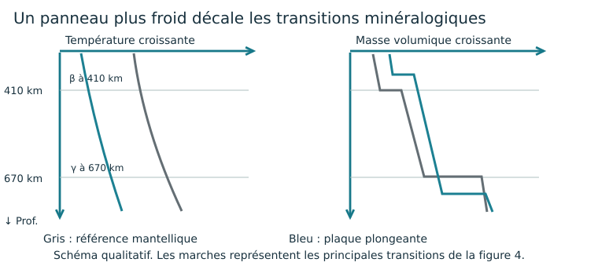
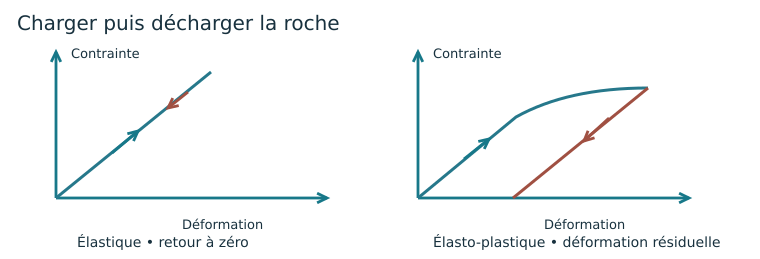
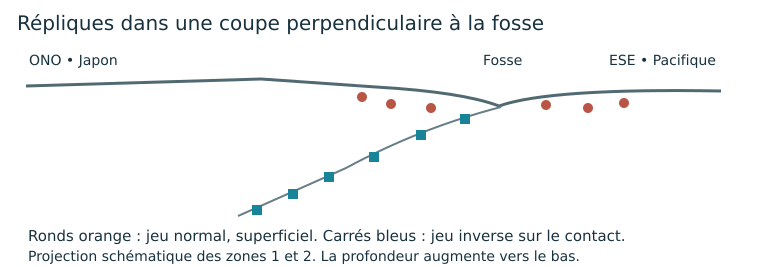
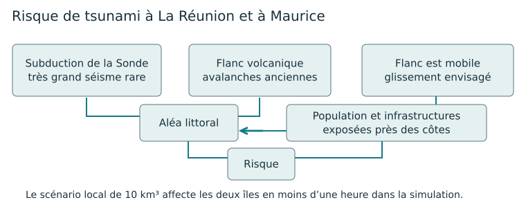
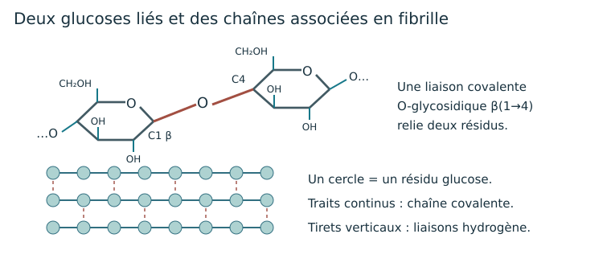
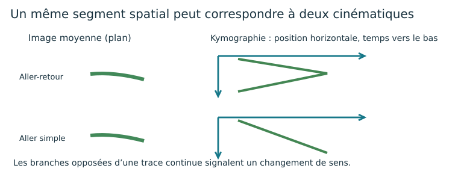
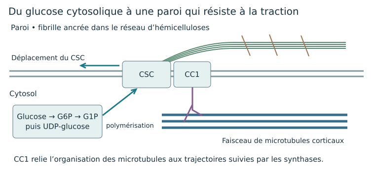

# Agro-Véto — BCPST, SVT 2022 · Corrigé guidé

*Corrigé rédigé par IA, non officiel.*

**Rédaction (tour 1)** · GPT-6.2 Astra Ultra · vitesse non renseignée

Les deux cahiers et leurs annexes sont corrigés. G1 à G20 désignent les questions de géologie et B1 à B14 les questions de biologie. Les schémas précisent les tracés à reporter sur les planches A3.

## Géologie • le séisme de Tōhoku-Oki et son contexte

### Question G1 — Le Japon au-dessus d’une subduction

> [!INDICATION]
> Suivre la profondeur des foyers depuis la fosse vers l’intérieur de l’arc.

#### Solution

Le foyer ou hypocentre est le point en profondeur où débute la rupture. L’épicentre est sa projection à la surface, à la verticale. Au large de la façade orientale du Japon, une fosse allongée borde le Pacifique. Les séismes sont superficiels près de la fosse et deviennent plus profonds vers l’ouest, sous l’arc japonais. La lithosphère océanique pacifique plonge donc sous la plaque portant le Japon.

### Question G2 — Du temps de parcours à la plaque froide

> [!INDICATION]
> Vérifier le signe des couleurs dans la légende de la figure 2.

#### Solution

L’alignement des foyers en profondeur définit le plan de Wadati–Benioff. L’inversion des écarts de temps d’arrivée de nombreuses ondes P par rapport à un modèle moyen permet de cartographier des contrastes de vitesse. On exprime l’anomalie comme cent fois le rapport de la différence entre vitesse locale et vitesse de référence à la vitesse de référence. Une anomalie positive traduit généralement, à composition comparable, une roche plus froide et rigide. En zone 1, la bande bleue rapide plonge vers l’ouest dans le prolongement des foyers. Elle matérialise la lithosphère pacifique en subduction.

### Question G3 — Quatre discontinuités de vitesse

> [!INDICATION]
> Faire coïncider la profondeur de chaque saut avec une limite de composition ou de phase.

#### Solution

A correspond au Moho, à quelques dizaines de kilomètres, où les vitesses augmentent en passant des roches crustales aux péridotites mantelliques. B se situe vers 410 km, au passage de l’olivine α à la wadsleyite β. C correspond, vers 520 km, à la ringwoodite γ. D, vers 670 km, marque la transformation en bridgmanite (structure pérovskite) et ferropériclase (magnésiowüstite). Sur la figure 4, le géotherme traverse les limites de ces domaines de stabilité. La réorganisation des phases modifie densité et modules élastiques, d’où les discontinuités de vitesse. Les sauts de masse volumique les plus visibles ici sont ceux de B et D.

### Question G4 — Tracer les profils d’un panneau froid

> [!INDICATION]
> Sur le diagramme de phase, comparer les deux géothermes à une même pression.

#### Solution

Le géotherme du panneau se place à gauche du géotherme normal. La transition α–β est rencontrée à une pression plus faible et la transition finale à une pression plus forte. À 410 km, le panneau contient donc déjà de la wadsleyite β. À 670 km, il conserve de la ringwoodite γ. Dans un même domaine minéralogique, la contraction thermique tend à le rendre plus dense que le manteau environnant. Reporter le premier saut de densité moins profond et le saut terminal plus profond. Entre les deux profondeurs de transition terminale, la différence de phase peut dominer l’effet thermique.

### Question G5 — Étalement vers la base de la zone de transition

> [!INDICATION]
> Distinguer la couleur de l’anomalie de vitesse et le contraste de densité aux environs de 670 km.

#### Solution

La bande bleue rapide de la figure 2 se prolonge presque horizontalement dans la zone 2. Le panneau froid y conserve la ringwoodite alors que le manteau voisin, juste au-dessous de 670 km, est déjà transformé en un assemblage plus dense. La transition retardée réduit alors le contraste de flottabilité qui favorisait l’enfoncement. Cela peut freiner la plaque et contribuer à son étalement au-dessus du manteau inférieur. Le texte du rapport qualifie l’anomalie de négative, mais le bleu correspond bien aux vitesses supérieures à la référence sur la légende du sujet.

### Question G6 — Compression lente et déplacement cosismique

> [!INDICATION]
> Les flèches des deux cartes ont des unités différentes. Mesurer la variation entre la côte est et l’ouest.

#### Solution

De 2001 à début 2011, les vitesses sur Honshū sont dirigées globalement vers l’ONO. Leur composante ouest est plus forte sur la côte pacifique qu’à l’ouest de l’île. La distance entre les stations diminue, ce qui révèle un raccourcissement. Le contact bloqué entraîne progressivement la plaque supérieure avec la plaque pacifique. Le séisme principal a eu lieu le 11 mars 2011. La carte cosismique cumule les déplacements du 8 au 11 mars, ce qui explique la présence des deux dates dans le sujet. Lors de la rupture, le déplacement cumulé sur quelques jours est en sens opposé, vers la fosse, et plus grand à l’est. L’île s’étire alors dans cette direction. Les vitesses intersismiques sont centimétriques par an, les déplacements cosismiques d’ordre métrique.

### Question G7 — Tracer charge et décharge

> [!INDICATION]
> L’axe vertical porte la contrainte. Examiner le point final sur l’axe horizontal.

#### Solution

En régime élastique linéaire, la déformation croît proportionnellement à la contrainte puis décroît sur le même segment jusqu’à l’origine. En comportement élasto-plastique, au-delà d’un seuil, une fraction supplémentaire de la déformation devient permanente. À la décharge, le trajet retrouve approximativement la pente élastique et coupe l’axe des déformations en une valeur positive.

### Question G8 — Portée du modèle du rebond

> [!INDICATION]
> Associer les directions des vecteurs de toute l’île à la série temporelle d’une station.

#### Solution

L’interface couplée charge élastiquement la plaque supérieure entre les séismes. Au relâchement, le déplacement de l’ensemble des stations change de sens. À MIZU, la figure 6 indique pendant la secousse un déplacement final voisin de 2 m vers l’est et de 1,1 m vers le sud après une oscillation transitoire. Le saut est très bref par rapport aux années de chargement. Le terme de rebond rend compte de cette restitution. Le glissement irréversible sur la faille, les oscillations et les ajustements progressifs après la rupture montrent que tout l’édifice ne parcourt pas exactement une droite élastique aller-retour.

### Question G9 — Répartir les jeux en profondeur

> [!INDICATION]
> Utiliser la couleur pour lire la profondeur et les quadrants pour lire le mécanisme.

#### Solution

La coupe ONO–ESE part de l’arc et franchit la fosse vers le Pacifique. Dans la zone 1, des séismes superficiels à jeu normal se superposent aux séismes inverses alignés sur le contact interplaque, qui s’approfondit vers l’ONO. En zone 2, au large du bombement externe, dominent les séismes normaux superficiels dans la plaque océanique. Les symboles du croquis sont placés dans la roche.

### Question G10 — Trois régimes de rupture

> [!INDICATION]
> Relier étirement de la plaque supérieure, flexure de la plaque entrante et variations latérales du déplacement.

#### Solution

En zone 1, le raccourcissement à l’interface produit le jeu inverse sur le plan de subduction. Dans la plaque supérieure, le déplacement cosismique vers la fosse, plus fort près de la côte, étire les terrains et favorise les failles normales. En zone 2, la face supérieure de la plaque pacifique en flexion est mise en extension avant la subduction. En zone 3, les mécanismes de décrochement indiquent un cisaillement horizontal. Les amplitudes et directions du déplacement cosismique varient le long de l’arc, ce qui peut expliquer ce cisaillement différentiel.

### Question G11 — Hauteur de l’eau et durée de la submersion

> [!INDICATION]
> Additionner la hauteur du quai et la partie noyée du sémaphore.

#### Solution

Le sommet du quai se situe environ 3 m au-dessus du niveau initial et le sémaphore le dépasse de 8 m. Quand il ne reste émergé qu’environ 1 m de ce dernier, l’élévation locale atteint approximativement 3 + 7 = 10 m. Cette lecture fournit une hauteur à cet endroit du port. À hauteur comparable, un tsunami possède une période et une longueur d’onde beaucoup plus grandes qu’une vague de tempête. Le niveau reste élevé plus longtemps, un grand volume d’eau pénètre à terre et les courants de retour peuvent aussi être importants.

## Géologie • tsunamis dans le sud de l’océan Indien

### Question G12 — Comparer les côtes exposées à une source lointaine

> [!INDICATION]
> Identifier la zone de subduction capable d’engendrer un événement de magnitude 9.

#### Solution

Près de Sumatra, la subduction de la Sonde produit rarement de très grands séismes, mais en 2004 l’échelle de la carte atteint localement plus de 10 m près de l’Indonésie. Ce scénario y est possible. Maurice et La Réunion se situent à environ 5 000 km de la subduction la plus proche. Pour le même événement, la carte indique dans leur secteur des hauteurs de l’ordre de quelques décimètres. Un tsunami tectonique de 10 m y est donc beaucoup moins vraisemblable dans ce scénario. La carte d’un seul événement ne fournit pas de probabilité annuelle.

### Question G13 — Un bloc récifal sur un paléosol

> [!INDICATION]
> Rapprocher l’environnement nécessaire aux coraux, la date des restes et l’altitude du dépôt.

#### Solution

Les coraux constructeurs étudiés vivent fixés en eau marine chaude, peu profonde, claire et éclairée, conditions favorisant leurs symbiotes photosynthétiques. À Maurice, un bloc métrique à plurimétrique de récif se trouve une centaine de mètres à l’intérieur du rivage, à environ 10 m d’altitude sur un ancien sol émergé. Des restes de coraux donnent un âge minimal d’environ 4 425 ± 35 ans. Le niveau marin postglaciaire est monté et était alors proche ou légèrement en dessous du niveau actuel. Une croissance sur place à +10 m n’explique donc ni la position ni le paléosol sous-jacent. Un transport est nécessaire dans l’interprétation des documents.

### Question G14 — De la taille des blocs au courant

> [!INDICATION]
> Convertir d’abord dix centimètres en cent millimètres. Distinguer entraînement et dépôt quand le courant faiblit.

#### Solution

Pour un claste de l’ordre de 100 mm, la limite de dépôt du diagramme de Hjulström se situe vers 200 cm/s, soit 2 m/s. Pour un bloc de l’ordre de quelques milliers de millimètres, une lecture extrapolée donne environ 1 000 cm/s, soit 10 m/s. Il s’agit d’ordres de grandeur au franchissement du seuil de transport. Le courant a dû être puissant avant que les blocs se déposent lors de sa décélération. Associées au site à +10 m, ces observations rendent peu convaincant un tsunami lointain analogue à celui de 2004. Un tsunami dû à un effondrement volcanique régional est compatible, mais les seuls blocs ne prouvent ni sa source ni sa date.

### Question G15 — L’avalanche de débris du cap La Houssaye

> [!INDICATION]
> Distinguer la surface striée de la coulée et le matériau fragmentaire qui la recouvre.

#### Solution

Une coulée basaltique cohérente forme le substrat. Au-dessus, le dépôt épais contient des blocs basaltiques anguleux de tailles très diverses dans une matrice fine de même composition. Le mauvais tri et l’absence de fort émoussé sont compatibles avec un transport en masse. Les stries sur le substrat témoignent d’une abrasion en base de l’avalanche suivant une direction E–O. Le sens des gradins asymétriques de la figure 14.3 indique un mouvement de l’est vers l’ouest.

### Question G16 — Une prolongation sous-marine

> [!INDICATION]
> Estimer la portée du lobe avec la barre de 50 km. Examiner ensuite tout le pourtour de l’île.

#### Solution

Face au cap La Houssaye s’étend, à l’ouest de l’île, une zone bombée à relief irrégulier, moins profonde que les fonds environnants. Sa portée de plusieurs dizaines de kilomètres et sa position dans le prolongement de l’écoulement terrestre permettent de l’interpréter comme un dépôt d’avalanche sous-marin. D’autres dépôts d’avalanches et irrégularités des flancs sont repérés au nord, au sud et à l’est. Le processus a donc été récurrent au cours de l’histoire de l’île. Les dimensions particulièrement grandes du lobe ouest n’impliquent pas une fréquence élevée d’effondrements de ce volume.

### Question G17 — Glissement du flanc est après 2007

> [!INDICATION]
> Comparer les trois interférogrammes couvrant la même durée, puis localiser la déformation par rapport aux réservoirs.

#### Solution

La figure 15.2 indique un mouvement vers l’est et vers le bas, maximal sur le flanc oriental, de l’ordre de deux décimètres dans chaque composante. Les franges interférométriques sont nombreuses de mai à septembre 2007, moins nombreuses ensuite puis encore plus espacées en 2008. Pour des intervalles égaux, le déplacement suivant la ligne de visée décroît, donc le phénomène s’amortit. Le secteur affecté se superpose au réservoir temporaire oriental et se prolonge vers la côte. L’intrusion puis la vidange peuvent avoir déstabilisé le flanc et facilité son glissement gravitaire vers l’océan. La seule déflation de la chambre sommitale explique mal le déplacement horizontal et sa localisation.

### Question G18 — Définir le risque géologique

> [!INDICATION]
> Deux phénomènes de même intensité produisent des dommages différents selon les enjeux exposés.

#### Solution

Le risque géologique correspond aux conséquences dommageables possibles d’un phénomène naturel dans un lieu et une période donnés. Il associe l’aléa (probabilité et intensité du phénomène), l’exposition des populations, ouvrages et activités et leur vulnérabilité, c’est-à-dire leur sensibilité aux dommages.

### Question G19 — Construire le bilan régional

> [!INDICATION]
> Faire arriver une branche « aléa » et une branche « enjeux » dans le même schéma.

#### Solution

L’événement tectonique lointain de 2004 indique une faible amplitude aux Mascareignes pour cette source. Une autre origine est documentée par les avalanches géologiques anciennes de La Réunion, les mouvements mesurés sur le flanc oriental et les dépôts de transport intense à Maurice. Dans le scénario de la figure 16, un volume de 10 km³ se déstabilise, se déplace vers l’océan et met une grande masse d’eau en mouvement. L’onde est marquée près de La Réunion à 500 s, approche Maurice vers 1 000 s et a atteint ses côtes à 2 500 s (environ 42 min). Plusieurs secteurs littoraux des deux îles sont densément occupés sur la figure 17. Le délai de réaction et l’altitude des zones occupées influencent les conséquences. Le calcul est conditionnel, et ne prédit pas la date d’un glissement.

### Question G20 — Surveiller un flanc mobile

> [!INDICATION]
> La carte montre dix stations en 2007. Distinguer une référence stable et un point susceptible de glisser.

#### Solution

Un récepteur GNSS mesure les temps de propagation des signaux de plusieurs satellites dont on connaît les orbites. Quatre satellites au moins permettent d’estimer trois coordonnées et le décalage d’horloge. Les séries différentielles par rapport à des références stables donnent un déplacement tridimensionnel. Des stations permanentes réparties sur le flanc est, entre l’amont du réservoir temporaire et la côte, sur ses marges et de part et d’autre des limites de déformation, compléteraient le réseau concentré autour du sommet. Une accélération cohérente aiderait à caractériser la zone instable et à déclencher une vérification puis, si nécessaire, une alerte littorale. La surveillance réduit la vulnérabilité par une réaction plus rapide. Elle ne permet pas de dater à elle seule une rupture.

## Biologie • structure de la tige et synthèse de la cellulose

### Question B1 — De la tige d’aristoloche à la microfibrille

> [!INDICATION]
> Séparer les trois panneaux. Les flèches de la vue générale concernent notamment la disposition du faisceau conducteur.

#### Solution

Le carmin colore en rose les parois pectocellulosiques et le vert d’iode met en évidence en vert les parois lignifiées. La distinction porte sur les parois. Sur le panneau supérieur de l’annexe, les trois premières flèches, de haut en bas, indiquent le xylème primaire à gros vaisseaux du côté interne, le cambium puis le phloème primaire situé vers l’extérieur. Sur le détail de droite, placer l’épiderme puis la cuticule externe. Sur le second panneau optique, les trois traits repèrent, de haut en bas, le collenchyme sous-épidermique, le sclérenchyme à parois épaisses lignifiées puis le parenchyme à grandes cellules. En microscopie électronique, les trois traits de gauche indiquent paroi secondaire (interne et épaisse), paroi primaire et lamelle moyenne entre deux cellules. Le dernier repère sur le détail à 200 nm désigne une microfibrille de cellulose. Ces cinq, trois et quatre repères rendent compte des douze légendes.

### Question B2 — Une rosette de synthases

> [!INDICATION]
> Dans cette question, respecter la convention de la figure, qui colore deux sous-unités séparément.

#### Solution

Dans le modèle 2C, 1 désigne une hélice α et 2 un feuillet β, deux motifs de structure secondaire. La figure présente la cellulose-synthase comme un assemblage transmembranaire à deux sous-unités de couleurs différentes, donc de structure quaternaire dans ce modèle. Plusieurs synthases s’assemblent au sein du complexe de synthèse de la cellulose (CSC). En vue de dessus, la rosette comporte six groupes de trois synthases. Si chacune extrude une chaîne, une fibrille regroupe 6 × 3 = 18 chaînes linéaires de cellulose.

### Question B3 — Donneur de glucose et allongement

> [!INDICATION]
> Suivre le phosphate et les nucléotides dans les deux sens des réactions du tableau.

#### Solution

La réaction 1 utilise l’UDP-glucose identifié dans le site de l’enzyme. Elle transfère un résidu glucosyle sur la chaîne de longueur n, donnant la chaîne n + 1 et libérant l’UDP. Son enthalpie libre standard transformée est négative dans le tableau. La réaction 2 avec glucose libre est défavorable dans ces conditions de référence. L’enzyme accélère la réaction sans modifier sa constante d’équilibre. À partir du glucose, suivre la réaction 4 dans le sens direct (glucose + ATP → glucose-6-phosphate + ADP), puis la réaction 5 à rebours (glucose-6-phosphate → glucose-1-phosphate). La réaction 3 fournit l’UDP-glucose à partir de glucose-1-phosphate et d’UTP en libérant du pyrophosphate. La réaction 1 incorpore enfin le glucosyle. L’hydrolyse cellulaire du pyrophosphate favorise la formation du donneur activé.

### Question B4 — Liaison β et association en fibrilles

> [!INDICATION]
> Préciser à quel carbone s’applique β. Distinguer la liaison entre deux résidus de celles qui rapprochent deux chaînes.

#### Solution

L’uridine diphosphate est un ribonucléotide constitué d’uracile, de ribose et de deux phosphates. La liaison O-glycosidique β(1→4) part du carbone anomérique C1 du premier D-glucose en configuration β et aboutit via un oxygène au carbone C4 du suivant. Dans la projection usuelle du D-glucose, la liaison β sort du même côté du cycle que le substituant CH₂OH. Les glucoses successifs adoptent dans la chaîne étendue des orientations alternées. Plusieurs chaînes non ramifiées se disposent parallèlement et s’associent, notamment par liaisons hydrogène.

### Question B5 — De la rosette à la résistance à la traction

> [!INDICATION]
> Passer du mode d’action d’une enzyme à l’architecture produite collectivement.

#### Solution

Le site cytosolique de chaque synthase utilise l’UDP-glucose pour allonger une chaîne β(1→4), que le domaine transmembranaire fait passer du côté pariétal. Les synthases voisines de la rosette délivrent simultanément des chaînes linéaires proches et parallèles. Des interactions entre ces chaînes, notamment des liaisons hydrogène, stabilisent une microfibrille cohésive. Une traction dans son axe sollicite de nombreuses chaînes covalentes associées. Le réseau de fibrilles, reliées à d’autres polysaccharides pariétaux, contribue à résister à l’étirement dû à la pression de turgescence.

## Biologie • les microtubules orientent les trajectoires membranaires

### Question B6 — Ce que révèle une colocalisation

> [!INDICATION]
> Une image instantanée fournit une position. Le guidage est une hypothèse sur une trajectoire.

#### Solution

Une fusion fluorescente associe dans une même chaîne polypeptidique la protéine d’intérêt et un domaine fluorescent. Le signal renseigne sur sa localisation si la fusion conserve un comportement représentatif. Sans oryzaline, les signaux associés aux synthases s’organisent le long de lignes parallèles aux microtubules corticaux. Quand le réseau est déstabilisé, la fluorescence des microtubules devient diffuse et l’alignement des synthases se désorganise. La distribution ordonnée des synthases dépend donc du réseau. Ces images fixes ne suffisent pas à suivre la direction de croissance d’une fibrille ni à démontrer un guidage mécanique.

### Question B7 — Deux représentations d’une trajectoire

> [!INDICATION]
> Dans un kymographe, une ligne par instant est empilée sous la précédente.

#### Solution

Une synthase faisant un aller-retour sur un segment laisse, en moyenne, un trait le long du segment. Son kymographe montre une diagonale qui change de pente au moment de l’inversion. Une marche unidirectionnelle sur le même segment donne aussi un trait dans l’image moyenne, mais une seule diagonale dans le kymographe. L’image moyenne conserve deux dimensions spatiales et efface l’ordre des positions. Le kymographe affiche une dimension spatiale et le temps, ce qui révèle sens, vitesse et inversions éventuelles.

### Question B8 — Lire un sens et une vitesse

> [!INDICATION]
> La distance parcourue se mesure horizontalement sur le kymographe avec la barre de 2 µm.

#### Solution

Les lignes de microtubules sont analogues sur les vues instantanée et moyenne, indiquant une position globalement stable à cette échelle de temps. Les points de synthase instantanés deviennent des lignes lorsqu’on moyenne les images. Des synthases se déplacent donc selon des trajectoires globalement parallèles au réseau. Des diagonales de pentes opposées traduisent des mouvements dans les deux sens le long d’un même axe. Chaque trace rectiligne conserve son sens pendant le suivi. Par exemple, environ 4,2 µm en 11 min donnent 0,38 µm/min, soit environ 6,4 nm/s. La pente choisie et l’épaisseur du trait limitent la précision.

### Question B9 — Tester l’hypothèse des moteurs

> [!INDICATION]
> Supposer comme l’énoncé qu’une seule piste polarisée est observée.

#### Solution

Sur un microtubule unique, un moteur qui marche toujours vers l’extrémité positive entraînerait son cargo dans un seul sens. Le même raisonnement vaut pour un moteur dirigé vers l’extrémité négative. Le seul type de kinésine ou le seul type de dynéine décrit par le sujet ne peut donc expliquer toutes les diagonales de sens opposés. Deux activités motrices de sens opposés ou un mécanisme indépendant des moteurs restent compatibles avec la seule kymographie. Elle ne démontre la présence d’aucun de ces moteurs.

### Question B10 — Séparer guidage et motricité

> [!INDICATION]
> Identifier les trajectoires coïncidentes, puis celles qui persistent en l’absence de filament visible.

#### Solution

Sous le traitement le moins déstabilisant, une partie des trajectoires de synthase suit les microtubules résiduels, d’autres s’en écartent. Sous le traitement le plus marqué, la fluorescence de tubuline devient diffuse alors que des trajets de synthases restent visibles. Le déplacement peut donc persister sans réseau cortical résolu, ce qui écarte un mécanisme reposant exclusivement sur des moteurs utilisant ces pistes. La coïncidence partielle est compatible avec un guidage, mais le mot « seulement » attribue une fonction exclusive que ces données ne mesurent pas. Ajouter au même ensemble une condition sans oryzaline, sous les mêmes conditions d’imagerie, permettrait de comparer quantitativement alignement et mobilité avant et après traitement.

### Question B11 — La polymérisation comme source de mouvement

> [!INDICATION]
> Raisonner sur l’action et la réaction entre une chaîne ancrée et un complexe mobile dans la membrane.

#### Solution

La fibrille produite est rigide et se trouve liée au réseau pariétal, notamment par des hémicelluloses. Lorsque la synthase ajoute des résidus à une chaîne déjà contrainte dans la paroi, l’extrusion ne peut déplacer librement toute la fibrille. La force de réaction peut repousser le complexe mobile dans le plan de la membrane en sens opposé à l’extrusion de la chaîne. La polymérisation fournirait ainsi la force, les microtubules pouvant en orienter la trajectoire. Cette explication mécanique demeure un modèle compatible avec les observations.

## Biologie • protéines associées aux microtubules et synthèse de la paroi

### Question B12 — Interprétation d’une électrophorèse

> [!INDICATION]
> Comparer successivement A, B et C à l’échelle de masse et distinguer monomères et assemblages.

#### Solution

En A, CC1Δ migre près de 20 kDa. En B, les tubulines α et β ont chacune une masse proche de 50 kDa et migrent ensemble. Dans les conditions de cette figure, B présente essentiellement cette bande et aucun assemblage stable d’ordre supérieur détectable. Cela ne définit pas la capacité générale des tubulines à polymériser. C présente une bande 1 proche de 70 kDa, compatible avec une tubuline et une CC1Δ associées. Les bandes plus hautes, notamment vers 120 kDa et au-delà, suggèrent des assemblages contenant davantage de sous-unités. Le fragment favorise ou stabilise donc les associations impliquant les tubulines. Le seul poids apparent ne détermine pas la composition exacte de chaque bande.

### Question B13 — Organisation en faisceaux

> [!INDICATION]
> Les microtubules de départ sont déjà stabilisés. La quantité mesurée est leur association latérale.

#### Solution

Avec davantage de CC1Δ, la proportion de microtubules engagés dans des faisceaux augmente. À 5,1 µM, la médiane atteint environ 70 %, contre 25–30 % sans CC1Δ. Le nombre moyen de microtubules par faisceau s’élève approximativement de 1–2 à près de 4. Les images à même échelle montrent des structures plus épaisses. Les grains d’or localisent CC1Δ sur les microtubules. Plusieurs régions de sa séquence flexible sont en contact avec des tubulines α et β. Une interaction multivalente le long du réseau pourrait stabiliser et rapprocher plusieurs microtubules en faisceaux. L’image soutient leur association, sans visualiser chaque pont entre deux filaments.

### Question B14 — Relier biosynthèse et fonctions de la paroi

> [!INDICATION]
> Sur le dessin, séparer cytosol, membrane et paroi. Rendre distincts orientation, force motrice et cohésion des chaînes.

#### Solution

Dans le cytosol, le glucose passe par les phosphates de glucose puis l’UDP-glucose. À la membrane, chaque synthase du CSC incorpore le glucosyle dans une chaîne et l’extrude vers la paroi. Le groupement des enzymes en rosette rapproche les chaînes parallèles. Elles forment par association une fibrille résistante. Les complexes CC1 et les synthases se déplacent ensemble dans la figure 10, observation compatible avec une association directe ou indirecte. Le domaine cytosolique de CC1 interagit avec les tubulines et favorise la formation de faisceaux. Le réseau cortical contribue à l’orientation des CSC et des dépôts pariétaux. La force de progression peut provenir de la polymérisation face à une fibrille ancrée. L’orientation des fibrilles rend la résistance à l’étirement différente selon les directions et contribue ainsi à orienter la croissance de la cellule turgescente.

