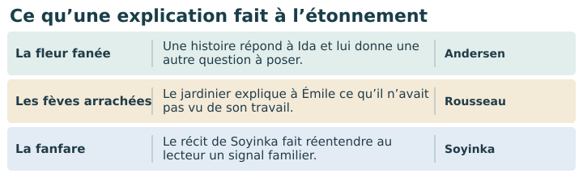

# Banque PT — Français A 2022 · Corrigé brut

*Corrigé rédigé par IA, non officiel. Signalez toute erreur.*

**Rédaction** · GPT-6.2 Astra Ultra · vitesse non renseignée

[Énoncé officiel](https://www.banquept.fr/documents/2022/fr_a_2022_pt.pdf) · [Rapport du jury](https://www.banquept.fr/documents/ecrit/rapport/2022/rapport_fra_a_ecrit_2022.pdf) · [Programme officiel](https://www.education.gouv.fr/bo/21/Hebdo28/ESRS2119554A.htm)

Épreuve de quatre heures sur « L’enfance ». Soyinka, Aké, les années d’enfance (traduction Étienne Galle) · Rousseau, Émile ou De l’éducation, livres I et II · Andersen, Contes (traduction Marc Auchet).

Julien Green, L’Apprenti psychiatre (édition citée de 1977), p. 2 du sujet.

## Dissertation

Dans quelle mesure les œuvres confirment-elles le jugement de Julien Green selon lequel le regard presque poétique de l’enfant disparaît à mesure que l’éducation lui rend le monde familier ?

Pourquoi les fleurs de la petite Ida, si belles hier, ont-elles l’air abattu ce matin ? La réponse de l’étudiant, chez Andersen, est qu’elles ont dansé toute la nuit. Ida reçoit bien une explication de ce qui l’étonnait. Loin de la rassasier, elle lui donne une nouvelle nuit à observer et une histoire à poursuivre. Julien Green assimile presque tous les enfants à des poètes parce que le monde leur fait l’effet d’un pays étranger. L’éducation, en leur apprenant à s’y reconnaître, les priverait peu à peu de la faculté de s’étonner. Toute explication se paie-t-elle de la perte de ce qui avait rendu possible la première question ?

L’enfant est d’abord étranger à un monde dont le familier masque aux adultes l’étrangeté. Le petit Wole, à Aké, n’entend pas seulement la fanfare comme un signal dont il connaîtrait la fonction. La musique appelle le mouvement. Il suit le cortège et découvre un espace qui déborde les limites dans lesquelles son entourage le croyait en sûreté. Il est poète au sens de Green sans avoir écrit un vers. Une disposition de son attention lui fait trouver dans le bruit ordinaire, pour d’autres, la promesse d’une expérience. Dans « Les Habits neufs de l’empereur », c’est au contraire ce qui manque qui retient le regard de l’enfant. Il voit un corps là où les adultes ont déjà appris à voir les marques d’un rang et à taire ce qui pourrait les compromettre. L’étonnement n’est donc pas seulement une agréable surprise. Il peut mettre le monde connu en difficulté.

Une éducation qui apporte trop vite les noms et les usages risque alors de fermer les questions. Rousseau en fait l’épreuve au livre II de l’*Émile* en examinant ce que comprend un enfant de la fable du corbeau et du renard. Le maître croit transmettre une morale évidente. Pour l’enfant, les mots demandent des explications et la réussite du renard pourrait bien paraître plus séduisante que la leçon de prudence. Exiger seulement la récitation permettrait à l’élève de se croire chez lui dans un langage qui n’est pas encore le sien. Chez Andersen, l’adulte qui raille les histoires contées à Ida sait déjà ce qu’est une fleur et ce qu’une fleur peut faire. À ce degré de familiarité, plus rien ne mérite en effet d’être regardé.

Mais Rousseau propose aussi de laisser Émile apprendre par l’expérience. Lorsqu’il sème ses fèves sur une terre que Robert avait déjà travaillée, la destruction de son ouvrage lui fait demander pourquoi le jardinier lui a fait subir ce qu’il éprouve comme un tort. La réponse lui découvre le point de vue de quelqu’un dont il avait lui-même compromis le travail. Il ne pourra plus voir la terre disponible comme avant. Ici l’explication déplace l’étonnement du végétal qui pousse au droit de celui qui le cultive. Dans *Aké*, l’enfant qui accompagne les femmes mobilisées entre lui aussi dans un monde de règles et de rapports de force. Comprendre que l’impôt peut être contesté rend étonnant un ordre qui se prétendait nécessaire. Apprendre éclaire dans ce cas ce qui mérite de rester une question.

Enfin, il faut un écrivain adulte pour donner au lecteur la possibilité de suivre une seconde fois la fanfare. Le récit de Soyinka ne nous rend pas sans médiation le regard d’autrefois. Il organise les écarts entre ce que le jeune Wole comprenait et ce que ses proches voyaient, et laisse le lecteur passer d’un point de vue à l’autre. Andersen donne semblablement aux fleurs une vie nocturne dont la possibilité demeure ouverte à l’intérieur du conte. Ces œuvres permettent de préciser le danger pressenti par Green. Les poètes meurent lorsque l’explication acquise dispense de regarder encore. L’éducation et le récit peuvent aussi apprendre à retrouver de l’inconnu dans ce dont on connaît désormais le nom.
