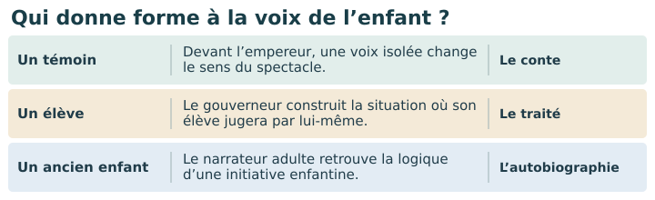

# Banque PT — Français B 2022 · Corrigé brut

*Corrigé rédigé par IA, non officiel. Signalez toute erreur.*

**Rédaction** · GPT-6.2 Astra Ultra · vitesse non renseignée

[Énoncé officiel](https://www.banquept.fr/documents/2022/fr_b_2022_pt.pdf) · [Rapport du jury](https://www.banquept.fr/documents/ecrit/rapport/2022/rapport_fra_b_ecrit_2022.pdf) · [Programme officiel](https://www.education.gouv.fr/bo/21/Hebdo28/ESRS2119554A.htm)

Épreuve de quatre heures sur « L’enfance ». Soyinka, Aké, les années d’enfance (traduction Étienne Galle) · Rousseau, Émile ou De l’éducation, livres I et II · Andersen, Contes (traduction Marc Auchet).

Christelle Robert, « Place de l’enfant dans la littérature scientifique : de l’enfant objet à l’enfant sujet », dans Les Enfants dans les livres (Érès, 2013). De « Si aujourd’hui la plupart des chercheurs » (p. 2) jusqu’à « mieux saisir sa part d’activité » (p. 5). Le fascicule signale des coupes à l’intérieur du passage. Les questions sont p. 5, la dernière page est blanche.

Texte de 1631 mots selon le sujet. Résumé de 200 mots à 10 % près (180 à 220), 8 points. Dissertation, 12 points.

## Résumé

Les chercheurs reconnaissent volontiers que les enfants participent à leur développement. Mais leur attribuer des compétences intellectuelles ne suffit pas pour les considérer comme des sujets capables de choisir, de transformer leur milieu et de donner sens à leurs actes. Les programmes scientifiques étudient surtout leurs droits, les influences sociales et les conditions favorables à leur éducation. Leur expérience singulière demeure méconnue.

Nous proposons donc de regarder comment la recherche accueille leur parole. Leur dépendance initiale incite les adultes à parler pour eux. Même les études qui portent sur leurs propos les restituent rarement. Être entendu participe pourtant à la construction de soi. Il faut pouvoir dialoguer avec les enfants et examiner sérieusement la confiance que mérite leur témoignage.

Dès deux ans, ils peuvent décrire fidèlement une expérience avec peu de mots. Leurs erreurs concernent davantage les explications que les observations. Vers quatre ans, ils expriment aussi émotions et significations implicites. Comme chez les adultes, leur récit comporte une dimension subjective. Consulter leurs proches pour garantir une prétendue objectivité reconduit une vision adulte du monde. Écouter directement leur interprétation éclaire au contraire leurs besoins, leur manière propre de vivre une situation et la part qui leur revient dans leur développement.

*200 mots.*

## Dissertation

Les auteurs du programme prennent-ils en compte la vie intérieure de l’enfant et son point de vue tel qu’il s’exprime par sa parole ?

Un enfant annonce que l’empereur ne porte rien. Les adultes qui avaient sous les yeux le même spectacle n’avaient pas osé le dire. Pour le lecteur d’Andersen, que révèle cette parole sur l’enfant qui la prononce ? Elle expose clairement sa perception. Elle ne nous apprend presque rien sur sa personnalité ni sur ce qu’il éprouvera devant la réaction de la foule. C’est cette différence qu’invite à examiner Christelle Robert. Accueillir la parole d’un enfant ne suffit pas toujours à faire place à son point de vue et à sa vie intérieure. Comment un écrivain adulte peut-il les rendre sensibles sans substituer ses raisons aux siennes ?

Un premier geste consiste à faire apparaître ce qui compte pour l’enfant et que les adultes n’avaient même pas remarqué. Dans *Aké*, le petit Wole suit une fanfare. Là où ses parents pourraient ne voir que l’imprudence d’un enfant qui s’éloigne, l’autobiographie fait entendre l’appel de la musique et suivre l’enchaînement d’initiatives par lesquelles une excursion devient possible. Nous comprenons un motif qui n’a pas besoin d’une justification adulte pour être réel. Dans « Les Fleurs de la petite Ida », c’est également la question de la fillette sur ses fleurs fanées qui donne son départ au récit. L’étudiant accepte de lui répondre dans un langage auquel son imagination pourra faire écho. Ses nouvelles questions et les soins qu’elle donne aux fleurs nous découvrent ensemble une curiosité et un attachement. Le conte laisse apparaître de la sorte quelque chose de plus intime que la seule exactitude de ses observations.

Cependant les œuvres ne sont pas des enregistrements, et les usages qu’elles font des voix enfantines diffèrent. Émile est un élève imaginé par un philosophe. Au livre II, le gouverneur s’intéresse à ce que son élève comprend effectivement de la propriété. Le trouble devant les fèves arrachées est pris au sérieux. Il suscite un dialogue avec le jardinier Robert, lui-même lésé par la destruction de ses plantations. Mais la scène a été conçue pour que l’enfant découvre une règle dont le lecteur adulte connaît déjà la destination. Ce que l’enfant peut juger ici par lui-même et ce que le dispositif lui permet de dire ne coïncident pas entièrement. De même, la parole de l’enfant dans « Les Habits neufs de l’empereur » a sa place décisive dans la satire de la cour. La brièveté même de l’apparition interdit d’en tirer un portrait psychologique complet.

Le récit rétrospectif présente une autre difficulté. Comment un écrivain devenu adulte ferait-il entendre les paroles de son enfance comme si personne ne les avait choisies et ordonnées ? Chez Soyinka, les désignations familiales, les questions du petit garçon et la voix qui fixe après coup la géographie d’Aké ne proviennent pas tout à fait du même moment. Ce décalage permet de montrer les limites du jugement enfantin sans lui enlever sa logique. Dans les scènes qui entourent l’action collective des femmes, un lecteur peut saisir la signification politique d’événements d’abord perçus par Wole à travers des déplacements, des commissions et des paroles entendues. Sa manière de découvrir compte autant que ce qu’il finit par comprendre. La littérature peut ainsi respecter la vie intérieure de l’enfant jusque dans ce qu’il ne sait pas encore formuler.

Le conte, l’autobiographie et le traité éducatif accordent donc à l’enfant trois formes de présence. Sa parole peut déplacer une évidence commune, rendre accessible une expérience singulière ou mettre à l’épreuve une théorie de l’éducation. La question décisive est de savoir si, une fois la scène comprise par l’adulte, le lecteur peut encore y reconnaître ce que l’enfant seul avait vu, voulu ou craint.
