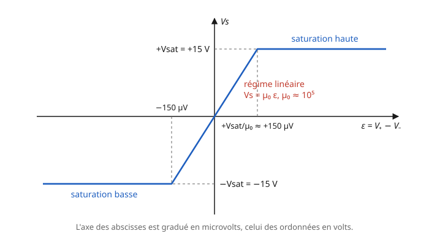
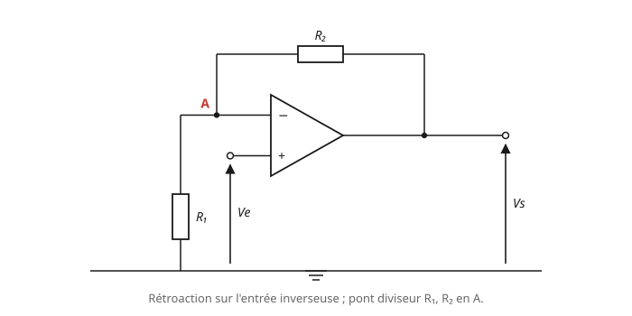
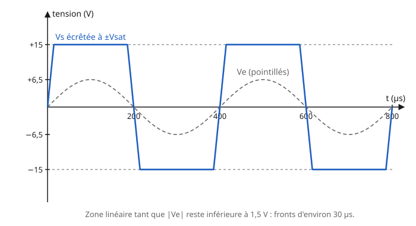
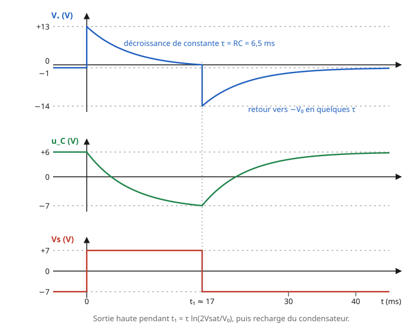
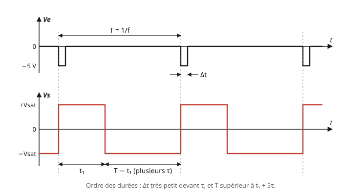
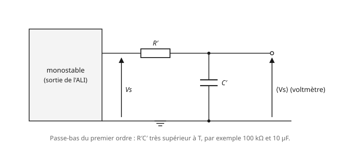

# Banque PT PT — Informatique et modélisation 2022 · Corrigé brut

*Corrigé rédigé par IA, non officiel. Signalez toute erreur.*

**Rédaction** · modèle exact non renseigné (famille Claude) · effort non renseigné · vitesse non renseignée

**Révision (tour 2)** · modèle exact non renseigné (famille Claude) · effort non renseigné · vitesse non renseignée · 28 novembre 2026

Épreuve de quatre heures, sans calculatrice : suivi de la consommation d'eau d'une habitation, 46 questions en deux parties indépendantes. Les valeurs lues sur les oscillogrammes du sujet sont données avec leur lecture en divisions. Documents officiels : [sujet](https://www.banquept.fr/documents/2022/info_mod_2022_pt.pdf) et [rapport du jury](https://www.banquept.fr/documents/ecrit/rapport/2022/rapport_info_model_ecrit_2022.pdf).

## Première partie — Compteur d'impulsions analogique

**A. Généralités sur les ALI (questions 1 à 8).**

L'ALI est alimenté en $\pm 15\ \mathrm{V}$ et sature à $\pm V_{sat} = \pm 15\ \mathrm{V}$. On note $\varepsilon = V_+ - V_-$ la tension différentielle d'entrée et $\mu_0$ le gain statique.

### Question 1 — Caractéristique de transfert de l'ALI

En régime linéaire, la sortie est proportionnelle à la tension différentielle :

$$V_s = \mu_0\,\varepsilon \quad\text{avec}\quad \mu_0 \sim 10^5 .$$

Ce régime cesse quand $|V_s|$ atteint $V_{sat}$, c'est-à-dire pour

$$|\varepsilon| = \frac{V_{sat}}{\mu_0} \approx \frac{15}{10^5}\ \mathrm{V} = 150\ \mathrm{\mu V} .$$

Au-delà, la sortie est saturée : $V_s = +V_{sat}$ si $\varepsilon > 0$ et $V_s = -V_{sat}$ si $\varepsilon < 0$.



**La zone linéaire ne couvre que quelques centaines de microvolts : à l'échelle du volt, la caractéristique est une marche, et on écrit $\varepsilon \approx 0$ en régime linéaire.**

### Question 2 — Montage suiveur

La sortie est rebouclée sur l'entrée inverseuse seule : la rétroaction est négative et l'ALI peut fonctionner en régime linéaire. Le schéma donne $V_+ = V_e$ et $V_- = V_s$, donc

$$V_s = \mu_0\,(V_e - V_s) .$$

On en tire

$$V_s = \frac{\mu_0}{1+\mu_0}\,V_e .$$

Avec un gain infini (ce qui revient à écrire $\varepsilon = 0$) :

$$\boxed{V_s = V_e}$$

C'est le **montage suiveur**. Son gain vaut 1, son intérêt est ailleurs : l'entrée de l'ALI ne prélève aucun courant sur la source (résistance d'entrée quasi infinie) et la sortie se comporte comme une source de tension presque idéale (résistance de sortie très faible). Intercalé entre deux étages, il recopie la tension du premier sans la perturber, quelle que soit la charge : c'est une adaptation d'impédance.

### Question 3 — Lecture de l'oscillogramme d'entrée

Lecture sur l'oscillogramme ($2\ \mathrm{V/div}$, $100\ \mathrm{\mu s/div}$) :

- deux maxima successifs sont séparés de $4{,}0$ divisions, soit $T = 400\ \mathrm{\mu s}$ ;
- la trace s'étend sur $6{,}6$ divisions de crête à crête, soit environ $13\ \mathrm{V}$ ;
- elle est centrée sur l'axe horizontal médian de l'écran.

La tension d'entrée est donc **sinusoïdale, de fréquence $f = 1/T = 2{,}5\ \mathrm{kHz}$, d'amplitude $V_m \approx 6{,}5\ \mathrm{V}$ et de valeur moyenne nulle** (pulsation $\omega = 2\pi f \approx 1{,}6\times 10^{4}\ \mathrm{rad\,s^{-1}}$).

On peut raisonnablement attendre la même tension en sortie, car aucune limitation de l'ALI n'est atteinte :

- l'amplitude reste inférieure à $V_{sat} = 15\ \mathrm{V}$ ;
- la pente maximale du signal vaut $2\pi f V_m \approx 1{,}0\times 10^{5}\ \mathrm{V\,s^{-1}} = 0{,}1\ \mathrm{V/\mu s}$, bien en dessous de la vitesse de balayage d'un ALI courant (de l'ordre de 1 à $10\ \mathrm{V/\mu s}$) ;
- la fréquence est très inférieure à la bande passante du suiveur (de l'ordre du mégahertz) ;
- la sortie est à vide : le courant débité est négligeable.

### Question 4 — Vitesse de balayage

À fréquence plus élevée, la sortie devient **triangulaire** : sa pente reste constante en valeur absolue, alors que le signal d'entrée exigerait une pente plus grande. On met en évidence la **vitesse de balayage** (*slew rate*) de l'ALI, valeur maximale de $|\mathrm dV_s/\mathrm dt|$.

Lecture ($2\ \mathrm{V/div}$, $1\ \mathrm{\mu s/div}$) : le triangle a une période de $2{,}0$ divisions, soit $2\ \mathrm{\mu s}$ (fréquence $500\ \mathrm{kHz}$), et une excursion crête à crête de $5{,}7$ divisions, soit $11{,}4\ \mathrm{V}$, parcourue en une demi-période :

$$\sigma = \left|\frac{\mathrm dV_s}{\mathrm dt}\right|_{max} \approx \frac{11{,}4\ \mathrm{V}}{1\ \mathrm{\mu s}}$$

$$\boxed{\sigma \approx 11\ \mathrm{V/\mu s} \sim 10^{7}\ \mathrm{V\,s^{-1}}}$$

Une mesure directe des pentes sur la figure donne $11\ \mathrm{V/\mu s}$ à la montée et $12\ \mathrm{V/\mu s}$ à la descente. C'est l'ordre de grandeur d'un ALI à entrées JFET courant.

### Question 5 — Saturation en courant

À la fréquence de la question 3, avec la charge $R_0 = 50\ \mathrm{\Omega}$, la sortie est écrêtée symétriquement. Lecture ($2\ \mathrm{V/div}$) : les paliers se situent à $\pm 1{,}95$ division de l'axe médian, soit $\pm 3{,}9\ \mathrm{V}$, très en dessous de $V_{sat}$. Ce n'est donc pas une saturation en tension : c'est le **courant de sortie** de l'ALI qui est limité (**saturation en courant**).

Tout le courant de sortie traverse $R_0$ (le courant de l'entrée inverseuse est nul), d'où

$$i_{s,max} = \frac{V_{s,max}}{R_0} \approx \frac{3{,}9}{50}\ \mathrm{A}$$

$$\boxed{i_{s,max} \approx 80\ \mathrm{mA}}$$

soit quelques dizaines de milliampères, ordre de grandeur habituel. Sans limitation, il aurait fallu $6{,}5/50 = 130\ \mathrm{mA}$.

### Question 6 — Amplificateur non inverseur

L'entrée $V_e$ est appliquée sur l'entrée $+$. Une résistance $R_2$ relie la sortie à l'entrée $-$, et une résistance $R_1$ relie l'entrée $-$ à la masse.



La rétroaction est négative : le régime est linéaire et $V_- = V_+ = V_e$. Aucun courant n'entre dans la borne $-$, donc $R_1$ et $R_2$ forment un pont diviseur de la tension $V_s$ :

$$V_- = \frac{R_1}{R_1+R_2}\,V_s .$$

En égalant à $V_e$ :

$$\boxed{G = \frac{V_s}{V_e} = 1 + \frac{R_2}{R_1}}$$

### Question 7 — Choix des résistances et limites du gain

On garde les résistances entre le kilo-ohm et le mégohm. Avec $R_1 = 1\ \mathrm{k\Omega}$ :

| Gain | $R_2/R_1$ | $R_2$ |
|---|---|---|
| 10 | 9 | $9\ \mathrm{k\Omega}$ |
| 100 | 99 | $99\ \mathrm{k\Omega}$ (en pratique $100\ \mathrm{k\Omega}$) |
| 1000 | 999 | $999\ \mathrm{k\Omega}$ (en pratique $1\ \mathrm{M\Omega}$) |

**En continu**, la formule $G = 1 + R_2/R_1$ suppose le gain de l'ALI infini. Avec un gain statique fini $\mu_0 \sim 10^5$, elle n'est valable que si $G \ll \mu_0$ : on peut aller jusqu'à un gain de l'ordre de $10^3$ à $10^4$, et $\mu_0 \sim 10^5$ est une borne infranchissable. Il faut aussi que $G\,V_e$ reste inférieur à $V_{sat}$.

**À $10\ \mathrm{kHz}$**, l'ALI se comporte comme un passe-bas du premier ordre et le produit gain × bande passante du montage est constant, de l'ordre de $1\ \mathrm{MHz}$ (un à quelques mégahertz selon le composant). Le gain reste égal à $G$ tant que $G \times f$ est inférieur à ce produit :

$$G_{max} \sim \frac{10^{6}\ \mathrm{Hz}}{10^{4}\ \mathrm{Hz}} = 10^{2} .$$

**En continu, le gain est borné par le gain statique de l'ALI ($\mu_0 \sim 10^5$) et reste fiable jusqu'à $10^3$ ou $10^4$ ; à $10\ \mathrm{kHz}$, le produit gain × bande passante le limite à une centaine.**

### Question 8 — Sortie de l'amplificateur de gain 10

Avec un gain de 10, la sortie devrait atteindre $10 \times 6{,}5 = 65\ \mathrm{V}$, très au-delà de $V_{sat} = 15\ \mathrm{V}$. L'ALI ne reste en régime linéaire que tant que $|V_e| < V_{sat}/10 = 1{,}5\ \mathrm{V}$ ; au-delà, la sortie est bloquée à $\pm 15\ \mathrm{V}$.

La sortie est donc une sinusoïde très fortement **écrêtée**, presque un créneau de $\pm 15\ \mathrm{V}$, de même période $400\ \mathrm{\mu s}$ et en phase avec l'entrée. Les fronts sont des portions de sinusoïde quasi rectilignes : la zone linéaire correspond à $|\sin\omega t| < 1{,}5/6{,}5$, soit un angle de $\pm 13^\circ$ autour de chaque passage par zéro et une durée d'environ $30\ \mathrm{\mu s}$ par front. Leur pente, $10 \times 0{,}1 = 1\ \mathrm{V/\mu s}$, reste inférieure à la vitesse de balayage mesurée à la question 4.



**B. Compteur d'impulsions (questions 9 à 21).**

L'ALI est maintenant alimenté en $\pm V_{cc} = \pm 7\ \mathrm{V}$ et fonctionne en régime saturé : $V_s = +V_{sat}$ si $\varepsilon = V_+ - V_e > 0$, et $V_s = -V_{sat}$ sinon, avec $V_{sat} = 7\ \mathrm{V}$. La rétroaction revient sur l'entrée $+$, à travers le condensateur. Conventions lues sur le schéma : $u_C = V_+ - V_s$, le courant $i$ descend dans $R$ du nœud $+$ vers la source, et la flèche de $V_0$ pointe vers la masse, de sorte que la borne de la source reliée à $R$ est au potentiel $-V_0 = -1\ \mathrm{V}$. On a donc, à tout instant,

$$V_+ = -V_0 + R\,i \qquad\text{et}\qquad V_+ = V_s + u_C .$$

### Question 9 — État stationnaire

En régime stationnaire, la tension $u_C$ est constante : le courant dans le condensateur est nul. L'entrée $+$ de l'ALI ne prélève aucun courant. La loi des nœuds au point $+$ donne donc

$$\boxed{i = 0}$$

La résistance n'est le siège d'aucune chute de tension :

$$\boxed{V_+ = -V_0 = -1\ \mathrm{V}}$$

Si $V_e = 0$, alors $\varepsilon = V_+ - V_e = -V_0 < 0$ : l'ALI, en régime saturé, est en saturation basse, $V_s = -V_{sat} = -7\ \mathrm{V}$. L'hypothèse inverse ($V_s = +V_{sat}$) exigerait $\varepsilon > 0$ alors que $V_+$ vaudrait toujours $-V_0$ : elle est contradictoire. C'est le rôle de la source $V_0$ que d'imposer un état de repos unique.

Enfin

$$u_C = V_+ - V_s = -V_0 + V_{sat}$$

$$\boxed{u_C = V_{sat} - V_0 = 6\ \mathrm{V}}$$

### Question 10 — Impulsion d'entrée

$V_e(t)$ est un créneau négatif : $V_e = 0$ pour $t < 0$, $V_e = -5\ \mathrm{V}$ pour $0 \le t < \Delta t$, puis $V_e = 0$ pour $t \ge \Delta t$, avec deux fronts verticaux en $t = 0$ et $t = \Delta t$.

```text
 Ve
 0 V  ─────────┐       ┌─────────────────────────────► t
               │       │
-5 V           └───────┘
              t=0     t=Δt
```

### Question 11 — Sens de « très brève »

La seule durée caractéristique du circuit est sa constante de temps

$$\tau = RC = 10\times 10^{3} \times 650\times 10^{-9}\ \mathrm{s} = 6{,}5\ \mathrm{ms} .$$

« Très brève » signifie donc

$$\boxed{\Delta t \ll RC = 6{,}5\ \mathrm{ms}}$$

par exemple $\Delta t \lesssim 0{,}1\ \mathrm{ms}$.

La tension $u_C$ est continue et n'évolue que par la charge ou la décharge du condensateur à travers $R$, sur une durée de l'ordre de $\tau$. Pendant $\Delta t \ll \tau$, sa variation relative est de l'ordre de $\Delta t/\tau \ll 1$ : $u_C$ reste pratiquement égale à sa valeur initiale $V_{sat} - V_0$.

### Question 12 — Basculement à l'arrivée de l'impulsion

*Basculement à $t = 0$.* Juste avant, $V_+ = -V_0 = -1\ \mathrm{V}$. Quand $V_e$ passe à $-5\ \mathrm{V}$,

$$\varepsilon = V_+ - V_e = -1 + 5 = +4\ \mathrm{V} > 0 ,$$

donc la sortie bascule en saturation haute : $V_s = +V_{sat}$.

*Conséquence sur $V_+$.* La tension $u_C$ est continue et vaut encore $V_{sat} - V_0$. Comme $V_+ = V_s + u_C$, le saut de $V_s$ est transmis intégralement à l'entrée $+$ :

$$V_+(0^+) = V_{sat} + (V_{sat} - V_0) = 2V_{sat} - V_0 = 13\ \mathrm{V} .$$

Le basculement est ainsi confirmé et renforcé ($\varepsilon = 18\ \mathrm{V}$) : c'est la rétroaction positive.

*Retour de $V_e$ à zéro, à $t = \Delta t$.* Comme $\Delta t \ll \tau$, $u_C$ n'a presque pas varié et $V_+ \approx 13\ \mathrm{V}$. Alors

$$\varepsilon = V_+ - 0 \approx +13\ \mathrm{V} > 0 .$$

Le signe de $\varepsilon$ ne change pas : **la sortie reste à $+V_{sat}$, il n'y a pas de second basculement.** L'état haut est désormais entretenu par le condensateur, et non plus par l'entrée.

### Question 13 — Évolution de la tension du condensateur

Pour $t > 0$ (après le basculement), $V_s = +V_{sat}$. Le courant d'entrée de l'ALI étant nul, le courant $i$ qui descend dans $R$ arrive au nœud $+$ en traversant le condensateur depuis la sortie. Pour le condensateur, ce courant entre par l'armature reliée à la sortie, alors que $u_C = V_+ - V_s$ est comptée vers l'armature reliée au nœud $+$ :

$$i = C\,\frac{\mathrm d(V_s - V_+)}{\mathrm dt} = -C\,\frac{\mathrm du_C}{\mathrm dt} .$$

La loi des mailles s'écrit $V_+ = -V_0 + Ri$ et $V_+ = V_{sat} + u_C$, d'où

$$V_{sat} + u_C = -V_0 - RC\,\frac{\mathrm du_C}{\mathrm dt} .$$

Avec $\tau = RC$ :

$$\tau\,\frac{\mathrm du_C}{\mathrm dt} + u_C = -(V_{sat} + V_0) .$$

La solution est la somme de la solution particulière constante et de la solution de l'équation homogène :

$$u_C(t) = A\,e^{-t/\tau} - (V_{sat} + V_0) .$$

La continuité de $u_C$ donne $u_C(0) = V_{sat} - V_0$, donc $A = 2V_{sat}$ :

$$\boxed{u_C(t) = 2V_{sat}\,e^{-t/\tau} - (V_{sat} + V_0)}$$

avec

$$\boxed{\tau = RC = 6{,}5\ \mathrm{ms}}$$

$\tau$ est la constante de temps du circuit $RC$ : elle fixe la durée du régime transitoire, c'est-à-dire la rapidité avec laquelle le condensateur se décharge puis se recharge en sens inverse à travers $R$. En l'absence de nouveau basculement, $u_C$ tendrait vers $-(V_{sat}+V_0)$ en quelques $\tau$.

### Question 14 — Durée de l'état haut

Pendant l'état haut, avec $V_e = 0$ (pour $t > \Delta t$) :

$$\varepsilon(t) = V_+(t) = V_{sat} + u_C(t) = 2V_{sat}\,e^{-t/\tau} - V_0 .$$

Cette tension décroît de $13\ \mathrm{V}$ vers $-V_0$. La sortie repasse en saturation basse à l'instant $t_1$ où elle s'annule :

$$2V_{sat}\,e^{-t_1/\tau} = V_0 .$$

$$\boxed{t_1 = RC\,\ln\!\left(\frac{2V_{sat}}{V_0}\right)}$$

Application numérique, avec $2V_{sat}/V_0 = 14$ :

$$t_1 = 6{,}5\ \mathrm{ms} \times \ln 14 \approx 6{,}5 \times 2{,}6\ \mathrm{ms}$$

$$\boxed{t_1 \approx 17\ \mathrm{ms}}$$

### Question 15 — Les deux phases de la tension de l'entrée non inverseuse

Lecture de l'enregistrement ($5\ \mathrm{V/div}$, $5\ \mathrm{ms/div}$) : niveau de repos à $-0{,}2$ division, soit $-1\ \mathrm{V}$ ; saut à $t = 0$ jusqu'à $+2{,}5$ divisions, soit environ $+12{,}5\ \mathrm{V}$ ; décroissance jusqu'à $0\ \mathrm{V}$, atteinte $3{,}3$ divisions plus tard, soit $16{,}6\ \mathrm{ms}$ ; chute brutale jusqu'à $-2{,}7$ divisions, soit environ $-13{,}6\ \mathrm{V}$ ; puis remontée lente vers $-1\ \mathrm{V}$.

**Première phase, $0 < t < t_1$ (sortie haute).** Le saut initial est celui de la question 12 : $V_+$ passe de $-V_0$ à $2V_{sat} - V_0 = 13\ \mathrm{V}$. Puis

$$V_+(t) = 2V_{sat}\,e^{-t/\tau} - V_0$$

décroît exponentiellement, avec la constante de temps $\tau = 6{,}5\ \mathrm{ms}$, jusqu'à s'annuler en $t_1 \approx 17\ \mathrm{ms}$, en accord avec la lecture.

**Basculement à $t_1$.** Dès que $V_+$ devient négative, $\varepsilon < 0$ et la sortie chute de $+V_{sat}$ à $-V_{sat}$. À cet instant $u_C(t_1) = V_+(t_1) - V_{sat} = -V_{sat}$, et cette tension est continue. Le saut de $-2V_{sat}$ de la sortie se reporte donc sur l'entrée $+$ :

$$V_+(t_1^+) = -V_{sat} + u_C(t_1) = -2V_{sat}$$

$$\boxed{V_{+,min} = -2V_{sat} = -14\ \mathrm{V}}$$

en accord avec la valeur lue ($-13{,}6\ \mathrm{V}$) à 3 % près ; de même la crête lue ($+12{,}5\ \mathrm{V}$) est un peu en dessous de $2V_{sat} - V_0 = 13\ \mathrm{V}$ : les tensions de saturation réelles sont légèrement inférieures à $V_{cc}$.

**Seconde phase, $t > t_1$ (sortie basse).** Avec $V_s = -V_{sat}$, la même mise en équation donne

$$\tau\,\frac{\mathrm dV_+}{\mathrm dt} + V_+ = -V_0 ,$$

d'où

$$V_+(t) = -V_0 - (2V_{sat} - V_0)\,e^{-(t-t_1)/\tau} .$$

$V_+$ remonte exponentiellement de $-14\ \mathrm{V}$ vers $-V_0 = -1\ \mathrm{V}$, avec la même constante de temps : le condensateur se recharge jusqu'à $u_C = V_{sat} - V_0$. Pendant toute cette phase $\varepsilon = V_+ < 0$ : la sortie reste basse, et le montage retrouve son état de repos au bout de quelques $\tau$.

### Question 16 — Chronogrammes de la tension du condensateur et de la sortie

**Sortie.** $V_s = -7\ \mathrm{V}$ pour $t < 0$, $V_s = +7\ \mathrm{V}$ pour $0 < t < t_1$, puis $V_s = -7\ \mathrm{V}$ pour $t > t_1$ : un créneau de durée $t_1 \approx 17\ \mathrm{ms}$, soit $3{,}4$ divisions.

**Condensateur.** $u_C = V_+ - V_s$ est continue :

$$u_C(t) = \begin{cases} V_{sat} - V_0 = 6\ \mathrm{V} & \text{si } t < 0, \\ 2V_{sat}\,e^{-t/\tau} - (V_{sat}+V_0) & \text{si } 0 \le t \le t_1, \\ (V_{sat} - V_0) - (2V_{sat} - V_0)\,e^{-(t-t_1)/\tau} & \text{si } t \ge t_1. \end{cases}$$

Elle décroît de $+6\ \mathrm{V}$ à $-V_{sat} = -7\ \mathrm{V}$ pendant l'état haut, en s'annulant à $t = \tau\ln(7/4) \approx 3{,}6\ \mathrm{ms}$, présente un point anguleux en $t_1$, puis remonte vers $+6\ \mathrm{V}$ en quelques $\tau$. À l'échelle de l'enregistrement ($5\ \mathrm{ms/div}$, origine à une division du bord gauche), la fenêtre couvre de $-5\ \mathrm{ms}$ à $45\ \mathrm{ms}$.



### Question 17 — Condition sur la période

Chaque impulsion doit trouver le montage revenu à son état de repos.

- Une impulsion arrivant pendant l'état haut ($t < t_1$) ne change rien, puisque $\varepsilon$ est déjà positif : elle ne serait pas comptée. Il faut donc au minimum $T > t_1$.
- Une impulsion arrivant pendant la recharge trouve $u_C$ inférieure à $V_{sat} - V_0$. Si $V_+ < -5\ \mathrm{V}$, elle ne provoque pas de basculement ; sinon elle en provoque un, mais la durée de l'état haut est plus courte que $t_1$. Il faut laisser le condensateur se recharger pendant environ $5\tau$.

D'où la condition

$$\boxed{T \gtrsim t_1 + 5\tau \approx 17 + 33 = 50\ \mathrm{ms}}$$

soit $f \lesssim 20\ \mathrm{Hz}$. Chaque créneau a alors exactement la durée $t_1$, ce que suppose la question 19.

### Question 18 — Régime périodique

$V_e$ est une suite d'impulsions négatives ($0 \to -5\ \mathrm{V}$), de largeur $\Delta t$ et de période $T$. $V_s$ vaut $-V_{sat}$ au repos, passe à $+V_{sat}$ au front descendant de chaque impulsion et y reste pendant $t_1$, puis revient à $-V_{sat}$ jusqu'à l'impulsion suivante. Les trois temps caractéristiques sont $\Delta t$, $t_1$ et $T$, avec $\Delta t \ll \tau < t_1$ et $T > t_1 + 5\tau$.



### Question 19 — Valeur moyenne de la sortie

Sur une période $T = 1/f$, la sortie vaut $+V_{sat}$ pendant $t_1$ et $-V_{sat}$ pendant $T - t_1$ :

$$\langle V_s \rangle = \frac{1}{T}\Big(V_{sat}\,t_1 - V_{sat}\,(T - t_1)\Big) .$$

$$\boxed{\langle V_s \rangle = V_{sat}\,(2\,t_1 f - 1)}$$

La valeur moyenne est une fonction **affine** croissante de la fréquence. Contrôle : elle vaut $-V_{sat}$ si $f = 0$ (sortie toujours basse) et s'annule pour $f = 1/(2t_1)$ (rapport cyclique un demi).

### Question 20 — Extraction de la valeur moyenne

$V_s$ est périodique : c'est la somme de sa valeur moyenne (composante continue) et d'harmoniques de fréquences $f$, $2f$, etc. Un **filtre passe-bas** de fréquence de coupure $f_c \ll f$ ne conserve que la valeur moyenne. Le plus simple est le passe-bas passif du premier ordre : une résistance $R'$ en série entre la sortie de l'ALI et la sortie du filtre, un condensateur $C'$ entre la sortie du filtre et la masse ; la tension filtrée est prise aux bornes de $C'$.



Branchement : l'entrée du filtre est reliée directement à la sortie de l'ALI, qui se comporte comme une source de tension ; la sortie du filtre doit débiter sur une grande résistance devant $R'$ (voltmètre, ou suiveur de la question 2).

Choix des composants pour $f = 10\ \mathrm{Hz}$ : on prend $f_c = 1/(2\pi R'C')$ environ cent fois plus petite que $f$. Avec

$$R' = 100\ \mathrm{k\Omega} \qquad\text{et}\qquad C' = 10\ \mathrm{\mu F} ,$$

on obtient $R'C' = 1\ \mathrm{s}$ et $f_c \approx 0{,}16\ \mathrm{Hz}$. Le fondamental est atténué d'un facteur $f/f_c \approx 60$ et les harmoniques davantage. En contrepartie, la mesure met quelques secondes (environ $5R'C'$) à s'établir après un changement de débit.

### Question 21 — Tension proportionnelle à la fréquence

La tension filtrée vaut $\langle V_s\rangle = 2V_{sat}t_1 f - V_{sat}$. Pour obtenir une tension proportionnelle à $f$, il faut lui ajouter la constante $V_{sat}$, qui est justement la tension d'alimentation $V_{cc}$ :

$$U = \langle V_s \rangle + V_{sat} = 2\,V_{sat}\,t_1\,f .$$

Réalisation : on place après le filtre (derrière un suiveur, pour ne pas le charger) un montage soustracteur à ALI, à quatre résistances identiques, dont la sortie vaut la différence de ses deux entrées. On applique $\langle V_s \rangle$ sur l'entrée positive et $-V_{cc}$ sur l'entrée négative ; le voltmètre branché en sortie mesure $U$. La tension $U$ reste inférieure à $2V_{sat}\,t_1/T$, soit moins de $5\ \mathrm{V}$ dans le domaine d'emploi $f \lesssim 20\ \mathrm{Hz}$ : ce second ALI peut être alimenté par la même source $\pm V_{cc}$ sans saturer. Plus simplement, un voltmètre branché entre la sortie du filtre et la borne $-V_{cc}$ de l'alimentation mesure directement cette différence.

Avec les valeurs du montage,

$$\frac{U}{f} = 2\,V_{sat}\,t_1 \approx 2 \times 7 \times 0{,}017\ \mathrm{V\,s} \approx 0{,}24\ \mathrm{V/Hz} ,$$

soit $2{,}4\ \mathrm{V}$ à $10\ \mathrm{Hz}$.

## Seconde partie — Exploitation informatique des mesures

Tout le code Python et SQL ci-dessous a été exécuté et testé (jeux d'essai aléatoires, exemples du sujet, base SQLite reprenant l'extrait de la table).

**C. Estimation des débits et volumes (questions 22 à 34).**

### Question 22 — Plus petite durée entre deux impulsions

D'après $Q = c/\tau$, la durée est minimale au débit maximal, qu'il faut convertir : $Q_{max} = 2{,}5/3600\ \mathrm{m^3\,s^{-1}}$.

$$\tau_{min} = \frac{c}{Q_{max}} = \frac{7\times 10^{-5} \times 3600}{2{,}5}\ \mathrm{s} = \frac{0{,}252}{2{,}5}\ \mathrm{s}$$

$$\boxed{\tau_{min} \approx 0{,}10\ \mathrm{s}}$$

### Question 23 — Incertitude relative sur le débit

Avec $c$ exactement connu, $\ln Q = \ln c - \ln \tau$. En différentiant :

$$\frac{\mathrm dQ}{Q} = -\frac{\mathrm d\tau}{\tau} .$$

En valeur absolue :

$$\boxed{\frac{\delta Q}{Q} = \frac{\delta\tau}{\tau}}$$

La condition $\delta Q/Q \le 1\,\%$ s'écrit $\delta\tau \le 0{,}01\,\tau$. Elle est la plus contraignante quand $\tau$ est minimale, c'est-à-dire au débit $Q_{max}$ :

$$\delta\tau \le 0{,}01 \times \tau_{min}$$

$$\boxed{\delta\tau_{max} \approx 1\ \mathrm{ms}}$$

### Question 24 — Limites du stockage sur 32 bits

Les instants à stocker valent environ $1{,}6\times 10^{9}\ \mathrm{s}$, à connaître à $10^{-3}\ \mathrm{s}$ près.

**Stockage entier.** En millisecondes, il faudrait représenter des entiers de l'ordre de $1{,}6\times 10^{12}$. Or le plus grand entier disponible est

$$2^{31} - 1 = 2 \times (2^{10})^{3} - 1 \approx 2\times 10^{9} .$$

Il manque un facteur proche de mille (il faudrait plus de 40 bits) : le stockage entier en millisecondes est impossible. On remarque que le même instant en secondes entières, $1{,}6\times 10^{9}$, tient de justesse, ce qu'exploitera la suite.

**Stockage flottant.** Une mantisse de 23 bits donne une précision relative de l'ordre de

$$2^{-23} = \frac{1}{8 \times (2^{10})^{2}} \approx 10^{-7} ,$$

soit environ sept chiffres décimaux significatifs. Pour une valeur de $1{,}6\times 10^{9}\ \mathrm{s}$, l'écart entre deux flottants consécutifs est donc de l'ordre de $10^{2}\ \mathrm{s}$ (exactement $2^{30-23} = 128\ \mathrm{s}$, puisque $2^{30} \le 1{,}6\times 10^{9} < 2^{31}$). On est très loin de la milliseconde, qui exigerait une précision relative de $10^{-3}/(1{,}6\times 10^{9}) \approx 6\times 10^{-13}$.

**Dans les deux cas, 32 bits ne suffisent pas pour stocker directement un *timestamp* à la milliseconde.**

### Question 25 — Lecture du fichier des impulsions

La première ligne donne l'instant de synchronisation $t_0$ en secondes entières, les suivantes les durées écoulées depuis $t_0$ en millisecondes. La fonction `int` accepte une chaîne terminée par un passage à la ligne.

```python
def recup(nomFichier):
    """Renvoie la liste des instants des impulsions, en secondes (flottants)."""
    f = open(nomFichier, "r")
    lignes = f.readlines()
    f.close()
    t0 = int(lignes[0])              # timestamp entier de la synchronisation (s)
    lImp = []
    for k in range(1, len(lignes)):
        ms = int(lignes[k])          # millisecondes écoulées depuis t0
        lImp.append(t0 + ms / 1000)
    return lImp
```

Sur le fichier de quatre lignes donné en exemple, la fonction renvoie `[1609825201.145, 1609825202.948, 1609825206.532]`. La division `/` produit un flottant ; l'instant de synchronisation lui-même n'est pas une impulsion et ne figure pas dans la liste. L'affichage reproduit dans le sujet indique `'1620115200\n'` en première ligne alors que le fichier montré contient `1609825200` : cette différence d'exemple est sans conséquence sur la fonction.

### Question 26 — Débits constants par morceaux

```python
def debits1(lImp, c):
    """Renvoie la liste des débits q_i = c / (T_{i+1} - T_i)."""
    lQ = []
    for i in range(len(lImp) - 1):
        lQ.append(c / (lImp[i + 1] - lImp[i]))
    return lQ
```

La liste renvoyée a un élément de moins que `lImp`. La liste des instants étant strictement croissante, aucune division par zéro n'est possible.

### Question 27 — Recherche de l'intervalle contenant un instant

Recherche séquentielle : on avance tant que l'impulsion suivante est antérieure ou égale à $t$.

```python
def indice(lImp, t):
    """Renvoie i tel que lImp[i] <= t < lImp[i+1].
    Précondition : lImp[0] <= t < lImp[-1]."""
    i = 0
    while lImp[i + 1] <= t:
        i = i + 1
    return i
```

Terminaison et correction : comme $t$ est strictement inférieur au dernier élément, la condition devient fausse au plus tard pour `i + 1 = len(lImp) - 1`, sans sortir de la liste. En sortie de boucle `lImp[i+1] > t`, et `lImp[i] <= t` (vrai au départ par la précondition, puis par la condition de la boucle au tour précédent).

La liste étant croissante, on peut aussi procéder par dichotomie, en maintenant l'invariant `lImp[g] <= t < lImp[d]` :

```python
def indice_dicho(lImp, t):
    """Même résultat que indice, par dichotomie (lImp est croissante)."""
    g = 0                    # invariant : lImp[g] <= t < lImp[d]
    d = len(lImp) - 1
    while d - g > 1:
        m = (g + d) // 2
        if lImp[m] <= t:
            g = m
        else:
            d = m
    return g
```

### Question 28 — Débit aux instants de calcul

```python
def temporel(lQ, lImp, lTemps):
    """Renvoie la liste des débits q(t) aux instants de lTemps."""
    lQT = []
    for t in lTemps:
        if t < lImp[0] or t >= lImp[-1]:
            lQT.append(0)            # hors de l'enregistrement
        else:
            lQT.append(lQ[indice(lImp, t)])
    return lQT
```

Le test préalable garantit la précondition de `indice`. On a retenu comme borne supérieure la dernière impulsion, `lImp[-1]`, conformément à la question 27 et à la figure 3 du sujet, où le débit s'annule à la dernière impulsion ; la relation (3) du sujet est écrite avec un indice décalé d'une unité ($T_{n-1}$ au lieu de $T_n$).

### Question 29 — Complexité de la fonction temporel

La boucle de `temporel` effectue $m$ tours. Chaque tour comporte un nombre borné d'opérations élémentaires et au plus un appel à `indice`. Avec la recherche séquentielle, cet appel coûte dans le pire des cas (instant situé dans le dernier intervalle) $n$ comparaisons, soit $O(n)$. La complexité de `temporel` dans le pire des cas est donc

$$\boxed{O(m\,n)}$$

Ce pire cas est atteint quand tous les instants de calcul sont proches de la fin de l'enregistrement. Avec la variante dichotomique, chaque appel coûte $O(\log n)$ et la complexité devient $O(m \log n)$.

### Question 30 — Parcours simultané des deux listes triées

**Avec `indice`.** Chaque appel est indépendant des précédents : il reprend la recherche depuis le début de la liste (ou depuis la liste entière par dichotomie) et ignore que l'instant précédent se trouvait déjà dans tel intervalle. Le coût d'un appel ne peut donc pas être réduit, et celui de `temporel` reste le produit du nombre d'appels par ce coût.

**Parcours simultané.** Les deux listes étant croissantes, l'indice de l'intervalle contenant $t_j$ est supérieur ou égal à celui de l'intervalle contenant $t_{j-1}$. On conserve donc un indice courant `i` dans `lImp`, qui n'est jamais remis à zéro : pour chaque nouvel instant de calcul, on l'avance tant que `lImp[i+1] <= t`, puis on lit `lQ[i]`. C'est le principe de la fusion de deux listes triées : chaque liste n'est parcourue qu'une fois.

```python
def temporel_trie(lQ, lImp, lTemps):
    """Variante en O(m + n) quand lTemps est croissante."""
    lQT = []
    i = 0                            # intervalle courant, ne recule jamais
    for t in lTemps:
        if t < lImp[0] or t >= lImp[-1]:
            lQT.append(0)
        else:
            while lImp[i + 1] <= t:
                i = i + 1
            lQT.append(lQ[i])
    return lQT
```

L'indice `i` augmente au plus $n$ fois au total et la boucle externe fait $m$ tours : la complexité est $O(m+n)$, soit

$$\boxed{O(n) \text{ pour } m = n}$$

au lieu de $O(n^2)$ avec la recherche séquentielle répétée, ou $O(n\log n)$ avec la dichotomie.

### Question 31 — Récurrence de la méthode des trapèzes

Le volume est l'intégrale du débit. Entre $t_{j-1}$ et $t_j$, on approche l'aire sous la courbe par celle du trapèze de bases $q_{j-1}$ et $q_j$ et de hauteur $\Delta t$ :

$$\boxed{v_j = v_{j-1} + \frac{q_{j-1} + q_j}{2}\,\Delta t}$$

### Question 32 — Calcul des volumes

```python
def volumes(lTemps, lQT, v0):
    """Renvoie la liste des volumes aux instants de lTemps (méthode des trapèzes)."""
    lVT = [v0]
    for j in range(1, len(lTemps)):
        dt = lTemps[j] - lTemps[j - 1]
        lVT.append(lVT[j - 1] + dt * (lQT[j - 1] + lQT[j]) / 2)
    return lVT
```

La liste renvoyée a la même longueur que `lTemps` et commence par `v0`. Le pas est recalculé à chaque tour : la fonction reste correcte même si les instants ne sont pas rigoureusement équidistants. Par exemple, `volumes([0, 1, 2], [0, 2, 4], 0)` renvoie `[0, 1.0, 4.0]`, valeurs exactes de l'intégrale d'un débit affine.

### Question 33 — Chaîne de traitement complète

```python
lImp = recup("2021-01-31.txt")
lQ = debits1(lImp, 0.07)                 # débits en litres par seconde

n = 1000                                 # 1000 instants, donc 999 intervalles
pas = (lImp[-1] - lImp[0]) / (n - 1)
lTemps = [lImp[0] + k * pas for k in range(n)]

lQT = temporel(lQ, lImp, lTemps)
lVT = volumes(lTemps, lQT, 0)            # volumes en litres
```

Les instants étant en secondes et le volume par impulsion en litres, les débits sont en litres par seconde et les volumes en litres. Le premier instant de `lTemps` est exactement `lImp[0]` ; le dernier coïncide avec `lImp[-1]` aux arrondis près, ce qui ne pose aucun problème puisque `temporel` renvoie un débit défini dans tous les cas.

### Question 34 — Détection des périodes sans consommation

**Principe.** Si $q_i = c/(T_{i+1}-T_i)$ est inférieur au seuil, on considère que le volume $c$ a en réalité été consommé juste après $T_i$, au débit précédent $q_{i-1}$, puis que la consommation s'est arrêtée. On retarde donc l'impulsion $T_i$ de la durée nécessaire pour écouler $c$ au débit $q_{i-1}$ :

$$T_i' = T_i + \frac{c}{q_{i-1}} = T_i + (T_i - T_{i-1}) ,$$

et on pose $q_i = 0$. Le débit $q_{i-1}$ s'applique alors de $T_{i-1}$ à $T_i'$ (volume $2c$), et le débit nul de $T_i'$ à $T_{i+1}$ : le volume total est conservé.

**Une seule modification d'affilée.** Un booléen `faible` indique si le débit précédent était déjà sous le seuil. Dans ce cas, le débit courant, même faible, est conservé tel quel et son impulsion n'est pas déplacée.

```python
def debits2(Limp, c, seuil):
    """Renvoie (instants modifiés, débits) avec détection des arrêts de consommation."""
    Lmod = Limp[:]                   # copie : Limp n'est pas modifiée
    lQ = []
    faible = False                   # le débit précédent était-il sous le seuil ?
    for i in range(len(Limp) - 1):
        q = c / (Limp[i + 1] - Limp[i])
        if q < seuil:
            if not faible and i > 0:
                # le volume c est rendu au débit précédent lQ[i-1] >= seuil
                Lmod[i] = Limp[i] + c / lQ[i - 1]
                q = 0
            faible = True
        else:
            faible = False
        lQ.append(q)
    return Lmod, lQ
```

Remarques.

- Les débits sont calculés à partir des instants d'origine `Limp`, jamais à partir des instants déjà déplacés.
- Quand une impulsion est déplacée, le débit précédent `lQ[i-1]` est supérieur ou égal au seuil, donc non nul, et $c/q_{i-1} \le c/\text{seuil} < T_{i+1} - T_i$ : la liste modifiée reste strictement croissante.
- Le tout premier débit n'a pas de prédécesseur : s'il est sous le seuil, on le conserve sans rien déplacer (choix nécessaire, le sujet ne traitant pas ce cas).
- Exemple vérifié : avec $c = 0{,}07$, un seuil de $0{,}01$ et les instants `[0, 2, 4, 6, 26, 27]`, la fonction renvoie les instants `[0, 2, 4, 8, 26, 27]` et les débits `[0.035, 0.035, 0.035, 0, 0.07]`. La somme des produits débit × durée vaut $5c$ avant comme après.

Les couples `(Lmod, lQ)` s'utilisent ensuite comme précédemment : `temporel(lQ, Lmod, lTemps)` puis `volumes`. On retrouve l'allure de la figure 5 du sujet : le débit précédent est prolongé de $2{,}2\ \mathrm{s}$ environ, puis le débit est nul jusqu'à l'impulsion suivante.

**D. Transmission des données et consultation à distance (questions 35 à 46).**

### Question 35 — Un OU exclusif bit à bit

On écrit les deux nombres sur quatre bits : $13 = (1101)_2$ et $7 = (0111)_2$.

| Rang | 8 | 4 | 2 | 1 |
|---|---|---|---|---|
| 13 | 1 | 1 | 0 | 1 |
| 7 | 0 | 1 | 1 | 1 |
| OU exclusif | 1 | 0 | 1 | 0 |

Le résultat est $(1010)_2 = 8 + 2$ :

**L'instruction `13^7` renvoie 10.**

### Question 36 — Chiffrement élément par élément

```python
def code1(L, cle):
    """Chiffre chaque entier de L par OU exclusif avec cle."""
    Lc = []
    for x in L:
        Lc.append(x ^ cle)
    return Lc
```

Par exemple, `code1([6, 13], 3)` renvoie `[5, 14]`.

### Question 37 — Involution et chiffrement symétrique

| $a$ | $b$ | $a \oplus b$ | $(a \oplus b) \oplus b$ |
|---|---|---|---|
| 0 | 0 | 0 | 0 |
| 0 | 1 | 1 | 0 |
| 1 | 0 | 1 | 1 |
| 1 | 1 | 0 | 1 |

La dernière colonne est identique à la première : $(a \oplus b) \oplus b = a$ pour tous les bits $a$ et $b$. (Autre lecture : $b \oplus b = 0$ et $a \oplus 0 = a$.)

La propriété s'étend bit à bit aux entiers : `(x ^ cle) ^ cle` vaut `x`. Pour décoder, il suffit donc d'appliquer la même fonction avec la même clé :

```python
L = code1(Lc, cle)
```

Le chiffrement est dit **symétrique** parce que la même clé, ici avec le même algorithme, sert à chiffrer et à déchiffrer : émetteur et destinataire doivent partager cette clé secrète.

### Question 38 — Écriture binaire sur 64 bits

```python
def bin64(n):
    """Écriture binaire de n sur 64 bits, sans préfixe."""
    s = bin(n)[2:]                   # on retire '0b'
    return '0' * (64 - len(s)) + s
```

Par exemple, `bin64(10)` est formée de soixante caractères `'0'` suivis de `'1010'`. Les zéros se placent en tête (poids forts) pour ne pas changer la valeur.

### Question 39 — Concaténation des écritures binaires

```python
def bits(L):
    """Concatène les écritures sur 64 bits des éléments de L."""
    flux = ''
    for n in L:
        flux = flux + bin64(n)
    return flux
```

La chaîne renvoyée a pour longueur 64 fois la longueur de `L`.

### Question 40 — Retour aux entiers

```python
def entiers(flux):
    """Découpe flux en blocs de 64 bits et renvoie les entiers correspondants."""
    L = []
    for k in range(len(flux) // 64):
        L.append(int(flux[64 * k: 64 * (k + 1)], 2))
    return L
```

La tranche `flux[64*k : 64*(k+1)]` contient exactement 64 caractères (borne de droite exclue). On vérifie que `entiers(bits(L))` redonne `L`.

### Question 41 — Position du bit de clé

La clé est répétée périodiquement, avec la période $l$. Le bit de rang $i$ du flux est donc combiné avec le bit de la clé de rang

$$\boxed{i \bmod l}$$

c'est-à-dire le reste de la division euclidienne de $i$ par $l$, noté `i % l` en Python. Il est bien compris entre $0$ et $l-1$.

### Question 42 — Chiffrement par flux

```python
def code2(L, cle):
    """Chiffrement par flux de L avec la clé cle répétée."""
    flux = bits(L)
    bcle = bin(cle)[2:]
    if len(bcle) % 2 == 0:           # longueur paire : on ajoute un 0 en tête
        bcle = '0' + bcle
    l = len(bcle)
    res = ''
    for i in range(len(flux)):
        if flux[i] == bcle[i % l]:   # bits égaux : le OU exclusif vaut 0
            res = res + '0'
        else:
            res = res + '1'
    return entiers(res)
```

Vérifications effectuées :

- la même fonction transposée à des mots de 4 bits redonne l'exemple du sujet : $(12, 3, 5, 8)$ avec la clé 2, écrite `010`, donne $(8, 10, 7, 12)$ ;
- `code2(code2(L, cle), cle)` redonne `L` : le chiffrement par flux est lui aussi symétrique, pour la même raison qu'à la question 37.

### Question 43 — Attaque à clair connu

Le OU exclusif est commutatif et associatif, et $m \oplus m = 0$. Si $c = m \oplus k$ est le chiffré du message $m$ par la clé $k$, alors

$$m \oplus c = m \oplus m \oplus k = k .$$

C'est la propriété de la question 37, où message et clé échangent leurs rôles.

**Pour `code1`.** Un seul couple suffit : si `L` est le message et `Lc` son chiffré, alors `L[0] ^ Lc[0]` est la clé. Tous les éléments étant chiffrés avec la même clé, le reste de toute transmission se déchiffre aussitôt.

**Pour `code2`.** On calcule le OU exclusif bit à bit des flux `bits(L)` et `bits(Lc)`. On obtient la clé répétée bout à bout. Il reste à repérer la période $l$ de ce motif (la plus petite longueur telle que le flux se répète identique à lui-même) : les $l$ premiers bits sont l'écriture binaire de la clé (précédée du zéro ajouté si elle avait un nombre pair de bits ; si ce motif est lui-même périodique, on obtient une clé plus courte qui produit le même chiffrement). Il faut pour cela disposer d'un message de longueur au moins égale à quelques périodes. Essai effectué : avec la clé $(1011001)_2$ et une vingtaine d'entiers, on retrouve la période 7 et la clé.

D'où l'intérêt d'une clé à usage unique, aussi longue que le message : la connaissance d'un message et de son chiffré ne révèle alors rien sur les suivants.

### Question 44 — Requêtes de sélection

Consommation du 17 novembre 2017 :

```sql
SELECT conso
FROM eau
WHERE date = '2017-11-17';
```

Dates des consommations supérieures à 500 litres :

```sql
SELECT date
FROM eau
WHERE conso > 500;
```

Sur l'extrait du sujet, la première requête renvoie 153.

### Question 45 — Filtre sur le mois et agrégats

Consommations de tous les jours de novembre 2017 :

```sql
SELECT date, conso
FROM eau
WHERE date LIKE '2017-11-%';
```

Consommations totale et moyenne du même mois :

```sql
SELECT SUM(conso), AVG(conso)
FROM eau
WHERE date LIKE '2017-11-%';
```

La seconde requête renvoie une seule ligne de deux valeurs. On affiche la date avec la consommation dans la première pour que le résultat soit lisible ; `SELECT conso` seul répond aussi à la demande.

### Question 46 — Plusieurs habitations : seconde table et jointure

**Table `habitations`.** Une ligne par logement, avec :

- un identifiant `id_hab`, entier, **clé primaire** (deux logements ne peuvent pas avoir le même) ;
- des attributs décrivant le logement : adresse, nom de l'occupant ou de l'abonné, nombre d'occupants, éventuellement surface ou numéro du compteur.

**Table `eau`.** Elle regroupe désormais les mesures de tous les logements. On lui ajoute l'attribut `id_hab`, **clé étrangère** qui référence la clé primaire de `habitations` : il indique à quel logement appartient chaque mesure. Les informations d'un logement ne sont ainsi écrites qu'une fois, sans redondance. L'attribut `id` reste la clé primaire de `eau`.

**Condition de jointure.** On associe chaque ligne de `eau` à la ligne de `habitations` qui a le même identifiant de logement, c'est-à-dire l'égalité entre la clé étrangère et la clé primaire :

```sql
eau.id_hab = habitations.id_hab
```

Les deux attributs portant le même nom, il faut les préfixer par le nom de leur table. Sans cette condition, on obtiendrait le produit cartésien : chaque mesure associée à tous les logements. Exemple, consommations quotidiennes d'un logement désigné par son adresse :

```sql
SELECT eau.date, eau.conso
FROM eau JOIN habitations ON eau.id_hab = habitations.id_hab
WHERE habitations.adresse = '3 rue des Lilas';
```
