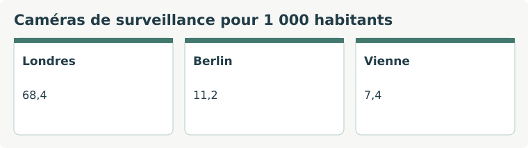
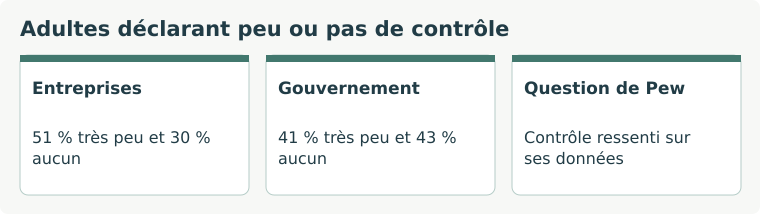
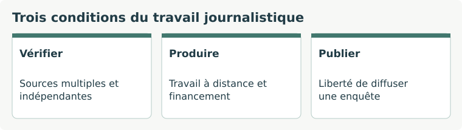
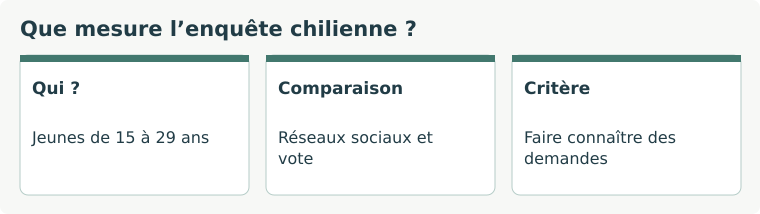
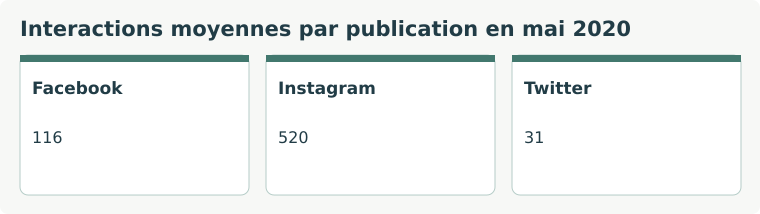

# Banque PT — Langue vivante A 2022 · Corrigé brut

*Corrigé rédigé par IA, non officiel.*

**Rédaction** · GPT-6.2 Astra Ultra · vitesse non renseignée

L’épreuve dure trois heures. Chaque candidat compose dans la langue choisie à l’inscription. Ce fascicule présente les cinq synthèses de 450 à 500 mots. Le décompte indiqué inclut le titre.

## Allemand

*Überwachung und Sicherheit: eine Gefahr für Datenschutz und Privatsphäre?*

**Wer schützt uns vor den Folgen des Schutzes?**

Eine Kamera im öffentlichen Raum, ein Sprachassistent in der Wohnung und das Erkennungssystem eines Zukunftsromans haben zunächst wenig miteinander gemein. Alle drei verändern jedoch das Verhältnis zwischen dem Menschen, der beobachtet wird, und der Instanz, die etwas über ihn erfährt. Ob Überwachung tatsächlich Sicherheit schafft oder den Datenschutz und die Privatsphäre gefährdet, hängt nicht allein von der eingesetzten Technik ab. Entscheidend ist auch, wer ihre Zwecke festlegt und ob sich die Betroffenen ihr entziehen können.

Der in der Zeit besprochene Roman führt diese Frage an einem extremen Beispiel vor. Menschen leben geschützt in einem riesigen Labor und wissen kaum, was mit der Außenwelt geschehen ist. Ein visuelles System beobachtet ihre Arbeit fast überall. Sicherheit und Abhängigkeit fallen hier zusammen, denn dieselbe Einrichtung, die den Bewohnern Schutz bietet, bestimmt auch die Bedingungen ihres Lebens. Dass der Programmierer Syz gelegentlich eigene Wege gehen kann, macht die Herrschaft des Systems eher undurchsichtiger. Eine gewährte Ausnahme ist etwas anderes als ein verlässlich geschützter privater Raum.

Die Österreichische Akademie der Wissenschaften untersucht vergleichbare Spannungen in demokratischen Gesellschaften. Nach den Anschlägen zu Beginn des Jahrhunderts stieg die Bereitschaft, zahlreiche Bereiche des Lebens als Sicherheitsfragen zu behandeln. Wer mehr Überwachung fordert, müsste jedoch erklären können, welche Gefahr eine Maßnahme vermindert und welche neuen Abhängigkeiten sie schafft. Das Städteranking zeigt für London 68,4 Kameras je tausend Einwohner, für Berlin 11,2 und für Wien 7,4. Die Dichte fällt also sehr unterschiedlich aus. Die Zahlen sagen weder, wie sicher die Bewohner sich fühlen, noch, ob mehr Kameras eine bestimmte Straftat verhindert haben.

Auch ohne staatlichen Zwang geben Menschen Einblick in ihren Alltag. Der Psychologe Gerd Gigerenzer bezweifelt, ob der Komfort ständig vernetzter Haushaltsgeräte das zusätzliche Risiko rechtfertigt. Nutzer können eine einzelne Dienstleistung wünschen, ohne zu überblicken, wie viele Informationen dabei zusammenkommen. Das Bild zum Datendiebstahl zeigt Hände an einer Tastatur vor einem Bildschirm voller Ziffern. Der begleitende Titel stellt einen jungen Täter mächtigen Behörden gegenüber. Damit stellt sich die Sicherheitsfrage ein zweites Mal. Daten, die zum Schutz oder aus Bequemlichkeit gesammelt werden, können ihrerseits unzureichend geschützt sein.

Freiheit besteht für die Akademie auch darin, sich eine Meinung zu bilden und Entscheidungen ohne unerwünschte Einflussnahme zu treffen. Wer sich ständig beobachtet glaubt, könnte sein Verhalten ändern, lange bevor tatsächlich jemand eingreift. Zugleich erklärt Gigerenzer, warum Bürger Kontrolle unter Umständen begrüßen, wenn sie sich davon beispielsweise weniger Korruption versprechen. Das Bedürfnis nach Sicherheit ist also ernst zu nehmen. Gerade deshalb muss beurteilt werden, welchen konkreten Schutz eine Maßnahme bietet, wer Zugang zu den gewonnenen Daten erhält und welcher Raum für unbeobachtete Entscheidungen bleibt. Diese Fragen lassen sich weder durch ein Sicherheitsversprechen noch durch die bloße Zahl installierter Geräte beantworten. Sie betreffen gleichermaßen die politische Verantwortung und die Entscheidungen im privaten Alltag.

**(457 Wörter, einschließlich Titel)**

## Anglais

*How is control exerted by the various actors of the American surveillance society?*

**Who watches whom in America?**

In a photograph of a House hearing, Mark Zuckerberg appears on a screen before lawmakers while cameras record the proceedings. The executive whose company observes users is himself being observed and questioned. Yet a public hearing does not give those users direct control over their information. The documents trace an American system in which governments, companies and individuals exercise very different kinds of power, sometimes cooperating and sometimes seeking protection from one another.

State surveillance expanded rapidly after the attacks of September 2001. Wired describes how security fears shifted the boundaries of political agreement. Measures that had previously seemed an unacceptable intrusion into private communications could now be presented as necessary to prevent another attack. Monitoring calls or electronic activity promised the authorities access to clues that might otherwise be missed. The urgency of that promise made it difficult to examine what powers would survive the immediate crisis. Consent to a particular security goal did not necessarily amount to informed support for every means proposed to reach it.

Commercial observation developed through a different bargain. In the comparison with Orwell’s novel, devices that people choose to bring into their lives can gather information a fictional state would have struggled to obtain. Companies have financial reasons to learn about users, predict what will attract their attention and shape the choices placed before them. People contribute through ordinary participation in services they value. This voluntary aspect complicates the analogy with a compulsory telescreen. It does not settle whether a customer understands or can realistically refuse the full terms of observation.

The Snowden disclosures also complicate the idea of a single alliance between Washington and Silicon Valley. The New York Times recounts that intelligence agencies had obtained information from major American companies’ systems without the companies’ knowledge. Executives viewed this as a betrayal, and customers feared that communications entrusted to private services could reach the government. The subsequent adoption of stronger encryption helped protect communications while intensifying disputes over access. Meanwhile, the photograph of Zuckerberg testifying shows legislators claiming a supervisory role over corporate power. Being questioned in public and being constrained in practice remain separate matters.

The Pew survey provides a way to gauge the position of the people at the centre of these exchanges. About four in five adults surveyed felt they had very little or no control over data collected by companies, and a similarly large majority said so about government data. The answers measure perceived control, not the amount of information held or a personal preference for either collector. Americans may welcome a useful service, demand protection from threats and object to how both are delivered. Their limited ability to follow data across institutions helps explain why the question of accountability outlasts any single scandal or congressional hearing.

**(464 words, title included)**

## Arabe

*ما هو حال الصحافة العربية ومآلها زمن جائحة كورونا؟*

**صحافة تصل إلى القارئ من بعيد وتكافح لتحافظ على استقلالها**

في الوقت الذي احتاج فيه الناس إلى معلومات دقيقة عن وباء مستجد، وجد الصحفيون أنفسهم أبعد من المعتاد عن مصادرهم وزملائهم وقرائهم. وكان على الصحافة العربية أن تواجه أزمة صحية وأزمة في تمويل الصحف الورقية، وأن تدافع في الوقت نفسه عن حقها في السؤال والتحقق. وقد أتاح النشر الإلكتروني استمرار العمل في ظروف الاستغلاق، لكنه لم يجب بمفرده عن سؤالين مختلفين، من يمول إنتاج المعلومة ومن يملك حرية نشرها؟

أعطت سرعة انتشار الأخبار على شبكات التواصل للمؤسسات الصحفية دورا ضروريا في التمييز بين المعرفة الموثوقة والشائعة. فالقارئ القلق قد يتلقى في ساعات روايات متعارضة تتداولها حسابات كثيرة من غير أن يكون تعددها دليلا على صحتها. وتوضح المقالات أن المهنية تتطلب العودة إلى المصادر والتحقق مما يمكن إثباته والاعتراف بحدود ما هو معروف. غير أن بعض السلطات اتخذ من مكافحة الأخبار الزائفة مبررا لتضييق مجال العمل الصحفي. وحين تصبح الرواية الرسمية هي الوحيدة المتاحة يصعب على الصحفي أن يؤدي الوظيفة التي يحتاج إليها الجمهور أصلا، أي التحقق بواسطة مصادر مستقلة.

كما تغيرت طريقة إنتاج الخبر قبل نشره. فاجتماع المحررين في القاعة نفسها والانتقال إلى موقع الحدث لم يعودا ممكنين بالسهولة المألوفة. واستعملت بعض الفرق تطبيقات المراسلة لتنظيم الاجتماعات وتبادل المواد عن بعد. وقد حافظ ذلك على الصلة بين الزملاء وأتاح مواصلة النشر من دون تعريض الجميع للمخالطة المباشرة. لكنه لا يعوض كل ما تمنحه المعاينة الميدانية والمقابلة المباشرة من إمكان الاستفسار والمقارنة. ويظهر هنا وجه آخر للتفاوت بين توافر وسيلة الاتصال والقدرة الفعلية على الوصول إلى أخبار متنوعة.

وتكشف الصورة التي تجمع جرائد ملفوفة ورمزا للفيروس وجها اقتصاديا للأزمة. فقد تراجع بيع النسخ الورقية، وعلقت بعض العناوين طبعاتها أو اكتفت بالنسخة الرقمية. ويشير النص المصاحب إلى إمكان خفض التكاليف وإلى دعوة نقابية لدعم الصحف. والانتقال إلى الشاشة قد يوفر نفقات الطباعة والتوزيع، لكنه لا يلغي تكلفة المراسلين والتحرير والتحقق ولا يضمن أن تتحول متابعة الأخبار عبر الإنترنت إلى دخل مستقر. وإذا كانت المؤسسة تعتمد على مساعدات عامة فإن شروط تلك المساعدات تهم استقلالها مثلما يهمها مقدارها.

أما الرسم الذي يقيد ميكروفونا وصحيفة بسلسلة واحدة فيبين أن الضغط على حرية التعبير يتجاوز مسألة الورق. قد تصل الجريدة إلى القارئ بسرعة أكبر وتكون مساحة ما يجوز لها أن تنشره أضيق. لذلك يتوقف مستقبل الصحافة على ما إذا كان التطوير التقني سيصاحبه تمويل يسمح باستمرار العمل وحماية تتيح للصحفي أن يسأل ويصحح وينشر من غير خوف. وقيمة ما ابتكرته غرف الأخبار زمن الجائحة لا تقاس فقط باستمرار تدفق المواد، بل أيضا بقدرة القارئ على الوثوق بمن أنتجها ومعرفة أن روايات أخرى قد اختبرت قبل اختيار ما يقرؤه. ومن هنا يلتقي مطلب الدعم مع مطلب الحرية في نقطة عملية، هي أن يظل في غرفة الأخبار من يملك الوقت والموارد اللازمة لمراجعة المعلومة حتى عندما تتعارض مع توقعات الممول أو تتطلب جهدا أكبر من إعادة نشر بيان جاهز.

**(452 كلمة، بما فيها العنوان)**

## Espagnol

*¿Cómo ser ciudadano/a en un mundo digital en el siglo XXI?*

**De hacerse visible a responder por lo que se difunde**

Un personaje con el rostro cubierto levanta un enorme signo de etiqueta como si fuera a lanzarlo. La imagen convierte el hashtag en un instrumento de intervención pública y deja abierta la cuestión de sus efectos. En las plataformas digitales, un ciudadano puede dar a conocer una injusticia sin esperar a que un periódico la publique. Pero actuar como ciudadano implica también preguntarse de dónde procede una información, a quién alcanza y qué relación guarda la visibilidad obtenida con las decisiones colectivas.

El recorrido de Estíbaliz Feito ilustra la posibilidad de intervenir con los recursos de la vida cotidiana. Sus vídeos breves explican cuestiones feministas en un lenguaje accesible a otros jóvenes. La duración obliga a seleccionar una idea y expresarla con claridad, mientras que el intercambio con los seguidores permite detectar preguntas que quizá no habrían encontrado espacio en un aula o en un informativo. La autora reivindica así la capacidad de los jóvenes para participar ya en el presente. El artículo sobre TikTok muestra que la aplicación ofrece también formas de identificación colectiva mediante sonidos, juegos y respuestas compartidas. Una misma herramienta puede servir para explicar un problema o para indicar a qué grupo se siente próximo un usuario.

Esa posibilidad interesa igualmente a organizaciones y partidos. El uso de formatos lúdicos acerca asuntos políticos a públicos que no buscan un discurso formal, aunque también facilita que la propaganda circule con la apariencia de una diversión entre amigos. El número de reproducciones de un reto indica su difusión, no la profundidad de las opiniones que se han formado los participantes. La encuesta chilena entre jóvenes de quince a veintinueve años plantea otra comparación reveladora. Muchos encuestados consideran las redes más útiles que el voto para dar a conocer demandas. La pregunta se refiere a comunicar esas demandas y no permite concluir que los jóvenes prefieran eliminar las elecciones o que una publicación tenga los efectos jurídicos de un voto.

El texto sobre el quinto poder explica por qué esa diferencia importa. El periodismo ciudadano permite documentar acontecimientos locales, convocar protestas y dar voz a personas excluidas de otros espacios informativos. A la vez, una acusación sin comprobar puede desencadenar una condena pública que se propaga antes de que la persona afectada pueda responder. El gesto ambiguo del personaje que lanza la etiqueta adquiere entonces pleno sentido. El mismo mecanismo que reúne testimonios dispersos puede dirigir una multitud contra un individuo.

La ciudadanía digital combina, pues, acceso a la palabra y responsabilidad por sus consecuencias. Una conversación iniciada en un vídeo puede convertirse en deliberación si los interlocutores verifican lo que comparten, reconocen los intereses que intervienen y distinguen entre expresar una posición y tomar una decisión vinculante. Así, una red amplía los lugares donde se practica la ciudadanía, sin resolver por sí sola los desacuerdos que hacen necesaria la vida democrática.

**(483 palabras, incluido el título)**

## Italien

*Che ruolo hanno gli influencer nel mondo dell’Arte?*

**Quando il primo incontro con un museo avviene sul telefono**

Una fotografia davanti a un capolavoro può raggiungere milioni di persone che quel giorno non avrebbero pensato di andare al museo. La domanda sollevata dal dibattito sugli influencer è che cosa accada dopo quel primo sguardo. Un’immagine condivisa può aprire la strada alla scoperta di una collezione, ma può anche lasciare il visitatore più interessato alla celebrità che all’opera. Il risultato dipende dalle scelte di chi comunica e dagli obiettivi dell’istituzione che gli apre le porte.

L’articolo di Daniele Rocca ricorda che il fenomeno ha precedenti. Una fotografia di Will Smith davanti alla torre di Pisa era stata apprezzata milioni di volte senza suscitare le polemiche nate intorno a Chiara Ferragni. Anche cinema e televisione hanno portato nuovi pubblici in luoghi prima poco frequentati. Il problema diventa perciò strategico. A un sito già celebre può servire relativamente poco un’altra immagine famosa, mentre per una località meno conosciuta la raccomandazione della persona giusta potrebbe fare una differenza considerevole. Non ogni personaggio è adatto a ogni progetto.

L’esperienza dei Musei Vaticani aggiunge l’urgenza economica delle chiusure durante la pandemia. Raggiungere adolescenti e giovani adulti attraverso persone che già seguono offre la possibilità di allargare il pubblico e di mantenere un rapporto quando la visita è difficile. La campagna ministeriale che invita a condividere fotografie dei propri musei preferiti mostra inoltre che anche i visitatori possono farsi mediatori, senza essere celebrità professionali. Le mani disposte a cuore attorno alla parola museo associano il gesto digitale a un legame affettivo con un luogo temporaneamente inaccessibile.

Per misurare questi risultati bisogna però scegliere indicatori pertinenti. Nella tabella relativa a maggio, Facebook conta 2.500 pubblicazioni e Instagram 1.435, mentre le interazioni medie per pubblicazione sono rispettivamente 116 e 520. Pubblicare di più non equivale quindi a ottenere più risposte per ogni contenuto. A sua volta un’interazione non dimostra che l’utente abbia visitato una sala o capito il significato dell’opera. È proprio questo il limite evidenziato dalla critica alla comunicazione degli Uffizi. Una celebrità messa in primo piano davanti a un dipinto può attirare utenti che, una volta passata la curiosità, ricordano soprattutto il suo abito o la sua posa.

Il ruolo dell’influencer può dunque essere quello di un invito, mentre al museo resta il compito di accompagnare concretamente, in sala oppure a distanza, chi accoglie questo invito. A un post possono seguire strumenti per capire il contesto dell’opera, riconoscere dettagli e proseguire la scoperta di altre collezioni. Se il successo viene definito prima della campagna, distinguendo visibilità, partecipazione e conoscenza, il prestigio digitale di una persona può servire il progetto culturale. Altrimenti la collezione rischia di diventare lo sfondo di una pubblicità che non sa dire che cosa abbia fatto conoscere.

**(455 parole, titolo compreso)**

