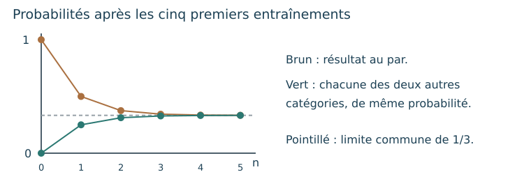

# Banque PT — Mathématiques A · 2022 · Corrigé brut

*Corrigé rédigé par IA, non officiel. Signalez toute erreur.*

**Rédaction** · GPT-6.2 Astra Ultra · vitesse non renseignée

La première partie diagonalise une matrice symétrique. La deuxième l’utilise pour comparer deux produits scalaires. La troisième réemploie ses puissances dans un modèle de probabilités au golf. Les deux dernières parties sont indépendantes l’une de l’autre.

## Première partie · Puissances d’une matrice symétrique

### Question I.1

La matrice $A$ a pour lignes $(5/2,1,1/2)$, $(1,2,1)$ et $(1/2,1,5/2)$. Elle est symétrique réelle. Le théorème spectral la rend diagonalisable sur $\mathbb R$ dans une base orthonormée.

### Question I.2

Comme les sommes des lignes valent $4$, $c=(1,1,1)$ vérifie $Ac=4c$. Le produit par $b=(1,0,-1)$ donne $Ab=2b$. Le vecteur $a=(1,-2,1)$, orthogonal aux deux précédents, vérifie $Aa=a$. Ces trois directions indépendantes remplissent $\mathbb R^3$. Les valeurs propres sont $1,2,4$.

### Question I.3

Les vecteurs de I.2 sont deux à deux orthogonaux, de normes $\sqrt6,\sqrt2,\sqrt3$ pour $a,b,c$. Prenons $e_1=a/\sqrt6$, $e_2=b/\sqrt2$, $e_3=c/\sqrt3$, $P=[e_1\ e_2\ e_3]$, $D=\operatorname{diag}(1,2,4)$. Alors $P^TP=I$, $AP=PD$ et $A=PDP^{-1}$. Les trois premières coordonnées sont strictement positives, comme demandé.

### Question I.4

Pour $n=0$, $A^0=I=PI P^{-1}=PD^0P^{-1}$. Si $A^n=PD^nP^{-1}$, alors $A^{n+1}=PD^n(P^{-1}P)DP^{-1}=PD^{n+1}P^{-1}$. La récurrence établit la formule pour tout $n\ge0$.

### Question I.5

Avec $h=2^n$, $k=4^n$, on a $A^n=aa^T/6+h\,bb^T/2+k\,cc^T/3$. En calculant les neuf coefficients de cette somme, on obtient
$$
A^n=\frac16\begin{pmatrix}
1+3h+2k&-2+2k&1-3h+2k\\
-2+2k&4+2k&-2+2k\\
1-3h+2k&-2+2k&1+3h+2k
\end{pmatrix}.
$$
Pour $n=0$ elle redonne bien l’identité.

### Question I.6

Dans $A'=P'D'P'^{-1}=P'D'P'^T$, la matrice $D'$ est diagonale réelle et donc symétrique. Par transposition, $A'^T=P'D'^TP'^T=A'$. Ainsi $A'$ est symétrique.

## Deuxième partie · Deux produits scalaires sur le même espace

### Question II.1.a

Le produit $U^TAV$ est une matrice réelle de taille $1\times1$, identifiée à un scalaire. Il dépend linéairement de $V$ par distributivité et homogénéité du produit matriciel. Sa transposée vaut $V^TA^TU=V^TAU$. Par conséquent $\varphi(u,v)=\varphi(v,u)$, ce qui donne aussi la linéarité dans le premier argument.

### Question II.1.b

$U'=P^TU=P^{-1}U$ est la colonne des coordonnées de $u$ dans la base orthonormée propre $(a/\sqrt6,b/\sqrt2,c/\sqrt3)$, dans cet ordre. Ainsi $u=x'e_1+y'e_2+z'e_3$.

### Question II.1.c

On a $\varphi(u,u)=(U')^TP^TAPU'=(U')^TDU'=(x')^2+2(y')^2+4(z')^2$.

### Question II.1.d

La forme est bilinéaire et symétrique par II.1.a. La somme pondérée de II.1.c est positive ou nulle. Tous les poids étant strictement positifs, elle s’annule exactement lorsque $x'=y'=z'=0$, donc lorsque $u=0$. C’est un produit scalaire.

### Question II.2.a

Pour $f(u)=\lambda u$ et $f(v)=\mu v$ avec $\lambda\ne\mu$, la symétrie de $A$ donne $(\lambda-\mu)\langle u,v\rangle=0$. Il s’ensuit que $\varphi(u,v)=\langle u,f(v)\rangle=\mu\langle u,v\rangle=0$, l’orthogonalité demandée.

### Question II.2.b

Les vecteurs unitaires usuels $e_i$ de I.3 sont orthogonaux pour $\varphi$ et vérifient $\varphi(e_i,e_i)=\lambda_i$. On obtient pour base $\varphi$-orthonormée $(e_1,e_2/\sqrt2,e_3/2)$, soit $(a/\sqrt6,b/2,c/(2\sqrt3))$.

### Question II.3

Si $f(u)=\lambda u$, alors pour tout $v$, $\varphi(u,v)=\langle f(u),v\rangle=\lambda\langle u,v\rangle$. Or $\lambda\in\{1,2,4\}$ est non nul. Les deux formes en $v$ ont donc le même noyau, d’où $F_u=F'_u$.

### Question II.4.a

Pour $v=(x,y,z)$, $\langle i,v\rangle=x$. Le plan $F_i$ est $x=0$, avec pour base $(j,k)$.

### Question II.4.b

$\varphi(i,v)=(5x+2y+z)/2$. Le plan $F'_i$ a pour équation $z=-5x-2y$. Les deux vecteurs $(1,0,-5)$ et $(0,1,-2)$ sont indépendants et en engendrent tous les éléments. Ils forment une base.

### Question II.4.c

$j\in F_i$ mais $\varphi(i,j)=1\ne0$, donc $F_i\ne F'_i$. Leur intersection vérifie $x=0$, $2y+z=0$. Une base en est le vecteur $(0,1,-2)$.

### Question II.5.a

Si $v\in F'_u$, on a $0=\varphi(u,v)=\langle u,f(v)\rangle$. Cela signifie exactement $f(v)\in F_u$.

### Question II.5.b

Notant $V,W$ les colonnes de $v,w$, $\langle f(v),w\rangle=(AV)^TW=V^TA^TW=V^TAW=\langle v,f(w)\rangle$.

### Question II.6.a

Sous l’hypothèse $F_u=F'_u$, II.5.a montre $f(F_u)\subset F_u$. Les valeurs propres de $A$ sont toutes non nulles, donc $f$ est injectif et $\dim f(F_u)=\dim F_u$. L’inclusion est donc une égalité.

### Question II.6.b

Pour $v\in F_u$, $\langle f(u),v\rangle=\langle u,f(v)\rangle=0$ puisque $f(v)\in F_u$. Ainsi $f(u)\in(F_u)^\perp=\mathbb Ru$. Comme $u\ne0$, cette colinéarité établit que $u$ est un vecteur propre.

## Troisième partie · Jouons au golf

### Question III.1.a

On a $\mathbb P(X=1)=1/3$, $\mathbb P(X=2)=(2/3)(1/2)=1/3$ et $\mathbb P(X=3)=(2/3)(1/2)\cdot1=1/3$. Le support est $\{1,2,3\}$ et la loi y est uniforme.

### Question III.1.b

$\mathbb E X=(1+2+3)/3=2$ et $\mathbb E X^2=(1+4+9)/3=14/3$. Donc $\operatorname{Var}(X)=14/3-4=2/3$.

### Question III.2.a

Il y a $2\times18=36$ tirages. Chaque tirage uniforme avec remise et nouveau choix indépendant donne une balle jaune avec probabilité $4/48=1/12$. $J$ compte les succès des 36 essais et suit donc une loi binomiale de paramètres $36,1/12$. Son support est $\{0,\ldots,36\}$. Pour chacun de ces entiers, $\mathbb P(J=k)=\binom{36}{k}(1/12)^k(11/12)^{36-k}$.

### Question III.2.b

La moyenne est $\mathbb E J=36/12=3$ balles jaunes tirées pendant les deux parcours.

### Question III.3.a

Comme $\mathbb E J'=\lambda$ et $\mathbb E J=3$, il faut et il suffit de prendre $\lambda=3$.

### Question III.3.b

La loi de Poisson donne $\mathbb P(J'=9)=e^{-3}3^9/9!$ et $\mathbb P(J'\ge1)=1-\mathbb P(J'=0)=1-e^{-3}$.

### Question III.3.c

En utilisant l’approximation admise et le tableau imprimé, $\mathbb P(J\le3)\simeq F(3)=0{,}6472$. Pour exactement sept, $\mathbb P(J=7)\simeq F(7)-F(6)=0{,}9881-0{,}9665=0{,}0216$. Enfin $\mathbb P(J\ge10)\simeq1-F(9)=1-0{,}9989=0{,}0011$.

### Question III.4.a

D’après les transitions depuis l’état $B_0$ de probabilité un, $(a_1,b_1,c_1)=(1/4,1/2,1/4)$.

### Question III.4.b

Après un résultat au-dessous du par, Anthony y reste avec probabilité $5/8$. Après un par, il passe au-dessous avec probabilité $1/4$. Après un résultat au-dessus, il passe au-dessous avec probabilité $1/8$. Ce sont respectivement $\mathbb P(A_{n+1}\mid A_n)$, $\mathbb P(A_{n+1}\mid B_n)$ et $\mathbb P(A_{n+1}\mid C_n)$, comprises comme transitions du modèle lorsque l’état initial est imposé.

### Question III.4.c

La formule des probabilités totales appliquée aux états $A_n,B_n,C_n$ donne $a_{n+1}=(5/8)a_n+(1/4)b_n+(1/8)c_n$. Un état de probabilité nulle apporte un terme nul.

### Question III.4.d

On obtient $b_{n+1}=(1/4)a_n+(1/2)b_n+(1/4)c_n$ et $c_{n+1}=(1/8)a_n+(1/4)b_n+(5/8)c_n$.

### Question III.4.e

En notant $G_n=(a_n,b_n,c_n)^T$, la matrice des transitions agissant sur cette colonne est $A/4$. D’où $G_{n+1}=(A/4)G_n$.

### Question III.4.f

Ces commandes Python conservent des valeurs rationnelles exactes pendant le calcul.

```python
from fractions import Fraction

a, b, c = Fraction(0), Fraction(1), Fraction(0)
for tour in range(20):
    a, b, c = (5*a + 2*b + c)/8, (a + 2*b + c)/4, (a + 2*b + 5*c)/8
print(b)
```

La sortie est la fraction $183251937963/549755813888$, soit environ $0{,}333333333334$.

### Question III.4.g

Pour tout $n\ge0$, $G_n=(A/4)^nG_0=4^{-n}A^nG_0$ avec $G_0=(0,1,0)^T$.

### Question III.4.h

En reprenant I.5 et en divisant sa deuxième colonne par $4^n$, on trouve $a_n=c_n=(1-4^{-n})/3$ et $b_n=(1+2\cdot4^{-n})/3$. À $n=0$ on retrouve exactement $(0,1,0)$.


### Question III.4.i

Comme $4^{-n}\to0$, les trois probabilités tendent vers $1/3$. Pour un entraînement d’indice de plus en plus élevé, les trois catégories de résultat deviennent équiprobables dans le modèle.

### Question III.5.a

Le numérateur obtenu est $(a+b)x+a$. Pour qu’il soit identiquement égal à un, il faut $a=1$ et $a+b=0$, soit $b=-1$. Ainsi $1/[x(x+1)]=1/x-1/(x+1)$ pour $x\ne0,-1$.

### Question III.5.b

Pour $n\ge1$, $\{T=n\}=\bigcap_{j=1}^{n-1} S_j^c\cap S_n$. Pour $n=1$, il n’y a aucun échec préalable et cet événement est simplement $S_1$.

### Question III.5.c

Au rang $j$, après les échecs précédents, la probabilité d’échec vaut $j/(j+1)$, y compris en $j=1$. Ainsi, pour $n\ge2$,
$$
\mathbb P(T=n)=\left(\prod_{j=1}^{n-1}\frac j{j+1}\right)\frac1{n+1}=\frac1{n(n+1)}.
$$
Pour $n=1$, le membre droit vaut $1/2=p_1$. La formule reste valable.

### Question III.5.d

Le succès en une heure ou moins est $\{1\le T\le20\}$. Par télescopage, sa probabilité vaut $\sum_{n=1}^{20}(1/n-1/(n+1))=1-1/21=20/21$.

### Question III.5.e

Après $m$ tentatives, la probabilité d’avoir échoué à toutes vaut $\prod_{j=1}^m j/(j+1)=1/(m+1)$. Par continuité décroissante des probabilités, $\mathbb P(T=0)=\lim_{m\to\infty}1/(m+1)=0$.

### Question III.5.f.i

Le terme constant est nul et $G_T(x)=\sum_{n\ge1}x^n/[n(n+1)]$. Le rapport des modules de deux termes consécutifs pour $x\ne0$ tend vers $|x|$ car $n/(n+2)\to1$. La série converge absolument pour $|x|<1$ et diverge pour $|x|>1$. Son rayon vaut donc $1$. Elle converge également absolument en $x=\pm1$.

### Question III.5.f.ii

Sur $0<|x|<1$, $\sum_{n\ge1}x^n/n=-\ln(1-x)$ et $\sum_{n\ge1}x^n/(n+1)=[-\ln(1-x)-x]/x$. Par différence, $G_T(x)=1+[(1-x)/x]\ln(1-x)$. On a $G_T(0)=0$, $G_T(1)=1$, $G_T(-1)=1-2\ln2$. Ces valeurs concordent avec le prolongement continu de la formule, par convergence uniforme sur $[-1,1]$.

### Question III.5.g

Comme $T\ge0$, son espérance étendue vaut $\sum_{n\ge1} n/[n(n+1)]=\sum_{n\ge1}1/(n+1)=+\infty$. Elle n’admet donc pas d’espérance finie, bien que le succès ait lieu presque sûrement.

## Sources et rapport du jury

Le rapport p. 2 demande de montrer les calculs intermédiaires de la puissance matricielle. Aux p. 3–4, il distingue les deux normes dans la construction d’une base orthonormée. Les p. 5–6 précisent la quantité à afficher en Python et le rôle des probabilités conditionnelles dans le dernier exercice.

[Énoncé de la Banque PT](https://www.banquept.fr/documents/2022/math_a_2022_pt.pdf) · [Rapport du jury](https://www.banquept.fr/documents/ecrit/rapport/2022/rapport_math_a_ecrit_2022.pdf)
