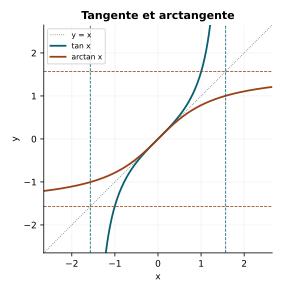
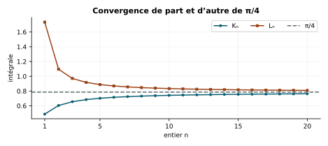

# Banque PT — Mathématiques C · Session 2022 · Corrigé guidé

*Corrigé rédigé par IA, non officiel. Signalez toute erreur.*

**Rédaction** · GPT-6.2 Astra Ultra · vitesse non renseignée

Le préambule fixe les branches de tangente et d’arctangente. Les quatre parties traitent de convergence impropre, de séries entières, d’un équivalent intégral et des nombres de Bernoulli.

Écrit de quatre heures, sans calculatrice. Une feuille de papier millimétré est à rendre avec la copie. La grille d’admissibilité donne le coefficient 6 pour l’École polytechnique et 3 pour chacune des ENS Paris-Saclay et Rennes. [Sujet](https://www.banquept.fr/documents/2022/math_c_2022_pt.pdf) · [Grille, p. 13](https://www.banquept.fr/documents/livret/2022/Livret_PT_2022.pdf#page=13)

Le rapport, pages 5–6 et 10–12, souligne la justification des changements de variable, la positivité stricte de la constante dans l’équivalent et l’identification des coefficients par unicité. [Rapport du jury](https://www.banquept.fr/documents/ecrit/rapport/2022/rapport_math_c_ecrit_2022.pdf)

## Repères de lecture

- La cotangente se prolonge en π/2 et sert de changement de variable sur tout l’intervalle ouvert.
- Pour prouver l’annulation des coefficients pairs, considérez la somme de deux indices impaire.
- Dans la troisième partie, le sens des inégalités de puissances dépend de la position de la base par rapport à 1.

## Préambule. Tangente et arctangente

### Question P.1

> [!INDICATION]
> Identifier les zéros du cosinus, puis se restreindre à la branche centrale.

#### Solution

La tangente est définie sur $\mathbb R\setminus\{\pi/2+k\pi:k\in\mathbb Z\}$. Elle est impaire et $\tan'=1/\cos^2=1+\tan^2$. Sur la branche centrale,
$$
\begin{array}{c|ccc}x&-\pi/2&&\pi/2\\\hline
\tan'(x)&&+&\\\tan x&-\infty&\nearrow&+\infty\end{array}.
$$
Les deux valeurs infinies sont les limites intérieures aux bornes.

### Question P.2

> [!INDICATION]
> Donner les hypothèses du théorème de la bijection monotone.

#### Solution

Une fonction continue strictement monotone sur un intervalle le met en bijection avec son image, un intervalle délimité par les valeurs ou limites aux extrémités. La tangente est continue et strictement croissante sur $]-\pi/2,\pi/2[$ et ses limites y sont $-\infty,+\infty$. Son image est $\mathbb R$. Sa réciproque $\arctan$ est donc définie sur $\mathbb R$, à valeurs dans cette branche, et $\arctan'(x)=1/(1+x^2)$.

### Question P.3

> [!INDICATION]
> La réciproque conserve l’ordre de deux images.

#### Solution

Si $u<v$, la stricte croissance de la bijection tangente impose $\arctan u<\arctan v$. On retrouve cette stricte croissance sur $\mathbb R$ car $1/(1+x^2)>0$. Les limites en $-\infty$ et $+\infty$ sont respectivement $-\pi/2$ et $\pi/2$.

### Question P.4

> [!INDICATION]
> Construire une courbe par réflexion de l’autre en gardant les mêmes unités.

#### Solution

La première courbe croît entre les asymptotes verticales $x=\pm\pi/2$ et passe par $(0,0)$ avec pente 1. Sa réflexion par rapport à $y=x$ échange chaque point $(x,\tan x)$ avec $(\tan x,x)$, donc dessine $y=\arctan x$, qui admet les asymptotes horizontales $y=\pm\pi/2$. Les points $(\pi/4,1)$ et $(1,\pi/4)$ contrôlent le dessin. La planche d’impression conserve 2 cm par unité sur chaque axe.

Pour reproduire l’échelle du sujet, ouvrez le fichier SVG, puis imprimez en A4 paysage à 100 %, sans ajustement, sans marges et sans en-têtes de navigateur. Vérifiez à la règle que deux graduations entières successives sont distantes de 2 cm. [Télécharger la planche à l’échelle](https://raw.githubusercontent.com/knoel99/corriges-concours/9ff54cac1631b8c479f3ae657dbb042bbc41edc5/2022/banque-pt/banque-pt_pt_maths-c_2022/planches/trace-echelle.svg)

### Question P.5

> [!INDICATION]
> Réduire les deux termes au dénominateur sinus carré.

#### Solution

Sur les deux intervalles indiqués où les expressions sont définies, $1+1/\tan^2t=(\sin^2t+\cos^2t)/\sin^2t=1/\sin^2t$.

## I. Convergence d’une intégrale à oscillations

### Question I.1.a

> [!INDICATION]
> Choisir un majorant valable aux deux infinis.

#### Solution

Pour $x$ fixé, $t\mapsto(1+x^2+t^2)^{-1}$ est continue sur $\mathbb R$, positive et majorée par $1/t^2$ pour $|t|\ge1$. L’intégrale $F(x)$ converge donc absolument.

### Question I.1.b

> [!INDICATION]
> Utiliser la primitive obtenue dans le préambule.

#### Solution

Puisque $F(0)=\int_{-\infty}^\infty dt/(1+t^2)$, la primitive $\arctan t$ et ses limites donnent $F(0)=\pi$.

### Question I.1.c

> [!INDICATION]
> Ramener le dénominateur à celui du cas x nul.

#### Solution

Posons $b=\sqrt{1+x^2}>0$ et $t=bu$. Les bornes infinies gardent leurs signes et $F(x)=b^{-1}\int_{-\infty}^{\infty}du/(1+u^2)=\pi/\sqrt{1+x^2}$.

### Question I.2.a

> [!INDICATION]
> Distinguer l’exposant nul avant d’utiliser un équivalent.

#### Solution

Pour $\alpha=0$, $u_n=\pi/\sqrt2$ et la série diverge. Si $\alpha>0$, $u_n=\pi/\sqrt{1+(n\pi)^\alpha}\sim\pi^{1-\alpha/2}n^{-\alpha/2}$. Les termes sont positifs, donc la comparaison aux séries de Riemann donne la convergence exactement pour $\alpha>2$.

### Question I.2.b

> [!INDICATION]
> Garder le sinus et comparer seulement la puissance de t sur chaque période.

#### Solution

Pour $n\pi\le t\le(n+1)\pi$, $(n\pi)^\alpha\le t^\alpha\le((n+1)\pi)^\alpha$. Multiplier par $\sin^2t\ge0$, ajouter 1 puis inverser renverse l’ordre. En intégrant et en posant $s=t-n\pi$ dans les intégrales extrêmes, $\sin^2t=\sin^2s$ donne $I_{n+1}\le J_n\le I_n$.

### Question I.2.c

> [!INDICATION]
> Utiliser la cotangente comme fonction régulière aussi au point π/2.

#### Solution

Écrivons $u=\cot t=\cos t/\sin t$. Elle est $C^1$ strictement décroissante de $]0,\pi[$ sur $\mathbb R$, avec limites $+\infty,-\infty$ et dérivée $-1/\sin^2t=-(1+u^2)$. La notation $1/\tan t$ donnée dans la question se prolonge ainsi par zéro en $\pi/2$. Posons $A=(n\pi)^\alpha$. Sur des segments tronqués, $dt=-du/(1+u^2)$ et $\sin^2t=1/(1+u^2)$. Passant aux limites grâce à I.1.a, on obtient
$$
I_n=\int_{-\infty}^{\infty}\frac{du}{1+A+u^2}=F((n\pi)^{\alpha/2}).
$$

### Question I.2.d

> [!INDICATION]
> Évaluer directement l’encadrement précédent.

#### Solution

Les questions I.1.c et I.2.c donnent $I_n=\pi/\sqrt{1+(n\pi)^\alpha}=u_n$. I.2.b devient donc $u_{n+1}\le J_n\le u_n$.

### Question I.2.e

> [!INDICATION]
> Relier la convergence d’une intégrale positive à la somme de ses blocs.

#### Solution

Sur $[0,\pi]$, l’intégrande est borné par 1 et se prolonge continûment en zéro pour $\alpha\ge0$. Sur la suite des intervalles suivants, la somme des intégrales $J_n$ converge exactement quand $\sum u_n$ converge par I.2.d. Puisque l’intégrande est positive, ses intégrales tronquées croissent et leur limite est la même qu’aux bornes $N\pi$. L’intégrale impropre converge donc si et seulement si $\alpha>2$.

## II. Série entière d’une solution de Riccati

### Question II.1.a

> [!INDICATION]
> Pour un même degré, toutes les paires d’indices ont une somme fixée.

#### Solution

Pour $|x|<R$, les deux séries convergent absolument. Le produit de Cauchy donne $f(x)g(x)=\sum_{n\ge0}c_n x^n$, avec $c_n=\sum_{k=0}^n a_k b_{n-k}$. Le rayon du produit est au moins $R$ et peut être plus grand en cas de compensations.

### Question II.1.b

> [!INDICATION]
> Prendre deux fois la même série.

#### Solution

On obtient $f(x)^2=\sum_{n\ge0}(\sum_{k=0}^n a_k a_{n-k})x^n$ pour $|x|<R$.

### Question II.2.a

> [!INDICATION]
> Identifier le coefficient constant séparément.

#### Solution

L’hypothèse $f(0)=0$ donne $a_0=0$. Dans $f'=1+f^2$, la dérivation terme à terme et l’unicité des coefficients donnent $a_1=1+a_0^2=1$ et, pour $n\ge1$,
$$
(n+1)a_{n+1}=\sum_{k=0}^n a_k a_{n-k}.
$$
On peut réunir les deux cas en ajoutant $\mathbf 1_{n=0}$ à la somme.

### Question II.2.b

> [!INDICATION]
> Dans une somme de deux indices impaire, l’un des indices est pair.

#### Solution

On a déjà $a_0=0$. Supposons $a_{2j}=0$ pour $0\le j\le p$. Appliquons la récurrence en $n=2p+1$. Pour chaque $k$, l’un des indices $k,2p+1-k$ est pair et au plus $2p$, donc le produit est nul. Il suit $a_{2p+2}=0$, ce qui conclut par récurrence forte. La série ne comporte que des puissances impaires et $f(-x)=-f(x)$.

### Question II.2.c

> [!INDICATION]
> Écrire la convolution pour les degrés deux, quatre et six.

#### Solution

L’équation en zéro donne $f'(0)=1$, donc $a_1=1$. En supprimant les termes pairs dans la récurrence, on obtient $3a_3=a_1^2=1$, $5a_5=2a_1a_3=2/3$, puis $7a_7=2a_1a_5+a_3^2=4/15+1/9=17/45$. Ainsi $a_3=1/3$, $a_5=2/15$, $a_7=17/315$.

### Question II.2.d

> [!INDICATION]
> Appliquer la même récurrence à la tangente en vérifiant sa valeur initiale.

#### Solution

Pour $x\to0$,
$$
f(x)=x+\frac{x^3}{3}+\frac{2x^5}{15}+\frac{17x^7}{315}+o(x^7).
$$
La tangente s’annule en zéro, vérifie $\tan'=1+\tan^2$ et possède la série entière admise dans le sujet. Ses coefficients sont donc donnés par les mêmes conditions initiales et la même récurrence. Elle a ce même développement limité.

## III. Puissances fractionnaires de la tangente

### Question III.1.a

> [!INDICATION]
> Comparer à une puissance intégrable de part et d’autre de 1.

#### Solution

La fonction $u^{2n}/(1+u^{4n})$ est continue en zéro et majorée par $u^{2n}$ sur $[0,1]$. Pour $u\ge1$, elle est majorée par $u^{-2n}$, intégrable à l’infini pour $n\ge1$. Donc $H_n$ converge.

### Question III.1.b

> [!INDICATION]
> Calculer exactement l’intégrale avant la limite.

#### Solution

On a $\int_0^1 u^{2n}du=1/(2n+1)\to0$.

### Question III.1.c

> [!INDICATION]
> Utiliser une comparaison qui dépend utilement du rang.

#### Solution

Sur $[1,+\infty[$,
$$
0\le\int_1^\infty\frac{u^{2n}}{1+u^{4n}}du\le\int_1^\infty u^{-2n}du=\frac1{2n-1}\longrightarrow0 .
$$

### Question III.1.d

> [!INDICATION]
> Additionner les deux contrôles positifs.

#### Solution

La partie de $H_n$ sur $[0,1]$ est au plus $1/(2n+1)$ par III.1.a–b. Celle sur $[1,+\infty[$ tend vers zéro par III.1.c. Ainsi $H_n\to0$.

### Question III.2.a

> [!INDICATION]
> Fixer l’entier n et utiliser la définition de la racine.

#### Solution

Pour $x>0$, $x^{1/(2n)}=\exp((\log x)/(2n))$. À $n\ge1$ fixé, l’exposant tend vers $-\infty$ quand $x\to0^+$. La limite est zéro.

### Question III.2.b

> [!INDICATION]
> Le point problématique du second intervalle est la borne droite.

#### Solution

L’intégrande $(\tan x)^{1/(2n)}$ se prolonge par zéro en zéro et est continue sur $[0,\pi/4]$, donc $K_n$ converge. Pour $x\uparrow\pi/2$, avec $h=\pi/2-x$, on a $\tan x=1/\tan h\sim1/h$. L’intégrande est donc équivalente à $h^{-1/(2n)}$, intégrable en zéro car $1/(2n)<1$. Le reste du segment est régulier. Donc $L_n$ converge.

### Question III.2.c

> [!INDICATION]
> Comparer les puissances d’une base comprise entre zéro et un.

#### Solution

Sur $]0,\pi/4[$, $0<\tan x<1$. L’exposant $1/(2n)$ décroît avec $n$, donc la puissance croît strictement et reste inférieure à 1. L’intégration donne $0<K_n<K_{n+1}\le\pi/4$.

### Question III.2.d

> [!INDICATION]
> Après π/4, la base est supérieure à un.

#### Solution

Sur $]\pi/4,\pi/2[$, $\tan x>1$. La diminution de l’exposant rend l’intégrande strictement décroissante en $n$. Les intégrales existent et l’inégalité est stricte sur tout intervalle compact intérieur de longueur positive, donc $L_{n+1}<L_n$.

### Question III.2.e

> [!INDICATION]
> Intégrer une borne constante.

#### Solution

Sur $[\pi/4,\pi/2[$, $(\tan x)^{1/(2n)}\ge1$. L’intégrale sur cet intervalle est au moins sa longueur, $\pi/4$.

### Question III.2.f

> [!INDICATION]
> Utiliser la monotonie des deux suites et conserver une borne positive.

#### Solution

La suite $L_n$ est décroissante et minorée par $\pi/4$, donc converge vers $L\ge\pi/4$. La suite $K_n$ est croissante et majorée par $\pi/4$, donc converge vers $K\ge0$. Alors $\lim(K_n+L_n)=K+L\ge\pi/4$.

### Question III.3.a

> [!INDICATION]
> Transformer la racine et le différentiel dans le même changement de variable.

#### Solution

Posons $u=(\tan x)^{1/(2n)}$, bijection $C^1$ croissante de $]0,\pi/2[$ sur $]0,+\infty[$, de réciproque $x=\arctan(u^{2n})$. Sur un intervalle tronqué on a $dx=2nu^{2n-1}du/(1+u^{4n})$ et l’intégrande vaut $u$. Après réunion des deux segments en $\pi/4$ et passage aux bornes grâce aux convergences prouvées, $K_n+L_n=2n\int_0^\infty u^{2n}/(1+u^{4n})du=2nH_n$.

### Question III.3.b

> [!INDICATION]
> Pour parler d’équivalent, vérifier que la limite du produit par n est non nulle.

#### Solution

On a $nH_n=(K_n+L_n)/2\to H=(K+L)/2\ge\pi/8>0$, donc $H_n\sim H/n$. On peut aussi identifier la constante. Pour $0<x<\pi/2$, $(\tan x)^{1/(2n)}\to1$. Le majorant $1$ sur la première moitié et $(\tan x)^{1/2}$ sur la seconde est intégrable par III.2.b en $n=1$. La convergence dominée donne $K+L=\pi/2$, donc $H=\pi/4$.

## IV. Nombres de Bernoulli

### Question IV.1

> [!INDICATION]
> Utiliser l’équivalent du dénominateur en zéro.

#### Solution

Comme $e^x-1=x+o(x)$, $\phi(x)=x/(e^x-1)\to1$. En posant $\phi(0)=1$, on obtient le prolongement continu demandé.

### Question IV.2

> [!INDICATION]
> Évaluer la série admise en zéro.

#### Solution

Dans $\phi(x)=\sum_{n\ge0}B_nx^n/n!$, seul le terme constant subsiste en zéro. Donc $B_0=\phi(0)=1$.

### Question IV.3

> [!INDICATION]
> Le facteur exponentiel privé de 1 commence au degré un.

#### Solution

Pour $|x|<2\pi$, les séries de $e^x-1$ et de $\phi$ sont absolument convergentes. Leur produit vaut $x$, y compris en zéro. Pour $n\ge1$, le coefficient de $x^n$ dans ce produit est $\sum_{k=0}^{n-1}B_k/(k!(n-k)!)$. Donc
$$
x=\sum_{n=1}^\infty\left(\sum_{k=0}^{n-1}\binom nk B_k\right)\frac{x^n}{n!}.
$$

### Question IV.4.a

> [!INDICATION]
> Identifier les coefficients à partir du degré deux.

#### Solution

La fonction de gauche a seulement un coefficient non nul, au degré un. Pour $n\ge1$, l’unicité du développement en série entière donne donc au degré $n+1$ l’égalité $\sum_{k=0}^{n}\binom{n+1}{k}B_k=0$. En isolant le dernier terme, on trouve $(n+1)B_n=-\sum_{k=0}^{n-1}\binom{n+1}{k}B_k$.

### Question IV.4.b

> [!INDICATION]
> Dérouler la récurrence sans sauter les rangs impairs.

#### Solution

Avec $B_0=1$, on a $2B_1=-1$, donc $B_1=-1/2$. Puis $3B_2=-(1+3B_1)=1/2$, soit $B_2=1/6$. Ensuite $4B_3=-(1+4B_1+6B_2)=0$. Enfin $5B_4=-(1+5B_1+10B_2+10B_3)=-1/6$, donc $B_4=-1/30$. On reconnaît $2B_2=1/3=a_3$ et $4B_4=-2/15=-a_5$. Le signe négatif dans la seconde comparaison est essentiel.
