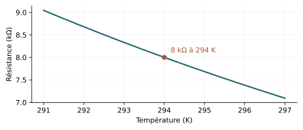
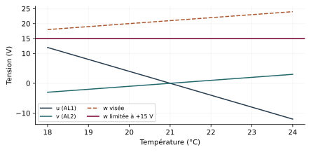
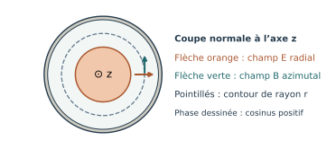
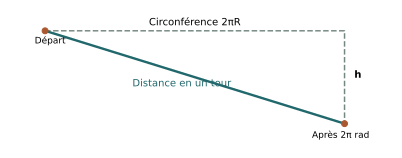
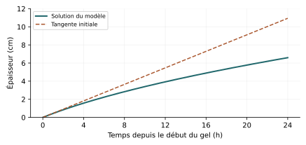

# Banque PT 2022 — Physique A · Corrigé guidé

*Corrigé rédigé par IA, non officiel. Signalez toute erreur.*

**Rédaction** · GPT-6.2 Astra Ultra · vitesse non renseignée

**Révision (tour 1)** · GPT-6.2 Astra Ultra · vitesse non renseignée

[Sujet officiel](https://www.banquept.fr/documents/2022/ph_a_2022_pt.pdf) · [Rapport du jury](https://www.banquept.fr/documents/ecrit/rapport/2022/rapport_phys_a_ecrit_2022.pdf) · [Livret de la session](https://www.banquept.fr/documents/livret/2022/Livret_PT_2022.pdf#page=13)

**Le lac de Joux.** Les questions 1 à 26 portent sur la température et la profondeur du lac. Les questions 27 à 38 étudient un toboggan puis un pédalo. Les questions 39 à 50 portent sur le gel du lac. Les graphes de cette édition sont recalculés à partir des modèles et des valeurs du sujet.

## Partie A · Thermistance et conditionnement du signal

### Question 1 · Allure de la caractéristique de la thermistance

**Piste de résolution**

Examiner d’abord la variation de l’exposant pour une température absolue croissante. Placer le point de référence puis vérifier le sens de variation dans la plage du lac.

Pour $T>0$, $R(T)=R_0\exp[B(1/T-1/T_0)]$ est positive. Sa dérivée est $R'=-BR/T^2<0$ et sa dérivée seconde $R''=R(B^2/T^4+2B/T^3)>0$. La courbe est donc décroissante et convexe, et passe par $(294\ {\rm K},8\ {\rm k}\Omega)$. Dans le modèle prolongé mathématiquement, elle diverge quand $T\to0^+$ et tend vers $R_0e^{-B/T_0}$ quand $T\to+\infty$. Sur la plage estivale, le calcul donne environ 9,04 kΩ à 291 K et 7,09 kΩ à 297 K, ce qui borne le tracé.

### Question 2 · Validation et paramètres de la loi

**Piste de résolution**

Prendre le logarithme avant de choisir les axes. Identifier le coefficient de la variable en abscisse et l’ordonnée lue pour la température de référence.

En prenant le logarithme de la valeur numérique de $R$ en ohms et en posant $X=1/T$, on obtient $\ln R=BX+b$, avec $b=\ln R_0-B/T_0$. Des points alignés valident la forme proposée sur le domaine mesuré. La pente de la droite donne $B$, en kelvins. La valeur lue à $X=1/T_0$ donne $\ln R_0$, ou encore $R_0=\exp(b+B/T_0)$ en ohms. Par exemple, une lecture approchée de la figure donne une hausse d’environ 7 unités de logarithme pour une variation de $1/T$ de $2{,}0\times10^{-3}$ K$^{-1}$. La pente vaut donc environ $3{,}5\times10^3$ K. Les valeurs retenues par le sujet sont $B=3500$ K et $R_0=8000$ Ω.

### Question 3 · Sensibilité au voisinage de la référence

**Piste de résolution**

Reconnaître une dérivée logarithmique. Distinguer la loi exacte dépendant de la température et sa valeur locale au voisinage de la référence.

La dérivée logarithmique s’écrit $s=(1/R)\,\mathrm dR/\mathrm dT=-B/T^2$. Autour de $T_0=294$ K, on trouve $s\simeq-B/T_0^2\simeq-0{,}0405$ K$^{-1}$. Pour une petite hausse de 1 K, la valeur de la résistance diminue donc d’environ 4 %.

### Question 4 · Comparaison au capteur métallique

**Piste de résolution**

Ramener les deux sensibilités à la même unité, par exemple le pourcentage par kelvin. Comparer leurs valeurs absolues.

La valeur absolue de la sensibilité de la thermistance vaut environ $4\,\%$ par kelvin. Celle de la résistance métallique vaut $0{,}5\,\%$ par kelvin. Pour une même variation de température, le signal relatif de la thermistance est environ huit fois plus grand. Elle est préférable sur le seul critère de sensibilité. Le signe indique le sens de variation.

### Question 5 · Effet de la mise en parallèle

**Piste de résolution**

Calculer la dérivée de la résistance équivalente, puis la diviser par sa valeur de référence. Comparer ce résultat à celui du capteur avant linéarisation.

La résistance équivalente linéarisée a une sensibilité relative voisine de $\alpha=-0{,}02$ K$^{-1}$ à $T_0$. Elle perd environ la moitié de la sensibilité relative initiale. La pente absolue passe également d’environ $-324$ Ω/K pour la thermistance à $R'_0\alpha=-100$ Ω/K pour l’ensemble. Une même variation de température produit un moindre écart de résistance à mesurer.

### Question 6 · Courants d’entrée et gain d’un ALI

**Piste de résolution**

Le courant d’entrée se mesure en ampères et le gain de tension est un rapport. Séparer les ordres de grandeur technologiques de leurs limites dans le modèle idéal.

Pour un amplificateur linéaire intégré courant, on peut retenir des courants d’entrée de l’ordre du nanoampère à quelques dizaines de nanoampères selon la technologie, et un gain statique en boucle ouverte de l’ordre de $10^5$ à $10^6$, sans dimension. Dans le modèle idéal, $i_+=i_-=0$ et le gain en boucle ouverte tend vers l’infini. L’alimentation fixe les limites de la tension de sortie.

### Question 7 · Hypothèse de régime linéaire

**Piste de résolution**

Suivre le trajet de la sortie jusqu’à l’une des entrées. Envisager d’abord le régime sans saturation puis vérifier sa cohérence en Q9.

La sortie revient vers l’entrée inverseuse par $R_t$, d’où une rétroaction négative. On peut chercher une solution en régime linéaire puis vérifier qu’elle reste entre les niveaux de saturation. Pour l’ALI idéal en ce régime, $V_+-V_-=0$ et les courants d’entrée sont nuls.

### Question 8 · Tension en sortie du premier étage

**Piste de résolution**

Reporter le sens de la flèche du générateur avant de poser les potentiels. Écrire séparément la loi du diviseur non inverseur et le bilan des courants de l’entrée inverseuse.

La flèche de $E$ est tournée vers la masse. Le nœud commun aux deux résistances d’entrée est donc au potentiel $-E$. Le pont diviseur donne $V_+=-E/2$ et $V_-=V_+$. L’équation du nœud inverseur s’écrit
$$\frac{-E-V_-}{R'_0}+\frac{u-V_-}{R_t}=0.$$
En remplaçant $V_-$ puis $R_t$, on obtient $u=(E/2)(R_t/R'_0-1)=(E\alpha/2)(T-T_0)$. Pour les valeurs fournies, $u=-4(T-T_0)$ en volts lorsque l’écart de température est compté en kelvins.

### Question 9 · Vérification aux limites de la plage

**Piste de résolution**

Les valeurs extrêmes d’une loi affine sur un intervalle sont obtenues aux deux bornes. Comparer leurs modules à la tension de saturation.

À 291 K, $\Delta T=-3$ K donne $u=+12$ V. À 297 K, $u=-12$ V. La loi est affine et la sortie reste strictement entre $-15$ et $+15$ V sur toute la plage. Cela valide le fonctionnement linéaire du premier étage dans le modèle d’ALI idéal à sortie limitée du sujet.

### Question 10 · Gain du deuxième étage et addition de la référence

**Piste de résolution**

Distinguer l’étage à entrée inverseuse de l’étage à deux résistances égales. Dans ce dernier, calculer les potentiels des deux entrées avant de les égaler.

AL2 est inverseur avec une résistance d’entrée $4R$ et une résistance de retour $R$. On a $v=-u/4$. Pour AL3, les deux résistances égales vers $v$ et $E'$ donnent $V_+=(v+E')/2$. Le pont de retour impose $V_-=w/2$. En régime linéaire, $w=v+E'$. Avec les valeurs de Q8, $v$ varie de $-3$ à $+3$ V.

### Question 11 · Étalonnage en degrés Celsius et saturation

**Piste de résolution**

Lire la température en degrés Celsius qui correspond à la référence de 294 K. Vérifier ensuite si la plage de sortie ainsi demandée tient entre les rails.

Numériquement $v=(T-294)$ V pour $T$ exprimée en kelvins. En régime linéaire, viser $w=(T-273)$ V impose donc **$E'=21$ V**. Cette loi réclame 18 à 24 V sur la plage étudiée. Or AL3 est alimenté comme AL1 et sature à $+15$ V. À la température de référence, AL2 sort 0 V et le dernier étage devrait sortir 21 V, déjà au-dessus du rail positif. Le montage annoncé ne peut pas donner effectivement une lecture de 18 à 24 V avec ces rails. Dans le modèle à écrêtage, la sortie réelle est au plafond sur toute la plage.

## Partie A · Profondeur mesurée par sonar

### Question 12 · Lecture de la base de temps de l’oscilloscope

**Piste de résolution**

Lire la graduation du sélecteur horizontal puis compter les divisions entre deux crêtes. Renverser la période mesurée pour obtenir la fréquence.

Deux périodes remplissent dix divisions horizontales, soit cinq divisions par période. Le sélecteur de balayage indique 5 µs/div. On trouve $T_s=25$ µs et $f=1/T_s=40$ kHz. Il s’agit d’ultrasons acoustiques, au-delà de la limite supérieure usuelle de l’audition humaine, voisine de 20 kHz.

### Question 13 · Profondeur par temps de vol

**Piste de résolution**

Identifier la distance effectivement parcourue par l’impulsion pendant le temps mesuré. Calculer au préalable la célérité à partir de la fréquence et de la longueur d’onde.

La célérité acoustique vaut $c_s=\lambda f=0{,}0375\times40000=1500$ m/s. Le trajet dure $\tau=0{,}040$ s et couvre la descente puis le retour. Ainsi $2H=c_s\tau$, d’où $H=\lambda f\tau/2=30$ m.

## Partie A · Onde dans la liaison coaxiale

### Question 14 · Équations de Maxwell dans le diélectrique

**Piste de résolution**

Lister séparément les équations de divergence et de rotationnel. Dans l’espace interconducteur, préciser les sources électromagnétiques réellement absentes.

Dans la région séparant les conducteurs, la densité de charge et le courant de conduction sont nuls. Les quatre équations locales sont
$$\nabla\!\cdot\!\vec E=0,\qquad \nabla\!\cdot\!\vec B=0,$$
$$\nabla\!\times\!\vec E=-\partial_t\vec B,\qquad \nabla\!\times\!\vec B=\mu_0\varepsilon_0\,\partial_t\vec E.$$
Le terme de déplacement demeure dans l’équation de Maxwell–Ampère.

### Question 15 · Variation radiale du champ électrique

**Piste de résolution**

Quel opérateur relie directement la variation en rayon de la seule composante électrique non nulle à la densité de charge dans l’isolant ?

Pour $\vec E=E(r)\cos(\omega t-kz)\vec u_r$, l’équation de Maxwell–Gauss dans l’isolant impose $(1/r)\,\mathrm d(rE)/\mathrm dr=0$. Ainsi $rE(r)$ est constant et $E(R_1)=E_0$ donne $E(r)=E_0R_1/r$ pour $R_1<r<R_2$.

### Question 16 · Champ magnétique de l’onde

**Piste de résolution**

Repérer la composante du rotationnel qui contient la dérivée du champ radial selon z. Vérifier les signes en dérivant une seconde fois la réponse dans le temps.

Posons $\phi=\omega t-kz$. Le rotationnel de $\vec E$ possède la seule composante $\partial_z E_r=k(E_0R_1/r)\sin\phi$ suivant $\vec u_\theta$. Maxwell–Faraday impose donc $\partial_t B_\theta=-k(E_0R_1/r)\sin\phi$. L’intégration temporelle, sans composante statique, donne
$$\vec B(r,z,t)=\frac{k}{\omega}\frac{E_0R_1}{r}\cos\phi\,\vec u_\theta.$$
Les champs sont en phase et leur produit vectoriel est dirigé selon $+\vec u_z$.

### Question 17 · Relation de dispersion

**Piste de résolution**

Utiliser d’abord les symétries du champ magnétique pour sa divergence. Comparer ensuite les composantes du rotationnel et du courant de déplacement.

La divergence de $\vec B$ est nulle car il n’a qu’une composante azimutale indépendante de $\theta$. Son rotationnel a une composante axiale nulle puisque $rB_\theta$ est indépendant de $r$. La composante radiale vaut $-\partial_zB_\theta=-(k^2/\omega)(E_0R_1/r)\sin\phi$. En l’identifiant à $\mu_0\varepsilon_0\,\partial_tE_r$, on trouve $k^2=\mu_0\varepsilon_0\omega^2$. Comme $k>0$, $k=\omega/c$, avec $c=(\mu_0\varepsilon_0)^{-1/2}$.

### Question 18 · Courant dans le conducteur central

**Piste de résolution**

Choisir la normale du disque qui s’appuie sur le contour circulaire. Calculer le produit scalaire du champ électrique avec cette normale.

Orientons le disque délimité par le cercle d’Ampère suivant $+\vec u_z$. Le champ électrique est radial. Son flux sur ce disque et le flux de sa dérivée temporelle sont donc nuls. Le théorème intégral donne $\oint\vec B\cdot\mathrm d\vec l=\mu_0 i$, même si l’onde dépend du temps. Le contour enlace uniquement le cylindre intérieur. Ainsi
$$i(t,z)=\frac{2\pi rB_\theta}{\mu_0}=\frac{2\pi E_0R_1}{\mu_0c}\cos(\omega t-kz).$$
Le signe positif désigne le courant de référence vers $+z$.

### Question 19 · Puissance moyenne guidée

**Piste de résolution**

Déterminer la direction du vecteur de Poynting. Garder à la fois le facteur de moyenne temporelle et le facteur de surface d’un anneau élémentaire.

Le vecteur de Poynting vaut $\vec\Pi=(\vec E\times\vec B)/\mu_0=(E_0^2R_1^2/(\mu_0c r^2))\cos^2\phi\,\vec u_z$. La moyenne temporelle de $\cos^2$ est $1/2$. Intégrons sur l’anneau entre les deux conducteurs, avec $\mathrm dS=2\pi r\,\mathrm dr$,
$$\langle P\rangle=\frac{\pi E_0^2 R_1^2}{\mu_0 c}\ln\frac{R_2}{R_1}=\pi E_0^2R_1^2\sqrt{\frac{\varepsilon_0}{\mu_0}}\ln\frac{R_2}{R_1}.$$
Le diamètre extérieur étant le double du diamètre intérieur, le logarithme vaut ici $\ln 2$.

## Partie A · Profondeur mesurée par capteur de pression

### Question 20 · Pression absolue au fond

**Piste de résolution**

Énumérer la pression au niveau de l’air et la variation de pression due à la colonne d’eau. Passer des pascals aux bars à la toute fin.

Dans l’eau de masse volumique $\rho\simeq1000$ kg/m$^3$, le gradient de pression vaut $\rho g$ suivant la verticale descendante. À 30 m, la surpression est $\rho gH\simeq3{,}0\times10^5$ Pa, soit 3 bars avec $g\simeq10$ m/s$^2$. En ajoutant le bar atmosphérique, on trouve $P\simeq4$ bars absolus.

### Question 21 · Champ du solénoïde long

**Piste de résolution**

Mettre l’un des grands côtés du contour rectangulaire à l’extérieur. Compter les spires effectivement enlacées par la longueur choisie.

L’enroulement idéal est invariant par rotation et translation axiales. Les symétries du courant donnent un champ axial qui ne peut dépendre que de $r$. Un contour d’Ampère rectangulaire ayant deux longs côtés à l’intérieur montre que le champ y est uniforme. Plaçons ensuite l’un des côtés de longueur $a$ à l’extérieur, où le champ est pris nul. Le rectangle enlace $Na/\ell$ spires, donc $Ba=\mu_0 INa/\ell$. Le champ intérieur a pour norme $\mu_0 NI/\ell$ et pour sens celui donné par la main droite en suivant le courant. Si $+z$ est orienté par la normale positive des spires, $\vec B=\mu_0(N/\ell)I\vec u_z$.

### Question 22 · Flux propre et inductance

**Piste de résolution**

Calculer le flux d’une spire avant de totaliser les flux liés à l’enroulement. Vérifier que l’expression finale dépend du carré du nombre de spires.

Une spire de surface $S$ est traversée par le flux $BS$. Avec les $N$ spires, le flux total lié vaut $\Phi_p=NBS=\mu_0N^2SI/\ell$. Par définition $L_0=\Phi_p/I$, soit $L_0=\mu_0N^2S/\ell$. Avec $N=1000$, $S=10^{-3}$ m$^2$ et $\ell=0{,}05$ m, la valeur est $0{,}0251$ H, environ 25 mH.

### Question 23 · Impédances des deux dipôles du pont

**Piste de résolution**

Décider si les deux composants de chaque bras se combinent en série ou en parallèle. Écrire une admittance lorsque la combinaison le demande.

En régime harmonique avec la convention $e^{j\omega t}$, la bobine réelle correspond à la série $Z_1=R_1+j\omega L_1$. Pour le deuxième dipôle, les admittances du condensateur et de la résistance s’additionnent, soit $1/Z_2=1/R_2+j\omega C_2$. Ainsi $Z_2=R_2/(1+j\omega R_2C_2)$.

### Question 24 · Condition d’équilibre du pont

**Piste de résolution**

Choisir une même origine de potentiel pour les deux diviseurs. À l’équilibre, la tension détectée sur la diagonale du pont est nulle.

Prenons le nœud de gauche comme origine et celui de droite au potentiel complexe $\underline e$. Les diviseurs donnent $\underline V_A=\underline e\,Z_1/(Z_1+R_3)$ et $\underline V_B=\underline e\,R_4/(R_4+Z_2)$. Lorsque la tension entre A et B est nulle, les fractions sont égales. Après produit en croix et simplification, il reste $Z_1Z_2=R_3R_4$.

### Question 25 · Identification des deux paramètres

**Piste de résolution**

Séparer la partie résistive du terme proportionnel à la pulsation. Conserver la notation complexe jusqu’à cette séparation.

En remplaçant $1/Z_2$ dans $Z_1=R_3R_4/Z_2$, on obtient $R_1+j\omega L_1=R_3R_4/R_2+j\omega R_3R_4C_2$. L’identification des parties réelle et imaginaire à pulsation non nulle donne
$$R_1=\frac{R_3R_4}{R_2},\qquad L_1=R_3R_4 C_2.$$

### Question 26 · Résultat du pont et validation de la profondeur

**Piste de résolution**

Convertir les microfarads avant de lire les henrys. Introduire ensuite le rapport des deux inductances dans la loi étalonnée en pression.

On calcule $R_1=100\times10/100=10$ Ω et $L_1=100\times10\times32{,}5\,\mu{\rm F}=0{,}0325$ H, soit 32,5 mH. La loi du capteur donne $P=P_0[1+(L_1/L_0-1)/\beta]$. Avec $L_0=25$ mH, $\beta=0{,}1$ et $P_0=1$ bar, on retrouve $P=4$ bars. La surpression équivaut à une colonne d’eau d’environ 30 m.

## Partie B · Descente en toboggan

### Question 27 · Pas de l’hélice

**Piste de résolution**

Un tour complet correspond à un angle précis en radians. La cote croît de la hauteur annoncée à chaque tour.

En un tour l’angle croît de $2\pi$ et la cote descendante augmente de $h$. Comme $z=\gamma\theta$, $h=2\pi\gamma$. La sortie après trois tours se trouve à $z=3h$ et $\theta=6\pi$.

### Question 28 · Position et vitesse de l’enfant

**Piste de résolution**

Dans la base locale, le vecteur unitaire radial change avec le temps même si le rayon est constant. Ne conserver que les composantes nécessaires de la position.

Dans la base cylindrique locale, $\overrightarrow{OM}=R\vec u_r+z\vec u_z$. La dépendance en $\theta$ est contenue dans $\vec u_r$. Avec $\mathrm d\vec u_r/\mathrm dt=\dot\theta\vec u_\theta$ et $R$ constant,
$$\vec v=R\dot\theta\vec u_\theta+\dot z\vec u_z,\qquad v^2=R^2\dot\theta^2+\dot z^2.$$

### Question 29 · Énergie le long de la trajectoire

**Piste de résolution**

Éliminer la vitesse angulaire à l’aide de la géométrie. Fixer l’origine de l’énergie de pesanteur et tenir compte du sens de l’axe vertical.

Puisque $z=\gamma\theta$, on a $\dot\theta=\dot z/\gamma$. L’énergie cinétique vaut $\tfrac12 m(1+R^2/\gamma^2)\dot z^2$. L’axe $z$ étant descendant, l’énergie potentielle de pesanteur est $-mgz$ en choisissant zéro en A. Ainsi $E_m=\tfrac12 A\dot z^2-Bz$ avec $A=m(1+R^2/\gamma^2)$ et $B=mg$. Sans frottement, la réaction normale ne travaille pas et $E_m$ reste constante.

### Question 30 · Vitesse en sortie

**Piste de résolution**

Évaluer l’énergie mécanique au point haut puis à la sortie. La hauteur perdue dépend du nombre de tours.

L’enfant part du repos et perd une hauteur $3h$. La conservation de l’énergie donne $mv_s^2/2=mg(3h)$, donc $v_s=\sqrt{6gh}$. Il s’agit de la norme de toute la vitesse, comprenant la composante azimutale.

### Question 31 · Équation horaire et durée

**Piste de résolution**

Dériver l’énergie, puis examiner les conditions initiales. Résoudre jusqu’à la hauteur atteinte après les trois tours.

La dérivée de l’énergie conservée donne $\dot z(A\ddot z-B)=0$. Sur la descente, puis par continuité au départ, $\ddot z=B/A$. On peut aussi obtenir cette équation en projetant la dynamique sur la tangente pour éliminer la réaction. Avec $z(0)=\dot z(0)=0$, il vient $z(t)=Bt^2/(2A)$. La solution est une parabole en temps puisque l’accélération axiale est constante. La sortie à $z(T)=3h$ donne $T=\sqrt{6Ah/B}$.

### Question 32 · Énergie dissipée par un frottement constant

**Piste de résolution**

Dérouler un tour de l’hélice sur un plan et identifier l’hypoténuse parcourue. Préciser le signe du travail avant de donner l’énergie perdue.

L’élément de longueur de l’hélice est $\mathrm ds=\sqrt{R^2\mathrm d\theta^2+\mathrm dz^2}=\sqrt{R^2+\gamma^2}\,\mathrm d\theta$. Sur trois tours, la distance vaut $6\pi\sqrt{R^2+\gamma^2}$. La force de frottement est opposée au mouvement, donc son travail est $-6\pi F\sqrt{R^2+\gamma^2}$. L’énergie mécanique perdue, comptée positivement, vaut $6\pi F\sqrt{R^2+\gamma^2}$.

## Partie B · Traversée en pédalo

### Question 33 · Fraction immergée des flotteurs

**Piste de résolution**

La poussée porte sur le volume d’eau effectivement déplacé. Le volume disponible est la somme des volumes des deux flotteurs.

À l’équilibre vertical, la poussée d’Archimède compense $Mg$, soit $\rho g V_{\rm imm}=Mg$. Le volume immergé total est $200/1000=0{,}20$ m$^3$ sur $2V=1{,}0$ m$^3$ disponibles. La fraction immergée vaut donc 0,20, soit 20 % du volume total et de chaque flotteur si la répartition est symétrique.

### Question 34 · Moment de la force sur le pédalier

**Piste de résolution**

Pour chaque dessin, prolonger la ligne d’action de la force. Mesurer la distance perpendiculaire de cette droite à l’axe de rotation.

Sur le schéma (a), le bras de levier perpendiculaire à la ligne d’action est $d=0{,}20$ m. La force fait tourner le pédalier dans le sens horaire sur la figure. Le moment a donc pour norme $F_{\rm pied}d=50\times0{,}20=10$ N·m et pour composante $-10$ N·m suivant l’axe sortant du dessin. Sur (b), la ligne d’action passe par O, donc le moment est nul.

### Question 35 · Puissance moyenne du pédalage

**Piste de résolution**

Le sujet prescrit la moyenne des deux positions. Utiliser le couple moyen ainsi défini et la pulsation dans le même sens.

Selon la moyenne de deux valeurs prescrite par le sujet, le couple moteur moyen a pour norme $(10+0)/2=5$ N·m. Il est du même sens que la rotation. À 10 rad/s, la puissance mécanique fournie au pédalier vaut donc $\overline{\mathcal P}=5\times10=50$ W.

## Partie B · Assistance électrique

### Question 36 · Courant du moteur d’assistance

**Piste de résolution**

Choisir le sens du courant de la figure. La tension induite est une contre-électromotrice qui dépend de la vitesse de rotation.

Dans le sens indiqué pour $i$, la force contre-électromotrice s’oppose à la source. La loi des mailles donne $Ri=E-e$, avec $e=\omega Ba^2/2$. Pour $a=1$ m, $B=1$ T et $\omega=10$ rad/s, $e=5$ V. Le courant est $i=(23-5)/6=3$ A.

### Question 37 · Couple de Laplace et puissance

**Piste de résolution**

Découper la tige en petits segments radiaux. Le bras de levier de la force élémentaire varie entre le centre et l’extrémité.

Dans la barre, le courant circule du centre vers C. Sur un élément à distance $r$, $\mathrm d\vec F=i\,\mathrm dr\,\vec u_r\times B\vec u_z=-iB\,\mathrm dr\,\vec u_\theta$. Son moment axial vaut $\mathrm d\vec M=-riB\,\mathrm dr\,\vec u_z$. L’intégration de 0 à $a$ donne $\vec M=-iBa^2\vec u_z/2$. Cela revient à appliquer la résultante $iBa$ au milieu de la barre. La rotation indiquée est horaire, $\vec\omega=-\omega\vec u_z$, donc $\mathcal P=\vec M\cdot\vec\omega=i\omega Ba^2/2=ei=15$ W. Le couple moteur vaut 1,5 N·m en norme.

### Question 38 · Réduction de l’effort du vacancier

**Piste de résolution**

À vitesse identique, écrire le bilan de puissance utile. Choisir la puissance du vacancier sans assistance comme référence du pourcentage.

À même vitesse, la puissance à fournir au pédalier reste 50 W. Le moteur en apporte 15. Il reste donc 35 W à fournir humainement. On vérifie également le bilan électrique de l’assistance, $Ei=69$ W et $Ri^2=54$ W, d’où 15 W convertis en puissance mécanique. La réduction relative de puissance, et de couple à vitesse fixée, vaut $15/50=30\,\%$.

## Partie C · Gel du lac

### Question 39 · Longueur thermique de référence

**Piste de résolution**

Comparer les unités des deux coefficients au lieu de supposer la nature du résultat. Convertir ensuite les mètres en centimètres.

Avec $\ell_0=\lambda/h$, les unités donnent $(\mathrm W\,\mathrm m^{-1}\mathrm K^{-1})/(\mathrm W\,\mathrm m^{-2}\mathrm K^{-1})=\mathrm m$. Numériquement $\ell_0=2{,}1/42=0{,}050$ m, soit 5 cm. Cette longueur met sur un pied d’égalité les résistances de conduction et de convection.

### Question 40 · Chaleur libérée par kilogramme

**Piste de résolution**

Un kilogramme d’eau et de glace est à la même température pendant la transition considérée. Chercher l’enthalpie associée au changement d’état.

L’eau liquide se solidifie à sa température de fusion. La chaleur cédée au milieu extérieur pour 1 kg vaut $q=\Delta h_f=335$ kJ/kg, soit 335 kJ pour ce kilogramme. La variation d’enthalpie du système eau–glace est l’opposée. Le modèle porte sur le changement d’état à 273 K.

### Question 41 · Chaleur libérée par le gel du lac

**Piste de résolution**

Convertir la surface de kilomètres carrés en mètres carrés avant de calculer le volume du lac. Multiplier la masse par la chaleur latente massique.

Le volume de référence est $SH=(10\times10^6)\times30=3{,}0\times10^8$ m$^3$. Avec une masse volumique voisine de $10^3$ kg/m$^3$, la masse est d’environ $3\times10^{11}$ kg. La chaleur libérée vaut $Q\simeq(3\times10^{11})(3{,}35\times10^5)\simeq10^{17}$ J. La masse volumique de glace indiquée conduit au même ordre de grandeur.

### Question 42 · Profil de température dans la glace

**Piste de résolution**

Simplifier l’équation de diffusion à un instant donné. Déterminer les coefficients du profil grâce aux conditions de température aux deux extrémités.

En régime quasi stationnaire, le profil s’ajuste bien avant que l’épaisseur ait fortement changé. Dans l’équation de diffusion, on néglige le terme de stockage au premier ordre et donc $\partial_{xx}T\simeq0$. À l’instant considéré, $T=ax+b$. Les conditions $T(0,t)=T_0(t)$ et $T(\ell,t)=T_e$ donnent
$$T(x,t)=T_0(t)+\frac{T_e-T_0(t)}{\ell(t)}\,x.$$
La pente est positive car l’axe descend vers l’eau plus chaude.

### Question 43 · Chaleur libérée au front de gel

**Piste de résolution**

Exprimer le volume de la couche solidifiée pendant le pas temporel. La masse correspondante fait intervenir la masse volumique de la phase créée.

Sur une surface $S$, l’accroissement d’épaisseur $\mathrm d\ell>0$ crée une masse $\mathrm dm=\mu S\,\mathrm d\ell$ de glace. La chaleur cédée par l’eau qui se solidifie vaut $\delta Q_1=q\,\mathrm dm=\mu S q\,\mathrm d\ell$, comptée positivement vers le haut.

### Question 44 · Transfert par conduction

**Piste de résolution**

Le gradient suit l’axe vertical descendant. Calculer d’abord la composante du flux, puis la chaleur demandée dans le sens montant.

Le flux vectoriel de Fourier est $-\lambda(T_e-T_0)\vec u_x/\ell$. Le transfert demandé va du bas vers le haut, dans le sens $-\vec u_x$. Sa valeur positive pendant $\mathrm dt$ est donc $\delta Q_2=\lambda S(T_e-T_0)\,\mathrm dt/\ell$.

### Question 45 · Température à la surface

**Piste de résolution**

Égaler le flux qui traverse la glace et celui qui quitte sa surface. Vérifier les limites d’une couche mince et d’une couche épaisse.

L’égalité des flux donne $h(T_0-T_a)=\lambda(T_e-T_0)/\ell$. Avec $\ell_0=\lambda/h$, on trouve
$$T_0(t)=\frac{\ell_0 T_e+\ell(t)T_a}{\ell_0+\ell(t)}.$$
Cette moyenne pondérée tend vers $T_e$ pour une couche naissante, puis vers $T_a$ quand l’épaisseur devient grande devant $\ell_0$.

### Question 46 · Équation d’avancement du front

**Piste de résolution**

Remplacer la température de surface dans le terme convectif. Isoler la dérivée de l’épaisseur et identifier les dimensions de la constante.

La chaleur libérée au front et évacuée par convection vérifie $\mu q\,\mathrm d\ell=h(T_0-T_a)\,\mathrm dt$. En remplaçant $T_0-T_a$ par $\ell_0(T_e-T_a)/(\ell+\ell_0)$, on obtient
$$\left(1+\frac{\ell}{\ell_0}\right)\frac{\mathrm d\ell}{\mathrm dt}=v_0,\qquad v_0=\frac{h(T_e-T_a)}{\mu q}.$$
Les unités de $v_0$ sont le m/s. Sa valeur est environ $1{,}27\times10^{-6}$ m/s. C’est la vitesse initiale prédite, qui décroît ensuite avec l’épaisseur.

### Question 47 · Intégration de l’équation

**Piste de résolution**

Intégrer l’équation séparée en conservant la condition de glace initialement absente. Vérifier les unités des termes du polynôme.

On sépare les variables puis on intègre de la condition initiale $\ell(0)=0$ jusqu’à l’instant $t$. Il vient $\ell+\ell^2/(2\ell_0)=v_0t$, soit l’équation du second degré $\ell^2+2\ell_0\ell-2\ell_0v_0t=0$.

### Question 48 · Épaisseur de la glace en fonction du temps

**Piste de résolution**

Parmi les deux racines du second degré, choisir celle compatible avec le signe de l’épaisseur et avec la condition initiale.

La racine positive, continue à partir d’une épaisseur nulle, est
$$\ell(t)=\ell_0\left(\sqrt{1+\frac{2v_0t}{\ell_0}}-1\right),\qquad 0\le\ell(t)\le H.$$
Au bout de 24 h, les données numériques conduisent à environ 6,59 cm de glace. La racine avec le signe moins devant le radical est négative. Pour les temps courts, $\ell\simeq v_0t$. Lorsque $\ell\gg\ell_0$, la croissance devient proportionnelle à $\sqrt{t}$. La formule s’applique jusqu’à $t_H=(H+H^2/(2\ell_0))/v_0$ dans ce modèle.

### Question 49 · Temps caractéristique de croissance

**Piste de résolution**

Mettre le terme temporel sous la racine sous la forme d’un rapport sans dimension. Selon la convention, un facteur numérique peut rester visible.

En écrivant $\ell/\ell_0=\sqrt{1+t/\tau}-1$, on identifie $\tau=\ell_0/(2v_0)$. Avec $v_0$ de l’ordre de $10^{-6}$ m/s, on trouve $\tau\simeq2{,}5\times10^4$ s, soit plusieurs heures. La valeur calculée en Q46 donne $1{,}97\times10^4$ s. Choisir $\ell_0/v_0$ comme durée de référence revient à garder un facteur 2 explicite sous le radical.

### Question 50 · Temps de diffusion et validité du régime

**Piste de résolution**

Extraire la diffusivité de l’équation de la chaleur. Sur la longueur de référence, comparer la durée d’ajustement du profil à celle du mouvement du front.

La diffusivité de la glace est $D_{\rm th}=\lambda/(\mu c_g)$. L’ajustement thermique sur $\ell_0$ a pour durée $\tau'\sim\ell_0^2/D_{\rm th}=\mu c_g\ell_0^2/\lambda$. Avec $c_g=2100$ J/(kg·K), $\mu=990$ kg/m$^3$ et $\ell_0=0{,}05$ m, on obtient $D_{\rm th}\simeq1{,}0\times10^{-6}$ m$^2$/s et $\tau'\simeq2{,}5\times10^3$ s, soit 41 min. La diffusion est environ huit fois plus rapide que l’évolution caractéristique de Q49 avec les données complètes. Cet écart appuie l’approximation quasi stationnaire à l’échelle considérée.
