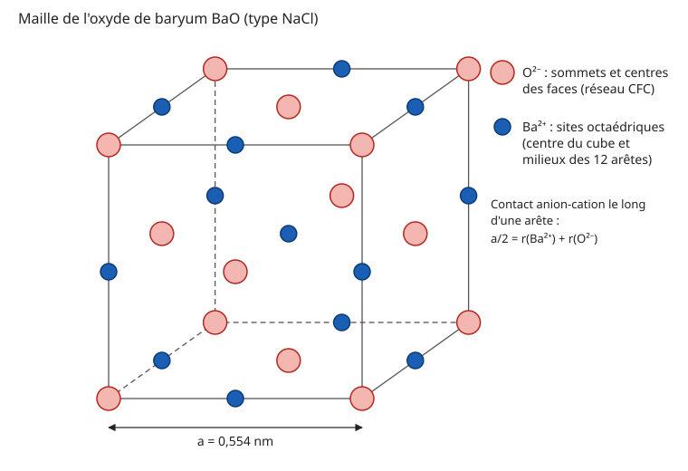
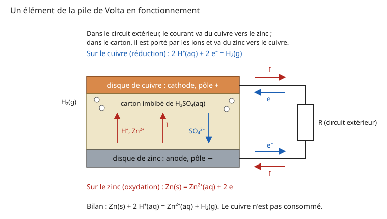
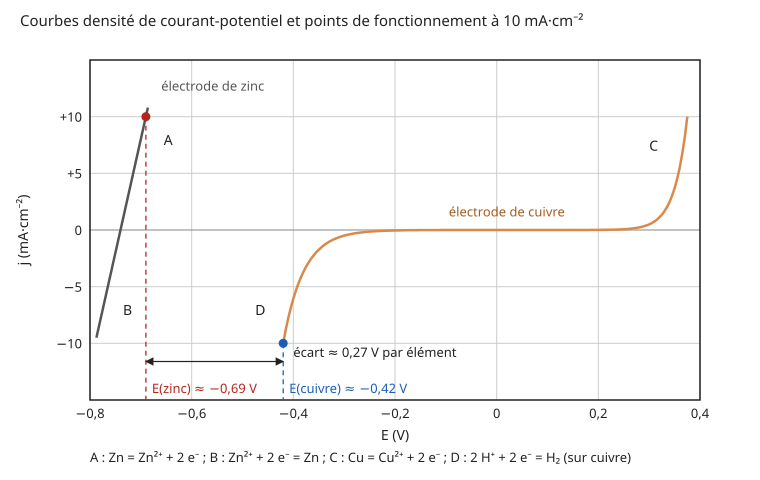
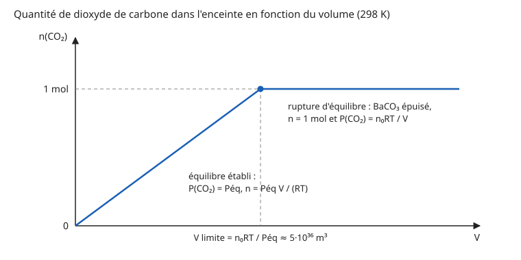
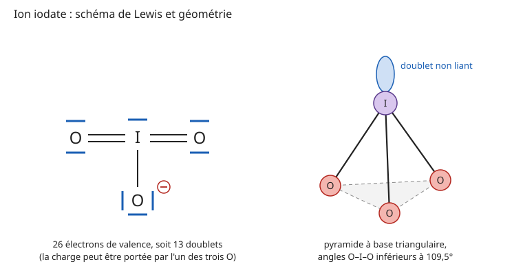
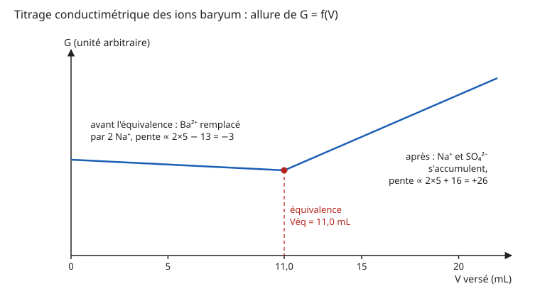
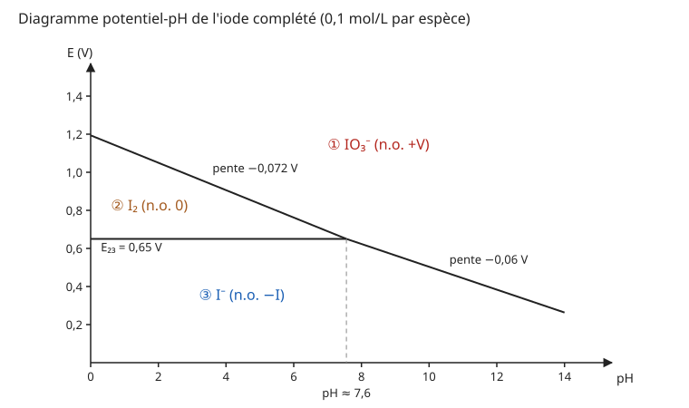

# Banque PT PT — Physique B - Chimie 2022 · Corrigé brut

*Corrigé rédigé par IA, non officiel. Signalez toute erreur.*

**Rédaction** · modèle exact non renseigné (famille Claude) · effort non renseigné · vitesse non renseignée

**Révision (tour 2)** · modèle exact non renseigné (famille Claude) · effort non renseigné · vitesse non renseignée · 28 novembre 2026

Épreuve de 2 heures, sans calculatrice, autour du baryum : 43 questions en quatre parties indépendantes (atome et cristal d'oxyde de baryum, pile de Volta, carbonatation de l'oxyde de baryum, solubilité de l'iodate de baryum). Les 43 questions sont traitées. Les valeurs lues sur les courbes densité de courant-potentiel (questions 14, 18 et 19) et sur le diagramme potentiel-pH (questions 40 et 41) sont signalées à l'endroit où elles servent.

[Sujet officiel](https://www.banquept.fr/documents/2022/ph_b_ch_2022_pt.pdf) · [Rapport du jury](https://www.banquept.fr/documents/ecrit/rapport/2022/rapport_phys_b_ecrit_2022.pdf)

## Partie A — Propriétés du baryum

### Question 1 — Configuration électronique du baryum

L'atome de baryum possède $Z = 56$ électrons. On remplit les sous-couches par énergie croissante (règle de Klechkowski), en respectant le principe de Pauli (deux électrons au plus par orbitale) :

$$\boxed{\mathrm{Ba} : 1s^2\,2s^2\,2p^6\,3s^2\,3p^6\,4s^2\,3d^{10}\,4p^6\,5s^2\,4d^{10}\,5p^6\,6s^2}$$

soit $[\mathrm{Xe}]\,6s^2$. Contrôle : $2+2+6+2+6+2+10+6+2+10+6+2 = 56$.

### Question 2 — Ion le plus courant

Les électrons de valence sont les deux électrons $6s$. En les cédant, le baryum acquiert la configuration du xénon, gaz noble particulièrement stable :

$$\boxed{\mathrm{Ba^{2+}} : [\mathrm{Xe}]}$$

L'ion courant du baryum est donc $\mathrm{Ba^{2+}}$ (nombre d'oxydation $+\mathrm{II}$), ce que confirment les composés de l'énoncé ($\mathrm{BaO}$, $\mathrm{BaCO_3}$, $\mathrm{BaSO_4}$).

### Question 3 — Position dans le tableau périodique

- Le plus grand nombre quantique principal occupé est $n = 6$ : le baryum est dans la **6ᵉ période** (ligne).
- La configuration de valence est $6s^2$ : le baryum appartient au bloc $s$ et possède deux électrons de valence, il est dans la **2ᵉ colonne**.

**Le baryum est dans la 6ᵉ période et la 2ᵉ colonne.**

### Question 4 — Famille chimique

Les éléments de la deuxième colonne (Be, Mg, Ca, Sr, Ba, Ra), de configuration de valence $ns^2$, forment la famille des **alcalino-terreux**.

### Question 5 — Métal ou non-métal, propriétés

Situé à gauche du tableau périodique, peu électronégatif, le baryum est un **métal**. Propriétés générales des métaux (deux au moins sont demandées) :

- bons conducteurs de l'électricité et de la chaleur ;
- éclat métallique (ils réfléchissent la lumière) ;
- malléables et ductiles ;
- réducteurs : ils cèdent facilement leurs électrons de valence et donnent des cations (ici $\mathrm{Ba^{2+}}$) ;
- leurs oxydes sont le plus souvent basiques et ioniques (ici $\mathrm{BaO}$).

### Question 6 — Nombre de motifs par maille

Les ions $\mathrm{O^{2-}}$ occupent les nœuds d'un réseau cubique à faces centrées : 8 sommets partagés chacun entre 8 mailles, 6 centres de faces partagés chacun entre 2 mailles.

$$N(\mathrm{O^{2-}}) = 8\times\frac18 + 6\times\frac12 = 4$$

La stœchiométrie $\mathrm{BaO}$ (ou l'électroneutralité : charges $+2$ et $-2$) impose le même nombre de cations : $N(\mathrm{Ba^{2+}}) = 4$. Le motif étant un ion baryum et un ion oxyde :

$$\boxed{\text{4 motifs } \mathrm{BaO} \text{ par maille}}$$

### Question 7 — Sites tétraédriques et octaédriques

**Sites tétraédriques.** Ils sont aux centres des huit petits cubes d'arête $a/2$ (chacun est entouré d'un sommet et de trois centres de faces, qui forment un tétraèdre). Ils sont entièrement à l'intérieur de la maille :

$$\boxed{N_T = 8\times 1 = 8}$$

**Sites octaédriques.** Ils sont au centre du cube (entouré des six centres de faces) et aux milieux des douze arêtes (chaque milieu d'arête est partagé entre 4 mailles) :

$$\boxed{N_O = 1 + 12\times\frac14 = 4}$$

Il y a donc, par maille, 8 sites T et 4 sites O, soit deux sites T et un site O par anion.

### Question 8 — Type de site occupé par les ions baryum

La maille contient 4 ions $\mathrm{O^{2-}}$ ; l'électroneutralité exige 4 ions $\mathrm{Ba^{2+}}$.

- Occupation de 100 % des sites T : 8 cations pour 4 anions, formule $\mathrm{Ba_2O}$, cristal non neutre avec des ions $\mathrm{Ba^{2+}}$. Impossible.
- Occupation de 100 % des sites O : 4 cations pour 4 anions, formule $\mathrm{BaO}$. Convient.

**Les ions baryum occupent tous les sites octaédriques** : la structure est de type $\mathrm{NaCl}$.

### Question 9 — Dessin de la maille

Les ions $\mathrm{O^{2-}}$ sont aux sommets et aux centres des faces du cube d'arête $a$ ; les ions $\mathrm{Ba^{2+}}$ sont au centre du cube et aux milieux des douze arêtes.

Chaque ion est entouré de six ions de signe opposé situés à la distance $a/2$ (coordinence 6-6).

### Question 10 — Rayon ionique de l'ion baryum

Les ions de même signe se repoussent : le contact a lieu entre un anion et un cation voisins, le long d'une arête, où l'on rencontre un demi-anion, un cation entier puis un demi-anion. La tangence s'écrit

$$a = 2\,r(\mathrm{O^{2-}}) + 2\,r(\mathrm{Ba^{2+}})$$

$$r(\mathrm{Ba^{2+}}) = \frac a2 - r(\mathrm{O^{2-}})$$

Application numérique :

$$r(\mathrm{Ba^{2+}}) = \frac{0{,}554}{2} - 0{,}140 = 0{,}277 - 0{,}140$$

$$\boxed{r(\mathrm{Ba^{2+}}) = 0{,}137\ \mathrm{nm}}$$

Contrôle : deux anions voisins (sommet et centre de face) sont distants de $a\sqrt2/2 \approx 0{,}39\ \mathrm{nm}$, valeur supérieure à $2\,r(\mathrm{O^{2-}}) = 0{,}280\ \mathrm{nm}$ : les anions ne se touchent pas, l'hypothèse de contact anion-cation est cohérente.

## Partie B — Découverte du baryum

### Question 11 — Réactions dans la pile de Volta

**Inventaire.** Espèces présentes : $\mathrm{Zn(s)}$, $\mathrm{Cu(s)}$, $\mathrm{H^+(aq)}$ (noté aussi $\mathrm{H_3O^+}$) et ions sulfate ou hydrogénosulfate, eau. Il n'y a pas d'ions $\mathrm{Cu^{2+}}$ en solution.

Échelle des potentiels standard : $E^\circ(\mathrm{Zn^{2+}/Zn}) = -0{,}76\ \mathrm V$, $E^\circ(\mathrm{H^+/H_2}) = 0\ \mathrm V$, $E^\circ(\mathrm{Cu^{2+}/Cu}) = 0{,}34\ \mathrm V$. Le réducteur le plus fort est le zinc ; l'oxydant présent le plus fort est $\mathrm{H^+}$. Le cuivre, réducteur du couple de potentiel $0{,}34\ \mathrm V > 0\ \mathrm V$, n'est pas oxydé par $\mathrm{H^+}$ : il reste inerte et sert de conducteur électronique.

**À l'anode (disque de zinc), oxydation :**

$$\mathrm{Zn(s)} = \mathrm{Zn^{2+}(aq)} + 2\,e^-$$

**À la cathode (disque de cuivre), réduction :**

$$2\,\mathrm{H^+(aq)} + 2\,e^- = \mathrm{H_2(g)}$$

**Bilan :**

$$\boxed{\mathrm{Zn(s)} + 2\,\mathrm{H^+(aq)} = \mathrm{Zn^{2+}(aq)} + \mathrm{H_2(g)}}$$

### Question 12 — Rôle de l'acide sulfurique

La solution d'acide sulfurique joue deux rôles :

- **électrolyte** : ses ions assurent le passage du courant à l'intérieur de la pile, entre le zinc et le cuivre, et maintiennent l'électroneutralité (elle ferme le circuit, comme un pont salin) ;
- **réactif** : elle apporte les ions $\mathrm{H^+}$, oxydant réduit en dihydrogène à la surface du cuivre.

Le carton sert de support poreux qui retient la solution et évite le contact direct entre les deux métaux d'un même élément.

### Question 13 — Schéma d'un élément de la pile

Le zinc, siège de l'oxydation, est l'anode et constitue le pôle négatif ; le cuivre, siège de la réduction, est la cathode et constitue le pôle positif. Dans le circuit extérieur, les électrons vont du zinc vers le cuivre et le courant du cuivre vers le zinc. Dans le carton imbibé, les cations ($\mathrm{H^+}$, $\mathrm{Zn^{2+}}$) migrent vers le cuivre et les anions vers le zinc.

### Question 14 — Réactions associées aux branches A, B, C et D

Par convention, un courant positif correspond à une oxydation (branche anodique), un courant négatif à une réduction (branche cathodique).

**Électrode de zinc (courbe de gauche).** Elle coupe l'axe vers $-0{,}74\ \mathrm V$ (lecture), valeur proche de $E^\circ(\mathrm{Zn^{2+}/Zn}) = -0{,}76\ \mathrm V$.

- A (courant positif) : oxydation du zinc, $\mathrm{Zn(s)} \rightarrow \mathrm{Zn^{2+}(aq)} + 2\,e^-$.
- B (courant négatif) : réduction des ions zinc, $\mathrm{Zn^{2+}(aq)} + 2\,e^- \rightarrow \mathrm{Zn(s)}$, possible seulement si la solution contient des ions $\mathrm{Zn^{2+}}$ ; en milieu acide, la réduction des ions $\mathrm{H^+}$ en dihydrogène, $2\,\mathrm{H^+(aq)} + 2\,e^- \rightarrow \mathrm{H_2(g)}$, peut s'y ajouter, mais elle est très lente sur le zinc.

**Électrode de cuivre (courbe de droite).**

- C (courant positif, à partir de $0{,}3\ \mathrm V$ environ, proche de $E^\circ(\mathrm{Cu^{2+}/Cu}) = 0{,}34\ \mathrm V$) : oxydation du cuivre, $\mathrm{Cu(s)} \rightarrow \mathrm{Cu^{2+}(aq)} + 2\,e^-$.
- D (courant négatif, à partir de $-0{,}25\ \mathrm V$ environ) : réduction des ions $\mathrm{H^+}$ sur le cuivre, $2\,\mathrm{H^+(aq)} + 2\,e^- \rightarrow \mathrm{H_2(g)}$. Ce ne peut pas être la réduction de $\mathrm{Cu^{2+}}$, qui se ferait dès $0{,}34\ \mathrm V$ et qui suppose des ions absents ici.

Dans la pile en fonctionnement, seules les branches A (sur le zinc) et D (sur le cuivre) interviennent.

### Question 15 — Système rapide ; nature des systèmes étudiés

**Définition.** Un système (un couple sur une électrode donnée) est rapide si l'échange d'électrons à l'interface est facile : dès que le potentiel de l'électrode s'écarte du potentiel d'équilibre de Nernst, un courant notable circule. La courbe intensité-potentiel coupe alors l'axe des potentiels avec une pente forte, sans palier de courant nul. Un système est lent s'il faut dépasser le potentiel d'équilibre d'une surtension seuil (anodique ou cathodique) pour obtenir un courant mesurable.

**Application.**

- $\mathrm{Zn^{2+}/Zn}$ sur zinc : la courbe traverse l'axe en ligne droite très pentue au voisinage du potentiel d'équilibre. **Système rapide.**
- $\mathrm{H^+/H_2}$ sur cuivre : le potentiel d'équilibre est $0\ \mathrm V$, mais la réduction ne démarre que vers $-0{,}25\ \mathrm V$ ; il existe une surtension cathodique seuil d'environ $0{,}25\ \mathrm V$ en valeur absolue. **Système lent.**
- $\mathrm{Cu^{2+}/Cu}$ sur cuivre : l'oxydation démarre au voisinage de $0{,}34\ \mathrm V$, sans surtension notable. **Système rapide** (il ne joue pas de rôle dans la pile).

### Question 16 — Tension à vide de la pile

Les activités étant égales à 1, les potentiels de Nernst sont les potentiels standard. Pour un élément, avec les couples $\mathrm{H^+/H_2}$ à la cathode et $\mathrm{Zn^{2+}/Zn}$ à l'anode :

$$e_1 = E^\circ(\mathrm{H^+/H_2}) - E^\circ(\mathrm{Zn^{2+}/Zn})$$

$$e_1 = 0 - (-0{,}76) = 0{,}76\ \mathrm V$$

Les $N = 10$ éléments étant en série :

$$e = N\,e_1$$

$$\boxed{e = 7{,}6\ \mathrm V}$$

C'est la valeur thermodynamique, celle que prévoit la relation de Nernst.

### Question 17 — Tension à vide et enthalpie libre de réaction

Pour une réaction de pile échangeant $n$ électrons, de tension à vide $e = E_{\text{cathode}} - E_{\text{anode}}$ :

$$\boxed{\Delta_r G = -\,n\,\mathcal F\,e}$$

et, dans les conditions standard, $\Delta_r G^\circ = -\,n\,\mathcal F\,e^\circ$. La réaction spontanée ($\Delta_r G < 0$) correspond bien à $e > 0$.

Ici $n = 2$ et $e^\circ = 0{,}76\ \mathrm V$ par élément :

$$\Delta_r G^\circ = -2\times 96\,485\times 0{,}76 \approx -1{,}5\cdot 10^{5}\ \mathrm{J\cdot mol^{-1}}$$

soit environ $-147\ \mathrm{kJ\cdot mol^{-1}}$.

### Question 18 — Interprétation de la tension mesurée de 5,2 V

La valeur mesurée correspond à

$$\frac{5{,}2}{10} = 0{,}52\ \mathrm V \text{ par élément}$$

au lieu de $0{,}76\ \mathrm V$. L'écart est d'origine cinétique. Le couple $\mathrm{H^+/H_2}$ est lent sur le cuivre : la réduction de $\mathrm{H^+}$ ne commence qu'au pied de la branche D, vers $-0{,}25\ \mathrm V$ (lecture), et non à $0\ \mathrm V$. La pile ne peut donc débiter que si l'électrode de cuivre est à un potentiel inférieur à cette valeur seuil, et la tension utile à courant quasi nul vaut

$$e_1' \approx E_{\text{seuil}}(\mathrm{H^+/H_2\ sur\ Cu}) - E(\mathrm{Zn^{2+}/Zn})$$

$$e_1' \approx -0{,}24 - (-0{,}76) = 0{,}52\ \mathrm V$$

La valeur $-0{,}24\ \mathrm V$ n'est pas une lecture précise de la courbe : c'est le seuil qu'il faut admettre pour retrouver $0{,}52\ \mathrm V$ par élément avec $E^\circ(\mathrm{Zn^{2+}/Zn}) = -0{,}76\ \mathrm V$. Elle tombe bien dans la zone où la branche D décolle de l'axe.

$$\boxed{e' = 10\times 0{,}52 = 5{,}2\ \mathrm V}$$

Les $2{,}4\ \mathrm V$ manquants par rapport à la valeur thermodynamique ($7{,}6\ \mathrm V$) représentent dix fois la surtension cathodique seuil du dihydrogène sur le cuivre, soit $0{,}24\ \mathrm V$ par élément. Cette valeur déduite est compatible avec la courbe, dont le courant cathodique devient perceptible entre $-0{,}2$ et $-0{,}3\ \mathrm V$.

### Question 19 — Tension aux bornes sous 100 mA

**Densité de courant.** Avec $I = 100\ \mathrm{mA}$ et $S = 10\ \mathrm{cm^2}$ :

$$j = \frac IS = 10\ \mathrm{mA\cdot cm^{-2}}$$

**Lectures sur les courbes (figure 3).**

- Sur le zinc (anode), branche A, à $j = +10\ \mathrm{mA\cdot cm^{-2}}$ : $E_a \approx -0{,}69\ \mathrm V$.
- Sur le cuivre (cathode), branche D, à $j = -10\ \mathrm{mA\cdot cm^{-2}}$ : $E_c \approx -0{,}42\ \mathrm V$.

Ces deux lectures contiennent la chute cinétique : surtension anodique d'environ $+0{,}07\ \mathrm V$ sur le zinc et surtension cathodique d'environ $-0{,}42\ \mathrm V$ sur le cuivre.

**Chute ohmique.** Chaque carton, de résistance $r = 1\ \Omega$, est traversé par $I$ : $r\,I = 0{,}10\ \mathrm V$ par élément.

**Tension d'un élément puis de la pile ($N = 10$).**

$$U_1 = E_c - E_a - r\,I$$

$$U_1 \approx -0{,}42 - (-0{,}69) - 0{,}10 = 0{,}17\ \mathrm V$$

$$U = N\,U_1$$

$$\boxed{U \approx 1{,}7\ \mathrm V}$$

Chaque potentiel étant lu à $0{,}01\ \mathrm V$ près, le résultat est connu à $0{,}2\ \mathrm V$ près. La tension en charge est très inférieure à la tension à vide : sur $7{,}6\ \mathrm V$ thermodynamiques, environ $4{,}9\ \mathrm V$ sont perdus par les surtensions et $1{,}0\ \mathrm V$ par effet ohmique.

### Question 20 — Puissance fournie

$$P = U\,I$$

$$P \approx 1{,}7\times 0{,}100$$

$$\boxed{P \approx 0{,}17\ \mathrm W}$$

À comparer aux $7{,}6\times 0{,}100 = 0{,}76\ \mathrm W$ que fournirait une pile idéale : moins du quart de la puissance chimique est récupéré, le reste est dissipé dans la pile (surtensions et effet Joule).

### Question 21 — Chute de tension au cours du fonctionnement

Plusieurs causes se cumulent :

- **polarisation de la cathode** : le dihydrogène formé reste en bulles à la surface du cuivre ; il réduit la surface active (la densité de courant locale et donc la surtension augmentent) et forme une couche isolante qui accroît la résistance interne ;
- **épuisement du réactif** : les ions $\mathrm{H^+}$ du petit volume de solution retenu par le carton sont consommés, leur apport par diffusion devient limitant et le potentiel de la cathode chute ;
- **accumulation des ions $\mathrm{Zn^{2+}}$** au voisinage du zinc, qui relève le potentiel de l'anode.

La tension $E_c - E_a - rI$ diminue donc rapidement. La cause principale, historiquement reconnue, est la polarisation par le dihydrogène.

### Question 22 — Amélioration par le sulfate de cuivre

Avec une solution de sulfate de cuivre, l'oxydant le plus fort présent devient $\mathrm{Cu^{2+}}$. La réaction de cathode est alors

$$\mathrm{Cu^{2+}(aq)} + 2\,e^- = \mathrm{Cu(s)}$$

et le bilan $\mathrm{Zn(s)} + \mathrm{Cu^{2+}(aq)} = \mathrm{Zn^{2+}(aq)} + \mathrm{Cu(s)}$. Avantages :

- **tension plus élevée** : $e_1 = 0{,}34 - (-0{,}76) = 1{,}10\ \mathrm V$ par élément au lieu de $0{,}76\ \mathrm V$ (et de $0{,}52\ \mathrm V$ en pratique) ;
- **système rapide** : le couple $\mathrm{Cu^{2+}/Cu}$ ne présente pas de surtension notable sur le cuivre, les pertes cinétiques à la cathode disparaissent presque ;
- **plus de dégagement gazeux** : le produit est du cuivre solide qui se dépose sur l'électrode, sans polarisation par des bulles ; la tension est stable dans le temps.

C'est le principe de la pile Daniell. Il faut alors empêcher les ions $\mathrm{Cu^{2+}}$ d'atteindre le zinc (séparation en deux compartiments), sans quoi la réaction se ferait directement sur le zinc sans produire de courant.

## Partie C — Carbonatation de l'oxyde de baryum

### Question 23 — Équation de la carbonatation

$$\boxed{\mathrm{BaO(s)} + \mathrm{CO_2(g)} = \mathrm{BaCO_3(s)}}$$

### Question 24 — Nombre de paramètres à fixer

On cherche la variance, nombre de paramètres intensifs indépendants à fixer pour déterminer l'état d'équilibre.

- Paramètres intensifs : la température $T$ et la pression $P$. Les deux solides sont purs, chacun dans sa phase (activité 1), et le gaz est du dioxyde de carbone pur ($P_{\mathrm{CO_2}} = P$) : il n'y a aucune variable de composition.
- Relation : la loi d'action des masses à l'équilibre, $K^\circ(T) = \dfrac{P^\circ}{P_{\mathrm{CO_2},\,\text{éq}}}$.

$$v = 2 - 1$$

$$\boxed{v = 1}$$

Il suffit de fixer **un seul** paramètre intensif : si l'on impose la température, la pression d'équilibre du dioxyde de carbone est déterminée (et inversement). Les quantités des solides n'interviennent pas dans l'état d'équilibre, tant que les trois phases sont présentes.

### Question 25 — Enthalpie standard de réaction

Loi de Hess :

$$\Delta_r H^\circ = \Delta_f H^\circ(\mathrm{BaCO_3}) - \Delta_f H^\circ(\mathrm{BaO}) - \Delta_f H^\circ(\mathrm{CO_2})$$

$$\Delta_r H^\circ = -1216 - (-553) - (-393)$$

$$\boxed{\Delta_r H^\circ = -270\ \mathrm{kJ\cdot mol^{-1}}}$$

$\Delta_r H^\circ < 0$ : la carbonatation est **exothermique**. D'après la loi de Van't Hoff, sa constante d'équilibre diminue quand la température augmente ; la réaction est donc favorisée à basse température.

### Question 26 — Entropie standard de réaction

**Signe.** La réaction consomme une mole de gaz et ne produit que du solide : $\sum \nu_{i,\text{gaz}} = -1 < 0$. Le désordre diminue, on prévoit $\Delta_r S^\circ < 0$.

**Valeur.**

$$\Delta_r S^\circ = S^\circ(\mathrm{BaCO_3}) - S^\circ(\mathrm{BaO}) - S^\circ(\mathrm{CO_2})$$

$$\Delta_r S^\circ = 112 - 70 - 213$$

$$\boxed{\Delta_r S^\circ = -171\ \mathrm{J\cdot K^{-1}\cdot mol^{-1}}}$$

Le signe est conforme à la prévision, et la valeur est proche de l'opposé de l'entropie molaire du gaz consommé.

### Question 27 — Constante d'équilibre à 298 K

$$\Delta_r G^\circ(T) = \Delta_r H^\circ - T\,\Delta_r S^\circ$$

$$\Delta_r G^\circ(T) = -RT\,\ln K^\circ(T)$$

$$\boxed{K^\circ(T) = \exp\!\left(-\frac{\Delta_r H^\circ - T\,\Delta_r S^\circ}{RT}\right)}$$

Application numérique à $T = 298\ \mathrm K$ :

$$\Delta_r G^\circ = -270\cdot 10^{3} - 298\times(-171) = -270\cdot 10^{3} + 51\cdot 10^{3}$$

$$\Delta_r G^\circ \approx -219\ \mathrm{kJ\cdot mol^{-1}}$$

$$\ln K^\circ = \frac{219\cdot 10^{3}}{8{,}31\times 298} \approx 88{,}4$$

soit $K^\circ \approx 10^{38{,}4}$, en accord avec la valeur de l'énoncé, $K^\circ = 2\cdot 10^{38}$, retenue pour la suite. La réaction est extrêmement favorable à 298 K.

### Question 28 — Pression d'équilibre du dioxyde de carbone

Les solides étant purs (activité 1), la loi d'action des masses s'écrit

$$K^\circ = \frac{P^\circ}{P_{\mathrm{CO_2},\,\text{éq}}}$$

$$P_{\mathrm{CO_2},\,\text{éq}} = \frac{P^\circ}{K^\circ}$$

Avec $P^\circ = 1\ \mathrm{bar}$ et $K^\circ = 2\cdot 10^{38}$ :

$$\boxed{P_{\mathrm{CO_2},\,\text{éq}} = 5\cdot 10^{-39}\ \mathrm{bar}}$$

Cette pression est infime : à 298 K, les deux solides ne coexistent qu'en présence de traces indétectables de dioxyde de carbone.

### Question 29 — Conservation de l'oxyde de baryum à l'air libre

À l'air libre, le quotient de réaction vaut

$$Q_r = \frac{P^\circ}{P_{\mathrm{CO_2,\,air}}} = \frac{1}{3{,}0\cdot 10^{-4}} \approx 3{,}3\cdot 10^{3}$$

$$Q_r \ll K^\circ = 2\cdot 10^{38}$$

(de façon équivalente, $P_{\mathrm{CO_2,\,air}} = 3{,}0\cdot 10^{-4}\ \mathrm{bar} \gg P_{\mathrm{CO_2},\,\text{éq}} = 5\cdot 10^{-39}\ \mathrm{bar}$). Le système évolue dans le sens direct. Comme l'atmosphère, réservoir quasi illimité, maintient $P_{\mathrm{CO_2}}$ constante, $Q_r$ ne varie pas et ne peut pas rejoindre $K^\circ$ : la réaction se poursuit jusqu'à disparition totale de l'oxyde de baryum (rupture d'équilibre).

**Non : à l'air libre, l'oxyde de baryum se carbonate entièrement.** Il doit être conservé en récipient hermétique, à l'abri du dioxyde de carbone. (La conclusion est thermodynamique ; elle ne dit rien de la vitesse de la transformation.)

### Question 30 — Effet d'une augmentation de volume

Le dioxyde de carbone étant un gaz parfait seul en phase gazeuse :

$$P_{\mathrm{CO_2}} = \frac{n_{\mathrm{CO_2}}\,RT}{V}$$

$$Q_r = \frac{P^\circ}{P_{\mathrm{CO_2}}} = \frac{P^\circ\,V}{n_{\mathrm{CO_2}}\,RT}$$

Partant de l'équilibre ($Q_r = K^\circ$), une augmentation de $V$ à $T$ et composition constantes fait baisser $P_{\mathrm{CO_2}}$ et augmenter $Q_r$ : on a alors $Q_r > K^\circ$, tandis que $K^\circ$, qui ne dépend que de $T$, est inchangée.

**Le système évolue dans le sens indirect** : le carbonate de baryum se décompose en libérant du dioxyde de carbone, jusqu'à ce que $P_{\mathrm{CO_2}}$ retrouve la valeur d'équilibre. On retrouve la loi de modération : une augmentation de volume (baisse de pression) déplace l'équilibre dans le sens qui augmente la quantité de gaz.

### Question 31 — Quantité de dioxyde de carbone en fonction du volume

On part de $n_0 = 1\ \mathrm{mol}$ de $\mathrm{BaCO_3}$ ; la décomposition produit autant de $\mathrm{BaO}$ que de $\mathrm{CO_2}$.

**Premier régime : équilibre établi.** Tant qu'il reste du carbonate, les trois phases coexistent et, à 298 K, $P_{\mathrm{CO_2}} = P_{\mathrm{CO_2},\,\text{éq}}$ :

$$n_{\mathrm{CO_2}} = \frac{P_{\mathrm{CO_2},\,\text{éq}}\,V}{RT}$$

La quantité de gaz croît **linéairement** avec $V$, en partant de 0.

**Second régime : rupture d'équilibre.** Lorsque tout le carbonate est décomposé, $n_{\mathrm{CO_2}} = n_0$ et ne peut plus augmenter. Cela se produit pour

$$V_{\lim} = \frac{n_0\,RT}{P_{\mathrm{CO_2},\,\text{éq}}}$$

$$V_{\lim} = \frac{1\times 8{,}31\times 298}{5\cdot 10^{-39}\times 10^{5}} \approx 5\cdot 10^{36}\ \mathrm{m^3}$$

Au-delà, $n_{\mathrm{CO_2}}$ reste constante et la pression décroît selon $P_{\mathrm{CO_2}} = n_0RT/V < P_{\mathrm{CO_2},\,\text{éq}}$.

$$\boxed{n_{\mathrm{CO_2}} = \begin{cases} \dfrac{P_{\mathrm{CO_2},\,\text{éq}}\,V}{RT} & \text{si } V \le V_{\lim} \\[2mm] 1\ \mathrm{mol} & \text{si } V \ge V_{\lim} \end{cases}}$$

L'évolution est croissante puis constante ; au point de changement de pente, $n_{\mathrm{CO_2}} = 1\ \mathrm{mol}$.

Le volume limite est démesuré : à 298 K, dans tout récipient réel, la décomposition du carbonate de baryum est imperceptible.

## Partie D — Solubilité du diiodate de baryum

### Question 32 — Structure de Lewis et géométrie de l'ion iodate

**Décompte.** L'iode ($Z = 53$, $[\mathrm{Kr}]\,4d^{10}\,5s^2\,5p^5$) est un halogène à 7 électrons de valence ; chaque oxygène en apporte 6 et la charge $-1$ en ajoute un :

$$N_e = 7 + 3\times 6 + 1 = 26$$

soit 13 doublets.

**Schéma de Lewis.** L'iode est l'atome central. Une écriture qui minimise les charges formelles : deux liaisons doubles $\mathrm{I{=}O}$ (chaque oxygène portant deux doublets non liants), une liaison simple $\mathrm{I{-}O}$ vers un oxygène porteur de trois doublets non liants et de la charge négative, et un doublet non liant sur l'iode. Décompte : $4 + 1 + 1 + 4 + 3 = 13$ doublets. L'iode, élément de la cinquième période, peut dépasser l'octet (hypervalence). Les trois oxygènes jouent en réalité le même rôle : la liaison simple et la charge peuvent être placées sur n'importe lequel d'entre eux (remarque hors programme, non exigée). L'écriture à trois liaisons simples, qui respecte l'octet avec une charge formelle $+2$ sur l'iode et $-1$ sur chaque oxygène, est également recevable.

**Géométrie.** L'iode est entouré de quatre directions de doublets (trois liaisons et un doublet non liant) qui se repoussent et s'orientent vers les sommets d'un tétraèdre. L'ion est donc **pyramidal à base triangulaire** (type $\mathrm{AX_3E_1}$), l'iode au sommet, avec des angles $\mathrm{O{-}I{-}O}$ un peu inférieurs à $109{,}5^\circ$ du fait de la répulsion plus forte du doublet non liant.

### Question 33 — Équation de dissolution

$$\boxed{\mathrm{Ba(IO_3)_2(s)} = \mathrm{Ba^{2+}(aq)} + 2\,\mathrm{IO_3^-(aq)}}$$

### Question 34 — Produit de solubilité en fonction de la solubilité

La solubilité $s$ est la quantité de solide dissoute par litre de solution saturée. Dans l'eau pure :

$$[\mathrm{Ba^{2+}}] = s$$

$$[\mathrm{IO_3^-}] = 2s$$

$$K_s = \frac{[\mathrm{Ba^{2+}}]\,[\mathrm{IO_3^-}]^2}{(c^\circ)^3}$$

$$\boxed{K_s = \frac{4\,s^3}{(c^\circ)^3}}$$

avec $c^\circ = 1\ \mathrm{mol\cdot L^{-1}}$.

### Question 35 — Réaction de titrage

$$\boxed{\mathrm{Ba^{2+}(aq)} + \mathrm{SO_4^{2-}(aq)} = \mathrm{BaSO_4(s)}}$$

Le sulfate de baryum étant très insoluble, la réaction est quantitative, condition nécessaire pour un titrage. Les ions $\mathrm{Na^+}$ et $\mathrm{IO_3^-}$ sont spectateurs.

### Question 36 — Rôle des 350 mL d'eau

L'ajout d'un grand volume d'eau rend le volume versé (une vingtaine de millilitres au plus) négligeable devant le volume total (environ 400 mL). La dilution au cours du titrage est alors négligeable : les concentrations, donc la conductance, varient de façon affine avec le volume versé, et la courbe est formée de **segments de droite** dont l'intersection donne l'équivalence. L'eau permet aussi d'immerger correctement la cellule de conductimétrie.

Ce volume n'a pas besoin d'être mesuré avec précision (« environ ») : il ne modifie pas la quantité d'ions baryum à titrer.

### Question 37 — Allure de la courbe G = f(V)

La conductance est proportionnelle à la conductivité (loi de Kohlrausch, dilution négligée) :

$$\sigma = \sum_i \lambda_i^\circ\,[X_i]$$

Pour un volume $V$ de solution titrante de concentration $C$ versé, on apporte $CV$ mole de $\mathrm{SO_4^{2-}}$ et $2CV$ mole de $\mathrm{Na^+}$.

**Avant l'équivalence.** Les ions sulfate versés sont consommés ; chaque ion $\mathrm{Ba^{2+}}$ qui précipite est remplacé en solution par deux ions $\mathrm{Na^+}$, tandis que $\mathrm{IO_3^-}$ reste en quantité constante. La variation de conductivité par mole versée est proportionnelle à

$$2\,\lambda^\circ(\mathrm{Na^+}) - \lambda^\circ(\mathrm{Ba^{2+}}) = 2\times 5 - 13 = -3$$

(en $10^{-3}\ \mathrm{S\cdot m^2\cdot mol^{-1}}$) : $G$ **décroît légèrement**.

**Après l'équivalence.** Il n'y a plus d'ions baryum ; les ions $\mathrm{Na^+}$ et $\mathrm{SO_4^{2-}}$ versés s'accumulent :

$$2\,\lambda^\circ(\mathrm{Na^+}) + \lambda^\circ(\mathrm{SO_4^{2-}}) = 2\times 5 + 16 = +26$$

$G$ **croît nettement**, avec une pente environ neuf fois plus forte en valeur absolue.

La courbe est formée de deux segments de droite, le premier légèrement descendant, le second fortement ascendant ; l'abscisse de leur intersection est le volume équivalent. En notant $n_0$ la quantité initiale d'ions baryum, la conductivité est proportionnelle à $27\,n_0$ au départ, $24\,n_0$ à l'équivalence et $50\,n_0$ pour $V = 2V_{\text{éq}}$.

### Question 38 — Concentration en ions baryum

À l'équivalence, $n(\mathrm{Ba^{2+}})_{\text{initial}} = n(\mathrm{SO_4^{2-}})_{\text{versé}}$. Avec $V_0 = 50{,}0\ \mathrm{mL}$ de filtrat (l'eau ajoutée ne change pas la quantité de matière) :

$$[\mathrm{Ba^{2+}}]\,V_0 = C\,V_{\text{éq}}$$

$$[\mathrm{Ba^{2+}}] = \frac{C\,V_{\text{éq}}}{V_0} = \frac{5{,}00\cdot 10^{-2}\times 11{,}0}{50{,}0}$$

$$\boxed{[\mathrm{Ba^{2+}}] = 1{,}10\cdot 10^{-2}\ \mathrm{mol\cdot L^{-1}}}$$

Cette concentration est la solubilité $s$ de l'iodate de baryum d'après ce titrage ; la relation de la question 34 donnerait $K_s = 4s^3 \approx 5{,}3\cdot 10^{-6}$.

### Question 39 — Nombres d'oxydation de l'iode

- $\mathrm{I_2}$ (corps simple) : n.o.(I) $= 0$.
- $\mathrm{I^-}$ (ion monoatomique) : n.o.(I) $= -\mathrm{I}$.
- $\mathrm{IO_3^-}$ : avec n.o.(O) $= -\mathrm{II}$, $x + 3\times(-2) = -1$, d'où n.o.(I) $= +\mathrm{V}$.

$$\boxed{\mathrm{I^-} : -\mathrm{I} \qquad \mathrm{I_2} : 0 \qquad \mathrm{IO_3^-} : +\mathrm{V}}$$

### Question 40 — Attribution des domaines du diagramme

Plus le potentiel est élevé, plus l'espèce stable est oxydée. Du bas vers le haut du diagramme, à pH donné en milieu acide, on rencontre donc l'iodure, le diiode puis l'iodate :

- domaine ③ (bas) : $\mathrm{I^-}$ ;
- domaine ② (coin intermédiaire, limité aux pH inférieurs à 7,5 environ) : $\mathrm{I_2}$ ;
- domaine ① (haut) : $\mathrm{IO_3^-}$.

Contrôles : la frontière ②/③ est horizontale (le couple $\mathrm{I_2/I^-}$ n'échange pas de protons) ; la frontière ①/② est décroissante (la réduction de l'iodate consomme des protons). Au-delà de pH 7,5 environ, le diiode n'a plus de domaine : il se dismute en iodate et iodure, et la frontière sépare directement ① et ③.

### Question 41 — Potentiel de la frontière entre les domaines 2 et 3

Demi-équation du couple $\mathrm{I_2/I^-}$ :

$$\mathrm{I_2(aq)} + 2\,e^- = 2\,\mathrm{I^-(aq)}$$

Relation de Nernst à 298 K (avec $RT\ln 10/\mathcal F \approx 0{,}06\ \mathrm V$) :

$$\boxed{E_{23} = E^\circ(\mathrm{I_2/I^-}) + \frac{0{,}06}{2}\,\log\frac{[\mathrm{I_2}]\,c^\circ}{[\mathrm{I^-}]^2}}$$

Sur la frontière, $[\mathrm{I_2}] = [\mathrm{I^-}] = 0{,}1\ \mathrm{mol\cdot L^{-1}}$ :

$$E_{23} = 0{,}62 + 0{,}03\,\log\frac{0{,}1}{(0{,}1)^2} = 0{,}62 + 0{,}03\times 1$$

$$\boxed{E_{23} = 0{,}65\ \mathrm V}$$

Cette valeur, indépendante du pH, correspond bien au palier horizontal lu sur le diagramme (un peu au-dessus de 0,6 V).

### Question 42 — Formation de l'espèce marron

En milieu acide (pH inférieur à 7,5 environ), les domaines de $\mathrm{IO_3^-}$ (①) et de $\mathrm{I^-}$ (③) sont disjoints, séparés par celui du diiode : ces deux espèces réagissent pour former le diiode, responsable de la couleur brune (médiamutation). En présence d'un excès d'iodure, le diiode est d'ailleurs sous la forme de l'ion triiodure $\mathrm{I_3^-}$, brun.

Demi-équations :

$$2\,\mathrm{IO_3^-} + 12\,\mathrm{H^+} + 10\,e^- = \mathrm{I_2} + 6\,\mathrm{H_2O}$$

$$2\,\mathrm{I^-} = \mathrm{I_2} + 2\,e^-$$

En combinant la première avec cinq fois la seconde, puis en divisant par 2 :

$$\boxed{\mathrm{IO_3^-(aq)} + 5\,\mathrm{I^-(aq)} + 6\,\mathrm{H^+(aq)} = 3\,\mathrm{I_2(aq)} + 3\,\mathrm{H_2O(\ell)}}$$

Constante d'équilibre :

$$K^\circ = \frac{[\mathrm{I_2}]^3\,(c^\circ)^{9}}{[\mathrm{IO_3^-}]\,[\mathrm{I^-}]^5\,[\mathrm{H^+}]^6}$$

L'équation échange $n = 5$ électrons. L'égalité des potentiels des deux couples à l'équilibre donne

$$\log K^\circ = \frac{n\,\bigl(E^\circ(\mathrm{IO_3^-/I_2}) - E^\circ(\mathrm{I_2/I^-})\bigr)}{0{,}06}$$

$$\log K^\circ = \frac{5\times(1{,}20 - 0{,}62)}{0{,}06} \approx 48$$

$$\boxed{K^\circ \approx 10^{48}}$$

$K^\circ \gg 1$ : la réaction est quantitative. Les ions iodure (10 mL à $1\ \mathrm{mol\cdot L^{-1}}$, soit $10^{-2}$ mol) et les ions $\mathrm{H^+}$ étant en large excès, l'iodate est le réactif limitant et il est entièrement transformé en diiode. L'acide chlorhydrique convient : les ions chlorure ne sont pas oxydés par l'iodate, puisque $E^\circ(\mathrm{Cl_2/Cl^-}) = 1{,}36\ \mathrm V > 1{,}20\ \mathrm V$.

### Question 43 — Exploitation du titrage par le thiosulfate

**Première étape.** L'iodate étant limitant et la réaction quantitative :

$$\boxed{n(\mathrm{I_2})_{\text{formé}} = 3\,n(\mathrm{IO_3^-})_0}$$

**Titrage.** Le diiode est réduit par le thiosulfate (couples $\mathrm{I_2/I^-}$ à $0{,}62\ \mathrm V$ et $\mathrm{S_4O_6^{2-}/S_2O_3^{2-}}$ à $0{,}08\ \mathrm V$, réaction quantitative) :

$$\mathrm{I_2(aq)} + 2\,\mathrm{S_2O_3^{2-}(aq)} = 2\,\mathrm{I^-(aq)} + \mathrm{S_4O_6^{2-}(aq)}$$

À l'équivalence, repérée par la décoloration de la solution (éventuellement précisée par de l'empois d'amidon) :

$$n(\mathrm{S_2O_3^{2-}})_{\text{versé}} = 2\,n(\mathrm{I_2})_{\text{formé}} = 6\,n(\mathrm{IO_3^-})_0$$

En notant $C' = 10^{-2}\ \mathrm{mol\cdot L^{-1}}$ la concentration du thiosulfate et $V'_{\text{éq}}$ le volume équivalent :

$$\boxed{n(\mathrm{IO_3^-})_0 = \frac{C'\,V'_{\text{éq}}}{6}}$$

La concentration en iodate du filtrat s'en déduit avec la prise d'essai $V_0' = 20\ \mathrm{mL}$ : $[\mathrm{IO_3^-}] = \dfrac{C'\,V'_{\text{éq}}}{6\,V_0'}$. On vérifie ensuite la cohérence des deux dosages par la relation $[\mathrm{IO_3^-}] = 2\,[\mathrm{Ba^{2+}}] = 2s$.

Remarque : avec la valeur de la question 38, on attendrait $[\mathrm{IO_3^-}] = 2{,}20\cdot 10^{-2}\ \mathrm{mol\cdot L^{-1}}$, soit $4{,}4\cdot 10^{-4}$ mol dans 20 mL et un volume équivalent de 264 mL, peu réaliste avec une burette. Ce volume découle des données numériques de l'énoncé (équivalence à 11,0 mL au premier dosage, prise de 20 mL de filtrat, thiosulfate à $10^{-2}\ \mathrm{mol\cdot L^{-1}}$), non d'une erreur de calcul ; en pratique il faudrait diluer le filtrat ou employer un thiosulfate plus concentré. L'énoncé ne demande pas cette valeur.
