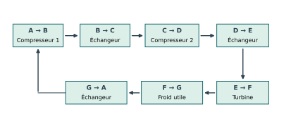
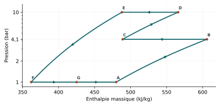
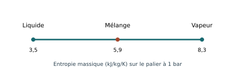

# Banque PT 2022 — Physique B · Thermodynamique · Corrigé brut

*Corrigé rédigé par IA, non officiel. Signalez toute erreur.*

**Rédaction** · GPT-6.2 Astra Ultra · vitesse non renseignée

**Révision (tour 1)** · GPT-6.2 Astra Ultra · vitesse non renseignée

[Sujet et document réponse](https://www.banquept.fr/documents/2022/ph_b_th_2022_pt.pdf) · [Rapport du jury](https://www.banquept.fr/documents/ecrit/rapport/2022/rapport_phys_b_ecrit_2022.pdf) · [Coefficients de la session](https://www.banquept.fr/documents/livret/2022/Livret_PT_2022.pdf#page=13)

**Réfrigération de l’air et techniques cryogéniques.** Les puissances et transferts sont orientés explicitement dans les bilans. Les valeurs relevées graphiquement sont arrondies à la précision des diagrammes du sujet.

## I · Machine frigorifique à cycle de Brayton inversé

### Question 1 · Premier principe pour une machine en écoulement

En régime stationnaire, pour un kilogramme de fluide, $h_s-h_e+(v_s^2-v_e^2)/2+g(z_s-z_e)=q+w_i$. Le travail indiqué $w_i$ exclut le travail de poussée déjà pris en compte dans l’enthalpie. Les variations d’énergie cinétique et potentielle sont négligées dans le cycle, donc $\Delta h=q+w_i$. Pour obtenir les puissances, on multiplie par le débit massique.

### Question 2 · Position des états sur le schéma de l’annexe

A précède le compresseur entraîné par la turbine. B se situe entre ce compresseur et l’échangeur R134a de droite. C le suit, en haut à droite du schéma officiel. D suit le compresseur électrique en haut à gauche. E, après le second échangeur R134a, précède la turbine. F se place en bas à gauche, entre la turbine et l’échangeur utile à −70 °C. G est entre cet échangeur et le dernier échangeur R134a. Celui-ci ramène l’air à A.

### Question 3 · Travail du turbo-détendeur et contrepartie sur l’arbre

La turbine adiabatique reçoit de l’air en E à 10 bar et −10 °C. On descend sur l’isentrope jusqu’à 1 bar en F. Sur l’annexe, $h_E\simeq488$ et $h_F\simeq362$ kJ/kg. Ainsi $w_{i,EF}=h_F-h_E\simeq-126$ kJ/kg. À débit égal et transmission idéale, le compresseur reçoit ce travail, $w_{i,AB}=h_B-h_A=-w_{i,EF}\simeq+126$ kJ/kg.

### Question 4 · États et cycle dans le plan pression-enthalpie

Les isobares sont horizontales et les trois transformations de machine suivent des isentropes. La liaison de puissance explique pourquoi on ne peut pas choisir arbitrairement une pression identique de part et d’autre des étages. La pression intermédiaire, obtenue à l’intersection de $h_B=h_A+126$ avec $s=s_A$, est voisine de 4 bar. Les valeurs suivantes sont des lectures arrondies. Le document 2 arrondit la température à la sortie de la turbine à −140 °C.

| État | Entrée de l’organe suivant | Pression (bar) | Température (°C) | Enthalpie (kJ/kg) |
|---|---|---:|---:|---:|
| A | Compresseur sur arbre commun | 1 | −20 | 480 |
| B | Échangeur R134a | ≈ 4,1 | ≈ 105 | 606 |
| C | Compresseur électrique | ≈ 4,1 | −10 | 489 |
| D | Échangeur R134a | 10 | ≈ 67 | 566 |
| E | Turbine | 10 | −10 | 488 |
| F | Échangeur de la source froide | 1 | ≈ −140 | 362 |
| G | Dernier échangeur R134a | 1 | −75 | 425 |

Le parcours est A–B–C–D–E–F–G–A. Les refroidissements BC et DE ont lieu à des pressions différentes. Les deux réchauffements consécutifs FG et GA appartiennent à l’isobare basse.

### Question 5 · Chaleur utile reçue par l’air

Le fluide à refroidir cède sa chaleur à l’air sur FG. L’échangeur n’a pas de pièce mobile, donc $q_{FG}=h_G-h_F\simeq425-362=63$ kJ/kg d’air. Le signe positif traduit la chaleur extraite de la source froide par kilogramme circulant.

### Question 6 · Efficacité frigorifique réversible

Notons $q_f>0$ la chaleur reçue de la source froide, $q_c<0$ celle reçue de la source chaude et $w>0$ le travail reçu. Sur un cycle, $w+q_f+q_c=0$. La réversibilité donne $q_f/T_f+q_c/T_c=0$. Ainsi $w=q_f(T_c/T_f-1)$ et $\varepsilon_C=q_f/w=T_f/(T_c-T_f)$. Pour $T_f=203$ K et $T_c=248$ K, **$\varepsilon_C\simeq4{,}5$**.

### Question 7 · Première estimation du coefficient de performance

Le travail électrique spécifique idéal est $w_{i,CD}=h_D-h_C\simeq77$ kJ/kg. L’estimation limitée à cette dépense donne $\varepsilon_1=q_{FG}/w_{i,CD}\simeq63/77\simeq0{,}82$. Elle est inférieure à l’efficacité de Carnot. Le service frigorifique du circuit R134a intervient encore dans le bilan réel.

### Question 8 · Dépense auxiliaire à inclure

Il faut compter l’énergie mécanique ou électrique de la machine complémentaire qui ramène le R134a à son état de fonctionnement. Ce circuit absorbe une partie de la chaleur de l’air et en rend une autre fraction. La charge nette restante doit être extraite par cette machine.

### Question 9 · Bilan des trois échangeurs au R134a

Du côté de l’air, $q_{BC}=489-606=-117$, $q_{DE}=488-566=-78$ et $q_{GA}=480-425=+55$ kJ/kg d’air. Ainsi $q_{{\rm air},R}=-140$ kJ/kg. Le transfert total reçu par le R134a vaut donc **+140 kJ par kilogramme d’air**. Pour exprimer une chaleur par kilogramme de R134a, il faudrait connaître le rapport des débits.

### Question 10 · Efficacité globale avec la machine auxiliaire

La machine de coefficient 2 reçoit un travail de $140/2=70$ kJ/kg d’air. Son effet frigorifique sert à régénérer le R134a. L’effet utile pour le fluide à −70 °C reste $q_{FG}$. Ainsi $\varepsilon_{\rm tot}=q_{FG}/[w_{i,CD}+q_R/2]\simeq63/(77+70)\simeq0{,}43$. Sur le cycle de l’air, le contrôle énergétique donne $77+63-140=0$.

## II · Turbinage et détente de Joule-Thomson

### Question 11 · Détente de Joule-Thomson et gaz parfait

La vanne est calorifugée, sans travail d’arbre, et les variations d’énergie cinétique et potentielle sont négligeables. Le premier principe industriel donne $h_s=h_e$. Pour un gaz parfait, $h=h(T)$ avec $\mathrm dh=c_p\,\mathrm dT$, $c_p>0$. Alors $T_s=T_e$. Dans le plan où $h$ est en abscisse et $\log P$ en ordonnée, les isothermes du gaz parfait sont aussi les isenthalpes, des droites verticales.

### Question 12 · Signe du coefficient de Joule-Thomson

La pression diminue dans une détente. Pour un refroidissement, $\mathrm dT<0$ lorsque $\mathrm dP<0$, donc $\mu_{JT}=(\partial T/\partial P)_h>0$ dans le domaine choisi sous la température d’inversion. Pour un gaz parfait, l’isenthalpique est isotherme et $\mu_{JT}=0$. On retrouve ce résultat dans la formule fournie car $V=nRT/P$ donne $T(\partial V/\partial T)_P=V$.

### Question 13 · Température après turbinage idéal

Sur l’isobare d’arrivée, l’intersection est voisine de l’isotherme **−20 °C** (environ −17 °C selon l’interpolation). Un contrôle par le gaz parfait avec $\gamma\simeq1{,}4$ donne $T_f\simeq493(1/10)^{(\gamma-1)/\gamma}\simeq255$ K, soit −18 °C. Cette estimation s’accorde avec le diagramme et son échelle.

### Question 14 · Turbinage réel à même pression de sortie

La turbine est adiabatique, donc $s_{f,\mathrm{irr}}-s_i=s_{\rm créée}>0$, tandis que $s_{f,\mathrm{rev}}=s_i$. Sur l’isobare finale de 1 bar, les états d’entropie plus élevée se situent à droite sur le diagramme et correspondent à des températures supérieures. Ainsi $T_{f,\mathrm{irr}}>T_{f,\mathrm{rev}}$. La détente réelle assure moins de refroidissement.

### Question 15 · Justification à partir de l’identité thermodynamique

À quantité de matière fixée, $\mathrm dH=T\,\mathrm dS+V\,\mathrm dP$. Avec $\mathrm dH=C_p\,\mathrm dT$ et $V=nRT/P$, on a $\mathrm dS=C_p\,\mathrm dT/T-nR\,\mathrm dP/P$. Pour $C_p$ constante, $\Delta S=C_p\ln(T_f/T_i)-nR\ln(P_f/P_i)$. Avec les mêmes état initial et pression finale, la différence entre les deux bilans est $S_{\rm créée}=C_p\ln(T_{f,\rm irr}/T_{f,\rm rev})>0$, d’où la température supérieure en sortie irréversible.

### Question 16 · Turbinage près du domaine diphasé

Des gouttelettes de liquide peuvent apparaître dans le gaz et frapper les aubages à grande vitesse, entraînant érosion et dégradation mécanique. La turbine produit du travail récupérable et peut abaisser la température d’un gaz même presque parfait. En contrepartie, la présence de liquide limite son domaine d’utilisation et l’appareil comporte des pièces mobiles.

### Question 17 · Intérêt et limite de la détente en vanne

La vanne n’a pas de pièce mobile et peut déboucher sur un mélange liquide-vapeur. Elle permet donc d’achever une liquéfaction. Elle ne fournit aucun travail et le refroidissement dépend de l’écart du gaz au comportement parfait. Là où les isenthalpes sont presque horizontales dans le plan $(s,T)$, la chute de température est faible. Le signe de $\mu_{JT}$ peut même conduire à un échauffement.

## II · Évaporation des cryogènes et réfrigération de l’hélium

### Question 18 · Évaporation d’un cryogène pour liquéfier le diazote

La condensation du diazote à 1 bar se fait vers 77 K. Pour extraire de la chaleur avec un écart fini de température, l’évaporateur à 1 bar doit employer un corps dont le palier est sous 77 K. D’après le document 3, **l’hélium (4,2 K), le dihydrogène (20,4 K) et le néon (27,1 K)** satisfont ce critère thermodynamique. Le diazote à la même pression a un palier identique à celui de la cible.

### Question 19 · Fraction de liquide d’hélium après la vanne

Le document 5 donne une détente à enthalpie constante depuis l’isobare 3 bar vers le palier d’environ 4,2 K à 1 bar. Sur ce palier, on relève approximativement $s_l\simeq3{,}5$, $s_m\simeq5{,}9$ et $s_v\simeq8{,}3$ en kJ/(kg·K) dans les références du diagramme. Avec $s_m=x_l s_l+(1-x_l)s_v$, la fraction liquide vaut $x_l=(s_v-s_m)/(s_v-s_l)\simeq(8{,}3-5{,}9)/(8{,}3-3{,}5)\simeq0{,}5$. Au palier, l’écart entre entropies saturées vaut aussi approximativement $20{,}4/4{,}2\simeq4{,}9$ kJ/(kg·K), ce qui concorde avec la largeur lue. On obtient environ la moitié de la masse sous forme liquide. La lecture utilise l’entropie du mélange **après** la détente irréversible.

### Question 20 · Température accessible avec l’hélium liquide

À 1 bar, l’évaporation d’hélium impose un bain à environ **4,2 K**. À 15 mbar, le palier du document 5 est vers **1,8 K**. Un corps qui donne de la chaleur au bain s’en approche par températures supérieures. La lecture à 15 mbar correspond à environ 1,77 K avant arrondi. Le transfert exige un écart non nul tant que la puissance extraite reste finie.

### Question 21 · Étapes de refroidissement des aimants

Le document 6 permet de compléter le tableau ainsi. Le prérefroidissement à 80 K et l’injection d’hélium froid précèdent l’exploitation des masses d’aimants à 1,9 K.

| Grandeur | Phase 1 | Phase 2 | Phase 3 |
|---|---|---|---|
| Objet à refroidir | Hélium à 80 K | Aimants à environ 4,5 K | Aimants à 1,9 K |
| Fluide réfrigérant | Diazote liquide à 77 K, 1 bar | Hélium vers 4,2 K, avec turbinage cryogénique | Hélium vers 1,8 K, sous 15 mbar |

Le document décrit le circuit prérefroidi à 4,5 K avant le remplissage des aimants. Les 4,2 K de l’hélium au palier de 1 bar donnent le niveau plus froid approprié au tableau de la deuxième phase.
