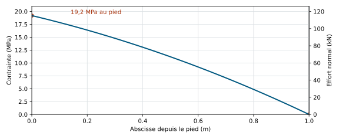
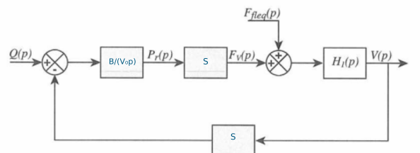
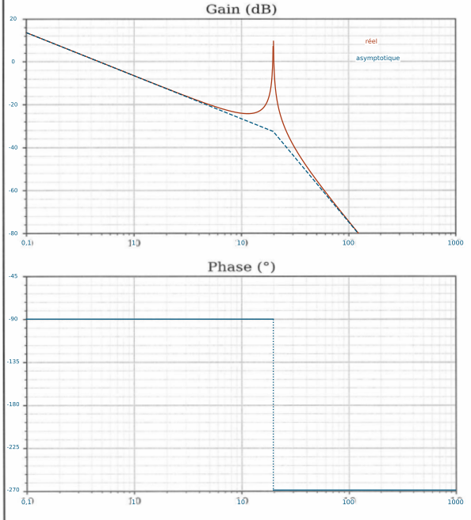
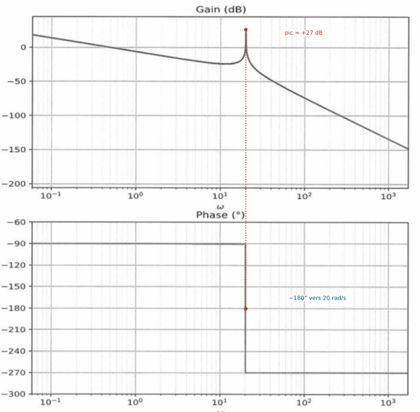
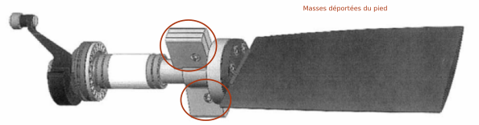
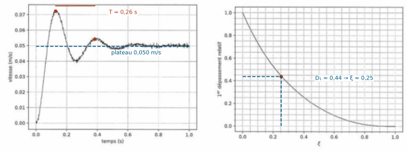
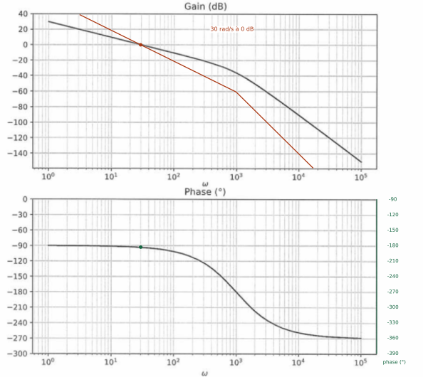

# Banque PT 2022 — Sciences industrielles A · Corrigé brut

*Corrigé rédigé par IA, non officiel. Signalez toute erreur.*

**Rédaction** · GPT-6.2 Astra Ultra · vitesse non renseignée · 26 novembre 2026

**Moteur Open Rotor.** Épreuve de cinq heures en quatre parties et 45 questions. Le dossier réunit la présentation, le travail demandé, les annexes et le cahier de réponses.

[Sujet et cahier officiels](https://www.banquept.fr/documents/2022/si_a_2022_pt.pdf) · [Rapport du jury](https://www.banquept.fr/documents/ecrit/rapport/2022/rapport_si_a_ecrit_2022.pdf)

## I. Actions mécaniques dans une aube

### Question 1 — Vitesses de croisière

$V_{\max}=0{,}7\times340=238$ m/s, soit $856{,}8$ km/h. À 800 tr/min, $\omega_{\max}=800(2\pi/60)=83{,}8$ rad/s. Le sujet prescrit ensuite les arrondis indépendants 250 m/s et 80 rad/s.

[Sujet p. 8](https://www.banquept.fr/documents/2022/si_a_2022_pt.pdf#page=8) · [Cahier p. 33 du PDF](https://www.banquept.fr/documents/2022/si_a_2022_pt.pdf#page=33)

### Question 2 — Vitesse en bout d’aube

$\vec V_C=V\vec z_0+\dot\theta\vec z_0\times R\vec x_2=V\vec z_0+R\dot\theta\vec y_2$. Les deux composantes étant orthogonales, $V_C=\sqrt{V^2+R^2\dot\theta^2}$.

### Question 3 — Comparaison à Mach 1

Avec les valeurs imposées, $V_C=250\sqrt{1+(160/250)^2}$ m/s. Le premier ordre donne $250(1+0{,}4096/2)=301{,}2$ m/s ; le calcul direct donne 296,8 m/s. Le paramètre 0,41 est assez grand pour expliquer cet écart. La vitesse de bout d’aube reste subsonique, environ Mach 0,87 dans le modèle.

### Question 4 — Actions en pied d’aube

Le poids et l’aérodynamique sont négligés dans cette partie. La liaison encastrement est la seule action extérieure conservée. Le principe fondamental donne, au même point B, $\mathcal T(3\to2)=\mathcal D(2/0)$. Les trois composantes de la résultante et les trois composantes du moment sont donc déterminées.

### Question 5 — Résultante dynamique

Posons $d=(r+R)/2$. Alors $\vec V_G=V\vec z_0+d\dot\theta\vec y_2$ et $\vec a_G=\dot V\vec z_0+d\ddot\theta\vec y_2-d\dot\theta^2\vec x_2$. La résultante dynamique est $m_2\vec a_G$.

### Question 6 — Moments cinétique et dynamique en G

$\vec\sigma_G=I_G\vec\Omega=C_2\dot\theta\vec z_2$. Au centre de masse, le moment dynamique est directement sa dérivée galiléenne, soit $\vec\delta_G=C_2\ddot\theta\vec z_2$.

### Question 7 — Vitesse du pied

Le champ de vitesse donne $\vec V_B=V\vec z_0+r\dot\theta\vec y_2$. Il faut conserver la composante de translation de l’avion.

### Question 8 — Moment dynamique en B

En notant $h=(R-r)/2=L/2$, $\vec\delta_B=\vec\delta_G+h\vec x_2\times m_2\vec a_G$. Ainsi $\vec\delta_B=-m_2h\dot V\vec y_2+(C_2+m_2hd)\ddot\theta\vec z_2$. La composante radiale centripète ne crée pas de moment en B.

### Question 9 — Inertie autour de l’axe de la soufflante

Pour un parallélépipède homogène $C_2=m_2(L^2+e^2)/12$. À épaisseur négligeable $C_2\simeq m_2L^2/12$. La largeur $a$, parallèle à cet axe, intervient dans la masse.

### Question 10 — Torseur de la liaison

$X_{32}=-m_2d\dot\theta^2$, $Y_{32}=m_2d\ddot\theta$ et $Z_{32}=m_2\dot V$. En B, $L_{32}=0$, $M_{32}=-m_2h\dot V$ et $N_{32}=(C_2+m_2hd)\ddot\theta$. La force suivant $x_2$ ramène l’aube vers le centre.

### Question 11 — Moments au roulage

$m_2=\rho aeL$, $d=3L/2$ et $h=L/2$. Pour les accélérations données, $L_{32}=0$, $M_{32}=-(\rho aeL^2/2)a_{\max}$ et $N_{32}=(5/6)\rho aeL^3\ddot\theta_{\max}$. Le coefficient $5/6$ est la somme de $1/12$ et $3/4$.

### Question 12 — Ordres de grandeur des moments

$m_2=2000\times0{,}30\times0{,}02\times1=12$ kg. Avec $a_{\max}=5$ m/s² et $\ddot\theta_{\max}=2$ rad/s², les modules sont 0, 30 et 20 N·m. Une tonne à 1 m exerce environ 9810 N·m : les deux plus grands valent 0,31 % et 0,20 % de la référence. Cela justifie l’approximation pour ces moments inertiels seuls.

### Question 13 — Résultante en croisière

$\dot V=\ddot\theta=0$ annule les trois moments et les efforts tangentiels et axiaux. Il subsiste $X_{32}=-(3/2)m_2L\dot\theta^2$, soit $-115\,200$ N pour les valeurs imposées. Le signe indique l’action centripète du rotor.

### Question 14 — Résultante dynamique d’une tranche

Une tranche de masse $dm=\rho S\,dx$ est à distance $r+x$. En croisière $d\vec R_d=-\rho S(r+x)\omega_{\max}^2\,dx\,\vec x_2$, au premier ordre en $dx$.

### Question 15 — Équilibre dynamique sur les deux faces

Sur la face droite l’effort est $+N(x+dx/2)\vec x_2$, sur la face gauche $-N(x-dx/2)\vec x_2$. Leur somme donne $N(x+dx/2)-N(x-dx/2)=-\rho S(r+x)\omega_{\max}^2dx$.

### Question 16 — Équation locale de traction

$N'(x)+f(x)=0$, avec $f(x)=\rho S(r+x)\omega_{\max}^2$ en N/m, orientée radialement vers l’extérieur. Il s’agit de la force d’inertie rapportée au repère en rotation.

### Question 17 — Effort normal

$N(L)=0$ donne $N(x)=\int_x^L f(u)\,du=\rho S\omega_{\max}^2[(r+L)^2-(r+x)^2]/2$. Il est positif sur la portée et maximal en B. On retrouve $N(0)=-X_{32}$.

### Question 18 — Contrainte maximale

Le maximum est atteint en $x=0$ et $\sigma_{\max}=N(0)/S$. Comme $r=L$, $\sigma_{\max}=(3/2)\rho L^2\omega_{\max}^2=19{,}2$ MPa.

[Sujet p. 11](https://www.banquept.fr/documents/2022/si_a_2022_pt.pdf#page=11) · [Cahier p. 41 du PDF](https://www.banquept.fr/documents/2022/si_a_2022_pt.pdf#page=41)

### Question 19 — Comparaison à la limite élastique

$R_e/\sigma_{\max}=1500/19{,}2\simeq78$. La traction due à la seule inertie reste dans le domaine élastique du modèle homogène ; le calcul ne représente pas les efforts aérodynamiques ni les concentrations au pied.

### Question 20 — Déformation et allongement

$\varepsilon(x)=N(x)/(ES)=\rho\omega_{\max}^2[(r+L)^2-(r+x)^2]/(2E)$. Avec $u(0)=0$, $\Delta L=\int_0^L\varepsilon\,dx=\rho\omega_{\max}^2(rL^2/2+L^3/3)/E$. Pour $r=L=1$ m et $E=500$ GPa cela donne $2{,}13\times10^{-5}$ m, soit 21 µm. L’allongement relatif est de l’ordre de $2\times10^{-5}$.

## II. Transmission contrarotative

### Question 21 — Relation de Willis

Dans ce repère, le contact soleil–satellite est extérieur et satellite–couronne intérieur. Aussi $(\omega_{41}-\omega_{3'1})/(\omega_{31}-\omega_{3'1})=-Z_3/Z_4=\lambda=-3$. Après réarrangement $\omega_{41}+(\lambda-1)\omega_{3'1}-\lambda\omega_{31}=0$.

[Sujet p. 12](https://www.banquept.fr/documents/2022/si_a_2022_pt.pdf#page=12) · [Cahier p. 43 du PDF](https://www.banquept.fr/documents/2022/si_a_2022_pt.pdf#page=43)

### Question 22 — Vitesses des deux hélices

$\omega_{3'1}=(\omega_{41}-\lambda\omega_{31})/(1-\lambda)=(-7-\lambda)\omega_{\max}/(1-\lambda)=-80$ rad/s. Les deux hélices tournent en sens opposés, au même module.

### Question 23 — Équilibre des puissances

L’énergie cinétique totale est constante et les actions intérieures idéales ont une puissance totale nulle. Le théorème de l’énergie cinétique donne $-C\omega_{41}+C_{a3}\omega_{31}+C_{a3'}\omega_{3'1}=0$. Les paliers sur le bâti fixe ne fournissent pas de puissance.

### Question 24 — Répartition des couples

Avec la contrainte de Willis, $(C_{a3}-\lambda C)\omega_{31}+[C_{a3'}-(1-\lambda)C]\omega_{3'1}=0$. Pour déterminer les deux couples, écrire le bilan des puissances virtuelles à l’équilibre pour les deux vitesses indépendantes du train idéal. Il vient $C_{a3}=\lambda C=-3C$, $C_{a3'}=(1-\lambda)C=4C$. Au seul point de fonctionnement, le bilan de puissance réelle fournit uniquement $C_{a3'}-C_{a3}=7C$.

### Question 25 — Couple résiduel transmis

Leurs modules sont $3|C|$ et $4|C|$. La somme vaut $C$ et ne s’annule pas pour un entraînement chargé. Le support du groupe moteur doit reprendre le couple résiduel avec la réaction du générateur de puissance ; la contrarotation des vitesses n’implique pas une compensation parfaite des couples.

## III. Chaîne de puissance du calage

### Question 26 — Loi géométrique du calage

$\lambda=\overrightarrow{OC}\cdot\vec z_1=L_2\sin\alpha$. Près de zéro et en radians, $\alpha\simeq\lambda/L_2$, donc $K_{am}=1/L_2=3{,}33$ rad/m. À 35° la linéarisation de $\sin\alpha$ présente déjà environ 6 % d’écart sur le déplacement.

[Sujet p. 15](https://www.banquept.fr/documents/2022/si_a_2022_pt.pdf#page=15) · [Cahier p. 46 du PDF](https://www.banquept.fr/documents/2022/si_a_2022_pt.pdf#page=46)

### Question 27 — Blocs hydrauliques

Posons $D=V_0/B$. Avec conditions initiales nulles $Q=SV+DpP_r$ et $F_V=SP_r$. Au comparateur de débit on retranche $SV$ ; du débit résiduel à la pression placer $1/(Dp)=B/(V_0p)$, puis $S$ de la pression à la force. Le retour de vitesse vers le débit a pour gain $S$. La perturbation de force s’additionne à la force du vérin.

[Sujet p. 16](https://www.banquept.fr/documents/2022/si_a_2022_pt.pdf#page=16) · [Cahier p. 46 du PDF](https://www.banquept.fr/documents/2022/si_a_2022_pt.pdf#page=46)

### Question 28 — Moment cinétique de l’aube et du galet

Le galet a une inertie négligeable. On note $A,B_2,C_2$ les moments principaux en O et $\omega=\dot\theta$. O est fixe dans le repère 1 du modèle. Comme $\vec z_1=\sin\alpha\vec y_2+\cos\alpha\vec z_2$, le moment cinétique vaut $\vec\sigma_O=A\dot\alpha\vec x_2+B_2\omega\sin\alpha\vec y_2+C_2\omega\cos\alpha\vec z_2$.

### Question 29 — Moment dynamique autour de l’axe de calage

La composante cherchée est $\delta_{Ox}=A\ddot\alpha+(C_2-B_2)\omega^2\sin\alpha\cos\alpha$. Les dérivées des composantes selon $y_2,z_2$ ne se projettent pas suivant $x_2$ dans la dérivée relative.

### Question 30 — Rotation autour de l’axe propre

Notons $F$ la composante suivant $z_1$ de l’effort du poussoir sur un galet. Son bras de levier est $L_2\cos\alpha$ ; le pivot parfait ne transmet pas de moment selon $x_2$. On a $A\ddot\alpha+(C_2-B_2)\omega^2\sin\alpha\cos\alpha=C_{air,x}+L_2F\cos\alpha$. Au premier ordre : $A\ddot\alpha+(C_2-B_2)\omega^2\alpha=C_{air,x}+L_2F$.

### Question 31 — Translation de la tige

La résultante suivant $z_1$ sur la tige et le poussoir vaut $F_V-10F$. Le théorème de la résultante dynamique donne $m_7\ddot\lambda=F_V-10F$, les réactions des galets étant opposées aux efforts employés en Q30.

### Question 32 — Masse et raideur équivalentes

En substituant $10F$ de Q30 dans Q31, $M_{eq}\ddot\lambda+K_{eq}\lambda=F_V+F_{eqair}$. Ici $M_{eq}=m_7+10A/L_2^2$, $K_{eq}=10(C_2-B_2)\omega^2/L_2^2$ et $F_{eqair}=10C_{air,x}/L_2$. Les unités respectives sont kg, N/m et N.

### Question 33 — Transfert mécanique vitesse–force

Avec conditions initiales nulles $H_1(p)=V/(F_V+F_{eqair})=p/(M_{eq}p^2+K_{eq})$. Le numérateur $p$ provient de $V=p\Lambda$.

### Question 34 — Transferts en débit et perturbation

De $Q=SV+Dp[(M_{eq}p+K_{eq}/p)V-F_{eqair}]/S$, il vient $(S^2+DK_{eq}+DM_{eq}p^2)V=SQ+DpF_{eqair}$. Donc $K_V=S/(S^2+DK_{eq})$, $K_{air}=D/(S^2+DK_{eq})$ et $\omega_V^2=(K_{eq}+S^2/D)/M_{eq}$. Le terme hydraulique $S^2/D$ est une raideur.

### Question 35 — Échelle des deux signaux du comparateur

$M=C_{ap}\lambda=C_{ap}\alpha/K_{am}$. Il faut donc $A_E=C_{ap}/K_{am}=20\times0{,}30=6$ V/rad. L’écart est alors proportionnel à une erreur d’angle.

### Question 36 — Bloc entre vitesse et position

$V(p)=p\Lambda(p)$ donne $I(p)=\Lambda(p)/V(p)=1/p$.

### Question 37 — Gain sans amortissement

$L_o=K_{sv}K_VC_{ap}/[p(1+p^2/20^2)]=0{,}48/[p(1+p^2/400)]$. Les pentes sont −20 puis −60 dB par décade de part et d’autre de 20 rad/s. La courbe réelle diverge à la résonance ; la phase passe de −90° à −270°. Le polynôme fermé $p^3+400p+192$ a deux racines dans le demi-plan droit (table de Routh par passage à la limite sur le coefficient de $p^2$). Cette boucle est instable.

[Sujet p. 18](https://www.banquept.fr/documents/2022/si_a_2022_pt.pdf#page=18) · [Cahier p. 51 du PDF](https://www.banquept.fr/documents/2022/si_a_2022_pt.pdf#page=51)

### Question 38 — Gain proportionnel maximal

La phase franchit −180° aux alentours de 20 rad/s sur le pic très étroit du cahier. Le gain tracé à cet endroit atteint environ +26 à +28 dB. Pour une marge de 15 dB, décaler la courbe d’environ −42 dB : $K_{C,\max}\simeq10^{(-15-27)/20}\simeq0{,}008$ (ordre de 0,007 à 0,009 selon lecture). La coupure restante, bien sous 20, présente une phase voisine de −90°, donc la marge de phase dépasse 60°. L’amortissement exact n’est pas fourni pour ce premier tracé.

[Sujet p. 18](https://www.banquept.fr/documents/2022/si_a_2022_pt.pdf#page=18) · [Cahier p. 52 du PDF](https://www.banquept.fr/documents/2022/si_a_2022_pt.pdf#page=52)

### Question 39 — Approximation du temps de réponse

Pour un suivi stable, dominé autour de la coupure par un intégrateur, sans résonance ou retard dominant, avec gain statique fermé voisin de un et amortissement suffisant, la boucle fermée ressemble à $1/(1+p/\omega_c)$. Alors $t_{5\%}\simeq-\ln(0{,}05)/\omega_c\simeq3/\omega_c$. Ce produit n’est pas une identité valable pour tous les asservissements.

### Question 40 — Compatibilité du gain avec la rapidité

$\omega_c\simeq0{,}48K_C\simeq0{,}0038$ rad/s et $t_{5\%}\simeq7{,}9\times10^2$ s pour le gain de Q38. La limite de 0,1 s imposerait une coupure de l’ordre de 30 rad/s. Un simple déplacement vertical du diagramme ne permet pas de concilier cette cible et les marges exigées.

## IV. Correction du calage

### Question 41 — Équilibrage des inerties

Imposer $C_{O2}=B_{O2}$ supprime dans $K_{eq}$ le terme dépendant de $\dot\theta^2$. Les masselottes déportées sur la partie tournante au pied de la pale, entourées sur la vue, servent à ajuster les moments suivant les deux directions transverses. Une masse sur l’axe du calage contribue de façon identique aux deux moments ; c’est son déport transverse qui permet d’en régler la différence.

[Sujet p. 20](https://www.banquept.fr/documents/2022/si_a_2022_pt.pdf#page=20) · [Cahier p. 54 du PDF](https://www.banquept.fr/documents/2022/si_a_2022_pt.pdf#page=54)

### Question 42 — Identification de la dynamique du vérin

La vitesse finale vaut environ 0,050 m/s et le premier maximum 0,072 m/s, soit $D_1\simeq0{,}44$. L’annexe A donne $\xi\simeq0{,}25$ ; on retrouve $\xi=-\ln D_1/\sqrt{\pi^2+(\ln D_1)^2}$. La pseudo-période d’environ 0,26 s conduit à $\omega_v=2\pi/(T_p\sqrt{1-\xi^2})\simeq25$ rad/s. Le numérateur du filtre doit reproduire ces deux paramètres du mode mesuré.

[Sujet p. 21](https://www.banquept.fr/documents/2022/si_a_2022_pt.pdf#page=21) · [Cahier p. 54 du PDF](https://www.banquept.fr/documents/2022/si_a_2022_pt.pdf#page=54)

### Question 43 — Classe et gain de la correction intégrale

Pour la consigne, la boucle contient déjà $1/p$ et rejette l’erreur statique sur un échelon une fois stabilisée. Pour la perturbation de force en rampe, le facteur $pK_{air}$ compense l’intégrateur cinématique sur la voie directe de la perturbation ; son gain direct en position est fini et non nul à l’origine. Avec $L_o\sim k/p^{1+\gamma}$ l’erreur de régime pour cette rampe est proportionnelle à $\lim_{p\to0}p^\gamma$. Il faut donc $\gamma_{\min}=1$. Pour conserver le module unitaire à 30 rad/s, $K_i/30=1$, soit $K_i=30\ \mathrm{s^{-1}}$.

### Question 44 — Marges après ajout de l’intégrateur

Les pentes du gain sont −40 dB/décade jusqu’à $10^3$ rad/s puis −80. La phase devient $-180^\circ-2\arctan(\omega/1000)$ ; la nouvelle échelle verte décale chaque ancienne ordonnée de −90°. À 30 rad/s, la marge de phase vaut $-2\arctan(0{,}03)\simeq-3{,}44^\circ$. La phase s’écarte immédiatement au-dessous de −180° quand on quitte zéro, où le gain tend vers l’infini : aucune marge de gain stabilisante pour une multiplication positive constante (rapport limite 0, soit $-\infty$ dB). Les deux intégrateurs exigent une avance de phase.

[Sujet p. 22](https://www.banquept.fr/documents/2022/si_a_2022_pt.pdf#page=22) · [Cahier p. 55 du PDF](https://www.banquept.fr/documents/2022/si_a_2022_pt.pdf#page=55)

### Question 45 — Réglage de l’avance de phase

La marge visée vaut 60°. Avec la phase de Q44 il faut $\varphi_m\simeq63{,}44^\circ$. Pour $H_a=K_a(1+\tau_ap)/(1+a_a\tau_ap)$, $\sin\varphi_m=(1-a_a)/(1+a_a)$, donc $a_a=(1-\sin\varphi_m)/(1+\sin\varphi_m)\simeq0{,}0557$. Le maximum est à $1/(\tau_a\sqrt{a_a})=30$, soit $\tau_a\simeq0{,}141$ s. Le module y est $K_a/\sqrt{a_a}$ et la coupure est donc conservée pour $K_a=\sqrt{a_a}\simeq0{,}236$. Si l’on lit une phase initiale arrondie à −180°, l’abaque donne environ 0,072, 0,124 s et 0,268.
