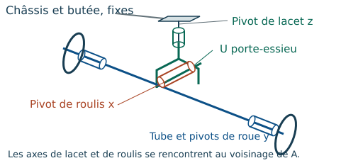
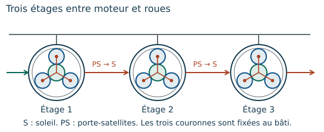
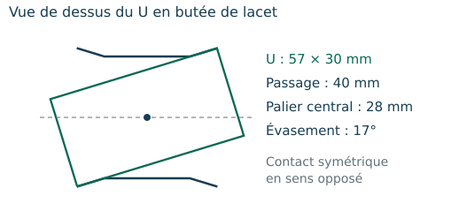
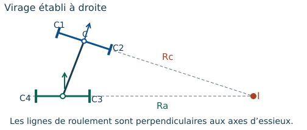
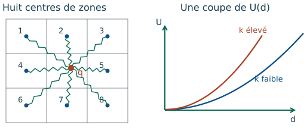
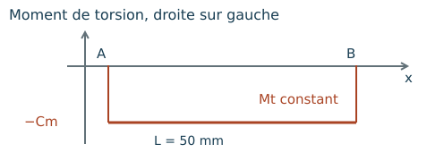
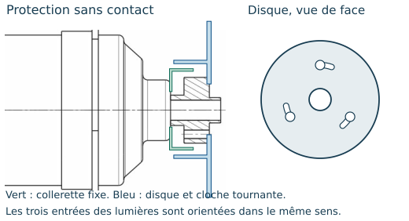
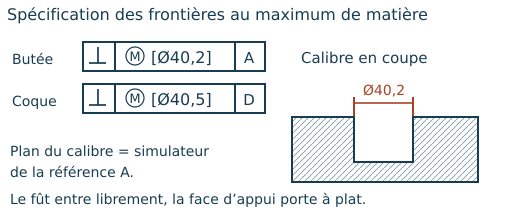
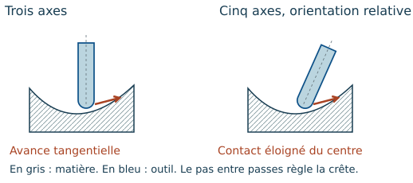

# Banque PT 2022 — Sciences industrielles C · Corrigé brut

*Corrigé rédigé par IA, non officiel. Signalez toute erreur.*

**Rédaction** · GPT-6.2 Astra Ultra · vitesse non renseignée · 26 novembre 2026

**Révision (tour 1)** · GPT-6.2 Astra Ultra · vitesse non renseignée · 26 novembre 2026

**Robot Vitirover pour l’entretien des parcelles de vignoble.** Épreuve de six heures. Les 50 questions forment cinq parties, notées respectivement 20 %, 20 %, 20 %, 15 % et 25 % selon le rapport. Le temps conseillé par la garde est de 20 % par partie après quinze minutes de lecture. Les points individuels ne sont pas publiés.

[Sujet et planches](https://www.banquept.fr/documents/2022/si_c_2022_pt.pdf) · [Rapport du jury](https://www.banquept.fr/documents/ecrit/rapport/2022/rapport_si_c_ecrit_2022.pdf)

## I · Comprendre le robot

### Q1 · Chaîne de puissance

Deux entrées convergent sur la batterie. Depuis le réseau EDF, **adapter et redresser** avec un **chargeur secteur** donne du courant continu. Depuis le rayonnement solaire, **produire** avec le **panneau photovoltaïque** fournit aussi du courant continu. **Stocker et restituer** avec la **batterie** fournit l’électricité continue déjà indiquée sur la flèche. **Moduler** avec la carte de commande fournit une tension continue modulée au moteur. **Convertir** avec le **moteur à courant continu** donne une rotation rapide à faible couple. **Adapter et transmettre** avec le **réducteur** donne une rotation lente à couple augmenté. **Agir sur le sol** avec les roues produit le déplacement du châssis. Sur la grille, les cinq énergies à préciser sont l’électricité alternative du secteur, l’électricité continue des sources au stockage, l’électricité modulée au moteur, la rotation avant réduction puis la rotation après réduction.

### Q2 · Train arrière à deux rotations libres

La butée est solidaire du châssis. La tige verticale du U pivote dans cette butée autour de l’axe de lacet z. Le tube d’essieu pivote entre les joues du U autour de l’axe de roulis x. Les deux roues ont chacune leur pivot d’axe transversal y sur le tube. Les deux mobilités successives entre châssis et essieu permettent de braquer et de suivre un sol en dévers. Les butées limitent l’amplitude, elles ne constituent pas un pivot supplémentaire.

### Q3 · Réduction composée

Les rapports exacts de la ressource II sont arrondis à deux décimales. **5,18 × 6,75 × 6,75 = 236,01**, compatible avec 236,09 dans le catalogue. On retient donc un étage désigné 5:1 et deux étages désignés 7:1. Le produit des appellations arrondies donnerait 245 et écarterait à tort cette combinaison. L’ordre de montage n’est pas déterminé par le seul rapport.

### Q4 · Trois trains épicycloïdaux

Pour chaque étage, le soleil est l’entrée, la couronne à denture intérieure est fixée au carter, et le porte-satellites est la sortie. Trois satellites tournent librement sur ce porte-satellites et engrènent avec le soleil et la couronne. Relier rigidement le premier porte-satellites au deuxième soleil, puis le deuxième porte-satellites au troisième soleil. Le troisième porte-satellites entraîne l’arbre de roue. Pour chaque train à couronne fixe, la relation de Willis donne un rapport moteur/sortie égal à 1 + Zcouronne/Zsoleil, positif.

### Q5 · Débattement de lacet

Superposer en vue de dessus le rectangle du U, **57 × 30 mm**, et le passage de largeur **40 mm** au centre. Le sens de la rotation à étudier est z conformément à la question. La partie à bords parallèles de la butée s’étend sur **28 mm** avant les lèvres inclinées à 17°. À l’extrémité de la portion droite, le coin de la butée est à (14, 20) mm du centre. Sa distance signée à l’axe long du U tourné de θ est 20 cos θ − 14 sin θ. À 17°, cette distance est 15,03 mm pour une demi-largeur du U de 15 mm. Le côté du U est alors presque parallèle à la lèvre. Vérifier sur le tracé toute la longueur en recouvrement, y compris l’extrémité de la face inclinée, et répéter par symétrie. On lit **environ ±17°, débattement total 34°**. L’égalité au dixième de degré dépend des cotes arrondies et de la longueur réellement en contact. L’angle de dépouille fixe ainsi pratiquement le sens de la face en butée.

### Q6 · Distance au drapeau

Le faisceau optique est horizontal sur la ressource IV. À la hauteur y au-dessus du pivot, le drapeau incliné vers la gauche s’écarte de la verticale de y tan θ. Pour le sens positif dessiné, **d(θ) = x + y tan θ**, et la variation depuis la position médiane est Δd = y tan θ. Si le sens positif du braquage est inversé, le signe change. L’étalonnage inverse est θ = arctan[(d − x)/y].

### Q7 · Position du capteur

Choisir une seule branche monotone de la courbe tension–distance, loin du sommet proche de 3 cm. Sur la branche descendante, la pente en valeur absolue est nettement plus forte près de 4–8 cm qu’au-delà de 20 cm. Pour le bruit de tension δU, l’incertitude de premier ordre est δθ ≈ δU cos²θ/(|U′(d)| y). Augmenter y améliore la sensibilité, mais augmente aussi l’excursion en distance. Fixer deux distances admissibles dlo et dhi sur la branche choisie, avec les marges de montage, poser x = (dhi + dlo)/2 et y ≤ (dhi − dlo)/(2 tan 17°), puis tester les deux butées. Par exemple **x = 6 cm, y = 6 cm** donne environ 4,2 à 7,8 cm. Vérifier qu’à ces hauteurs le faisceau reste sur le drapeau réel.

### Q8 · Précision de navigation

Le GNSS donne la position du robot dans la parcelle à l’échelle du mètre, alors que les zones de gestion font 10 m de côté. La tonte repose sur des passages répétés par le troupeau, et l’approche fine du tronc sur la détection locale de contact à très petite vitesse. Le système peut donc affecter et couvrir les zones avec cette incertitude. Une limite sensible de parcelle justifie de garder une marge adaptée à l’erreur de position.

## II · Suivre une courbe et orienter le troupeau

### Q9 · Amorcer le virage à droite

Pour amorcer un virage à droite, le nez du châssis tourne à droite et l’arrière se déporte vers la gauche. Il faut d’abord orienter le train arrière libre vers la gauche relativement au châssis, jusqu’à sa butée. Une manœuvre sans ripage consiste à tenir les roues avant à l’arrêt et à faire rouler les deux roues arrière sur des arcs opposés autour du pivot central, C3 droite vers l’avant et C4 gauche vers l’arrière. Puis avancer avec les quatre roues, les roues extérieures gauches plus rapides que les droites, en maintenant le braquage extrême par la loi des rayons. Si la manœuvre doit rester continue, effectuer le même braquage différentiel sur une vitesse d’avance commune, en tenant compte de la rotation du châssis. Bloquer une roue avant pour tourner sur place serait incompatible avec la butée de 17°.

### Q10 · Centre instantané et vitesse

Dans le virage établi et à angle de braquage constant, le centre instantané I est à l’intersection des droites portant les essieux avant et arrière, perpendiculaires aux directions de roulement. Sur la feuille réponse il est à droite de C3, sur le prolongement de C4C3. Pour le même solide en mouvement plan, **‖V(Ci)‖/‖V(C)‖ = ICi/IC = Ri/Rc**. Les vitesses sont tangentes aux cercles, et non dirigées vers I.

### Q11 · Vitesse des quatre centres

Notons tf la direction avant longitudinale du châssis, tr la direction de roulement de l’essieu arrière, l = 0,39 m la voie et e = 0,39 m l’empattement. Pour le virage à droite représenté, le rayon au centre arrière est Ra = √(Rc² + e²). Alors R1 = Rc + l/2, R2 = Rc − l/2, R3 = Ra − l/2, R4 = Ra + l/2. Les vitesses des centres des roues avant valent (Vc/Rc) R1 tf et (Vc/Rc) R2 tf. À l’arrière elles valent (Vc/Rc) R3 tr et (Vc/Rc) R4 tr, dans le régime de braquage constant. Le roulement sans glissement donne également ‖V(Ci)‖ = Rroue |ωroue,i|. En phase de braquage, la rotation propre du train arrière doit être ajoutée pour ses deux centres.

### Q12 · Vitesse des moteurs

Avec ired = 236 et Rroue = 0,090 m, la consigne moteur en rad/s est **ωi = 236 Vc Ri/(0,090 Rc)** dans le sens de marche propre à chaque moteur. Remplacer Ri successivement par Rc + l/2, Rc − l/2, √(Rc² + e²) − l/2 et √(Rc² + e²) + l/2 pour C1, C2, C3, C4. Pour un virage à gauche, échanger droite et gauche. Quand Rc tend vers l’infini, les quatre modules tendent vers la même vitesse.

### Q13 · Plus petit rayon

Le triangle reliant C, le milieu de l’essieu arrière et I est rectangle en C. L’angle entre les axes des roues vaut |θ|, avec tan |θ| = e/Rc. La valeur imposée de 17° conduit à **Rc,min = 0,39/tan 17° = 1,28 m** au milieu de l’essieu avant. Le rayon suivi par la roue intérieure avant serait plus petit de l/2.

### Q14 · Force attractive

Pour q = (x,y) et qi = (xi,yi), le potentiel vaut Ui = ki[(x − xi)² + (y − yi)²]/2. La force est l’opposé du gradient spatial, soit **Fi = ki(xi − x, yi − y)**. Elle s’annule au centre et pointe vers lui partout ailleurs.

### Q15 · Analogie élastique

Un ressort linéaire idéal de longueur à vide nulle, attaché en qi, a pour énergie ki d²/2 avec d = ‖q − qi‖. En coupe le tracé est une parabole de minimum nul en d = 0. Dans le plan c’est un paraboloïde. Doubler ki double le potentiel à même distance et la raideur de la pente. La figure de Q17 montre les deux coupes.

### Q16 · Pondérer les zones

Augmenter ki pour une zone dont le dernier passage est ancien, ou dont la hauteur d’herbe estimée est forte. Réduire ki lorsque des positions et trajectoires transmises indiquent que d’autres robots viennent de tondre cette zone ou vont déjà la rejoindre. Les mesures de couverture et d’occupation donnent deux paramètres observables qui évitent de concentrer le troupeau inutilement.

### Q17 · Huit ressorts attractifs

Relier la particule q aux huit centres par huit ressorts indépendants de longueur à vide nulle et de raideurs k1 à k8. Chaque force agit sur q suivant la droite vers son centre, même pour les zones diagonales plus éloignées. Le robot reste libre de se déplacer dans les deux directions du plan.

### Q18 · Huit forces explicites

Avec le numérotage de VI, les centres se trouvent à 10 m du centre dans chaque direction utile. Les composantes des forces, dans l’ordre de la figure, valent F1 = k1(−10 − x, 10 − y), F2 = k2(−x, 10 − y), F3 = k3(10 − x, 10 − y), F4 = k4(−10 − x, −y), F5 = k5(10 − x, −y), F6 = k6(−10 − x, −10 − y), F7 = k7(−x, −10 − y), F8 = k8(10 − x, −10 − y). Les coordonnées sont exprimées en mètres.

### Q19 · Potentiel total

Posons K = somme des ki, X = 10(−k1 + k3 − k4 + k5 − k6 + k8), Y = 10(k1 + k2 + k3 − k6 − k7 − k8). Par développement des huit carrés, **UT = K(x² + y²)/2 − Xx − Yy + B**. La constante B = 100(k1 + k3 + k6 + k8) + 50(k2 + k4 + k5 + k7) provient des quatre distances diagonales de carré 200 m² et des quatre distances axiales de carré 100 m². C’est la somme exacte des huit énergies.

### Q20 · Direction résultante

Le vecteur de descente vaut **D = (X − Kx, Y − Ky)**. S’il est non nul, la direction unitaire est D/‖D‖ et l’angle de cap peut être obtenu avec atan2(Dy,Dx). Le point cible du modèle est le barycentre (X/K,Y/K). Une simple tangente du quotient perdrait l’information du quadrant.

### Q21 · Minimum symétrique

À l’origine avec huit raideurs égales, les forces opposées s’annulent, D = 0. La direction est indéterminée bien que l’énergie totale soit positive. Pour reprendre la couverture, utiliser la procédure de réorientation aléatoire prévue, puis recalculer, ou attribuer une plus grande priorité à une zone encore peu tondue. Un simple petit déplacement avec huit poids gelés ramènerait vers le même minimum.

## III · Vérifier l’autonomie énergétique

### Q22 · Glissement lors d’une collision

Le châssis arrêté ne progresse plus mais les roues tournent. La vitesse périphérique est 2π × 9 940/60 × 0,090/236 = **0,397 m/s**. Les efforts tangentiels des quatre pneus s’additionnent en 0,3 Mg = 69 N. L’énergie dissipée en 2 s est 69 × 0,397 × 2 = **54,8 J mécaniques pour les quatre roues**. En prenant le rendement maximal moteur de 0,85 et un réducteur idéal, la demande électrique estimée est **64,4 J**, soit 0,0179 Wh par choc. Les pertes réelles peuvent la majorer.

### Q23 · Mobilité en cinq heures

On compte 200 chocs et 400 s d’immobilisation sur 18 000 s. La distance de croisière est donc (18 000 − 400) × 600/3 600 = 2 933 m. La résistance au roulement est 0,05 × 23 × 10 = 11,5 N. Les déplacements demandent **33,73 kJ mécaniques**, soit 39,69 kJ électriques au rendement adopté. Ajouter 200 × 64,4 J donne **52,58 kJ = 14,60 Wh électriques**. Sans conversion de rendement, le bilan mécanique est 44,69 kJ = 12,41 Wh. Compter cinq heures de déplacement et ajouter les chocs ferait compter deux fois leurs 400 secondes.

### Q24 · Monter un mètre

La distance de 1 m est mesurée le long de la pente. À 45°, le gain d’altitude est sin 45° m. L’excédent d’énergie potentielle vaut **Mg sin 45° × 1 = 162,6 J**. Il faut environ 191,3 J électriques dans le modèle à 85 %. L’énoncé évoque également la pente actuelle de 15 %, dont le gain serait d’environ 34 J mécaniques par mètre. Une pente de 15 % n’est pas un angle de 15°.

### Q25 · Pourcentage de surconsommation

Le temps de montée sur cinq heures vaut 5 × 20 min = 100 min. À 600 m/h, c’est 1 000 m de montée effective, ou 978 m si l’on retranche uniformément les collisions. Poser ΔE = Mg dm sin 45°/η et rapporter cette valeur au bilan **électrique de mobilité à plat** de Q23. Avec 1 000 m, on obtient environ 191 kJ et **364 % de surconsommation**. En défalquant les collisions au prorata on trouve environ 356 %. Les phases de descente ne récupèrent aucune énergie dans l’hypothèse imposée. Préciser la convention de temps et le dénominateur évite de confondre excédent relatif et consommation totale relative.

### Q26 · Variation au cours d’une journée

Une zone où l’herbe est plus haute et dense augmente l’effort moyen et le courant du moteur de coupe. L’humidité, par exemple la rosée puis le séchage, change le frottement et l’agglomération des résidus. Ces deux variations peuvent exister à vitesse d’avance identique sur la même journée.

### Q27 · Variation saisonnière

La croissance et la densité de l’herbe varient avec température, pluviométrie et saison, donc avec la matière à couper entre deux passages. L’usure ou l’encrassement progressifs des organes de coupe peuvent également augmenter le couple nécessaire avant entretien. On peut contrôler cette deuxième hypothèse en comparant les consommations avant et après remplacement à terrain semblable.

### Q28 · Consommations annexes

Le récepteur GNSS, les capteurs d’orientation et de contact, le calculateur de commande, les télécommunications avec le troupeau et le cloud et la veille consomment aussi. Ajouter les pertes du chargeur, des convertisseurs et du stockage si l’on compare une production au panneau avec une consommation aux moteurs.

### Q29 · Puissance crête

Le panneau horizontal a une surface de 0,63 × 0,32 = 0,2016 m². À 175 Wc/m², la puissance nominale sous conditions de référence est **35,28 Wc**, soit 0,03528 kWc. La puissance reçue de 1 000 W/m² caractérise l’essai d’irradiance et ne doit pas être multipliée de nouveau.

### Q30 · Production bordelaise sur six mois

La ressource VIII donne une **énergie annuelle** par kWc, plutôt qu’une courbe de puissance. Pour le Sud-Ouest, prendre 1 100 à 1 200 kWh/(kWc·an) et corriger par 0,93 pour le panneau horizontal. Sur une demi-année représentative, le haut de fourchette vaut **0,03528 × 1 200 × 0,93/2 = 19,69 kWh**. Le bas vaut 18,05 kWh. Cette estimation répartit par moitié l’énergie annuelle, faute de données mensuelles pour mars–octobre. La puissance crête instantanée reste 35,28 Wc. Ces 19,69 kWh représentent environ 4,5 W de puissance moyenne continue sur une demi-année.

### Q31 · Bilan sur 120 journées de travail

Chaque séquence de cinq heures consomme 2 × 14,60 = 29,20 Wh si la mobilité représente 50 %. Sur 24 semaines à cinq jours, la demande vaut **3,50 kWh** à plat. La production évaluée en Q30, même à la borne basse, est supérieure. Le bilan moyen est compatible avec l’autonomie. Au sens strict, 24 semaines représentent 168 jours au lieu d’une demi-année calendaire, donnant encore environ 16,6 à 18,1 kWh sous la même hypothèse de répartition. L’ombrage des ceps, plusieurs jours couverts, la capacité du parc et les pertes supplémentaires déterminent si cette autonomie tient chaque jour.

## IV · Vérifier le système de coupe et faciliter son entretien

### Q32 · Outils articulés

En régime de rotation les trois petites étoiles mobiles se déploient sous l’effet d’inertie. Lorsqu’une étoile rencontre un obstacle résistant, elle peut pivoter autour de sa fixation et s’effacer. L’effort de choc transmis au disque, à l’arbre et au pied de vigne diminue. Cette mobilité répond à l’exigence de tondre près du tronc sans le blesser.

### Q33 · Charge ponctuelle au blocage

La ressource X imprime **45 kW à 60 tr/min**. Le couple correspondant à ce point de marche vaut 45 000/(2π) = **7 162 N·m**. Le blocage est modélisé avec ce couple comme donnée de remplacement, car la puissance nominale et sa vitesse ne déterminent pas à elles seules le couple réel à vitesse nulle. En prenant le couple moteur positif suivant x, le moment de la force résistante en P est cFp suivant x. L’équilibre donne **Fp = −Cm/c**, de module 7 162/0,050 = **143 kN** pour une seule étoile. Cette valeur est incompatible avec l’ordre de grandeur du robot de 23 kg. Elle découle des chiffres visibles, sans modification silencieuse de l’unité.

### Q34 · Réaction du support

La résultante du support vaut **RA = −Fp z**, soit +143 kN suivant z avec le sens de Q33. À l’appui, la force excentrée crée aussi en A un moment −L Fp suivant y et cFp suivant x. Le couple moteur annule ce dernier. La liaison de guidage du rotor doit reprendre le moment de flexion **L Fp y**, soit −7,16 kN·m dans cette convention. L’énoncé demande ensuite d’isoler la contribution de torsion.

### Q35 · Torseur de cohésion

Pour une section G de cote x comprise entre A (0) et B (L), isoler la partie droite, portant la force en P. Avec la convention du sujet, l’action de droite sur gauche a la même résultante que le chargement extérieur de cette partie droite. Elle vaut (0, 0, Fp). Le moment en G est GP × Fp z, soit **(cFp, −(L − x)Fp, 0)** dans la base x, y, z. On trouve un effort tranchant, une flexion variable et une torsion constante. Dans la restriction à la seule torsion, la seule composante gardée est Mt = cFp = −Cm.

### Q36 · Diagramme du moment de torsion

Dans tout l’intervalle ouvert 0 < x < L, **Mt(x) = −Cm** avec le choix de signe de Q33. Le graphe présente un plateau sous zéro, dont la hauteur absolue vaut 7,16 kN·m et la largeur 50 mm. Aux extrémités, les couples appliqués équilibrent les sauts. Un choix opposé de sens moteur retourne le tracé sans modifier la contrainte maximale.

### Q37 · Cisaillement du rotor

Pour un arbre circulaire plein, J = πD⁴/32 et τ(r) = |Mt| r/J. Avec D = 20 mm et le couple exprimé en N·mm, **τmax = 16 × 7,162 × 10⁶/(π × 20³) ≈ 4 560 MPa** à la périphérie. L’effort tranchant Fp crée également du cisaillement, avec une répartition différente. Le modèle demandé ne le superpose pas à la torsion.

### Q38 · Vérification de résistance

En torsion pure, le critère de von Mises donne σéquiv = √3 τmax ≈ 7 900 MPa. La limite d’élasticité imprimée est 290 MPa. **Le rotor échoue sous les données littérales**. Le critère de Tresca conduit à la même décision avec τlim = Re/2 = 145 MPa. À titre de vérification de l’incohérence d’échelle, si la puissance avait été 45 W au même régime, le calcul donnerait 7,16 N·m et 4,56 MPa. Cette hypothèse illustrative ne constitue pas un erratum officiel. La validation réelle au calage nécessiterait la courbe moteur ou un couple de blocage mesuré.

### Q39 · Entraînement du support de disque

La coupe B–B et son détail C montrent une pièce d’entraînement transversale, de type coin ou clavette tangentielle, engagée dans le support et en prise sur le méplat de l’arbre. Une vis d’arrêt maintient cette pièce dans son logement. Le couple passe de l’arbre à l’élément transversal puis au moyeu par appui sur les flancs. Le montage reste démontable et évite de compter sur le seul frottement d’une vis sur un arbre cylindrique. Les trois autres vis du support fixent le disque et constituent une autre interface.

### Q40 · Écarter les résidus de l’arbre

Prolonger le disque par une cloche tournante dont la jupe recouvre axialement une courte collerette fixe autour du nez moteur. Laisser un jeu radial et un jeu axial sur tout le tour, pour permettre la rotation même avec les tolérances du montage. Le chemin coudé et la surface lisse empêchent les brins d’accéder directement au tronçon d’arbre, et les débris sont rejetés vers l’extérieur. La protection est solidaire du disque démontable. Elle vise les brins et projections, sans prétendre assurer une étanchéité hydraulique.

### Q41 · Disque à dégagement rapide

Une empreinte fendue permet un desserrage en plein champ avec un simple tournevis plat. Prévoir trois lumières en trou de serrure sur un même cercle, chacune avec un large passage pour la tête et un arc étroit pour la tige filetée. Les trois arcs ont **le même sens de rotation**. Desserrer partiellement les vis, tourner le disque pour aligner les têtes avec les entrées larges et déposer axialement. Au montage, tourner en sens inverse puis serrer sur la partie étroite, assez large autour d’elle pour soutenir la tête. Positionner l’extrémité fermée des lumières du côté où le couple de travail tend à asseoir le disque. Le principe est représenté à droite du dessin précédent.

## V · Industrialiser et contrôler

### Q42 · Coque en matière plastique

La coque d’environ 700 × 400 × 200 mm protège l’électronique de l’humidité et des projections. Un polymère adapté présente une bonne tenue à l’eau et évite la corrosion, tout en allégeant le véhicule pour réduire la demande énergétique et le tassement. Choisir un grade résistant aux UV et aux chocs pour le service extérieur.

### Q43 · Choix d’un procédé pour la coque

La grande surface projetée d’environ 0,28 m² imposerait en injection une force de fermeture et une presse importantes. La forme creuse profonde de 200 mm, à parois de 5 mm étendues, demanderait un grand moule mâle–femelle, un remplissage et un refroidissement maîtrisés pour limiter retassures et voilage. Pour une série limitée, investissements et mise au point deviennent pénalisants. Une feuille thermoformée sur un outillage simple, détourée puis percée, est envisageable si les dépouilles et les rayons le permettent.

### Q44 · Trois spécifications GPS et écart imprimé

La référence retenue pour la pièce est la figure 1 de **XII**. Le cahier réponse, pages 18–19 imprimées, porte une perpendicularité **0,02 sans diamètre** et une planéité **0,01**. Le plan porte respectivement **Ø0,1** et **0,1**. Le jury confirme l’écart p. 3 de son rapport. Pour remplir les fiches il faut annoncer le document utilisé.

**Perpendicularité de l’axe de la portée extérieure Ø40.** Élément unique tolérancé, ligne médiane extraite du cylindre. Référence unique, plan idéal associé à la face réelle d’appui A. La zone du plan de définition est un cylindre Ø0,1 mm dont l’axe est perpendiculaire à A. Sa position dans le plan est libre. Toute la ligne doit y tenir. Si l’on suit littéralement le cadre du cahier sans signe diamètre, la zone est une paire de plans parallèles distants de 0,02 mm, perpendiculaires à A, dans une direction de contrôle à préciser. Cette lecture diffère d’une zone cylindrique.

**Planéité du plan d’appui.** Élément unique tolérancé, surface plane extraite qui établira A pour les autres cadres. Aucune référence pour sa propre planéité. Tous ses points se trouvent entre deux plans parallèles distants de 0,1 mm sur XII ou de 0,01 mm sur le cahier. Le couple de plans peut s’orienter et se placer pour envelopper la surface.

**Localisation du groupe des quatre perçages.** Éléments tolérancés, quatre lignes médianes des trous Ø3,2. Références, face primaire A puis axe B établi avec la portée extérieure sous la contrainte de A. Quatre zones cylindriques de Ø0,2 mm, axes normaux à A et disposés suivant le rectangle théoriquement exact **66 × 22 mm**, demi-coordonnées ±33 et ±11 mm autour de B. L’ensemble des zones peut tourner en bloc autour de B en l’absence de référence tertiaire. Chaque ligne doit se trouver en entier dans sa propre zone, avec un seul placement du groupe compatible avec les références.

### Q45 · États virtuels au maximum de matière

Les figures 2 et 3 à lire sont sur **XII**, malgré le renvoi à XI dans le corps de l’énoncé. La butée est un arbre Ø40 ±0,1. Son maximum de matière est 40,1 mm et son état virtuel extérieur vaut **40,1 + 0,1 = 40,2 mm**. La coque porte un alésage Ø40 avec écarts +0,6 et +0,8. Son maximum de matière est le plus petit alésage, 40,6 mm. Son état virtuel intérieur vaut **40,6 − 0,1 = 40,5 mm**. Dans l’écriture NF EN ISO 2692:2021 montrée sur la feuille, inscrire après le symbole de perpendicularité le modificateur M encerclé, puis le diamètre d’état virtuel entre crochets, avec référence A pour la butée et D pour la coque. Les deux cadres sont reproduits ci-dessous dans la notation de l’énoncé.

### Q46 · Jeu garanti

Les deux frontières fonctionnelles sont respectivement Ø40,5 et Ø40,2 mm quand les plans A et D sont en appui. Le jeu minimal d’assemblage est donc **0,30 mm au diamètre**, soit **0,15 mm au rayon**. Il conserve le caractère prépondérant du contact plan, même au pire cas de taille et d’orientation.

### Q47 · Calibre fonctionnel

Le calibre simule la référence primaire par un plan rectifié et la frontière de la butée par un alésage idéal **Ø40,2 mm strictement perpendiculaire à ce plan**. La longueur de contrôle doit couvrir toute la portée de la pièce. Prévoir une entrée dégagée et un dégagement au raccord qui n’entravent pas la mise en appui, sans diminuer la longueur vérifiée. La pièce doit entrer librement tout en portant sur le plan. Tolérance de fabrication et usure du calibre relèvent ensuite d’un dimensionnement de moyen de contrôle.

### Q48 · Vérification sur MMT

Palper le plan d’appui et le cylindre sur plusieurs génératrices et sections. Associer au plan primaire un plan tangent du côté extérieur à la matière, selon le critère de référence retenu. Construire le plus petit cylindre **circonscrit** aux points du tenon, avec axe imposé perpendiculaire au plan primaire et position transversale libre. Si son diamètre minimal est au plus 40,2 mm, l’enveloppe matière respecte la frontière virtuelle. Contrôler séparément les tailles admissibles 39,9 à 40,1 mm. Une association aux moindres carrés sans l’exigence d’enveloppe, ou le seul angle d’un axe moyen, peut accepter à tort une bosse locale. Le contrôle par échantillonnage dépend de la densité des points et de l’incertitude de la MMT.

### Q49 · Finition sur trois axes

Monter la butée en aluminium 2017A conformément à la phase 20 de XIII. Sur la fraiseuse trois axes, garder la broche verticale, employer une fraise hémisphérique de rayon compatible avec le plus petit rayon concave local et la distance aux parois. Programmer le centre de l’outil à une distance normale égale à son rayon de la surface voulue. Balayer la première plage bombée en passes voisines, puis l’autre plage. Le vecteur d’avance est tangent à la trajectoire du centre. Le pas latéral détermine la crête résiduelle entre passes. Contrôler dégagement du porte-outil et contact à l’extérieur du centre mort de la fraise lorsque la géométrie le permet.

### Q50 · Possibilités du centre cinq axes

L’inclinaison du berceau et la rotation du plateau permettent de choisir l’orientation relative outil–pièce. On peut indexer chaque plage, puis incliner légèrement l’outil ou programmer en cinq axes continus pour conserver une zone de contact donnant une vitesse de coupe suffisante. Orienter la fraise permet d’éviter les interférences et de réduire les reprises. Si une partie de la surface est réglée et accessible, une fraise cylindrique peut aussi travailler par son flanc en suivant sa génératrice. Une forme doublement courbe demande généralement de conserver la finition en bout. Vérifier les limites angulaires de la machine et tenir compte du mouvement de rotation du plateau dans la simulation.
