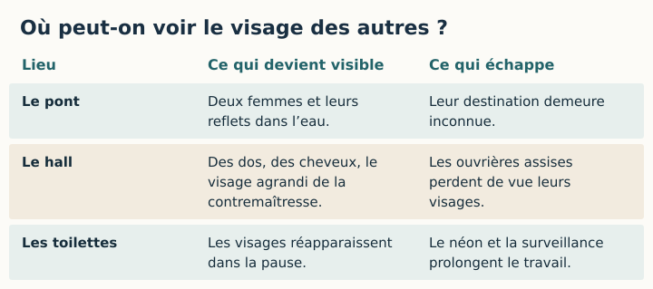

# BEL A/L — Allemand (commentaire et traduction) 2022 · Corrigé brut

*Corrigé rédigé par IA, non officiel. Signalez toute erreur.*

**Rédaction** · GPT-6.2 Astra Ultra · vitesse non renseignée

**Révision (tour 1)** · GPT-6.2 Astra Ultra · vitesse non renseignée

[Sujet officiel](https://www.ens-lyon.fr/sites/default/files/2022-11/Session-2022_BEL_Commentaire%20et%20traduction.pdf#page=2) · [Rapport du jury](https://www.ens-lyon.fr/sites/default/files/2022-11/Allemand%202022_0.pdf#page=2)

Emine Sevgi Özdamar, *Die Brücke vom goldenen Horn* (1998).

## Commentaire

Vor dem Hebbeltheater ist noch kein Licht zu sehen. Dennoch beginnt in Emine Sevgi Özdamars Roman *Die Brücke vom goldenen Horn* schon hier ein erstaunlich bewegtes Schauspiel. Schatten liegen auf dem Schnee, der Bus nimmt die Wartenden auf, auf der weißen Fläche bleiben Fußspuren und Kaffeeflecken zurück. Der tägliche Weg türkischer Arbeiterinnen vom Westberliner Wohnheim in die Fabrik ließe sich mit einem Fahrplan beschreiben. Die Ich-Erzählerin macht daraus eine Folge von Bildern und Lauten, die mit der Ordnung der Fabrik bisweilen mitgehen, ihr aber auch eigensinnig entgleiten. Was kann eine Arbeiterin von den anderen Frauen erfahren, wenn ihr Arbeitsplatz festlegt, wohin sie blickt, und ihr Deutsch erst aus geliehenen Wörtern entsteht?

Schon auf dem Weg ist das Sehen eine körperliche Tätigkeit. Aus dem rechten Fenster liest die Erzählerin eine Zeitungsüberschrift, aus dem linken sieht sie den Anhalter Bahnhof. Der Satz führt den Blick von einer Seite auf die andere, ohne die Stadt zuerst in einer Übersicht festzuhalten. Als der Bus bergauf fährt, kippt zunächst gleichsam das ganze Fahrzeug mit den Frauen zurück. Auf der Brücke kippen „wir“ nach vorn. Kaum hat sich die anonyme Menge so in ein gemeinsames körperliches Subjekt verwandelt, tritt aus dem Wir ein Ich hervor, das zwei andere Frauen jeden Morgen Hand in Hand gehen sieht. Diese Abstufung ist wesentlich. Nähe entsteht durch einen geteilten Bewegungsraum, ohne dass die Erzählerin ihre Mitfahrerinnen oder die beiden Unbekannten bereits zu kennen behaupten müsste.

Das Wasser in den Vertiefungen der Brücke verdoppelt das Paar. Im Regenwasser zittern die Schatten ihrer Knie stärker als die Knie der beiden Frauen. In diesem eigentümlich genauen Vergleich wird aus einer optischen Beobachtung eine Frage nach dem Leben der Frauen. Die Stadt wirkt so leer, als seien die beiden ihre einzigen lebendigen Bewohnerinnen. Dabei sitzen in unmittelbarer Nähe die vielen Frauen im Bus. Die Übertreibung bezeichnet also einen Augenblick der Wahrnehmung, keinen verlässlichen Stadtplan. Die Fragen nach Nacht und Morgen, Fabrik und Friedhof legen den Frauen sogar mehrere mögliche Lebensgeschichten bei. Keine setzt sich durch. Gerade weil die Erzählerin die beiden nicht kennenlernt, bleibt ihr Bild für sie offen. Mit dem Bild einer Naht verbindet sie die Dunkelheit und den beginnenden Tag räumlich miteinander. Der Übergang wird zu etwas, durch das man gehen kann.

Die Stadt hat außerdem verschiedene Sprachen. Das Wort für den beschädigten Bahnhof kann auf Türkisch auch eine Kränkung bezeichnen. Die Frauen verleihen dem Gebäude dadurch einen Zustand, den sonst Menschen empfinden. In der Schreibweise des Wohnheims gelangt umgekehrt ein deutsches Wort in der Form auf die Seite, in der es ein fremdes Ohr aufgenommen hat. Der Text stellt die Lernende keineswegs als jemanden dar, der vorläufig noch zu wenig Sprache besitzt, um Berlin zu beschreiben. Gerade an der Stelle, an der zwei Bedeutungen auseinandergehen, entsteht eine zusätzliche Stadtansicht. Das beschädigte Gebäude steht künftig auch als beleidigtes Gegenüber am Weg.

Beim Pförtner wird aus derselben sprachlichen Beweglichkeit eine kleine Komödie. Die Erzählerin hat einen Satz aus der Schlagzeile gelernt und erprobt ihn wie eine fertige Redeformel. Es fehlt jedoch der Mann, auf den die Aussage im Gespräch passen könnte. Der Pförtner antwortet mit seinem zusammengezogenen Morgengruß, als habe er eine herkömmliche Begrüßung gehört. Schriftbilder und Lautfolgen verrutschen gegeneinander. Man kann über die unpassende Äußerung lächeln. Zugleich bekommt auch der angeblich selbstverständliche Gruß des Deutschsprechenden etwas Mechanisches. Der Pförtner hebt sich bei seiner Arbeit eben ein wenig vom Stuhl. Seine Bewegung und seine Antwort erscheinen im selben Takt wie die Karten, die zuvor mit einem hellen Geräusch in die Stechuhr gedrückt worden sind.

Im Arbeitssaal verändert sich die Verteilung der Blicke grundlegend. Jede Frau sitzt allein am Tisch und sieht den Rücken der nächsten. Was von einem Menschen sichtbar bleibt, zählt die Erzählerin in einer anhaltenden Reihe auf, schönes, müdes, junges, ausfallendes Haar. Die Adjektive geben den abgewandten Körpern Unterschiede zurück, ohne Gesichter vortäuschen zu können. Die einzige stehende Frau, die Meisterin, kann alle überwachen. Doch auch ihr Gesicht bleibt nicht unversehrt. Die Lupen auf den rechten Augen der Arbeiterinnen lassen die eine Hälfte größer erscheinen, während die Meisterin umgekehrt die Augen der Frauen verschieden groß sieht. Es handelt sich um ein Verhältnis von Macht, das durch einen komischen optischen Austausch dargestellt wird. Die Namensform der griechischen Arbeiterinnen, die das „sch“ anders aussprechen, setzt sich sogar in der Erzählung durch. Die Vorgesetzte kontrolliert die Arbeitsplätze, nicht alle Formen, in denen von ihr gesprochen wird.

Zuletzt verspricht der Toilettenraum eine Ausnahme. Hier lassen sich die Gesichter der anderen sehen. Die immer gleiche Haltung beim Rauchen und das starke Neonlicht verwandeln auch die Pause in eine Art Arbeit. Selbst das Öffnen und Schließen der Tür durch die Meisterin gehört zur Folge kurzer Verben, mit der das Stück endet. Es gibt keinen abschließenden Protest und keine Befreiung aus der Halle. Es gibt aber eine erzählerische Fähigkeit, die keine Stechuhr misst. Die Erzählerin hört in einem Gruß einen Rhythmus, entdeckt im Wasser ein zweites Paar Knie und hält aus, dass sie das Ziel der zwei Fußgängerinnen nicht kennt. So bleiben die Arbeiterinnen zugleich Bedingungen unterworfen, die ihre Wahrnehmung einschränken, und Personen, deren Beziehungen in den kleinen Abweichungen dieser Wahrnehmung erst sichtbar werden.

## Version française

Peu avant d’arriver à l’usine, le bus devait remonter une longue rue en forte pente. Tout un bus plein de femmes basculait en arrière. Puis venait un pont, là nous basculions en avant, et c’est là que, chaque matin humide, dans la demi-obscurité, je voyais deux femmes marcher main dans la main. Elles avaient les cheveux coupés court, portaient des jupes et des chaussures aux talons usés. Elles avaient froid aux genoux. Derrière elles, je voyais le canal et les sombres bâtiments des usines. Sur le pont, l’asphalte était défoncé, la pluie s’amassait dans les trous. Dans la lumière du bus, les deux femmes projetaient leurs ombres sur cette eau de pluie et sur le canal. Dans l’eau de pluie, les ombres de leurs genoux tremblaient davantage que leurs genoux réels. Jamais elles ne regardaient en direction du bus, mais elles ne se regardaient pas non plus elles-mêmes. L’une était plus grande que l’autre, elle avait pris dans sa main la main de la petite. On aurait dit qu’à cette heure du matin elles étaient les seuls êtres vivants de la ville. Le matin qu’elles traversaient ainsi semblait cousu à la nuit. Venaient-elles de la nuit ou venaient-elles du matin ? Je n’en savais rien. Allaient-elles à l’usine ou au cimetière, ou sortaient-elles d’un cimetière ?

