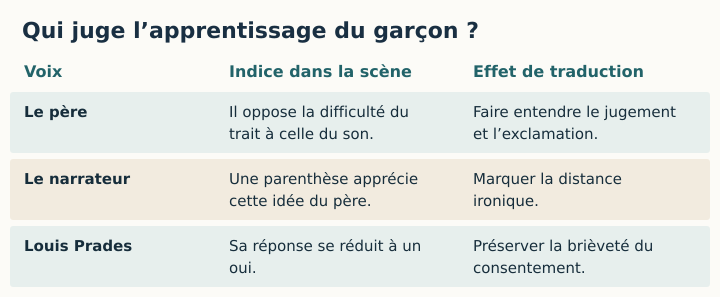

# BEL A/L — Allemand (thème Lyon) 2022 · Corrigé guidé

*Corrigé rédigé par IA, non officiel. Signalez toute erreur.*

**Rédaction** · GPT-6.2 Astra Ultra · vitesse non renseignée

**Révision (tour 1)** · GPT-6.2 Astra Ultra · vitesse non renseignée

[Sujet officiel](https://www.ens-lyon.fr/sites/default/files/2022-11/Session-2022_BEL_Epreuves%20de%20sp%C3%A9cialit%C3%A9.pdf#page=8) · [Rapport du jury](https://www.ens-lyon.fr/sites/default/files/2022-11/Allemand%202022_0.pdf#page=13)

Françoise Chandernagor, *Couleur du temps* (2004).

## Préparer l’épreuve

**Qui parle ?** Le récit suit le père. Dans le premier paragraphe, les servantes rapportent les chutes. Puis le jugement sur le garçon qui reste dans les jupes de sa mère glisse dans la voix paternelle. La parenthèse sur sa conception de la musique réintroduit le narrateur et son ironie. Le « Oui » final revient à Louis Prades.

**Suivre le temps et les reprises.** *Von da an* ouvre une habitude passée. Garder la projection dans l'avenir des noms de peintres avec *würde* ou une construction équivalente. Le son et le trait doivent rester parallèles, tout comme le crayon et le clavier. On peut donner au clavecin son nom précis, *das Cembalo*.

**Éviter deux contresens.** *Chaque fois qu’il y songeait* signifie que le père se rappelait d'emmener l'enfant. Le consentement est tacite, et le père ignore la musique. Les couleurs, les notes et les mots constituent pour lui trois arts susceptibles de charmer, même s'il traite ensuite l'exécution musicale avec condescendance. L'allemand peut alterner *das Kind*, *das Mädchen* et une reprise au féminin lorsque l'identité de l'enfant est claire.

L’imparfait de *disait Louis Prades* répond à *contrariait rarement*. *Pflegte … zu sagen* fait entendre cette approbation habituelle et laisse à Baptiste la question qui la provoque.

## Proposition de thème

Von da an nahm er das Kind, sooft er daran dachte, mit in die Werkstatt. Er setzte die Kleine auf einen niedrigen Stuhl. Dort blieb sie reglos sitzen, erstaunlich brav für so ein kleines Mädchen. Das war wohl auch besser so. Wenn sie herumlief, fiel sie hin, sagten die Mägde, und stieß sich überall. Manchmal schien ihre zarte Haut ebenso blau wie die Leiche ihres Bruders. Doch in der Werkstatt saß sie auf ihrer Bank, ohne sich zu rühren, ganz ins Spiel mit ihren Fingern versunken oder damit beschäftigt, Fäden aus ihrem Kleid zu ziehen. Sie weinte nie. Sie sprach auch nicht. Es sei denn, von fern drangen die etwas schrillen Klänge des Cembalos zu ihr. Dann hob sie die Hand, als wollte sie den Lehrlingen ihres Vaters Schweigen gebieten, und sagte mit großem Ernst: „Colas!“

Da übte tatsächlich Jean-Nicolas bei seiner Mutter. Ein ausgezeichneter Vorwand, weiter an ihrem Rockzipfel zu hängen! Der kleine Schelm! Anfangs hatte Baptiste freilich nichts gegen diesen Unterricht einzuwenden gehabt. Töne, Farben, Wörter, das waren ebenso viele Mittel für einen Menschen, seinesgleichen zu bezaubern. Jean-Nicolas war seit jeher zur Malerei bestimmt. Er würde „V*** Sohn“ sein, wenn aus dem alternden Baptiste „V*** Vater“ würde, „V*** der Jüngere“, wenn Baptiste endlich „V*** der Ältere“ wäre. Da es einem Kind jedoch schwerer fällt, einen Strich zu ziehen als einen Ton hervorzubringen (an diesem wunderlichen Gedanken lässt sich ablesen, dass V*** in der Musik eine einfache Kunst sah, bei der es einzig auf die Ausführung ankam), da es, wie er meinte, schwerer ist, einen Stift zu halten, als auf Tasten zu schlagen, warten wir doch, bis der Junge größer ist! „Bis dahin ist es mir genauso recht, wenn er sich mit einem Cembalo vergnügt wie mit einem Holzpferd! Habe ich etwa nicht recht?“

„Ja“, pflegte Louis Prades zu sagen, der seinem Meister selten widersprach.

Und so wurde Jean-Nicolas mit dem stillschweigenden Einverständnis eines Vaters, der „nichts davon verstand“, nach und nach zum Musiker …
