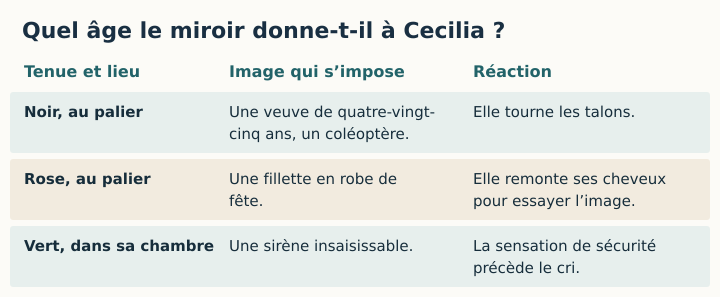

# BEL A/L — Anglais (commentaire et traduction) 2022 · Corrigé guidé

*Corrigé rédigé par IA, non officiel. Signalez toute erreur.*

**Rédaction** · GPT-6.2 Astra Ultra · vitesse non renseignée

**Révision (tour 1)** · GPT-6.2 Astra Ultra · vitesse non renseignée

[Sujet officiel](https://www.ens-lyon.fr/sites/default/files/2022-11/Session-2022_BEL_Commentaire%20et%20traduction.pdf#page=4) · [Rapport du jury](https://www.ens-lyon.fr/sites/default/files/2022-11/Anglais%202022.pdf#page=2) · [Archives de la session](https://www.ens-lyon.fr/formation/admission/archives-du-concours-lettres-et-sciences-humaines/concours-dentree-session-2022)

Commentaire en anglais, p. 4–5, l. 1–61, des deux sorties de la chambre au visage et au poing levé dans l’encadrement de la porte. Version française, p. 4, l. 23–37, de « How was she to think straight? » à « in less than fifteen minutes. ». La première phrase est la dernière du paragraphe anglais. Le souvenir de Hardman, p. 5, suit la borne.

Ian McEwan, *Atonement* (2001). Cecilia est revenue de Cambridge au domaine familial dans les années 1930.

## Préparer l’épreuve

**Organiser l'explication.** Dans le miroir privé, la robe noire semble protéger Cecilia. Sur le palier, elle lui donne l'air d'une veuve âgée. La robe rose ramène l'enfant. Le vert installe la sirène dans son miroir à elle. Relier à ces déplacements les personnes qu'elle s'attend à trouver au dîner, le temps qui presse et le cri final.

**Suivre les voix.** Des exclamations, des jugements et des fragments de discours intérieur traversent le récit à la troisième personne. La formule qui distingue l'apparence et ce que Cecilia croit être son apparence rend le problème explicite. La scène n'autorise pas à identifier le visage de la dernière ligne.

**Traduire le vestiaire.** *Finals* désigne les examens de fin d'études et *a third* la catégorie de résultat la plus basse permettant la réussite. *Bias-cut* signifie « coupée dans le biais », *halter neck* implique une attache autour du cou. Les « grandes sœurs » sont des robes personnifiées. Préserver la rapidité des verbes des dernières lignes.

La mesure de la penderie donne une longueur matérielle à une histoire personnelle. Un mètre ou deux rendent en français l’approximation du feuillet. Dans la version, distinguer la robe portant plusieurs taches de vin et celle trouée par la première cigarette. Le singulier du vêtement coexiste avec le pluriel des taches.

## Commentaire

Within half an hour Cecilia has made two expeditions from her room to the landing and back. The word “expeditions” might seem excessive for a woman trying on clothes before dinner in her own home. Yet in this extract from Ian McEwan's *Atonement* the landing is strange territory. A dress can age its wearer by half a century between one mirror and the next. What begins as a problem of choosing an outfit becomes a question about the image in which a person can bear to meet other people. The comedy depends on how hard Cecilia works to produce the appearance of never having thought about the matter. Its more disturbing underside emerges when another face finally appears.

The two mirrors establish different conditions of judgement. At the dressing table Cecilia values the severity of the black dress. She can even refine its effect by choosing jet over pearls. In the gilt frame above the stairs the result takes on a quite unintended significance. Mourning clothes seem to enclose an elderly widow. The polished surface of the black protective covering calls up an insect small enough to live in a matchbox. The exclamation that supplies the name of a beetle gives us the speed and confidence of the identification. One can see the shape she means and still find it absurdly inadequate as a description of the young woman who has just dressed. The third-person narrative allows her verdict to arrive before any outside observer has had time to pass one. Even the detail about the black heel on which she turns seems to pursue her into retreat. The joke comes a beat late. An idiom for turning away suddenly makes us look down at an actual heel.

It matters that no actual guest has looked at her yet. A mirror can acquire a “public gaze” at the point where the bedroom gives way to family space. The kitchen is waiting, her time with her brother is slipping away, her mother will have questions about where people sit, Paul Marshall will need company, and Robbie will arrive. These people make different demands. Their presence in her thoughts, in the order in which she expects to encounter them, begins to account for the difficulty of thinking straight. The anxious list ends in a direct question without a change to first-person narration. The reader has slipped into the rhythms of her thinking while remaining free to notice its contradictions. To look unconcerned, of course, takes time. More curiously, to feel self-contained appears to require a favourable judgement from something outside herself.

The wardrobe gives this unease a history. Cecilia runs her hand along an amount of rail small enough to measure in feet. The narrator calls this a chronicle. Its exhibits have been altered by use, a spill of wine, a hole burnt by a first cigarette. A dress can now look ridiculous and still be too closely connected to a past experiment to be thrown away. As the hand moves, the clothes become actors in their own story. Shoulders grow broader, skirts lengthen, and dresses appear as elder sisters with their own opinions about what men might want. Changes in fashion and the development of a single body overlap without becoming identical. The sisters seem able to put an earlier self behind them with an assurance that Cecilia herself cannot quite command. Even the dress she loves best has a double date. It celebrates the end of her examinations and belongs to the interval before she knew how poorly she had done. Once a result is known, silk bought in celebration can hold a quite different memory.

The pink dress looks like a sensible way of avoiding exposure. Its colour is subdued, and the triple mirror appears to agree with the choice. Three views in the same room offer surprisingly little protection against the single old mirror on the landing. Cecilia tries to supply a physical explanation for the change. Hardman has been replacing bulbs, and an uneven surface can distort proportions. Such details keep the episode rooted in an old house in which things have to be maintained. They also give the mind plausible reasons for seeing what it is already disposed to see. The black gown conjured up an old woman. The pink one returns Cecilia to childhood birthday parties. She actually raises her hands to make the bunches of hair that would complete the picture. For a moment the mirror supplies part of a costume and she supplies the rest. The reference to Shirley Temple puts a publicly recognisable image of girlhood between the woman and her own past.

The green evening gown seems to release her from these competing ages. She knew all along which dress she liked, yet earlier rejected it as too elaborate for an evening at home. In choosing it she briefly lets physical sensation precede judgement. The cut of the cloth is felt through her petticoat, a firm pressure described as a caress. She can be exposed at the back and still feel secure. The mermaid in her own full-length mirror is an alluring and elusive creature, quite unlike the insect that seemed to be pinned in a box. But it is another imagined figure, and the words for smoothness and security cluster together so insistently that their promise feels precarious. On opening the door Cecilia cries out. A real face and a raised fist occupy the space in which she has been preparing for imagined eyes. McEwan ends before explaining what the other person intends. This sudden limit on our knowledge makes the earlier performance newly exact. Cecilia could make a mirror appear to think, remember or disapprove. The visitor may simply be about to knock. Cecilia opens the door before the gesture is complete, and the reader shares her alarm for that instant. Encountering someone whose mind she cannot supply is another matter.

## Version française

Comment pouvait-elle y voir clair ?

Elle parcourut de la main un mètre ou deux de son histoire personnelle, brève chronique de ses goûts. Voici les robes à la garçonne de son adolescence. Comme elles lui paraissaient aujourd’hui ridicules, molles, asexuées ! Et pourtant, malgré les taches de vin sur l’une et le trou que sa première cigarette avait fait dans une autre, elle ne pouvait se résoudre à s’en débarrasser. Voici une robe où pointait timidement une première ébauche d’épaulettes. D’autres suivaient, plus affirmées, grandes sœurs musclées qui se défaisaient de leurs années garçonnières, retrouvaient une taille et des courbes, allongeaient leurs jupes dans une souveraine indifférence aux espoirs des hommes. Sa dernière acquisition et sa plus belle pièce, achetée pour fêter la fin de ses examens, alors qu’elle ignorait encore sa piètre mention, la plus basse qu’on pût obtenir, était cette robe du soir vert foncé, moulante, coupée dans le biais, dos nu, retenue par une attache autour du cou. Trop habillée pour l’étrenner à la maison. Elle enfonça la main un peu plus loin et sortit une robe de soie moirée au corsage plissé et à l’ourlet festonné. Un choix sûr, puisque ce rose assourdi, un peu passé, était assez discret pour une tenue du soir. Le miroir à trois faces était du même avis. Elle changea de chaussures, troqua son collier de jais pour les perles, retoucha son maquillage, se recoiffa, mit un peu de parfum à la naissance de sa gorge, maintenant plus dégagée, et en moins de quinze minutes elle était de retour dans le couloir.
