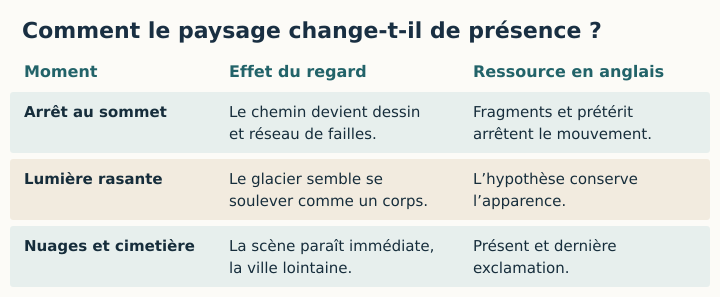

# BEL A/L — Anglais (thème Lyon) 2022 · Corrigé guidé

*Corrigé rédigé par IA, non officiel. Signalez toute erreur.*

**Rédaction** · GPT-6.2 Astra Ultra · vitesse non renseignée

[Sujet officiel](https://www.ens-lyon.fr/sites/default/files/2022-11/Session-2022_BEL_Epreuves%20de%20sp%C3%A9cialit%C3%A9.pdf#page=9) · [Rapport du jury](https://www.ens-lyon.fr/sites/default/files/2022-11/Anglais%202022.pdf#page=20)

Thomas Reverdy, *Climax* (2021).

## Préparer l’épreuve

**Choisir le sujet de chaque mouvement.** Les infinitifs du début décomposent une action générique. L'anglais peut enchainer les formes en *-ing*. Les ruptures après le retournement d'Anders fixent son regard et ralentissent le récit. Les relevés des instruments précèdent l'arrêt. Le verbe de possibilité dans « ce qu'il pouvait faire » diffère de l'obligation précédente.

**Changer de temps avec le texte.** Jusqu'à la vision du désastre, privilégier le prétérit. À partir de l'amoncellement des nuages, le présent rapproche le paysage. Rien n'autorise à transformer le pressentiment en catastrophe déjà survenue dans l'extrait.

**Conserver l'échelle.** Les crevasses forment d'abord un dessin abstrait. Une vie animale puis presque charnelle se prête au glacier, avant le détail minuscule des lanternes du cimetière. Le pronom de la dernière exclamation renvoie à la scène aperçue dans son ensemble.

## Proposition de thème

Climbing means putting one foot in front of the other and doing it again, finding the least tiring way through when the going gets tough, saving your strength, using your hands or your ice axe, overcoming each obstacle in turn like so many thousands of little summits, keeping going. It was once he was up there, before crossing to the other side and skirting the fault line over the rocks, on their third day in the mountains, that Anders properly turned around. Looked back along the way he would have to come down. Only then, once he had taken the instrument readings and done what he had to, or what he could, did he stop. Did he take in, helpless and serene, the full extent of the disaster, his eyes ranging across the whole of it. Astounded. For long minutes he stayed there watching the fissures, the cracks and the intricate lines they traced in the white ice, concentric and winding like some crazed spider’s web. He examined them as he might an abstract drawing, an impossible geometry at odds with nature, without thinking anything of it.

He knew, too, that he had probably been a fool to come there.

Faced with the sea of ice at his feet, in the grip of the storm, in the already setting Arctic sun, with its seasons of twilight, Anders had a foreboding. The low light set the slightest ridge aflame and sent shadows surging into the chasms. So fierce was the light and so swiftly did it sink towards the horizon that the glacier seemed to stir, seething with silent life like a carcass, raising its ancient crust, its huge and fragile skin, at the bidding of a breath or a swell from the depths.

It was only the melancholy caress of one of the year’s last suns, yet it made the scene look as though disaster were imminent. A sense of the world coming to an end.

Dark clouds are gathering in the east, farther inland, where the mountains wind like a sleeping dragon. Out there, all the way to the horizon, ridges of black rock waver in the thin smoke of the snow that fringes them, swept by icy winds. Everything seems to be waking up this evening. That is what Anders tells himself and that is how it feels. Down in the valley towards the sunset, the town at the mouth of the fjord is already lit up. You can make out the little cemetery on the slope, where hundreds of candles burn on the graves in their miniature lanterns. How far away it all seems.
