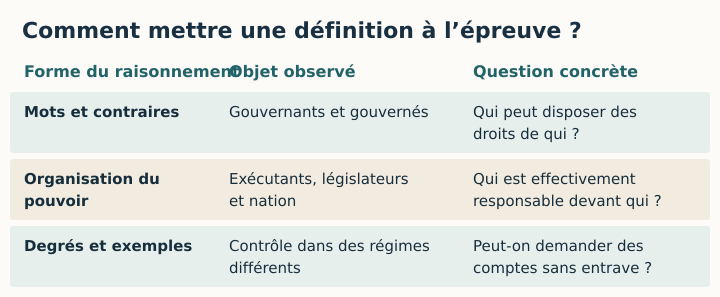

# BEL A/L — Arabe (commentaire et traduction) 2022 · Corrigé guidé

*Corrigé rédigé par IA, non officiel. Signalez toute erreur.*

**Rédaction** · GPT-6.2 Astra Ultra · vitesse non renseignée

[Sujet officiel](https://www.ens-lyon.fr/sites/default/files/2022-11/Session-2022_BEL_Commentaire%20et%20traduction.pdf#page=6)

L’extrait de Ṭabāʾiʿ al-istibdād, d’Abd al-Rahman al-Kawakibi, est donné dans l’édition arabe de 2011. Le commentaire couvre l’extrait entier. La version porte uniquement sur les lignes 25 à 31, de la concentration des pouvoirs aux affaires de Panama et Dreyfus.

## Préparer l’épreuve

Distinguer trois manières de définir. La première phrase traite de l’usage du mot. Les séries de synonymes et d’antonymes font ensuite entendre ses effets sur les gouvernants et les gouvernés. Enfin la description recherche une condition que l’on puisse vérifier en pratique. Relever à qui les exécutants et les législateurs doivent rendre compte.

Pour la version, respecter le retour de كلما et la portée du mot فعلا. La possibilité d’élire le gouvernant n’est que l’un des critères. Les « biens fixes » correspondent ici à la propriété immobilière. نفوس désigne la population. النياشين renvoie au scandale des décorations en France. Le passage des premiers temps de l’islam à la République française permet de tester le même critère dans deux histoires différentes.

## Commentaire

### متى يستبد الحكم بمن يخضع له؟

قد توحي كلمة الاستبداد بصورة سلطان واحد يستأثر بالحكم. ولكن الكواكبي يذكر، إلى جانب هذا السلطان، حاكما انتخبه الناس، ويذكر مجلسا تعددت فيه الآراء ودولة كتبت لنفسها دستورا. كيف يجمع اسم واحد هذه الصور المتباعدة؟ يتحرك النص من المعجم إلى المؤسسة، ثم من رسم المؤسسة إلى السؤال عمن يحاسبها، وأخيرا إلى الشروط التي تتيح استمرار المحاسبة أو تعطيلها. ووراء هذا التدرج قضية أشد إلحاحا من تسمية أنظمة الحكم: كيف تعرف الأمة، من واقع عمل حكومتها، أن لها حقا تستطيع المطالبة به؟

يفتتح الكاتب بالتفريق بين ما تعنيه الكلمة في اللغة وما يراد بها حين يجري إطلاقها في السياسة. فقد يستبد المرء برأيه ويرفض النصح، وقد تشبه سلطة الأب أو الزوج أو المعلم على غيره سلطة الحاكم. غير أن التشابه لا يمحو الفرق. للفعل السياسي أثر في حقوق مشتركة، وفي الحكومة تتجمع أسباب الضرر بحيث يطال من لا يملك الانصراف عن صاحب السلطة. ومن اللافت أن الكاتب بدأ بالغرور بالرأي ثم صاغ التعريف السياسي بما يدل على غياب الخوف من التبعة. بذلك ينقل السؤال من نفس الحاكم التي قد تصعب معرفتها إلى نتيجة يمكن ملاحظتها: ما الذي يحدث فعلا إذا اعتدى على حق من حقوق المحكومين؟

تجري بعد ذلك مجموعات من الألفاظ في صفوف متقابلة. فمن جانب نسمع اسما للفعل، وصفة للفاعل، ووصفا للحكومة، ثم وصفا للرعية. ومن الجانب الآخر تظهر أوصاف للعدل والمسؤولية والحرية والعزة. وتنكشف وظيفة هذا التوازي إذا وقفنا عند الانتقال من الحاكم إلى المحكوم. فما يبدو، عند وصف الحاكم، اتساعا في قدرته على التصرف، يغدو في الطرف الآخر أسرا أو استصغارا أو بؤسا. لا يكفي النظر إلى عدد القرارات التي في يد السلطان لنعرف معنى سلطانه. ينبغي أن ننظر أيضا إلى ما يستطيع الناس فعله إذا استاءوا من أحدها. وهذا التمرين المعجمي يمهد للحد الذي سيقيمه الكاتب بين حكومة مقيدة حقا وحكومة قادرة على إبطال قيدها كلما شاءت.

عندئذ يتغير وجه الكلام. فبعد التعريف بالمقابلات يأتي تعريف بالوصف يميز بين صورتين. في الأولى لا يلزم الحاكم عرض تصرفه على شريعة أو عرف أو إرادة عامة. وفي الثانية يوجد القيد ولكن الحاكم يملك من النفوذ ما يفرغه من أثره. ولعل الصورة الثانية أشد إرباكا للقارئ، لأنها تسلبه الاطمئنان إلى الأسماء المألوفة. فالمجلس المنتخب قد يختلف أعضاؤه، وقد يخفف الاختلاف من انفراد رأي واحد، لكن اتفاقهم جميعا قد يجعل الرد عليهم أصعب من الرد على فرد. وحتى انفصال التشريع والتنفيذ والرقابة لا يضمن بذاته زوال الاستبداد. يطلب الكاتب علاقة محددة بين أطراف متمايزة: يسأل المشرعون المنفذين، وتسأل الأمة المشرعين. ومعرفة الأمة بحقها وبطريقة ممارسة الرقابة جزء من هذه العلاقة. فهناك فرق بين خانة في رسم دستوري وبين شخص يستطيع أن يطلب جوابا وأن يرتب على الجواب أثرا.

وهذه الدقة تفسر الانتقال من حد الاستبداد إلى مراتبه. إن اجتماع وراثة العرش وقيادة الجيش والسلطة الدينية في فرد مطلق يراكم أسباب الطاعة في يد واحدة. ويقابل ذلك حاكم محدود المدة يمكن، بالفعل، مساءلته. وتتكرر صيغة المقارنة حين يتحدث الكاتب عن عدد الرعية والارتباط بالأملاك الثابتة والتفاوت في الثروة وانتشار المعارف. وهذه عناصر مختلفة عن النص الدستوري، تتصل بشروط استقلال المجتمع وقدرته على النظر في شؤون الحكم. يعرضها الكاتب في صورة ملاحظات متدرجة، فلا يجعل واحدا منها بديلا من الرقابة. وعندما يضع ما أُخذ على عثمان وعلي بإزاء قضايا هزت الجمهورية الفرنسية، ينتقل بين مرجعيتين لا تتفقان في شكل الدولة أو العهد. ما يصل بينهما هو إمكان الاعتراض على صاحب السلطة والنظر علنا في شأنه. ولا تستلزم المقارنة تطابق القضايا أو المواقف من أصحابها.

في الخاتمة تنقلب نبرة الباحث الذي يصنف الألفاظ إلى نبرة من يحذر من كارثة. فحتى الحكومة العادلة قد تتبدل إذا أمنت العاقبة. وإذا رسخ حكمها أعانها جهل الناس أو الجيش المنظم على دوام الحال. هنا تظهر مفارقة التقدم كما يصوره الكاتب: قد تتراجع الجهالة في بلد يعد نفسه متمدنا، بينما يشتد فيه التجنيد الإجباري العام. والمبالغة التي تستحضر الشيطان وأبناء آدم تنقل المسألة من عيب حكومة منفردة إلى مصير جماعات بأكملها. أما الشرط الذي تختتم به العبارة فيفتح أمام القارئ مستقبلا يخشاه الكاتب، ولا يسرد واقعة قد تمت. لقد بدأ النص برأي صاحبه لا يقبل النصيحة، وانتهى بأمة يمكن أن تُحرَم وسائل الاعتراض حتى تحت اسم التمدن. وبين الطرفين يضع الكواكبي محكا عمليا: من يستطيع أن يسأل، ومن يُلزم بالجواب، وما الذي يمنع إبطال هذا الإلزام؟

## Version française

Le degré le plus redoutable du despotisme, celui devant lequel on cherche refuge auprès de Dieu comme contre le diable, est le gouvernement d’un seul homme dont le pouvoir est absolu, qui hérite du trône, commande l’armée et détient une autorité religieuse. On peut dire que, chaque fois que disparaît l’un de ces caractères, le despotisme s’atténue, jusqu’à laisser place à un gouvernant élu pour un temps limité et qui répond effectivement de ses actes. De même, le despotisme s’atténue naturellement à mesure que la population gouvernée est moins nombreuse, que les gens sont moins liés aux biens immobiliers, que les écarts de fortune diminuent et que le peuple progresse dans les connaissances.

Un gouvernement, de quelque espèce qu’il soit, mérite toujours le nom de despotique tant qu’il n’est pas soumis à une surveillance étroite et à un contrôle qui ne laisse rien passer. C’est ce qu’on a vu aux premiers temps de l’islam dans les griefs adressés à Othman, puis à Ali, que Dieu les agrée tous deux. C’est également ce qu’on a vu en France sous l’actuelle République, dans les affaires des décorations, de Panama et de Dreyfus.
