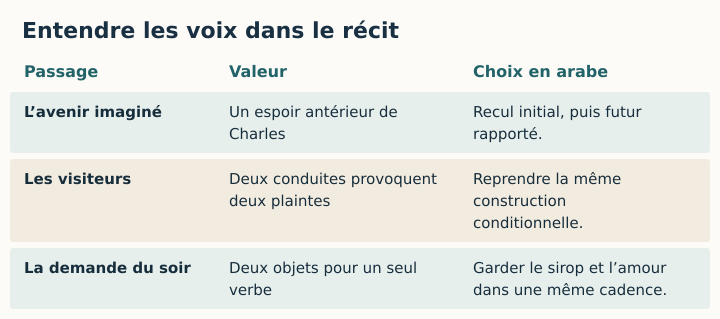

# BEL A/L — Arabe (thème Lyon) 2022 · Corrigé guidé

*Corrigé rédigé par IA, non officiel. Signalez toute erreur.*

**Rédaction** · GPT-6.2 Astra Ultra · vitesse non renseignée

[Sujet officiel](https://www.ens-lyon.fr/sites/default/files/2022-11/Session-2022_BEL_Epreuves%20de%20sp%C3%A9cialit%C3%A9.pdf#page=10)

Le thème de quatre heures provient du début de Madame Bovary. Il s’agit de Charles et de sa première épouse. La traduction maintient la coupure signalée dans l’énoncé.

## Préparer l’épreuve

Commencer par la temporalité. La première phrase rapporte un espoir que Charles avait formé avant l’expérience du mariage. Ensuite, la surveillance de sa femme devient une habitude. Réserver كان قد pour le premier recul et employer les formes de l’habitude pour les visites, les plaintes et les retours du soir. « Quand il y avait des femmes » se rapporte aux consultations de Charles.

Dans le second paragraphe, chercher le moment où le lecteur commence à entendre l’épouse sans guillemets. L’impossibilité de satisfaire ses demandes tient à la construction symétrique des deux hypothèses sur les visiteurs. Garder en arabe ce parallélisme et le ton du soupçon. Pour « sirop », la circonstance appelle un sirop médicinal. Le même mouvement de phrase doit porter ce remède et la demande d’amour. Garder les « bras » et le « bord du lit » donne à la scène sa précision comique et inconfortable.

## Proposition de thème

كان شارل قد لمح في الزواج تباشير حال أفضل، وخُيّل إليه أنه سيصبح أوسع حرية، وأنه سيملك أن يتصرف في نفسه وماله. غير أن الكلمة كانت لزوجته. […] كانت تفضّ رسائله، وتترصّد خطواته، وتصغي من وراء الحاجز إليه وهو يستقبل المرضى في عيادته إن كان بينهم نساء.

وكان لا بد لها كل صباح من شراب الشوكولاتة، ومن ألوان العناية والمراعاة ما لا آخر له. وكانت دائمة الشكوى من أعصابها وصدرها وتقلّب مزاجها. فوقع الأقدام يؤلمها، وإن انصرف الناس عنها لم تطق الوحدة، وإن عادوا إليها فما عادوا، ولا شك، إلا ليروها تموت. وفي المساء، حين يعود شارل، كانت تُخرج ذراعيها الطويلتين النحيلتين من تحت الأغطية وتطوّقه بهما من عنقه، ثم تُجلسه على حافة السرير وتأخذ في بثّ أحزانها إليه. لقد نسيها، إنه يحب امرأة أخرى! وكم قيل لها إنها ستكون تعيسة! وتنتهي بأن تطلب منه شيئا من شراب الدواء لصحتها، ومزيدا قليلا من الحب.
