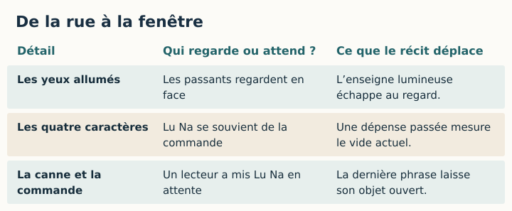

# BEL A/L — Chinois (commentaire et traduction) 2022 · Corrigé guidé

*Corrigé rédigé par IA, non officiel. Signalez toute erreur.*

**Rédaction** · GPT-6.2 Astra Ultra · vitesse non renseignée

[Sujet officiel](https://www.ens-lyon.fr/sites/default/files/2022-11/Session-2022_BEL_Commentaire%20et%20traduction.pdf#page=8) · [Rapport du jury](https://www.ens-lyon.fr/sites/default/files/2022-11/Chinois%202022.pdf#page=2)

L’extrait de Zhang Kangkang, « 把灯光调亮 » (2016), fait voir une rue commerçante depuis la fenêtre de la librairie de Lu Na. Le commentaire porte sur tout le texte. La traduction s’arrête à la fin de la ligne 11.

## Préparer l’épreuve

Prenez un plan de la rue et placez-y trois éléments. Lu Na est à l’intérieur. Des passants défilent devant la porte. Les magasins qu’ils regardent sont en face. Cette disposition suffit à écarter deux contresens. Le magasin demeure vide même quand la rue est pleine. La libraire voit les passants qui, eux, regardent ailleurs.

Pour la version, donnez une valeur de durée aux premiers mots. Conservez le changement de rythme entre les voyageurs pressés et les flâneurs. Traduisez la série de commerces sans en perdre le dernier et cherchez pour l’enseigne un nom français qui prolonge l’image des yeux allumés. Le premier chiffre mesure une proportion d’analphabètes. Le second donne un rang approximatif en partant du bas du classement mondial pour la lecture par habitant. Le récit présente les données que Lu Na a en tête.

Pour le commentaire, reprenez la scène du pêcheur en distinguant celui qui reçoit la canne de celui qui l’a fournie. La rectification du narrateur donne accès à la question la plus intime du passage. Que signifie l’attente quand le livre commandé est déjà arrivé ?

## Commentaire

### 人在门外，谁在等谁？

一家书店冷清，通常会让人想到一条冷清的街。张抗抗偏偏让这条街挤满了人。卢娜坐在窗边，看得见的越多，越难解释书店里少了什么。起初，问题似乎可以用客流来说明；到了最后，那本特地订来的书已经摆在那里，要等的人却连她自己也说不清了。这个变化是怎样发生的？

开头把几个月压缩成几句。上午挨着下午，一天接着一天，时间在过去，店里的情形却没有变。接下来，叙述的速度分成两种。赶路的人好像都怕误车，一刻也耽搁不起，他们经过店门还说得通。可还有人走得很慢，走过来又走过去，有空抬头低头，也有空看对面的店铺。这些闲人使第一个解释失效了。缺少的并不是走进书店的那点时间。一个个店名紧挨在一起，像一整排都能吸引目光的橱窗；直到列举结束，才显出这一排之中偏偏少了哪一家。

眼睛被比作灯泡，点亮它们的，是服饰美容之类的日常消费。反过来，名字里明明有“光”的书店，却得不到行人的一点亮光。光究竟是从哪里来的？匾上的金字本来就能看清，当年还是卢娜特地花钱请人题的。她记得那笔钱够买一台空调，也记得过去顾客多得转不开身。今天店铺仍是九十平方米，却好像扩建过。这个玩笑比一句生意萧条更有分量。人一少，原先嫌小的地方一下子空出来，仿佛连房子也变了。女店主为匾额自豪，同时又不得不承认，写得好、挂得高，并不能使人愿意去读。题目里调亮灯光这个动作，放到这里便格外耐人寻味。

叙述者没有马上替她下结论。她先想到识字率，又想到人均阅读量。前一个数字不能回答后一个问题：认得招牌上的字，怎么会等于愿意推门读书？随后浮现的是一位老书友的说法。从前有人读书为做官，如今做官另有门路，读书也就失去了吸引力。这种解释把貌似一贯的家庭传统分成了不同的读书动机。但说话的人是书友，卢娜想到这番话时也带着疑问。我们听见的是一个人为了弄懂门外的世界不断寻找解释，并没有得到作者对一个国家的最终诊断。尤其值得注意的是，卢娜并不要求路人非买不可。肯进来翻一翻，她也高兴。她在意的已经超过了账面上的损失。

最后，叙述的目光移回窗边，卢娜自己成了被观察的人。把等顾客的店主比作垂钓者，本来很贴切：她坐着不动，盼对方主动靠近。叙述者随即改口，那根竿偏偏是买书人递到她手里的。陌生人答应再来，把她变成了等待的人。她能请人从省城寄来指定的书，却不能替他走完最后几步。书名问我们需要怎样的文化繁荣，恰好把抽象的大问题放在一件极小的实事旁边：有人订书，有人备书，现在是否还会有人来取？

这一问仍然没有穷尽最后一句。如果只等那位顾客，等到他回来，事情也就结束了。结尾让卢娜知道自己还在等一个永远不会来的人，却没有替这个人取名字。读者可以想到从前拥挤的书店，想到无须为了升官或购物也愿意读书的人，也可以听出一种不肯全说出来的个人惆怅。开头到处是说得清、数得清的人，结尾只留下无人能够指认的一位。书店的静，至此才有了与街上的热闹相称的深度。

## Version française

Voilà des mois que cela dure. Jour après jour, le matin comme l’après-midi, toujours la même histoire. Dans la boutique, très peu de clients.

Du monde, il y en a. Seulement, ce ne sont pas des clients pour Lu Na. La rue fourmille de passants, hommes et femmes, vieux et enfants. L’un après l’autre, ils filent devant sa porte. À les voir, on croirait qu’ils ont tous un car de ligne ou un train à prendre, qu’ils ne peuvent pas perdre une seconde. Bien sûr, il y a aussi les flâneurs. D’un pas tranquille, ils passent et repassent devant chez elle. Leurs yeux roulent de tous côtés. Ils regardent à droite, à gauche, en l’air, par terre. Ils regardent les magasins d’en face, boutique de vêtements, institut de beauté, marchand de téléphones, débit de tabac et d’alcool, petite restauration, salon de massage des pieds. Que leurs yeux tombent sur l’un de ces commerces et les voilà qui s’allument comme des ampoules. Dommage, de toute cette lumière, pas le moindre rayon ne daigne se poser sur les quatre caractères de la « Librairie de la vive lumière ».

Ne sauraient-ils donc pas lire, tous autant qu’ils sont ? D’après les chiffres officiels, il reste en Chine environ huit pour cent d’analphabètes dans la population… Mais Lu Na connaît un autre chiffre. Pour le volume de lecture par habitant, la Chine figure quelque part entre la onzième et la dix-neuvième place en partant de la fin du classement mondial…
