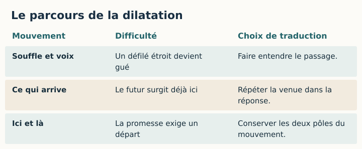

# BEL A/L — Chinois (thème Lyon) 2022 · Corrigé brut

*Corrigé rédigé par IA, non officiel. Signalez toute erreur.*

**Rédaction** · GPT-6.2 Astra Ultra · vitesse non renseignée

[Sujet officiel](https://www.ens-lyon.fr/sites/default/files/2022-11/Session-2022_BEL_Epreuves%20de%20sp%C3%A9cialit%C3%A9.pdf#page=11) · [Rapport du jury](https://www.ens-lyon.fr/sites/default/files/2022-11/Chinois%202022.pdf#page=5)

Le thème chinois de quatre heures porte sur deux paragraphes de Jean-Louis Chrétien, La Joie spacieuse, essais sur la dilatation (2007). La coupure de l’extrait est respectée.

## Proposition de thème

**喜悦中的空间问题与“扩张”一词的命运**

喜悦一起，一切都开阔了。我们的呼吸舒展开来。刚才身体还蜷缩着，只占着自己那点地方，守着自己那一角，此刻忽然挺直了，浑身跃跃欲动。我们想跳，想蹦，想奔跑，想起舞，因为天地更宽了，我们也更有生气了。喉间那道狭窄的关隘，如今成了一个渡口，呼喊、歌声、放声的大笑都从这里渡过。笑也好，哭也好，哭着笑，笑着哭，又有什么要紧！那涌来的实在太丰沛，我们都是在回应它。我们的面容舒展开来，目光也亮了。什么在到来？那将要到来的。它固然可以由我们筹划、推算、预期、想象，却也就在此时此地涌现。正因为此地和此刻都不可能仅仅是一个点，一切才开阔起来。

（……）在喜悦之中，彼处来到此地，彼处就在此地，却没有因此在此地穷尽自身，也没有整个归入此地。正因如此，我们才须成长，才须启程。启程并非为了逃离此地，而是为了兑现彼处在此地开启的那份许诺。喜悦不是一种状态，而是一种行动，一种运动，是蓬勃初生的那一刻。这是人与世界共同的行动，不能把它缩减为心理学的对象，装进心理学的盒子里，也不能把它收进某种关于“主体”的思想里。

让-路易·克雷蒂安，《开阔的喜悦：论扩张》，2007年。

