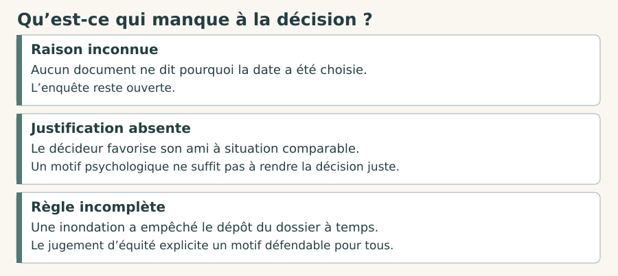

# BEL A/L — Deuxième composition de philosophie (Lyon), 2022 · Corrigé guidé

*Corrigé rédigé par IA, non officiel. Signalez toute erreur.*

**Lecture du rapport du jury** · GPT-6.2 Astra Ultra · vitesse non renseignée

**Rédaction** · GPT-6.2 Astra Ultra · vitesse non renseignée

**Autocontrôle** · GPT-6.2 Astra Ultra · vitesse non renseignée

**Révision (tour 1)** · GPT-6.2 Astra Ultra · vitesse non renseignée

**Révision (tour 2)** · GPT-6.2 Astra Ultra · vitesse non renseignée

## De quel manque parle-t-on ?

La deuxième composition de 2022 dure six heures. Le sujet porte sur « l’absence de principe ». L’expression laisse ouverte la nature de ce qui manque. Si l’on écrit dès l’introduction « l’absence du principe », on a déjà supposé un principe unique et concentré le problème sur sa disparition. Le rapport réserve un développement à ce changement d’article, ainsi qu’à la diversité des sens de l’absence.

**Distinguer quatre résultats possibles d’une enquête.** Aucun texte n’indique pourquoi la date a été retenue. Voilà une lacune documentaire. Le choix a été tiré au sort suivant un règlement public. Le résultat n’était pas fixé, mais la procédure a un principe. Le décideur a favorisé son ami et ne peut offrir aux autres une justification défendable. Le motif psychologique est connu, le principe de légitimité fait défaut. Enfin, le règlement est incomplet face à une circonstance exceptionnelle. Il faut maintenant expliciter ce qui rendra la décision équitable. Ces phrases ne posent pas le même diagnostic.

**Mettre une thèse à l’épreuve de sa portée.** Le principe de raison suffisante, chez Leibniz, laisse ouverte la connaissance que nous avons de la raison d’un fait singulier. Le principe de non-contradiction, chez Aristote, est engagé dès qu’un discours signifie une chose déterminée. Aucun de ces deux arguments ne suffit à prouver que la décision favorable à un proche est juste. Pour traiter cette dernière question, faire varier la décision dans un cas comparable et demander si la différence entre les deux peut être publiquement défendue.

**Relire le jury.** Le rapport invite à examiner aussi le domaine pratique et les situations où les principes doivent être recherchés, décidés ou institués. Sa remarque permet de construire la transition de l’absence d’une règle préalable à la responsabilité de juger. Le cas de l’équité fournit alors une difficulté véritable à résoudre, au lieu d’aligner successivement métaphysique, connaissance et morale.

Avant de qualifier une décision de dépourvue de principe, dire quelle découverte serait susceptible de modifier ce diagnostic. Une archive peut lever une ignorance sans rendre juste ce qu’elle explique.

**Exercice de préparation.** Un règlement demande une décision motivée sans fournir de barème. Éprouvez successivement trois diagnostics : une décision est impossible ; plusieurs décisions peuvent être justifiées ; n’importe quelle décision convient. La première proposition exige de prouver qu’un jugement sans calcul est impossible. La troisième oublierait l’exigence de motifs. En défendant la deuxième, nommez exactement ce qui manque et ce qui continue à faire principe. Vous pourrez alors examiner l’équité sans conclure trop vite à l’arbitraire.

## L’absence de principe

Deux demandes identiques de dérogation à une règle ont reçu des réponses opposées. Si celui qui décide se justifie simplement en disant qu’il n’avait cette fois-là aucune envie de rendre service, le reproche d’agir sans principe semble fondé. Il pourrait pourtant se faire que les situations diffèrent sur un point que la règle écrite n’avait pas prévu et que l’on doive approuver la différence des décisions. Dans les deux cas, on n’a trouvé aucun énoncé préalable qui commande mécaniquement le résultat. Dans un seul, apparemment, on a affaire à l’arbitraire. Que doit-il manquer pour qu’il y ait véritablement absence de principe ?

Un principe est ce à partir de quoi quelque chose procède, se comprend ou se règle. La cause première d’un ordre réel, le point de départ d’une démonstration et la norme d’une conduite jouent des rôles distincts. Une absence aussi a plusieurs sens. Ce que je cherche peut n’avoir jamais existé, avoir disparu, rester inconnu ou manquer comme ce qui devrait être là. Le sujet ne présuppose aucun principe suprême dont on annoncerait la disparition. Il porte sur ce que nous disons lorsque rien ne semble fournir, dans une situation, le point d’appui que nous attendions. Comment reconnaître une absence réelle sans prendre une raison qui nous échappe pour une inexistence, ni faire de toute conduite l’application d’un fondement déjà donné ?

### I. Constater qu’une raison manque n’est pas encore établir qu’il n’en existe aucune

Un commencement temporel est le premier événement d’une série. Un principe explicatif dit pourquoi cette série ou cette relation existe. Remonter au premier membre ne donne donc pas nécessairement le principe de l’ensemble. Si je demande pourquoi une institution attribue sa présidence au doyen d’âge, on peut retrouver la date du premier règlement qui le prescrit. Cette date explique comment une pratique est entrée en vigueur. Elle ne dit pas si l’âge est la bonne raison de confier à quelqu’un ce pouvoir. Le manque que je constate dépend de ma question. Retracer l’origine peut répondre à une question historique et laisser entière l’exigence de justification.

Leibniz formule dans la *Monadologie*, aux paragraphes 31 et 32, deux principes de nos raisonnements, celui de contradiction et celui de raison suffisante. Selon le second, il y a une raison pour laquelle un fait est ainsi plutôt qu’autrement, même lorsque nous ne pouvons la connaître. Prenons deux attributions différentes du même avantage. Mon ignorance des raisons peut m’inciter à poursuivre une enquête sur les documents et les circonstances. Elle ne m’autorise pas à déclarer qu’aucune raison ne saurait être trouvée. Le principe soutient ici la recherche et interdit de convertir trop rapidement une limite de connaissance en thèse sur l’être. Il n’autorise pas davantage à inventer la raison que l’enquête n’a pas établie. Supposer une intelligibilité et connaître l’explication de cet événement précis restent deux prétentions différentes.

On peut toutefois objecter à Leibniz que l’exigence d’expliquer constitue peut-être seulement une règle de notre recherche. Elle dit ce que nous essayons de faire, sans décider à elle seule si la réalité satisfait intégralement à cette attente. Soutenir qu’un événement est contingent n’équivaut d’ailleurs pas à le dire inintelligible. Qu’il ait pu en être autrement ne signifie pas que rien n’explique pourquoi, dans ces conditions, il en a été ainsi. Il faut donc préciser, face à une absence apparente, de quel droit on passe d’une recherche encore ouverte à l’affirmation d’un vide définitif.

### II. Une absence locale de règle peut être réelle et parfois féconde

Une décision peut être causalement intelligible et manquer de principe au sens pratique. L’autorité qui favorise son ami agit pour une raison psychologique très reconnaissable. Dire que sa décision est sans principe revient à lui reprocher l’absence d’une raison qu’elle puisse soutenir devant les autres personnes placées dans les mêmes conditions. Il existe bien un ressort constant, la préférence accordée au proche. Ce ressort ne devient pas une norme légitime du seul fait qu’il produit régulièrement les mêmes effets. Le défaut est ici réel parce que l’agent est tenu de justifier publiquement sa conduite et n’offre rien qui satisfasse à cette exigence.

Deux décisions identiques peuvent provenir de raisons très différentes. Si le dossier a disparu, l’enquêteur manque d’une raison documentée. S’il retrouve une règle qui exclut le demandeur à cause de son origine, la raison devient connaissable et la critique porte désormais sur sa légitimité. Le mot « absence » change donc de sens au cours même de l’enquête.

À l’inverse, toute décision différente prise dans un cas particulier ne relève pas du favoritisme. Dans le livre V de l’*Éthique à Nicomaque*, Aristote explique que la loi parle en général d’une matière humaine où des exceptions surviennent. L’équitable corrige ce que la généralité de la formulation laisserait manquer à la justice dans ce cas. Supposons qu’une allocation soit attribuée sur production d’un dossier avant une date et qu’une personne ait perdu ses pièces dans une inondation qui a fermé les services chargés de les délivrer. Accorder un délai peut respecter la raison de la procédure, qui est de départager équitablement des demandes vérifiables. Le refuser au seul motif qu’aucune phrase du règlement ne mentionne l’inondation confondrait la justice de la règle et sa lettre. Le motif précis pourra valoir pour toute personne pareillement empêchée.

Un jury doit départager deux réalisations recevables. Le règlement exige une appréciation motivée sans fixer le poids de chaque qualité. Une décision favorable à la première pourrait tenir à sa précision, une décision favorable à la seconde à son inventivité. Qu’aucun calcul ne détermine d’avance le classement laisse subsister des exigences précises : les motifs doivent porter sur les travaux, être appliqués avec cohérence et pouvoir être exposés aux intéressés. Introduire en secret l’ancienneté du candidat donnerait bien un principe de sélection au sens descriptif. Ce serait aussi manquer au principe qui donne au jugement sa légitimité. L’absence change de sens selon ce que l’on cherche : un procédé qui délivre mécaniquement le résultat, une régularité qui explique le choix ou une raison recevable de l’assumer.

Il manque ici une disposition explicite, et ce manque ne se dissipe pas lorsque l’on comprend sa fonction. Il oblige celui qui juge à répondre de la manière dont il particularise l’exigence de justice. La solution est plus risquée qu’une application automatique, car le privilégié pourra prétendre à tort relever d’une exception. Elle est aussi plus exigeante. Le décideur doit rendre publics les faits pertinents et admettre qu’on les confronte à d’autres cas. Un principe n’est donc pas toujours disponible avant l’action sous la forme d’une instruction prête à l’emploi. Son absence sous cette forme peut rendre nécessaire l’exercice du jugement plutôt que sa suspension.

### III. Interroger les principes engage déjà des distinctions dont il faut répondre

L’hypothèse la plus radicale est qu’il n’y aurait de principe nulle part. Mais en la proposant comme une thèse, on invite un interlocuteur à comprendre ce qu’elle exclut et à reconnaître qu’on ne soutient pas également son contraire sous le même rapport. Dans le livre Gamma de la *Métaphysique*, Aristote traite le principe de non-contradiction comme ce qui n’est pas démontrable à partir de prémisses plus certaines. Exiger une telle démonstration pour tout énoncé renverrait toujours à d’autres prémisses. On peut en revanche demander à celui qui conteste le principe de signifier quelque chose de déterminé. Pour contester, il s’appuie déjà sur une distinction entre la position qu’il défend et celle qu’il refuse. La mise en question des fondements n’abolit donc pas toutes les conditions de la discussion.

Cette limite n’établit ni que tout événement a une cause connue ni que tout commandement est juste. Le principe formel qui permet de distinguer deux réponses incompatibles ne tranche pas laquelle est soutenable. Reprenons l’exemple initial. Face à deux décisions opposées, il faut chercher si les faits sont effectivement identiques au regard de l’objet de la règle. Ce travail peut conduire à sortir d’une pratique sans motif avouable, en formulant une norme susceptible de correction. Nous ne la découvrons pas nécessairement comme une chose qui aurait toujours été là. Nous l’instituons parfois en acceptant de nous y conformer dans des cas futurs, y compris lorsqu’elle contrariera notre préférence du moment. Poser un principe ajoute alors une obligation nouvelle dont les raisons peuvent être débattues.

L’absence de principe ne reçoit donc pas une signification unique. L’ignorance du fondement laisse place à l’enquête, le défaut de justification peut rendre une décision arbitraire, la lacune de la règle générale requiert le jugement. L’affirmation absolue de l’absence de tout principe, elle, dépend encore de certaines conditions de sens. Reconnaître cette limite ne rétablit pas un fondement universel à toutes nos pratiques. Cela permet d’identifier où une recherche reste à mener et où il nous appartient de répondre des principes que nous faisons exister.

[Sujet officiel](https://www.ens-lyon.fr/sites/default/files/2022-11/Session-2022_BEL_Epreuves%20de%20sp%C3%A9cialit%C3%A9.pdf#page=2) · [Rapport du jury](https://www.ens-lyon.fr/sites/default/files/2022-11/Philosophie%202022.pdf) · [Leibniz, Monadologie, paragraphes 31 et 32](https://fr.wikisource.org/wiki/Monadologie/%C3%89dition_Nolen_1881)
