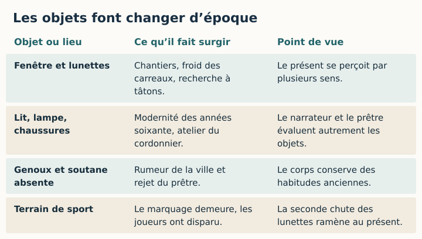

# BEL A/L — Espagnol (commentaire et traduction) 2022 · Corrigé guidé

*Corrigé rédigé par IA, non officiel. Signalez toute erreur.*

**Rédaction** · GPT-6.2 Astra Ultra · vitesse non renseignée

[Sujet officiel](https://www.ens-lyon.fr/sites/default/files/2022-11/Session-2022_BEL_Commentaire%20et%20traduction.pdf#page=10) · [Rapport du jury](https://www.ens-lyon.fr/sites/default/files/2022-11/Espagnol%202022.pdf#page=2)

Antonio Muñoz Molina, *Plenilunio* (1997), éd. Punto de Lectura, 2000, p. 423-427. Le sujet demande le commentaire en espagnol de tout l’extrait et la traduction de son début jusqu’aux fournisseurs de mobilier ecclésiastique.

## Préparer l’épreuve

Relever deux chutes des lunettes, puis déplacer l’attention d’un objet à l’autre. La lampe fait voir l’ameublement, les chaussures conduisent au souvenir du cordonnier, les genoux rappellent une soutane absente. Chaque détail matériel permet de changer d’époque sans interrompre le déplacement du prêtre. La fin ramène sur le terrain de sport une action physique commencée dans la chambre. Que vaut désormais la comparaison entre voir et se souvenir ?

Pour la voix narrative, distinguer le chapeau éditorial, les pensées attribuées au personnage et les propos collectifs que le récit reconstitue. L’hostilité rapportée n’est pas le jugement de l’auteur. L’emploi soudain du présent et des démonstratifs rend audible un propos que personne en particulier ne revendique. La répétition du mot *mentira* traduit ensuite l’étonnement du prêtre devant la disparition de ce qui semblait indestructible.

Dans la version, *flexo* désigne une lampe de bureau articulée et *plato de ducha* un bac de douche. Le second paragraphe écarte une explication de l’austérité puis en donne deux autres. Les subordonnées doivent donc rester sous la portée exacte de la négation et exprimer ce dont les autres jouissaient. Reconstituer enfin le groupe dont les deux sujets sont la table de nuit et la lampe. Leur état paraît au narrateur dater de la modernité des années soixante. Le prêtre, lui, ne les perçoit pas sous ce jour.

## Commentaire

Una mañana lluviosa, el padre Orduña recorre una residencia casi vacía para dirigirse a la iglesia. Lo que podría ocupar unos minutos basta aquí para que se oigan las voces de una ciudad de hace decenios. El fragmento de *Plenilunio*, de Antonio Muñoz Molina, sitúa al sacerdote en la España democrática de los años noventa. La información preliminar sobre su pasado franquista y su posterior compromiso con el movimiento obrero permite fechar el conflicto que recuerda. El relato, sin embargo, elige otra manera de contar esa vida. Empieza y acaba con la caída de unas gafas. ¿Qué clase de conocimiento del pasado se abre entre dos instantes en los que el personaje se queda prácticamente sin ver?

El espacio que rodea la residencia empieza a cambiar antes de que aparezca el hombre que lo habita. En la primera frase, el mismo terreno contiene, alternativamente, talleres, una granja y edificios en construcción. La repetición de «ahora» opondría claramente el presente al pasado si las grúas no estuvieran oscilando y las zanjas llenándose de barro. Este presente todavía está por hacer. El ruido metálico y la presión del temporal sobre el cristal se dejan sentir desde un interior apenas iluminado. Allí, los actos se suceden con la torpeza de quien necesita primero tocar un interruptor, luego recoger sus gafas y encontrar ropa. La planta del pie conoce el frío del suelo antes de que una mirada pueda ordenar el escenario. El relato nos acerca al anciano por los sentidos que le quedan disponibles.

El mobiliario parece prometer el retrato edificante de un hombre que se mortifica. La frase negativa que abre el segundo párrafo deshace esa expectativa. Orduña vive así porque no sabe imaginarse de otra manera. El pensamiento de Sócrates al ver el mercado de Atenas explica a la vez el placer y la indiferencia del sacerdote. Agradece poder pasar de largo ante las cosas que se pueden comprar, pero le gusta profundamente la cama que ya tiene. La enumeración de las asperezas de esa cama equivale a una prueba singular de afecto. El personaje y el narrador atribuyen así valores diferentes a un mismo objeto. Donde Orduña encuentra un lugar en el que ha dormido admirablemente, la voz narrativa reconoce una modernidad de los años sesenta que ha envejecido mal. El inciso temporal sobre el sueño introduce, además, una reserva discreta. Ni siquiera ese acuerdo entre el cuerpo y su habitación ha quedado enteramente a salvo del tiempo. Que Orduña se niegue a llamar celda a su cuarto acentúa la distancia respecto al modelo de santidad ostentosa que el lector habría podido atribuirle.

Son sus zapatos los que ponen en marcha otra historia. En vez de tirarlos, los lleva a reparar. Todavía hay un zapatero, pero es el hijo del antiguo interlocutor comunista del jesuita. En el portal de la tienda, las mujeres entraban con sus zapatos envueltos en periódicos mientras los dos hombres discutían sobre Cristo y el sentido revolucionario de los Evangelios. La yuxtaposición de estos pequeños gestos con las grandes preguntas teológicas modifica nuestra imagen de aquel diálogo. Había que hablar bajo. El adjetivo «clandestina» recuerda el peligro político, mientras que «laboral» conserva en la definición de aquella teología el lugar donde efectivamente se pensaba. Una práctica cotidiana del presente, hacer poner medias suelas, mantiene el contacto con una forma de pensamiento y de amistad cuya generación ya ha dado paso a otra.

En los pasillos, el tiempo transcurrido adquiere dimensiones espaciales. Como mucha gente se ha marchado o ha muerto, la residencia parece haberse agrandado. Los cuartos y las escaleras se multiplican, aunque nada indique que se hayan construido nuevos. La comparación con una ciudad deshabitada invierte la imagen inicial de las grúas. Fuera se edifica. Dentro, la ausencia de otros hombres basta para alargar los trayectos. La miopía difumina la perspectiva de las baldosas, pero Orduña distingue por el ruido las que se han soltado. Su cuerpo sabe también lo que hace mucho ha dejado de existir. Sus rodillas avanzan como si encontraran la resistencia de la sotana. La prenda ausente hace aparecer una memoria motriz más precisa que cualquier razonamiento sobre la fidelidad del viejo sacerdote a su pasado.

Ese roce imaginario devuelve al relato una multitud de voces. Un día, el cambio de ropa de un cura bastó para poner en movimiento sacristías, tertulias y mesas camillas. La ironía del «rezadero de chismes» hace del acto devoto una máquina de difundir rumores. Tal vez nadie haya visto al jesuita vestido de seglar. Aun así, cuando el relato pasa al presente de la habladuría y al demostrativo que señala a «ese cura», parece que todos sepan lo que hizo, a quién pertenece su familia y cuál ha sido siempre su postura política. El «desde siempre» que lo tacha de rojo cancela precisamente la transformación biográfica que el lector conoce por la nota introductoria. La injuria del veterano de la División Azul y la circunstancia de que ocurra un Viernes Santo hacen perceptible, en un gesto de desprecio, la violencia de una moral pública que se proclamaba católica. El narrador recupera la voz de los adversarios sin entregarle la última palabra.

El regreso a «ahora» no produce alivio. Más increíble que la existencia de aquel mundo le parece a Orduña que haya podido desaparecer. En el patio se ven todavía las líneas de una cancha que ya nadie utiliza. Constituyen, como la sotana, la huella sensible de una práctica extinguida. Pero esa imagen tan legible para quien lee no ayuda al personaje a esquivar el charco. Durante más de un minuto su mundo se reduce a dos peligros modestos y apremiantes, no encontrar las gafas o pisarlas. Se siente humillado y se ve incluso algo ridículo en el mismo instante en que ve peor. La compasión por el anciano y la distancia irónica caben juntas en esta última paradoja. Recorrer con él la residencia no ha servido para restituir una versión heroica de su vida. Ha permitido advertir cómo una historia colectiva sigue actuando en su cuerpo, en sus oídos y en los objetos que toca, incluso cuando ya no basta para orientarlo en el presente.

## Version française

La violence de la pluie faisait trembler la vitre, et le vent soufflait très fort à présent sur les terrains vagues où s’étaient autrefois trouvés les ateliers et la ferme et où s’élevaient maintenant des immeubles en construction, des grues qui oscillaient avec des grognements métalliques tandis que les tranchées ouvertes pour les fondations et les garages souterrains qu’on était en train de creuser se remplissaient d’eau, d’une boue brune et épaisse. Il chercha à tâtons l’interrupteur de sa lampe de bureau articulée et, quand la lumière s’alluma, ses lunettes tombèrent par terre. Il se redressa pour les ramasser et, en posant les pieds sur le carrelage, il en eut la plante glacée. Il s’enveloppa dans une vieille robe de chambre à carreaux, se lava la figure à l’eau très froide dans le petit cabinet de toilette attenant à sa chambre, où se trouvait aussi un bac à douche.

Si le père Orduña vivait si austèrement, ce n’était pas qu’il eût délibérément renoncé au confort dont d’autres n’auraient pu se passer. Il vivait ainsi parce qu’il n’arrivait pas à s’imaginer vivant autrement et que ces choses dont d’autres tiraient plaisir le laissaient, lui, indifférent. Il regardait d’un œil distrait les vitrines des magasins et se rappelait l’étonnement de Socrate devant l’abondance qui régnait sur le marché d’Athènes. « Que de choses au monde dont je n’ai pas besoin ! » Il aimait son lit étroit aux barreaux cylindriques d’un autre âge, tout contre le mur, et jusqu’à une époque assez récente il y avait dormi à merveille, malgré l’étroitesse du couchage, la rudesse des draps et la piètre qualité du matelas. Ni sa table de nuit, écaillée aux angles, ni sa lampe articulée à l’abat-jour bleu métallisé ne lui apparaissaient pour ce qu’elles étaient, les témoins d’une certaine modernité des années soixante, déjà décrépite, que les fournisseurs de mobilier ecclésiastique avaient tout particulièrement prisée.
