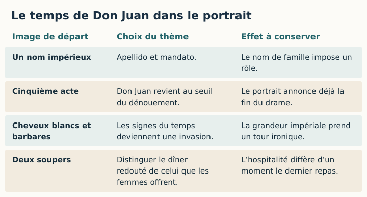

# BEL A/L — Espagnol (thème Lyon) 2022 · Corrigé brut

*Corrigé rédigé par IA, non officiel. Signalez toute erreur.*

**Rédaction** · GPT-6.2 Astra Ultra · vitesse non renseignée

**Révision (tour 1)** · GPT-6.2 Astra Ultra · vitesse non renseignée

[Sujet officiel](https://www.ens-lyon.fr/sites/default/files/2022-11/Session-2022_BEL_Epreuves%20de%20sp%C3%A9cialit%C3%A9.pdf#page=12) · [Rapport du jury](https://www.ens-lyon.fr/sites/default/files/2022-11/Espagnol%202022.pdf#page=11)

Jules Barbey d’Aurevilly, *Les Diaboliques*, édition citée par le sujet, Paris, 1882, p. 100-101. Le thème de spécialité dure quatre heures et porte sur l’intégralité du passage donné à la page 12 du fascicule.

## Proposition de thème

Un apellido providencial, señora... El conde de Ravila de Ravilès, que, dicho sea entre paréntesis, siempre había acatado el mandato de aquel imperioso apellido, era sin duda la encarnación de todos los seductores de los que se habla en las novelas y en la historia. Y hasta la marquesa Guy de Ruy —una vieja descontentadiza, de ojos azules, fríos y penetrantes, aunque menos fríos que su corazón y menos penetrantes que su ingenio— admitía que, en estos tiempos en que la cuestión de las mujeres pierde importancia de día en día, si alguien había que pudiera recordar a don Juan, ¡sin duda alguna tenía que ser él! Por desgracia, era el don Juan del quinto acto. […] Al igual que d’Orsay, aquel dandi tallado en el bronce de Miguel Ángel, que conservó su hermosura hasta la última hora, Ravila había tenido esa belleza privativa de la estirpe de los Juanes, de esa estirpe misteriosa que no pasa de padres a hijos como las demás, sino que surge aquí y allá, a trechos, entre las familias de la humanidad.

Era la belleza verdadera, la belleza insolente, jubilosa, imperial, «donjuanesca», en fin. La palabra lo dice todo y ahorra la descripción. Y —¿habría sellado un pacto con el diablo?— aún la conservaba... Solo que Dios también sacaba su parte. Las garras de tigre de la vida empezaban a surcarle aquella frente divina, coronada con las rosas de tantos labios, y en sus anchas sienes impías asomaban los primeros cabellos blancos que anuncian la inminente invasión de los bárbaros y el fin del Imperio... Los lucía, por lo demás, con la impasibilidad del orgullo exaltado por el poder, pero las mujeres que lo habían amado los miraban a veces con melancolía. ¿Quién sabe? ¿Acaso leían en aquella frente la hora que era para ellas? ¡Ay!, para ellas como para él era la hora de la terrible cena con el frío Comendador de mármol blanco, tras la cual solo queda el infierno, ¡el infierno de la vejez, a la espera del otro! Y he aquí quizá por qué, antes de compartir con él aquella cena amarga y postrera, se les ocurrió ofrecerle la suya e hicieron de ella una obra maestra.

