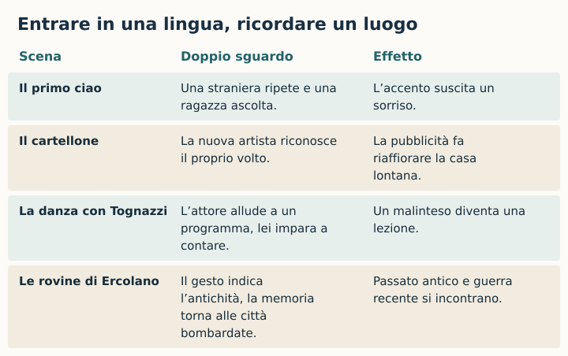

# BEL A/L — Italien (commentaire et traduction) 2022 · Corrigé brut

*Corrigé rédigé par IA, non officiel. Signalez toute erreur.*

**Rédaction** · GPT-6.2 Astra Ultra · vitesse non renseignée

[Sujet officiel](https://www.ens-lyon.fr/sites/default/files/2022-11/Session-2022_BEL_Commentaire%20et%20traduction.pdf#page=12) · [Rapport du jury](https://www.ens-lyon.fr/sites/default/files/2022-11/Italien%202022_0.pdf#page=2)

Edith Bruck, *Il pane perduto*, Milan, La nave di Teseo, 2021. Le commentaire porte sur l’extrait entier, jusqu’à Ischia. La version commence en mai, au milieu du paragraphe sur le jardin, et s’achève à la ligne 49 sur la ville où imagination et chant sont chez eux.

## Commentaire

Si può chiamare un luogo «il mio Paese» subito dopo esservi arrivati, senza conoscerne la lingua, e rifiutare al tempo stesso la parola *patria*? Nel *Pane perduto* Edith Bruck racconta il proprio arrivo a Napoli come componente di una compagnia di ballo. Una donna che ha attraversato Auschwitz incontra una città che le piace al primo sguardo. Chi scrive nel 2021 sa che l’italiano appreso allora sarebbe diventato la lingua dei suoi versi e dei suoi libri. Eppure sceglie di tornare al momento in cui persino la vocale finale del saluto più comune provocava un sorriso. Come si può raccontare la nascita di un’appartenenza senza farne una conversione definitiva né chiedere a Napoli di cancellare il passato?

La frase iniziale sembra rispondere con la facilità di una cartolina. A Zurigo spetta l’ordine, a Napoli il sole. Il femminile plurale di «arrivate» colloca nella stessa esclamazione di sollievo tutte le viaggiatrici. Ben presto, però, gli aggettivi danno luogo a un piccolo conflitto fra chi mette in guardia le ragazze e chi guarda la città. La narratrice si dispiace del pregiudizio dei consiglieri. La città che le appare come un paradiso è entrambi i luoghi insieme, quello che le viene raccontato come pericoloso e quello che le permette finalmente di sentirsi bene. Dalla sua stanza in pensione vede, attraverso un’altra vetrata, clienti che fissano un televisore. Prima di rivolgere alla nuova arrivata uno sguardo curioso, i napoletani sono dunque a loro volta spettatori assorti. L’oggetto appena giunto nel paese trasmette un canto che può parere antichissimo a chi lo ascolta senza capirne le parole. La Napoli sonora di Bruck si incontra anche attraverso uno schermo, un disco o un’insegna da decifrare.

Il passaggio al singolare nella frase «questo è il mio Paese» comporta un rischio che la scrittrice avverte subito. In base a quale diritto dire *mio*, e che cosa si è autorizzati a fare in nome della patria? La memoria di Auschwitz interrompe il respiro festivo dell’arrivo. Le parole che l’io vorrebbe abolire appartengono a registri molto diversi. A concetti politici riconoscibili come nazionalismo e razzismo si affiancano l’ordine di tacere, la pretesa di possesso, una dichiarazione solenne sull’uguaglianza di tutti davanti alla legge e perfino il nome dell’amore quando ha perduto sostanza. L’elenco unisce la violenza degli ordini all’uso ipocrita di parole desiderabili. Imparare una lingua nuova significa quindi cercare un modo meno doloroso di parlare, anche del campo. L’episodio minimo del «ciao» dà a questo desiderio un inizio concreto. La ragazza che pulisce una stanza parla e sorride sentendo la pronuncia della straniera. La prima interlocutrice le offre una risposta che non richiede né correttezza perfetta né obbedienza.

Il mese di maggio e il ricordo della nascita rendono possibile la figura di un secondo inizio. Ma la riconciliazione con la vita, appena affermata, subisce una correzione. Bruck si sente in pace con il sole e, forse, con un mare dal quale ha conosciuto anche una reazione fisica spiacevole. La propria vita resta più difficile da accogliere. La stessa oscillazione si ritrova nei manifesti pubblicitari. La ragazza che vede il proprio volto stampato per le strade di una città dove quasi nessuno la conosce si vergogna come se qualcuno potesse riconoscerla a casa sua. Proprio nel momento in cui dovrebbe presentarla come artista, la fotografia fa riaffiorare un altrove intimo e assente. La folla che applaude e i saluti ripetuti delle ballerine le permettono di sostenere uno sguardo pubblico senza dissipare del tutto quel sentimento.

Il locale sotto le stelle contiene a sua volta più mondi. Accanto alla musica per la danza del ventre si sentono musiche sudamericane, un pezzo classico e, sui dischi, canzoni di Sinatra o di interpreti italiani. L’autrice non canta più nella «città del canto». Sta imparando ad ascoltare. Il colloquio danzato con Ugo Tognazzi spinge all’estremo questa diversa educazione dell’orecchio. Il nome celebre ripetuto dal proprietario non le dice nulla. L’attore la stringe, mostra le dita e cerca di farle riconoscere il proprio programma. L’esito della lezione sfugge a chi credeva di impartirla. Lei impara a contare fino a tre. La scena fa sorridere il lettore che riconosce l’allusione televisiva, ma gli fa anche sperimentare quanto sia locale la fama che parrebbe ovvia a tutti. La scrittrice collega quei numeri alla sua opera futura con una rapida anticipazione. La competenza che ora le permette di raccontare con tanta precisione la propria ignoranza non viene retroattivamente attribuita alla ragazza che era.

Quando il racconto esce dal locale, Napoli si fa «povera, ricca, degradata, umana». Non serve scegliere uno degli aggettivi per annullare gli altri. Al mercato sacro e comico si affollano sotto lo stesso naso, i pastori del presepe insieme a Totò e ai De Filippo. Il passaggio al «ti» coinvolge il lettore nell’insistenza fisica del venditore. La narratrice riconosce poi la differenza fra una visita e una vita intera in un luogo. Ma l’apparenza osservata dal visitatore ha un proprio valore. Le permette, per esempio, di misurare la distanza fra lo stereotipo del seduttore italiano e le maniere dei suoi tre accompagnatori. Il visitatore miope di Ercolano tenta di spiegarsi con gesti, finché accosta ai nomi antichi un «kaputt» che la straniera può capire. Per lei, tuttavia, le rovine evocano Berlino e Dresda. Lo stesso sito si apre su due mappe temporali diverse. La gonna da poco prezzo che accetta come un dono prezioso prolunga intanto la conversazione in un linguaggio di attenzioni reciproche.

Il frammento si chiude su un altro nome imparato per ripetizione, Sant’Angelo, e sul mare ai piedi della montagna. Il nome di un’isola, tre numeri, una vocale pronunciata male sono cose piccole. Bastano a spiegare come la narratrice possa riconoscere un paese per suo pur senza rivendicarne il possesso. Chi è sopravvissuta porta uno sguardo che neppure il paesaggio più lieto renderà innocente. Proprio quello sguardo, divenuto capace di scrivere in italiano, restituisce ai lettori italiani una lingua e una città di cui la familiarità rischiava di renderli distratti.

## Version française

C’était en mai, le mois de ma naissance. Tout me semblait enchanté, j’étais presque en train de me réconcilier avec la vie, pas avec la mienne, mais avec le soleil et avec la mer, qui peut-être ne me ferait plus vomir. Au coucher du soleil, le patron aux yeux bleus, qui pour la première fois avait eu l’idée d’engager une troupe de danse, fut ému en faisant notre connaissance et nous le fûmes avec lui. Le journal du coin annonçait la nouveauté que proposait l’établissement, et on distribuait en ville des affiches avec notre photo. En les découvrant, j’eus honte, comme si j’étais chez moi et que quelqu’un pouvait me reconnaître. Enfin, après des répétitions et encore des répétitions, même avec un éclairagiste, nous fîmes nos débuts le premier samedi après notre arrivée. Le jardin était plein de familles, d’hommes, de femmes, d’enfants, de jeunes et de moins jeunes. Notre numéro s’accompagnait d’une musique sud-américaine, d’une musique arabe pour la danse du ventre et d’un morceau de musique classique pour la petite Elfi, qui ressemblait à un ange. Les applaudissements étaient généreux, enthousiastes, et nous saluâmes plusieurs fois.

Moi, je ne chantais plus dans la ville du chant. Il n’y avait pas d’orchestre. La musique sur laquelle on dansait venait surtout de disques de chansons américaines, de Sinatra principalement, et de chanteurs italiens connus à l’époque.

Aux tables, les gens buvaient de la bière, du vin, des jus de fruits pressés et quelques whiskys. Nous étions libres de partir ou de rester. Le patron demanda à Max, qui veillait sur nous, qu’on reste encore un peu. Quelques jeunes gens souhaitaient danser avec nous, et surtout deux acteurs célèbres voulaient danser avec moi, expliqua-t-il, Ugo Tognazzi et Walter Chiari. Il n’arrêtait pas de répéter ces noms qui ne me disaient rien. Celui qui s’appelait Tognazzi me serrait contre lui d’un air finaud, me parlant de « radio », de « io », de « programma », me montrant sans cesse ses doigts courts et répétant « uno, due, tre ». Et c’est ainsi que j’appris enfin à compter jusqu’à trois en italien, ce fut ma première leçon. Plus tard, j’allais écrire dans cette langue tous mes poèmes et tous mes livres après le premier, publié il y a soixante ans.

Naples me semblait une ville pleine de voix, pauvre, riche, délabrée, humaine et insistante. Sur les marchés, on voulait vous vendre, vous imposer la marchandise ou les figurines de la crèche. On vous mettait sous le nez les bergers, les Enfants Jésus, la Madone, les anges, Totò, le trio De Filippo et les cornes porte-bonheur. Il n’était pas facile de se défaire du marchand. Dans cette ville noble et tapageuse, les baisemains n’étaient pas rares et l’imagination, tout comme le chant, était chez elle.

