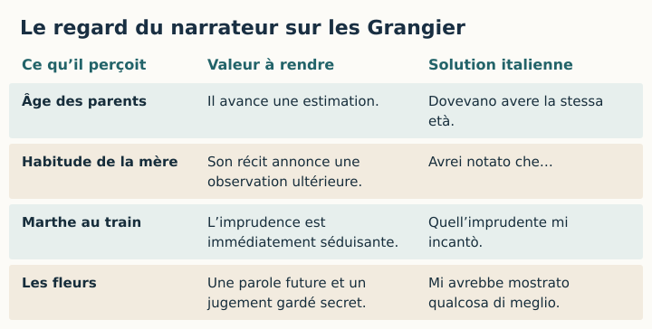

# BEL A/L — Italien (thème Lyon) 2022 · Corrigé guidé

*Corrigé rédigé par IA, non officiel. Signalez toute erreur.*

**Rédaction** · GPT-6.2 Astra Ultra · vitesse non renseignée

[Sujet officiel](https://www.ens-lyon.fr/sites/default/files/2022-11/Session-2022_BEL_Epreuves%20de%20sp%C3%A9cialit%C3%A9.pdf#page=13) · [Rapport du jury](https://www.ens-lyon.fr/sites/default/files/2022-11/Italien%202022_0.pdf#page=8)

Raymond Radiguet, *Le Diable au corps*, 1923. Le sujet de l’ENS de Lyon demande de traduire l’extrait entier en italien. La note de l’énoncé précise le nom et l’adjectif italiens relatifs à l’albinisme.

## Préparer l’épreuve

Dans les trois emplois de « devoir », identifier l’opération effectuée par le narrateur. L’âge des Grangier résulte d’une estimation. Les rides de Mme Grangier donnent lieu à une observation future dans le passé. Enfin la venue de Marthe par le prochain train est annoncée par sa mère. L’italien peut employer *dovevano avere*, *avrei notato* et *sarebbe arrivata* pour distinguer ces valeurs.

Répartir le regard entre les personnages. Le narrateur cherche une raison supplémentaire de détester Mme Grangier, transforme en charme l’imprudence de Marthe et garde pour lui le jugement défavorable que lui inspirent les fleurs. *Un quarto d’ora* se rapporte à l’arrivée du train suivant. Le relatif du passage sur le petit garçon porte sur les gestes qui trahissent la maladie. *Albino* figure dans la note du sujet.

Relire enfin les mouvements du groupe. Les deux jeunes gens marchent en tête, le père du narrateur vient derrière entre les Grangier, les frères s’ennuient avec un enfant à qui la course est interdite. Dans la dernière phrase, « mieux » a la valeur de « quelque chose de mieux » que précisent les fleurs stylisées. Pour « elle n’y attachait aucune importance », rendre le complément de *dare/importanza* selon le verbe retenu, par exemple *non dava loro alcuna importanza*.

## Proposition de thème

Sulla banchina della stazione di La Varenne ci aspettavano i Grangier. Il signore e la signora Grangier dovevano avere la stessa età, prossimi entrambi ai cinquant’anni. La signora Grangier però sembrava più anziana del marito. La sua scarsa eleganza e la sua bassa statura me la resero antipatica a prima vista.

Durante quella passeggiata avrei notato che aggrottava spesso le sopracciglia, e allora la fronte le si copriva di rughe che impiegavano un minuto a spianarsi. Desideravo che usasse espressioni piuttosto volgari, così da darmi ogni motivo per trovarla antipatica senza dovermi rimproverare di essere ingiusto. Su questo punto mi deluse.

Il padre, invece, aveva l’aria di un brav’uomo, un ex sottufficiale adorato dai suoi soldati. Ma dov’era Marthe? Tremavo all’idea di una passeggiata senza altra compagnia che quella dei suoi genitori. Sarebbe venuta col treno successivo, «fra un quarto d’ora», spiegò la signora Grangier. Non aveva fatto in tempo a prepararsi. Con lei sarebbe arrivato suo fratello.

Quando il treno entrò in stazione, Marthe era in piedi sul predellino della carrozza. «Mi raccomando, aspetta che il treno sia fermo!» le gridò la madre… Quell’imprudente mi incantò.

Il vestito e il cappello, semplicissimi, dimostravano in che poco conto tenesse l’opinione degli sconosciuti. Teneva per mano un ragazzino che sembrava avere undici anni. Era suo fratello, un bambino pallido con i capelli da albino, di cui ogni gesto tradiva la malattia.

Lungo la strada Marthe e io camminavamo in testa. Dietro veniva mio padre, in mezzo ai Grangier.

I miei fratelli, dal canto loro, sbadigliavano insieme al nuovo, gracile compagnetto, al quale era proibito correre.

Mentre mi complimentavo con Marthe per i suoi acquerelli, mi rispose modestamente che erano degli studi. Non dava loro alcuna importanza. Mi avrebbe mostrato qualcosa di meglio, dei fiori «stilizzati». Per la prima volta ritenni opportuno non dirle che trovavo ridicoli i fiori di quel genere.
