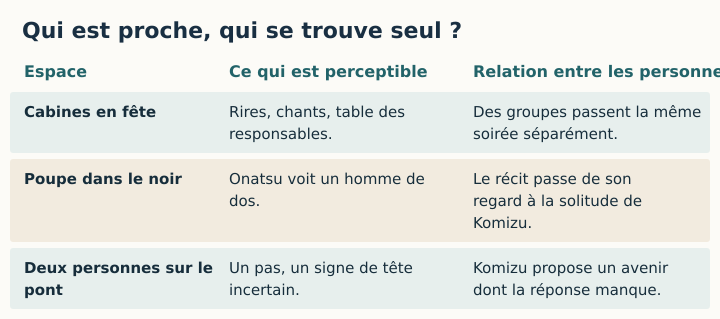

# BEL A/L — Japonais (commentaire et traduction) 2022 · Corrigé guidé

*Corrigé rédigé par IA, non officiel. Signalez toute erreur.*

**Rédaction** · GPT-6.2 Astra Ultra · vitesse non renseignée

[Sujet officiel](https://www.ens-lyon.fr/sites/default/files/2022-11/Session-2022_BEL_Commentaire%20et%20traduction.pdf#page=14) · [Rapport du jury](https://www.ens-lyon.fr/sites/default/files/2022-11/Japonais%202022.pdf#page=2)

Ishikawa Tatsuzō, *Sōbō* (« 蒼氓 », daté de 1939 dans le fascicule). Le commentaire en japonais couvre tout le passage. La version traduit la portion prescrite des lignes 13 à 22 et s’arrête avant le projet de consultation d’Akiho.

## Préparer l’épreuve

Au début, compter les espaces avant de compter les personnages. Le groupe des responsables, celui des buveurs, les femmes déjà couchées et le pont désert ne constituent pas une seule fête. Puis suivre le mouvement de la caméra narrative, du ciel à l’aisselle découverte, du dos vu de loin à l’intériorité de Komizu. Le changement de point de vue est marqué par la phrase qui l’identifie, puis par la répétition immédiate de son nom. Le discours final propose un avenir à Onatsu, mais le texte s’arrête sans livrer sa réponse.

Pour la version, *簡単服* est ici une tenue légère décrite comme sans manches ; *一段下* situe la cabine un niveau plus bas. Les verbes rendent d’abord la démarche d’Onatsu et ce qu’elle entend. Dans le paragraphe suivant, *すらも* indique que même le soutien de ses camarades n’est plus acquis ; *躊躇しはじめた* marque le début de leurs hésitations. Le sujet imprimé nomme 村松 près du début puis 松村 à l’intérieur du passage à traduire. On rend ici ce dernier nom tel qu’il est imprimé, Matsumura. Conserver aussi la différence entre l’absence de personne attendant Komizu au Brésil et sa question de savoir où s’établir.

## Commentaire

### 港に着く前に、人はどこに居場所を見つけるのか

冒頭の「午後六時」とサントスという地名は、航海日誌のように出発の時刻と行先を告げる。目的地はすでに決まっている。それなのに末尾で小水はお夏に、どこで、誰と暮らしていくのかを性急に問いかける。船の進路が確かであるのに、人間の行先がこれほど不確かであるのはなぜか。石川達三は、到着を前にして人々が同じ期待を抱く場面を描く代わりに、船内の階層、二人の身体を隔てる距離、そして一方に偏った対話を描き分ける。最後の晩は、移住者が群れを離れても、すぐには他人と共に生きる場所を得られないことを明らかにする時間である。

まず「最後の夜」は、船に乗った全員に共通していても、全員に同じように過ごされてはいない。大騒ぎを船長らがとがめなかったという説明に、語り手は「というよりも」と言い直しを加える。上に立つ人々もまた祝っていたのだが、それは監督たちとつくる別の集まりだった。古いウイスキイ、チーズ、ベエコン、アスパラガスという具体的な列挙は、別の場にいる人には分けられない上等な食卓を、その場で見せる。「彼等は彼等で」の反復が表す区切りは、食べ物の並びによって目に見える。一方、飲まない女たちはすでに寝床に入る。お夏だけは酔った孫市らの笑いを背にして甲板に上がる。彼女は眠る女たちにも、笑う男たちにも加わらず、自分の目で最後の夜を見ようとする。

ところが視界が急に広がるわけではない。闇は深く、しぶきと冷気が肌にしみる。南十字星は頭上の高いところで神の玉座を思わせ、北斗七星は、日本から見たときと違って北の水平線に半ば沈み、海水をくもうとしているように見える。一方を荘厳な座に、他方を水をくむ道具に見立てることで、二つの星座が同じ画面に異なる高さと動きをもって現れる。この空は新しい土地への希望だけを象徴するものではない。日本で身につけた空の見方が今も働くからこそ、北斗の位置の変化が感じられる。天の高さに続いて、袖のない服から出た脇の寒さが記される。移動は地図上の変化であると同時に、人ひとりの皮膚を通じて経験される変化でもある。

お夏の歩みは音によって測られる。下の船室の歌声が、足の裏で「踏」むことのできるどよめきのように感じられる。上ではワイヤロープの音が風の強さを知らせる。足元の人声と頭の上の金属音との間に、ひとりで歩く身体の高さが定まる。船尾で初めて別の人影が見える。しかし最初から「小水がいた」と知らせるのではない。まず波を見おろす黒い後ろ姿をお夏の側から描き、それから「小水であった」と短く名指す。次の段落も「小水は」と始まる。同じ固有名を続けて置いたところで、語りは、見られた身体の外側から、彼自身の孤独の事情へと移っていく。

小水に仲間がいないのは、物理的に甲板に一人しか立っていないからではない。船内には宴会があり、かつて味方になるはずだった同志会員もいる。ところが争いのあとでは、その仲間さえ彼の側につくことをためらっている。にぎやかさが増すほど、その中にも安心していられる場所がない、という逆説が強くなる。逃れて来た先に立っても、到着するブラジルには待ってくれる人がいない。配耕主任に相談するという一応の予定と、身の置き所がないという現在の心細さとは両立する。ここで「居場所」は座る場所ほど具体的でありながら、土地や仕事や人間関係にまで意味が広がる言葉になる。

二人が向かい合っても、会話がすぐその空白を埋めるわけではない。小水は振り返り、意味もなく笑う。騒ぎに加われないと語ってから、自分でも「ははははは」と笑ってみせる。孫市たちの大笑いが別の意味を持って繰り返されるのである。こちらの笑いは楽しさから起こったというより、次に何を言えばよいか分からない時間を埋めている。お夏は一間ほど離れて海面を見ている。その距離はきわめて具体的なのに、相手の考えに届く距離かどうかは分からない。神戸の収容所で床を並べた一夜を思い出すのも小水の側であり、この回想からお夏の気持ちまで読み取ることはできない。

小水は一歩近づき、日本へ帰るつもりかと尋ねる。お夏が首を振った「らしい」という言い方は、薄暗さに加えて、その動きの意味を受け取る側の不確かさを残す。それにもかかわらず、彼の発言はためらいから勢いへと転じる。「それより」を繰り返し、まずこちらで結婚するといいと一般的な助言をし、それから共稼ぎをすれば日本「見物」にも帰れると説く。「帰る」は、故郷へ生活を戻すことから、将来の一時的な訪問へと言い換えられる。どこにいても同じだという結論は、一人ではどこに落ち着けばよいか迷っていた小水自身の状態と食い違う。最後に「僕と」と相手をはっきり指定したとき、それまでの人生一般の助言が、自分と一緒に働いてほしいという申し出だったことが明らかになる。

小水は「ねえ」と同意を求め続けるが、お夏の返事はこの抜粋には書かれない。共同生活が始まるところまで読者を運ぶのではなく、誘いの言葉だけを残して文章は切れる。サントスへ向かう船という共同の空間は、同じ未来を保証しない。甲板で二人を近づけたのはむしろ集団からの離脱であり、最後まで残るのは、一歩の接近と返事の得られていない問いとの間の距離である。

## Version française

Onatsu portait une petite robe toute simple, sans manches, aussi lui semblait-il avoir froid sous les bras. De la cabine située un pont plus bas montaient des chants. Foulant de ses pas cette rumeur, elle s’en alla jusqu’à la poupe. Le froid de la nuit avait vidé le pont de toute silhouette ; tout là-haut, les câbles d’acier vibraient dans le vent. Elle passa sous l’infirmerie et, arrivée tout à l’arrière, vit la silhouette noire d’un homme qui lui tournait le dos et regardait les vagues par-dessus le bastingage. C’était Komizu.

Komizu était maintenant tout à fait seul. Depuis qu’il s’était querellé avec Matsumura, même les membres de son association commençaient à hésiter à prendre son parti. Dans la cabine, la fête de ce dernier soir s’animait, de plus en plus discordante. Même là, il n’avait pu trouver un endroit où se sentir en paix et il s’était enfui seul jusqu’ici. Il n’y avait personne pour l’attendre au Brésil, et maintenant que le moment était venu, il ne savait plus où s’établir.
