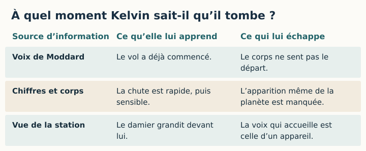

# BEL A/L — Polonais (commentaire et traduction) 2022 · Corrigé brut

*Corrigé rédigé par IA, non officiel. Signalez toute erreur.*

**Rédaction** · GPT-6.2 Astra Ultra · vitesse non renseignée

[Sujet officiel](https://www.ens-lyon.fr/sites/default/files/2022-11/Session-2022_BEL_Commentaire%20et%20traduction.pdf#page=16)

Stanisław Lem, *Solaris* (1961), ouverture du chapitre « Przybysz ». Commentaire en polonais du passage entier (lignes 1 à 92). Version française de « Zrozumiałem, że jestem… » jusqu’à la phrase se terminant sur « … ławica ich uleciała w górę » (lignes 24 à 49).

## Commentaire

### Jak przybysz dowiaduje się, że przybywa?

Rozdział otwierający *Solaris* nosi tytuł „Przybysz”. Zwykle przybycie jest zdarzeniem, które podróżny może określić sam: wie, kiedy wyruszył, widzi cel, wreszcie zauważa ludzi czekających na miejscu. Kelvin musi się dowiedzieć od Moddarda, że już leci. Kiedy po wielu wezwaniach otrzymuje odpowiedź ze stacji, rozpoznaje głos urządzenia. Powieść zaczyna się więc od podróży nie tylko niezwykłej technicznie. Stawia też bardzo zwyczajne pytanie o to, skąd człowiek wie, gdzie się znajduje i czy ktoś na niego czeka. Pierwszoosobowa relacja, ograniczone okno i coraz bardziej niepewne rozpoznawanie głosów sprawiają, że czytelnik zdobywa tę wiedzę po trochu, wraz z bohaterem.

Początek podaje godzinę z dokładnością pozornie właściwą dziennikowi pokładowemu. Jest to jednak dziewiętnasta „czasu pokładowego”, a więc miara ustanowiona w miejscu, które Kelvin właśnie opuszcza. Zamiast rozległej panoramy kosmosu pojawia się studnia, szczeble, zasobnik i przestrzeń wystarczająca ledwie na uniesienie łokci. Po napełnieniu skafandra nawet ten ruch staje się niemożliwy. Bohater koryguje swoją pierwszą informację o postawie ciała: właściwie już nie stoi, lecz wisi. Wrażenie ścisłości nie polega na nieomylności obserwatora. Bierze się stąd, że narrator poprawia słowa, które nie pasują do nowego doświadczenia. Pierwszym obiektem takiego pomiaru jest własne ciało połączone z metalową skorupą.

Twarz Moddarda znika wcześniej niż jego głos. To ważna asymetria. Przez zamkniętą osłonę nie widać już drugiego człowieka, ale dźwięki nadal pozwalają odtworzyć ruch mechanizmu, nawet policzyć osiem powtórzeń świstu. Ciemność ustępuje na tyle, że pojawia się seledynowy kontur wskaźnika. W tak ograniczonym polu widzenia każde nowe wrażenie ma dużą wagę. Kiedy Kelvin pyta o start, odpowiedź Moddarda unieważnia sens pytania. Podróż już się zaczęła. Głos w słuchawkach brzmi blisko właśnie wtedy, gdy mówiących dzieli coraz większa przestrzeń. Dzięki tej chwili rozumiemy też, dlaczego po otwarciu szczeliny bohater szuka Prometeusza i znanej gwiazdy. Nie chodzi o sporządzenie mapy astronomicznej dla czytelnika. Kelvin próbuje znaleźć w nieznanym niebie jakiś ślad kierunku, z którego przybywa. Obce konstelacje nic mu nie mówią.

W środkowej części fragmentu doświadczenie ruchu rozkłada się na kilka etapów. Liczby wskazują gwałtowny spadek, zanim ciało pozwala go bezpośrednio odczuć. Potem gorąco narasta niepostrzeżenie, twarz piecze, chłodne powietrze dotyka karku, drganie przenika przez kolejne osłony. Skoro bohaterowi wolno patrzeć tylko przed siebie, słuch i dotyk przejmują funkcję wzroku. Tętno staje się czyimś ciężkim krokiem; techniczny odgłos wymaga przybliżenia przez obraz metalu przesuwającego się po mokrym szkle. Obcość nie oznacza braku porównań, lecz konieczność sięgania po rzeczy pamiętane z innego świata. Chwilowe zapewnienie o braku lęku brzmi na tym tle szczególnie. Kelvin przekonuje siebie argumentem z odległości przebytej do tej pory, choć długość odbytej drogi nie stanowi przecież gwarancji bezpieczeństwa na jej końcu.

Pojawienie się planety zostaje paradoksalnie opowiedziane jako moment przegapiony. Kelvin widzi już skutek zdarzenia, którego początku chciał nie przeoczyć. Szerokość smug pozwala mu wnioskować, że jest jeszcze daleko, po czym „daleko” zastępuje słowem „wysoko”. Granicę stanowi tu zmiana układu odniesienia. Planeta przestaje być odległym ciałem, a staje się powierzchnią, względem której można spadać. Dalej podobnego wysiłku wymaga rozpoznanie chmur. Najpierw okienko zasnuwa się czymś w rodzaju bielma, ciało na to odpowiada, dopiero potem pojawia się poprawna nazwa. Gdy chmury odlatują ku górze, opis pozostaje wierny kierunkowi, w jakim widzi je opadający człowiek. Narrator nie przenosi punktu widzenia na zewnętrzną platformę obserwacyjną.

Nie tylko obraz trzeba odczytać. Kelvin kilkakrotnie wywołuje stację, aż wreszcie słyszy głos. Przedtem w tle trzasków niski szum brzmiał tak, jakby przemawiała sama planeta. Tryb porównania pozostawia sprawę otwartą. Tymczasem wypowiedź wyraźnie artykułowana nie okazuje się mową człowieka. Powtarzane formuły i ułamki miauknięć pomiędzy słowami zdradzają aparat. Technicznie wszystko jest w porządku, co urządzenie komunikuje już w pierwszych słowach. Tym bardziej niezwykły staje się brak zwykłego ludzkiego przywitania. Podróżny oczekuje, że przybysza z Ziemi zechcą zobaczyć żywi ludzie. Trafne rozpoznanie automatycznego komunikatu nie odpowiada mu na pytanie, gdzie się podziali.

Ostatnie obrazy przyspieszają. Biało-zielony znak urasta do rozmiarów konstrukcji przypominającej korpus wieloryba, widać cień stacji i ruch powierzchni oceanu. Nagle znajomy łopot spadochronu wydaje się pierwszym od miesięcy odgłosem prawdziwego wiatru. To, co „ziemskie”, dociera do Kelvina na obcej planecie jako wspomnienie zapisane w słuchu. Na końcu pojawia się jeszcze zielony napis „ZIEMIA”. Ma praktyczne znaczenie oznaczenia stanu urządzenia po lądowaniu, a dla czytelnika niesie zarazem echo porzuconej planety. Pierwszy krok wykonany po otwarciu zasobnika trudno uznać za triumfalną decyzję zdobywcy. Pneumatyczne łoże popycha go w plecy i podróżny występuje naprzód, żeby nie upaść. Urządzenia doprowadziły go na stację, lecz samo zakończenie transportu nie oznacza jeszcze spotkania. Na tę różnicę przygotowywał każdy moment, w którym Kelvin musiał nauczyć się na nowo znaczenia słów „lecieć”, „widzieć” i „słyszeć”.

## Version française

Je compris que j’étais déjà dans les hautes couches de l’atmosphère. Raide, enveloppé de coussins pneumatiques, je ne pouvais regarder que droit devant moi. Il n’y avait toujours pas d’horizon. Je volais, je volais encore sans rien en sentir ; seule la chaleur, lentement, insidieusement, me baignait le corps. Au-dehors s’éveilla un pépiement ténu, aigu, comme celui du métal sur du verre mouillé. Sans les chiffres qui surgissaient dans l’ouverture de l’indicateur, je ne me serais pas rendu compte de la violence de la chute. Les étoiles avaient disparu. Une clarté rousse emplissait le hublot. J’entendais le pas lourd de mon propre pouls, mon visage me brûlait, je sentais sur ma nuque le souffle froid du climatiseur ; je regrettais de n’avoir pas réussi à voir le *Prométhée*. Il devait être déjà hors de vue quand le dispositif automatique avait ouvert le hublot.

La capsule tressauta une fois, puis une deuxième, se mit à vibrer de façon intolérable. Le tremblement traversa toutes les enveloppes isolantes, les coussins d’air, pénétra au plus profond de mon corps ; le contour vert pâle de l’indicateur se brouilla. Je regardais cela sans peur. Je n’étais pas venu de si loin pour mourir au but.

« Station Solaris, dis-je. Station Solaris, Station Solaris ! Faites quelque chose. J’ai l’impression de perdre ma stabilité. Station Solaris, ici l’arrivant. À vous. »

Et je manquai une fois encore un moment important, celui où la planète était apparue. Elle s’étendait, immense et plate ; à la dimension des traînées sur sa surface, je pouvais juger que j’étais encore loin. Ou plutôt haut, car j’avais déjà franchi cette frontière insaisissable où la distance qui vous sépare d’un corps céleste devient une altitude. Je tombais. Je tombais toujours. Maintenant je le sentais, même les yeux fermés. Je les rouvris aussitôt, car je voulais en voir le plus possible.

Je laissai passer quelques dizaines de secondes de silence et renouvelai mes appels. Cette fois encore, je ne reçus pas de réponse. Dans les écouteurs éclataient par salves les crépitements des décharges atmosphériques. Ils avaient pour fond un grondement si profond et si grave qu’on aurait dit la voix de la planète elle-même. Dans le hublot, une taie recouvrit le ciel orange. La vitre s’obscurcit ; je me recroquevillai par réflexe, autant que le permettaient mes bandages pneumatiques, avant de comprendre, la seconde d’après, que c’étaient des nuages. Comme chassée d’un souffle, leur nappe s’envola vers le haut.

