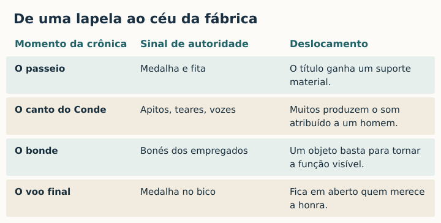

# BEL A/L — Portugais (commentaire et traduction) 2022 · Corrigé guidé

*Corrigé rédigé par IA, non officiel. Signalez toute erreur.*

**Rédaction** · GPT-6.2 Astra Ultra · vitesse non renseignée

[Sujet officiel](https://www.ens-lyon.fr/sites/default/files/2022-11/Session-2022_BEL_Commentaire%20et%20traduction.pdf#page=18) · [Rapport du jury](https://www.ens-lyon.fr/sites/default/files/2022-11/Portugais%202022.pdf#page=2)

Rubem Braga, chronique de février 1935, reprise dans *200 Crônicas Escolhidas*, Rio de Janeiro, Record, 1983. Le commentaire porte sur les deux pages, la version se termine à la ligne 22.

## Préparer l’épreuve

Pour comprendre la composition, résumer en une phrase le fait que Braga dit avoir lu dans le *Diário de São Paulo*. Mesurer ensuite l’espace qui sépare les deux moments de cette brève anecdote. Les détours par l’usine, Pierina, le tramway et le souvenir d’étudiant permettent à la nouvelle du journal de changer de sens. Les commentaires du chroniqueur ne peuvent être attribués ni au comte ni au journaliste du quotidien.

Lire à voix haute la répétition de *Conde*. Sa majuscule, sa sonorité et sa multiplication déplacent vers le titre l’attention que l’on pourrait porter au personnage. À l’autre extrême, repérer les diminutifs appliqués à l’oiseau, à la médaille et au ruban. Une petite attache suffit à faire tenir sur un vêtement la distinction sociale que le titre prétend rendre naturelle.

Dans la version, *torcer pelo passarinho* marque un parti pris, comme lorsqu’on soutient une équipe. *Urubu* désigne un vautour américain, un urubu en français. La forme *quisera* exprime ici un souhait. Préserver la répétition de *chanter/gazouiller* et la matérialité des « machines de chair » chaque fois que revient le bruit des usines.

## Commentaire

Um conde passeia num parque, um pássaro passa por ali e uma condecoração muda de dono. A notícia é curta o bastante para caber em poucas linhas. Rubem Braga, porém, deixa Francisco Matarazzo esperando tanto tempo pelo encontro que, no meio da crônica, parece ter-se esquecido dele. A estranha demora constitui a graça e o alcance político de «O conde e o passarinho», de fevereiro de 1935. No instante em que o pássaro leva a medalha, o que ela vale já não é o mesmo que na apresentação do Conde. Como pode a conversa aparentemente dispersa de um cronista transformar um incidente curioso numa pergunta sobre quem produz, quem manda e quem recebe as honras?

As primeiras frases apresentam o mundo como se o leitor devesse aprender um vocabulário elementar. O Conde é um Conde, possui fábricas, possui honras, uma das quais consiste numa medalhinha. A última explicação, segundo a qual se trata de uma condecoração, chega depois da medalha e da fita que a prende. O leitor conhece primeiro o objeto e só depois seu nome prestigioso. A aparente redundância convida a pensar no sentido da passagem entre as duas coisas. É preciso todo um acordo social para que um pedaço de ouro preso à lapela testemunhe o mérito de um homem. A repetição solene de «Conde», com a sua maiúscula, começa a soar engraçada ao lado da miudeza da medalha e da fita. Quando «aconteceu também um passarinho», até a construção do verbo parece dar à ave o estatuto de acontecimento. O jornal e a crônica reduzem o elenco a dois personagens, e já nisso aproximam um homem de posição excepcional de um bicho a que ninguém concedeu título algum.

O cronista entra então em cena como torcedor. Diz preferir o passarinho sem saber explicar a preferência e em seguida produz uma das comparações mais elaboradas do texto. Um canta e voa, o outro não sabe fazer nem uma coisa nem outra. Será mesmo? O verbo «gorjear» reaparece, agora aplicado ao Conde. O trinado impossível muda de escala e de timbre. Ouvem-se apitos, teares, vozes de operários e, por fim, o próprio movimento do dinheiro. Por um momento, a riqueza industrial parece dar ao Conde meios de produzir um canto mais poderoso que o da ave. Só que a enumeração revela quem efetivamente faz ruído e trabalha. O sujeito gramatical continua a ser um único proprietário, ao passo que a energia vem de uma multiplicidade de corpos e instrumentos espalhados pelo Brasil. A imagem das máquinas de aço e de carne coloca lado a lado os instrumentos e os homens, com a indiferença com que ambos podem entrar nas contas de uma empresa. A frase circular que explica que ele é conde porque é industrial acaba por destruir a impressão de que a nobreza explicaria alguma coisa por si mesma.

Seria fácil converter essa oposição numa fábula com dois valores firmes. O próprio narrador frustra a expectativa. Quer ser passarinho, corrige-se de imediato e deseja ser urubu, ave maior, triste e associada ao que apodreceu. A palavra «podre», que mais tarde surgirá ao se falar da vida, dá retrospectivamente outra cor a esse desejo. Há mais de uma maneira de ser ave, assim como o homem que conta a história não cabe inteiramente na simpatia gentil que expressou no início. Quanto a Pierina, ela entra quando a série de negações exige que ele diga o que ama. Seu nome próprio chega sem títulos nem explicações. A proximidade entre a mulher e a vida, levada adiante até a morte, interrompe por um instante a brincadeira. A liberdade de uma voz que pode confessar amor e mudar de ideia contrasta com a identidade do industrial, sempre devolvida ao mesmo nome de classe.

A digressão do bonde parece, a princípio, lançar o leitor para muito longe do parque. Na verdade, recoloca o problema do título em objetos que o leitor pode encontrar no cotidiano. Quem pode falar com quem? Quem usa o boné que indica uma função? O descompasso entre a solenidade dos conselhos dirigidos ao «povo» e o exagero grotesco a que a fala chega torna absurda qualquer leitura literal. O que ganha corpo é a impaciência de uma voz que não aceita que a posição de um empregado encerre a conversa. O episódio de juventude muda novamente o tom. O calouro lembra como uma turma tomou por algum tempo o lugar de quem comandava o bonde. Os bonés tornam-se explicitamente emblemas do poder. Também aqui, como na lapela do Conde, o que dá a alguém uma aparência de autoridade pode ser retirado. Mas a voz retrospectiva chama a própria façanha de «molecagem». A oscilação entre memória orgulhosa, autocrítica e desalento impede o cronista de se investir simplesmente na dignidade de um pregador. Quando se dirige a si mesmo pelo nome de Rubem, volta a fazer de sua própria voz um personagem entre os outros.

Ao retornar ao parque, o texto arma uma última confusão de identidades. O industrial Francisco gostaria de se parecer com outro Francisco, o de Assis, capaz de falar com as aves. O gesto de erguer as mãos reúne por um instante o homem, a criança e o santo. Basta o narrador devolver às mãos seu adjetivo de classe para que se abra a distância entre a bondade imaginada e a posição real. A ave se aproxima do peito. Será o coração o seu alvo? O pequeno bico desvia a história de uma moral demasiado pesada. O que leva consigo é a fita com a medalha. E o dono tanto se aborrece como acha graça. Até esse personagem engravatado, aparentemente previsível, tem duas reações que a prosa deixa juntas.

O fato relatado pelo jornal termina aí. A crônica continua no presente e, ao se dirigir ao «irmão passarinho», faz soar na voz do escritor algo da fraternidade que o industrial pretendera encenar. A pergunta sobre o peito a que caberá a medalha permanece sem resposta. A repetição de «voai» acompanha uma trajetória imaginada entre chaminés, fábricas e trabalhadores, estes novamente reduzidos a máquinas de carne. Agora se vê de cima o mundo cujo rumor havia sido atribuído ao Conde. A leveza do voo não elimina o peso desse mundo nem distribui automaticamente as honras de maneira justa. Leva, porém, o objeto que parecia destinado a uma só lapela até onde estão os corpos que tornam possível o prestígio do industrial. O narrador fez do leitor seu cúmplice precisamente ao deixar a resposta nesse ar ainda atravessado pelo passarinho.

## Version française

Il se trouve que le comte Matarazzo se promenait dans le parc. Le comte Matarazzo est un très vieux comte qui possède beaucoup d’usines. Il a aussi reçu beaucoup d’honneurs. L’un d’eux consiste en une précieuse petite médaille d’or que le comte arborait au revers de sa veste, attachée à un petit ruban. C’était une décoration.

Or il se trouva aussi un petit oiseau. Il y avait dans le parc un petit oiseau. Et ces deux personnages, le comte et le petit oiseau, furent les seuls de la singulière histoire racontée par le *Diário de São Paulo*.

Je dois d’abord avouer qu’entre un comte et un petit oiseau je préfère un petit oiseau. Moi, je suis pour le petit oiseau. Comme ça, sans raison. Je ne saurais même pas expliquer cette préférence. Tout compte fait, un petit oiseau, ça chante et ça vole. Le comte ne sait ni gazouiller ni voler. Le comte gazouille avec les sifflements des usines, avec l’énorme vacarme des fabriques disséminées à travers le Brésil, les voix des ouvriers, des métiers à tisser, des machines d’acier et de chair qui travaillent pour le comte. Le comte gazouille avec l’argent qui entre dans ses coffres et qui en sort, le comte est un industriel, et le comte est comte parce qu’il est industriel. Le petit oiseau n’est pas industriel, il n’est pas comte, il n’a pas d’usines. Il a un nid, il sait chanter, il sait voler, c’est seulement un petit oiseau et c’est gentil, d’être un petit oiseau.

J’aurais voulu être un petit oiseau. Non, pas un petit oiseau. Un oiseau plus grand, plus triste. J’aurais voulu être un urubu.

En revanche, je n’aurais pas voulu être comte. Toute ma vie a été guidée par le fait que je n’ai aucune ambition d’être comte. Je n’aime pas les comtes. Je n’aime pas non plus les industriels. Qu’est-ce que j’aime ? Pierina et pas grand-chose d’autre. Pierina et la vie, deux choses qui se confondent aujourd’hui et qui demain se confondront davantage encore dans la mort.
