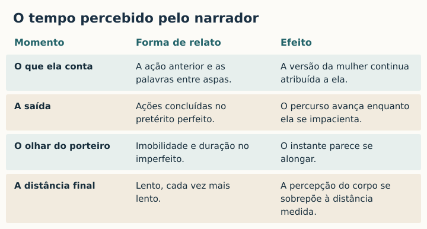

# BEL A/L — Portugais (thème Lyon) 2022 · Corrigé brut

*Corrigé rédigé par IA, non officiel. Signalez toute erreur.*

**Rédaction** · GPT-6.2 Astra Ultra · vitesse non renseignée

[Sujet officiel](https://www.ens-lyon.fr/sites/default/files/2022-11/Session-2022_BEL_Epreuves%20de%20sp%C3%A9cialit%C3%A9.pdf#page=14) · [Rapport du jury](https://www.ens-lyon.fr/sites/default/files/2022-11/Portugais%202022.pdf#page=7)

Patrick Modiano, *Souvenirs dormants*, 2017. Le texte français de la page 14 du fascicule de spécialité doit être traduit intégralement en portugais. La proposition adopte un usage brésilien cohérent.

## Proposition de thème

Na sala do apartamento, estendido sobre o tapete, jazia o corpo de Ludo F., o personagem mais obscuro daquele bando de «notívagos». Ela o tinha matado «por acidente», dizia-me, ao mexer num revólver que «encontrara numa das prateleiras da estante». Estendia-me a arma, já de volta ao estojo de camurça. Mas por que estava ela, naquela noite, sozinha com Ludo F. no apartamento? Havia de me explicar tudo «assim que estivéssemos longe daqui, ao ar livre».

Sem acender a luz temporizada da escada, peguei-a pelo braço e a ajudei a descer os degraus no escuro, em vez de usarmos o elevador. No térreo, uma luz atrás da porta de vidro do porteiro. Levei-a em direção ao portão de entrada e, no momento em que passávamos diante da portaria, saiu de lá um homem moreno, baixo, de cabelo cortado à escovinha. Ele nos observava na penumbra enquanto eu tentava abrir o portão às apalpadelas. Estava travado. Passado um instante — e aquele instante me parecia interminável —, avistei na parede o botão que acionava a abertura do portão. Ouvi o estalo e abri. Eu fazia cada gesto em câmera lenta para lhe dar a maior precisão possível e não tirava os olhos do homenzinho de cabelo à escovinha, como se quisesse desafiá-lo e dar-lhe tempo de guardar bem na memória os traços do meu rosto. Ela já se impacientava e eu a deixei sair na frente. Depois, antes de segui-la, fiquei alguns segundos parado no vão do portão, os olhos fixos no porteiro. Esperava que viesse em minha direção, mas ele também permanecia imóvel, a me observar. O tempo tinha parado. Ela já ia uns dez metros à minha frente e eu já não sabia se conseguiria alcançá-la, tão lento era o meu passo, cada vez mais lento, com aquela sensação de flutuar e de decompor o menor dos meus movimentos.

