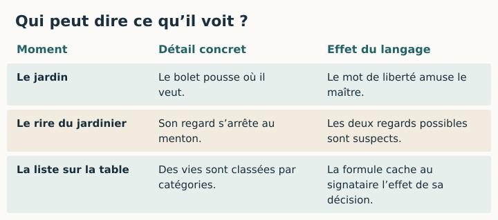

# BEL A/L — Russe (commentaire et traduction) 2022 · Corrigé brut

*Corrigé rédigé par IA, non officiel. Signalez toute erreur.*

**Rédaction** · GPT-6.2 Astra Ultra · vitesse non renseignée

[Sujet officiel](https://www.ens-lyon.fr/sites/default/files/2022-11/Session-2022_BEL_Commentaire%20et%20traduction.pdf#page=20) · [Rapport du jury](https://www.ens-lyon.fr/sites/default/files/2022-11/Russe%202022.pdf#page=2)

Iouri Dombrovski, *La Faculté de l’inutile* (*Факультет ненужных вещей*, 1978). Le commentaire porte sur tout l’extrait, jusqu’au dernier mot de la ligne 56. La version s’arrête à la première phrase qui s’achève sur « прямо в глаза », ligne 19.

## Commentaire

### От дачного удовольствия до права на чужую смерть

В начале отрывка из романа Юрия Домбровского человек, сидящий в саду, радуется солнцу, ветерку и возможности грибного дождя. В конце тот же человек держит в руках списки людей, которых разрешается убить одним решением. Между двумя сценами нет рассказа о том, как добрый любитель природы вдруг стал жестоким. Перед нами уже Сталин, и уже в самом безобидном разговоре садовник знает, до какой высоты можно поднимать глаза. Как текст заставляет обнаружить исключительную власть именно там, где все кажется привычным, уютным и даже смешным? Смена регистров ведет от языка удовольствия через правила поведения при хозяине к канцелярскому языку, изменяющему для него ощущение поступка.

Начальная фраза обещает рассказ о событии, произошедшем за неделю до некоего «этого». Точка отсчета лежит за пределами фрагмента. Вместо немедленного сообщения о важном событии появляются вечер, легкие облака, кресло, бумаги на столике. Даже география звучит двояко. Торжественная формула о столице Родины сменяется разговорным уточнением, что дело было примерно в двадцати пяти верстах от нее. «Товарищ Сталин работал», но работу читатель застает уже законченной. Бумаги просмотрены, и теперь есть время размышлять, хороши ли приметы грибного лета. Такое начало приглашает подойти близко к исторической фигуре. Близость, однако, не означает согласия с тем, что она видит.

В мыслях Сталина мир предстает почти ласковым собеседником. Уменьшительные формы следуют одна за другой; все происходящее немедленно оценивается как хорошее. Понятное каждому удовольствие от перемены погоды образует непрерывный ряд с желанием увидеть определенные грибы именно в своем саду. Тут возникает первая граница. Садовник знает, что шампиньоны можно вырастить там, где велено, а лесные грибы растут там, где им «вздумается». Получается крошечное царство, где приказ хозяина не исполняется. Слова «вольные, чистые, лесные» придают грибам достоинство, а заодно выдают увлеченность самого садовника. Сталина веселит особенно уважительный тон, каким тот говорит о маслятах. Смешно, казалось бы, именно то, что к грибам относятся почти как к лицам, обладающим собственной волей.

Но проверить свободу живого человека проще, чем проверить свободу боровика. Сталин смеется, садовник тоже смеется, однако каждому из них отмерена совершенно разная степень свободы. Повтор «очень-очень» относится теперь к мере допустимого смеха. Нижняя часть лица хозяина служит собеседнику настоящей границей. Смотреть прямо в глаза нельзя, но и отводить взгляд опасно: Сталин из этого выводит, будто у разговаривающего нечиста совесть. Невозможно выработать правило поведения, которое гарантировало бы невиновность. Повествователь дает читателю увидеть сразу обе стороны, тогда как в сознании хозяина между произвольной догадкой и твердым выводом помещается лишь слово «значит». После сцены он опять радуется вольному боровику. То, что для садовника составляло трудную задачу, в его памяти осталось удовольствием.

Облако закрывает солнце, и меняется сама поза сидящего. Мягкость кресла и ласковый прищур уступают место резкому движению. На месте тонкой, но большой книги возникает длинное, точно датированное заглавие полицейского циркуляра царского времени. После обозначенного в тексте пропуска повествователь возвращается к удобству нынешней минуты и к давним лишениям. Сибирь и сырая изба появляются в предложении о том, что они как раз не вспоминались. Память избирательна. В речах о борцах за свободу рабочего класса о самом человеке говорили только немногие, но первые тосты в свою честь он хорошо запомнил. Высокое чувство освобождения «от всего личного» оказывается рядом с удовольствием от того, что эти речи все-таки относились лично к нему. Не требуется объявлять все прошлые чувства героя притворством, чтобы заметить противоречие.

Обобщения о том, как рождаются герои и совершаются подвиги, на мгновение дают рассказу торжественный, почти учебниковый ритм. Затем короткое «Хорошо» возвращает знакомую интонацию, а под одним документом обнаруживается другой. Именно положение бумаг на столе связывает эпохи теснее, чем отвлеченное сопоставление царского и советского режимов. Молодой противник полицейского порядка и человек, чьего утверждения просит Ежов, оказываются одной фигурой над двумя бумагами. В четырех списках людей делят сначала по разрядам. Последний включает жен «врагов народа», то есть основанием для включения оказывается семейная связь. В просьбе нет описаний поступков отдельных обвиняемых. Грамматическая гладкость ходатайства заранее делает мыслимым одинаковое решение для всех.

Вслед за документом повествование называет физический смысл «первой категории». Масштаб обозначен сотнями списков и тысячами людей, но решающим для понимания остается короткий переход от формулы к тому, что произойдет с отдельным телом. В состоянии ли человек держать такой документ и не испытывать страха? Текст отвечает неожиданным вторым лицом: берешь в руки, и не страшно. На мгновение читатель оказывается в грамматической позиции того, кто держит бумагу. Само оправдание отвергает объяснение привычкой и повторяет готовые обороты о согласовании и санкции. Это и есть работа канцелярского языка. Остаются существительные, категории и последовательность действий ведомств, а связь между решением одного лица и смертью другого перестает непосредственно ощущаться.

Финальное восклицание о словах и канцелярщине возвращает нас к разговору о грибах. Там одно слово о воле было настолько живым, что вызвало смех; здесь слова о категории настолько бесцветны, что позволяют спокойно согласиться на убийство. Природная идиллия не просто предваряла ужас для усиления контраста. В саду уже обнаружилась способность хозяина превратить произвольное толкование чужого взгляда в моральный приговор. В списках эта же власть получает форму, в которой приговор больше не выглядит приговором для того, в чьих руках находится документ.

## Version française

Voici ce qui s’était passé une semaine plus tôt. Dans la capitale de notre patrie, Moscou, à quelque vingt-cinq verstes de là, ce soir-là il faisait encore clair, il faisait doux et l’on pouvait même, ma foi, parler de soleil, bien que, depuis le matin, le ciel fût semé de petits nuages blancs et légers.

Le camarade Staline travaillait au jardin. Devant lui, sur une petite table, il y avait des papiers, les uns épinglés ensemble, les autres tels quels. Il avait déjà eu le temps de les parcourir tous et restait maintenant tout simplement assis, adossé à son fauteuil d’osier, à regarder les petits nuages, la cime des arbres, à se reposer. « Tiens, le soleil montre le bout de son nez, pensait-il, c’est bien ! Tiens, une petite brise a fait bruire les bouleaux, c’est très bien aussi ! Et cette nuit, il tombera peut-être encore une petite pluie, c’est bon pour les champignons. Cette année, on n’en voit pour ainsi dire pas, et qu’est-ce qu’un été sans champignons ? »

Il en avait déjà parlé au jardinier. N’y aurait-il pas quelque chose à imaginer pour qu’il pousse ici des cèpes et des bolets bruns ? « Non, avait répondu fermement le jardinier, il n’y a rien à imaginer. Des champignons de Paris, ça, tant que vous voudrez, nous vous en ferons pousser partout où vous l’ordonnerez. Mais les bolets, les bolets bruns, les bolets roux et même les bolets jaunes, ce sont des champignons libres, purs, des champignons des bois : ils poussent où bon leur semble. »

« Et qu’ont-ils donc à être si libres ? avait-il demandé, tout égayé : le jardinier parlait des bolets jaunes avec un de ces respects ! Ils poussent où bon leur semble, alors, c’est cela ? Ce n’est tout de même pas dans l’ordre, hein ? » Et il avait ri. Le jardinier avait ri un peu lui aussi, mais comme ça, avec beaucoup, beaucoup de mesure. Il riait sans le regarder dans les yeux, son regard ne montait pas plus haut que le menton. Le maître ne supportait pas qu’on le regarde droit dans les yeux.

