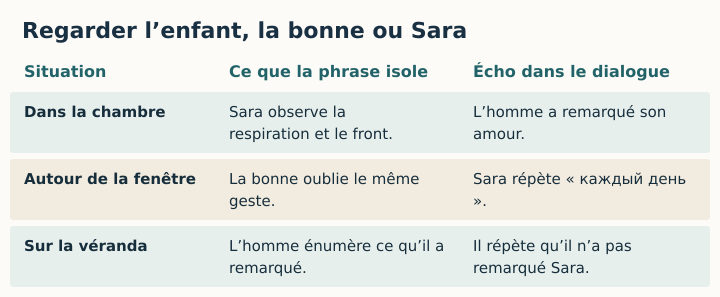

# BEL A/L — Russe (thème Lyon) 2022 · Corrigé brut

*Corrigé rédigé par IA, non officiel. Signalez toute erreur.*

**Rédaction** · GPT-6.2 Astra Ultra · vitesse non renseignée

[Sujet officiel](https://www.ens-lyon.fr/sites/default/files/2022-11/Session-2022_BEL_Epreuves%20de%20sp%C3%A9cialit%C3%A9.pdf#page=15) · [Rapport du jury](https://www.ens-lyon.fr/sites/default/files/2022-11/Russe%202022.pdf#page=11)

Marguerite Duras, *Les Petits Chevaux de Tarquinia*. Thème russe de spécialité, quatre heures, sans dictionnaire. Le signe de coupure imprimé dans la première phrase est conservé.

## Proposition de thème

Она ушла. Мужчина повернулся к Саре, улыбнулся ей, (…) потом сел на пол у стены. Сара извинилась и вошла в дом. Там было так же жарко, как днем. Она тихонько вошла в комнату ребенка. Служанка опять забыла открыть окно. Сара распахнула его настежь, вернулась к ребенку и стала разглядывать его в полумраке. Он спал хорошо, но ему было очень жарко. Она отогнула простыню, в которой он запутался, и вытерла ему лоб. Потом еще посмотрела на него, думая о мужчине, который ждал ее на веранде. Ребенок дышал так же легко, как цветок, и лоб у него, влажный и прохладный, был как у цветка. Она сказала себе, как говорила каждый вечер, но в этот вечер без горечи, вполне рассудительно, что уж последний раз в жизни приезжает в такое место, в место, где детям так плохо. Когда она его поцеловала, ребенок, недовольно проворчав, резко повернулся к стене. Она секунду подождала. Потом он замер в том положении, в каком повернулся, и в ночи снова послышалось его дыхание, от которого становилось спокойно, словно это было дыхание божества. Она вышла, прошла обратно к кухне, взяла бутылку кьянти и два бокала. Потом вернулась на веранду.

— Я ходила посмотреть на малыша, — сказала она. — Она каждый день забывает открыть окно, каждый день.

— Странно, — сказал мужчина, — когда я приехал, я вас совсем не заметил.

Сара налила вина в оба бокала, поставила бутылку кьянти на подоконник и села рядом с ним.

— Все-таки надоела мне эта служанка, — сказала она. — Я на все могу закрыть глаза, только не на эту историю с окном.

— А заметил я вот что, — сказал мужчина, — вашу любовь к ребенку, меня это даже раздражало.

— Всех, — сказала Сара.

— А потом еще удивительные отношения, какие у вас с этой служанкой.

— Надо будет найти другую, — сказала Сара.

— А вот вас — нет, вас я не заметил.

