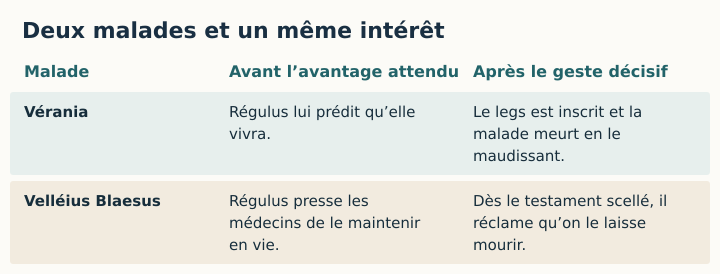

# ENS de Lyon · BEL A/L · Version latine 2022 — Corrigé guidé

*Corrigé rédigé par IA, non officiel. Signalez toute erreur.*

**Rédaction** · GPT-6.2 Astra Ultra · vitesse non renseignée

Pline le Jeune, Lettres, II, 20, « Un captateur de testaments ». Épreuve de spécialité, trois heures.

## Version française

Vérania, épouse de Pison, était gravement malade. Je parle de ce Pison que Galba avait adopté. Régulus vint la voir. Voyez d'abord l'impudence de l'homme ! Il était allé chez une malade, alors qu'il avait été l'ennemi juré de son mari et qu'elle-même le détestait plus que personne ! Admettons encore qu'il se soit contenté d'y aller. Mais il alla jusqu'à s'asseoir tout près du lit et lui demanda quel jour, à quelle heure elle était née. Une fois renseigné, il prend un air composé, fixe les yeux, remue les lèvres, agite les doigts, calcule… rien. Après avoir longtemps tenu la malheureuse en suspens, il lui dit qu'elle traverse une période critique, mais qu'elle s'en tirera. « Pour que tu en sois plus sûre encore, je vais consulter un haruspice que j'ai maintes fois mis à l'épreuve. » Sans plus attendre, il fait un sacrifice et affirme que les entrailles des victimes concordent avec le présage des astres. Elle, crédule comme on l'est dans le danger, réclame ses codicilles et inscrit un legs en faveur de Régulus. Bientôt son état empire. En mourant, elle le traite à grands cris de vaurien, de fourbe et de pire encore qu'un parjure, lui qui lui avait fait un faux serment sur la tête de son fils. C'est une pratique aussi criminelle que fréquente chez Régulus, car il détourne sur la tête de ce malheureux enfant la colère des dieux qu'il trompe lui-même chaque jour.

Velléius Blaesus, ce riche ancien consul, se débattait dans sa dernière maladie. Il désirait modifier son testament. Régulus espérait quelque chose des nouvelles dispositions, car il s'était mis depuis peu à capter sa faveur. Le voilà qui presse les médecins, qui les supplie de prolonger par tous les moyens le souffle de vie de cet homme. Une fois le testament scellé, il change de rôle, retourne son discours et dit à ces mêmes médecins : « Jusqu'à quand allez-vous tourmenter ce malheureux ? Pourquoi enviez-vous une bonne mort à celui auquel vous ne pouvez donner la vie ? »

## Construire la traduction

**Construire l'exclamation.** La première note fait sous-entendre *coniux* après *Verania*. L'accusatif *impudentiam* est exclamatif. Les deux datifs *marito* et *ipsi* donnent ensuite les personnes par rapport auxquelles se définissent la haine et l'hostilité. Régulus est ennemi du mari et détesté de la femme.

**Entendre le théâtre du calcul.** Les présents courts miment les gestes du prétendu devin, jusqu'à *nihil*. Le brusque mot final révèle l'imposture à l'auditeur de Pline, tandis que la malade croit au pronostic. Le récit garde le mouvement de la tête et des doigts même lorsque l'expression française doit changer.

**Conserver le changement de rôle.** Les infinitifs historiques *hortari, rogare* rendent vivantes les sollicitations adressées aux médecins avant le scellement. Après *postquam*, ce sont **les mêmes** médecins qui reçoivent des injonctions contraires. *Invidetis* introduit ce qu'on refuse au mourant, une bonne mort. L'intérêt matériel de Régulus explique à lui seul le revirement.

**Situer le faux serment.** *Per salutem filii* engage la vie du fils de Régulus. *Peierasset* est la forme contractée de *peieravisset*, au plus-que-parfait du subjonctif. Son rôle est de rapporter le grief que formule Vérania à l'article de la mort. La colère divine est ainsi appelée sur l'enfant par le père.

[Sujet officiel, passage p. 3](https://www.ens-lyon.fr/sites/default/files/2022-11/Session-2022_BEL_Epreuves%20de%20sp%C3%A9cialit%C3%A9.pdf#page=3)
