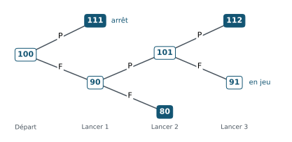
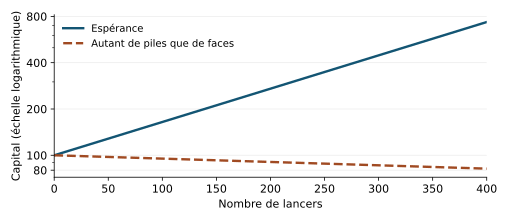
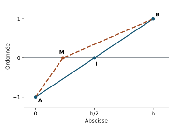
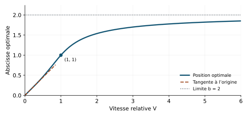
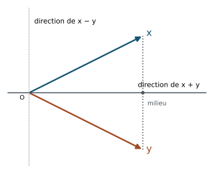

# BEL B/L — Mathématiques 2022 · Corrigé guidé

*Corrigé rédigé par IA, non officiel. Signalez toute erreur.*

**Rédaction** · modèle exact non renseigné (famille GPT-6) · effort non renseigné · vitesse non renseignée

**Révision (tour 1)** · modèle exact non renseigné (famille GPT-6) · effort non renseigné · vitesse non renseignée

**Révision (tour 2)** · GPT-6.2 Astra Ultra · vitesse non renseignée

**Révision (tour 3)** · GPT-6.2 Astra Ultra · vitesse non renseignée

Les trois problèmes sont indépendants. Le tableau de la page 2 du rapport attribue un coefficient à chacune des 55 rubriques. Leur somme vaut 60. Le texte de cette même page annonce un maximum brut de 64 et un bonus ou malus de deux points. Le rapport ne détaille pas le rapprochement de ces chiffres. [Sujet de la session](https://www.ens.psl.eu/sites/default/files/bl_22_mathematiques.pdf) · [Rapport du jury](https://www.ens.psl.eu/sites/default/files/2022_bl_rapport_ecrit_mathematiques.pdf).

## Présentation du sujet

L'écrit commun à Ulm, Lyon, Paris-Saclay, l'ENSAE et l'ENSAI dure quatre heures, sans calculatrice. Il comporte trois problèmes indépendants, numérotés de 1 à 22, et 55 réponses en comptant les subdivisions.

| Problème | Questions | Point de départ | Aboutissement |
|---|---|---|---|
| A | 1 à 8 | Loi d'un gain sur un lancer | Comparer espérance et comportement à long terme |
| B | 9 à 14 | Longueur de deux segments | Position optimale selon la vitesse et dérivée au bord |
| C | 15 à 22 | Colonnes orthogonales | Construire une réflexion échangeant deux vecteurs |

Pour répartir les quatre heures, on peut réserver une heure à chacun des deux premiers problèmes, une heure et demie au troisième, puis trente minutes pour compléter une preuve ou vérifier les calculs. Il est possible de commencer une nouvelle partie dès qu'un raisonnement bloque. Les questions 1, 2, 9, 10 et 16 donnent des entrées indépendantes. Le rapport de la session distingue particulièrement les difficultés de conditionnement en (4d), de passage à la limite en (13d) et de synthèse en (22).

## Problème A

Deux jeux équilibrés quant au lancer permettent d'étudier tour à tour une somme et un produit aléatoires. La règle d'arrêt s'applique à la seule question 4.

### Question 1

> [!INDICATION]
> Quelles sont les deux valeurs du gain sur un lancer ?

> [!INDICATION]
> Pondérer chacune par la probabilité de la face correspondante.

#### Solution

À chaque lancer les deux gains $11$ et $-10$ sont équiprobables. La formule de l'espérance donne $\boxed{\mathbb E[X_i]=(11-10)/2=1/2}$.

> [!PIEGE]
> Une variable qui prend deux valeurs peut être représentée à l'aide d'une Bernoulli. Les valeurs du gain utilisé ici sont $11$ et $-10$.

### Question 2

> [!INDICATION]
> Écrire d'abord le capital après un, puis deux lancers.

> [!INDICATION]
> Pour la loi de $S_2$, regrouper les suites de lancers donnant le même capital.

#### Solution

**(2a)** Chaque lancer ajoute son gain au capital précédent, donc $S_n=S_{n-1}+X_n$. En sommant ces accroissements on obtient $\boxed{S_n=100+\sum_{i=1}^n X_i}$.

**(2b)** Avec deux piles, le capital atteint $122$. Avec deux faces, il tombe à $80$. Avec une pièce de chaque sorte, dans l'un ou l'autre ordre, il vaut $101$. Les quatre suites ordonnées ont chacune probabilité $1/4$ par indépendance. Ainsi
$$
\mathbb P(S_2=k)=\begin{cases}1/4&k=80\ \text{ou}\ k=122,\\1/2&k=101,\\0&\text{sinon}.\end{cases}
$$

**(2c)** Par linéarité de l'espérance, $\boxed{\mathbb E[S_n]=100+n/2}$. La formule inclut $n=0$.

> [!METHODE]
> Vérifier que les probabilités trouvées totalisent un. La linéarité suffit pour l'espérance de la somme.

### Question 3

> [!INDICATION]
> Quel est le plus petit capital possible après dix lancers ? Pour le régime asymptotique, ramener le gain à un lancer.

> [!INDICATION]
> Comparer la moyenne des gains au seuil $1/4$. L'événement défavorable impose un écart à l'espérance d'au moins $1/4$.

#### Solution

**(3a)** Après dix lancers, même dix pertes consécutives laissent $100-10\times10=0$. Ainsi $S_{10}$ est positive ou nulle, intégrable car bornée, et $160>0$. L'inégalité de Markov et (2c) donnent
$$
\mathbb P(S_{10}\ge160)\le\frac{\mathbb E[S_{10}]}{160}=\frac{105}{160}=\frac{21}{32}\le\frac23.
$$

Le capital après dix lancers est exactement $21K$, où $K$ compte les piles et suit la loi binomiale de paramètres $10$ et $1/2$. Le seuil $160$ est franchi à partir de huit piles. Le calcul direct donne $(45+10+1)/2^{10}=7/128$, ce qui vérifie indépendamment la majoration.

**(3b)** Posons $\overline X_n=(S_n-100)/n$ pour $n\ge1$. Les $X_i$ sont indépendantes, de même loi et bornées. La loi faible des grands nombres donne $\overline X_n\to1/2$ en probabilité. Or $\{\overline X_n<1/4\}\subset\{|\overline X_n-1/2|\ge1/4\}$, de probabilité tendant vers zéro. Par complément,
$$
\boxed{\mathbb P(S_n\ge100+n/4)\longrightarrow1.}
$$

> [!JURY]
> Le rapport 2022 souligne en (3a) l'importance de vérifier la positivité et les autres hypothèses de l'inégalité de Markov.

### Question 4

> [!INDICATION]
> Dessiner les branches issues de $100$. S'interdire de prolonger un chemin déjà arrêté.

> [!INDICATION]
> En (4d), calculer la probabilité de l'événement sur lequel on conditionne. En (4e), étudier les deux prochains lancers depuis $100+j$.

#### Solution

Écrivons $P$ pour pile et $F$ pour face. L'arrêt a lieu à la première sortie de l'intervalle ouvert $]89,105[$.

**(4a)** Avec $P$ on atteint $111$ et on s'arrête. Avec $F$ on reste en jeu à $90$. Ainsi $\boxed{\mathbb P(T=1)=1/2}$.

**(4b)** Après $F$, un second $F$ mène à $80$ et un $P$ à $101$. Seule la suite $FF$ donne $T=2$, donc $\boxed{\mathbb P(T=2)=1/4}$.

**(4c)** Avoir $T\ge3$ impose donc $FP$ aux deux premiers lancers, d'où $\boxed{S_2=101}$.

**(4d)** Parmi les arrêts au plus tard au troisième lancer, les chemins terminaux sont $P$, $FF$ et $FPP$ (qui mène à $112$). Le chemin $FPF$ reste en jeu à $91$. Les chemins terminaux sont disjoints et de probabilités $1/2$, $1/4$, $1/8$. Seuls le premier et le troisième donnent un capital supérieur à $100$. Ainsi
$$
\boxed{\mathbb P(S_T>100\mid T\le3)=\frac{1/2+1/8}{1/2+1/4+1/8}=\frac57.}
$$

**(4e)** Depuis $100+j$, pour $0\le j\le4$, un pile arrête à $111+j$. Une face donne $90+j$, puis une seconde face arrête à $80+j$. L'unique prolongement pouvant atteindre exactement $105$ est donc $FP$, qui mène à $101+j$. Pour $j=0,1,2,3$, ce dernier capital est intérieur. Pour $j=4$, il vaut $105$. L'événement cherché est exactement la suite de cinq paires $FP$, de probabilité $\boxed{(1/4)^5=1/1024}$.

La même analyse borne le temps d’arrêt. Chaque paire qui laisse continuer le jeu augmente le capital d’une unité. Après quatre paires $FP$, le capital vaut $104$. La paire suivante provoque nécessairement la sortie, au plus tard au dixième lancer. Cette borne justifie que la variable $S_T$ est définie sur toutes les suites de lancers.

> [!PIEGE]
> À partir de $101$, le troisième lancer peut ramener à $91$. Ce chemin compte encore dans le jeu, mais sort du dénominateur de (4d).

### Question 5

> [!INDICATION]
> Identifier le facteur par lequel la fortune est multipliée.

> [!INDICATION]
> Une perte de $10\,\%$ laisse $90\,\%$ du capital de départ.

#### Solution

Le multiplicateur $Y_i$ prend les valeurs $1{,}11$ et $0{,}90$ avec probabilité $1/2$ chacune. Donc $\boxed{\mathbb E[Y_i]=(1{,}11+0{,}90)/2=1{,}005}$.

> [!METHODE]
> Raisonner sur le multiplicateur avant de revenir à la fortune exprimée en unités monétaires.

### Question 6

> [!INDICATION]
> Écrire la récurrence qui relie $\Pi_i$ et $\Pi_{i-1}$.

> [!INDICATION]
> Dérouler la récurrence jusqu'au capital initial. Quelle hypothèse permet ensuite de factoriser l'espérance ?

#### Solution

**(6a)** À chaque étape $\Pi_i=Y_i\Pi_{i-1}$. Comme $\Pi_0=100$, une récurrence donne $\boxed{\Pi_n=100\prod_{i=1}^nY_i}$.

**(6b)** Les multiplicateurs sont indépendants et bornés. L'espérance de leur produit est le produit de leurs espérances. Il vient $\boxed{\mathbb E[\Pi_n]=100(1{,}005)^n}$, également vraie au rang zéro.

> [!PIEGE]
> Dans le jeu additif, l'espérance d'une somme se calcule par linéarité. Pour un produit, l'indépendance intervient ici.

### Question 7

> [!INDICATION]
> Transformer le produit des multiplicateurs en somme.

> [!INDICATION]
> Calculer $\mathbb E[\ln Y_1]$ et situer le seuil $-\alpha/2$ par rapport à cette moyenne.

#### Solution

**(7a)** Les deux multiplicateurs sont strictement positifs. Les règles du logarithme donnent
$$
\alpha=-\tfrac12\bigl(\ln(1{,}11)+\ln(0{,}90)\bigr)=-\tfrac12\ln(0{,}999)>0,
$$
car $0<0{,}999<1$.

**(7b)** Les variables $\ln Y_i$ sont indépendantes, de même loi et bornées. Leur moyenne $Z_n=\frac1n\sum_{i=1}^n\ln Y_i$ converge en probabilité vers $-\alpha$. Si $Z_n>-\alpha/2$, alors $|Z_n+\alpha|>\alpha/2$. Ainsi $\mathbb P(Z_n\le-\alpha/2)\to1$. Or $\Pi_n=100e^{n Z_n}$ par (6a), et l'exponentielle est strictement croissante. Finalement
$$
\boxed{\mathbb P(\Pi_n\le100e^{-\alpha n/2})\longrightarrow1.}
$$

> [!METHODE]
> Pour une suite de produits positifs, la croissance exponentielle se lit dans la moyenne des logarithmes.

### Question 8

> [!INDICATION]
> Mettre côte à côte le résultat de (6b) et la borne de (7b).

> [!INDICATION]
> Choisir pour (8b) un critère explicite, par exemple la probabilité de dépasser la mise après beaucoup de lancers.

#### Solution

**(8a)** D'après (6b), $\mathbb E[\Pi_n]\to+\infty$. Pourtant, pour tout $\varepsilon>0$, la borne $100e^{-\alpha n/2}$ est inférieure à $\varepsilon$ pour $n$ assez grand. La question (7b) entraîne donc $\mathbb P(\Pi_n>\varepsilon)\to0$. Le capital tend vers zéro en probabilité alors que son espérance tend vers l'infini. Les trajectoires qui produisent des gains exceptionnellement élevés pèsent lourd dans la moyenne.

**(8b)** Pour un grand nombre fixé de lancers, je choisirais le premier jeu si je cherche une forte probabilité d'améliorer ma mise. Sans la règle d'arrêt de (4), (3b) garantit avec probabilité tendant vers un un capital d'au moins $100+n/4$. Dans le second jeu, (7b) donne au contraire un capital proche de zéro avec forte probabilité. Si l'on retient la variante arrêtée du premier jeu, il conserve au moins $80$ à l'arrêt par l'analyse de (4e), tandis que le second devient inférieur à cette somme avec probabilité tendant vers un.

> [!METHODE]
> Un jeu peut convenir à un objectif et mal répondre à un autre. Pour de grands $n$, viser l'espérance seule favoriserait le second jeu puisque sa moyenne croît exponentiellement.

## Problème B

On choisit un point de franchissement d'une droite. Le plus court chemin se déduit de la géométrie. Lorsque les vitesses des deux trajets diffèrent, c'est le temps total qu'il faut minimiser.

### Question 9

> [!INDICATION]
> Projeter les deux trajets sur les axes.

> [!INDICATION]
> Les deux dénivelés valent une unité. Les écarts horizontaux ont pour valeurs absolues $|x|$ et $|b-x|$.

#### Solution

**(9a)** Avec $A=(0,-1)$, $B=(b,1)$ et $M=(x,0)$, le théorème de Pythagore donne $\boxed{AM=\sqrt{1+x^2},\quad MB=\sqrt{1+(x-b)^2}}$.

**(9b)** Ainsi $L(x)=AM+MB$ est **la longueur du chemin brisé** qui va de $A$ à $B$ en passant par $M$.

> [!PIEGE]
> On additionne les longueurs des deux segments après avoir pris les racines carrées.

### Question 10

> [!INDICATION]
> Utiliser successivement les coordonnées de $A$ puis de $B$.

> [!INDICATION]
> Pour rencontrer l'axe horizontal, quelle coordonnée doit s'annuler ?

#### Solution

**(10a)** L'ordonnée à l'origine est celle de $A$, donc $\beta=-1$. La condition en $B$ s'écrit $\alpha b-1=1$, d'où $\boxed{\alpha=2/b,\quad\beta=-1}$ puisque $b>0$.

**(10b)** Sur l'axe horizontal, l'ordonnée est nulle. L'équation $2x/b-1=0$ a pour seule solution $x=b/2$. Comme $0<b/2<b$, l'intersection appartient au segment et $\boxed{I=(b/2,0)}$.

> [!METHODE]
> Les ordonnées de $A$ et $B$ sont opposées. Le milieu de leur segment fournit un contrôle immédiat.

### Question 11

> [!INDICATION]
> Comparer un trajet avec escale au segment joignant directement ses extrémités.

> [!INDICATION]
> Donner le cas d'égalité de l'inégalité triangulaire.

#### Solution

Par l'inégalité triangulaire $AM+MB\ge AB$, avec égalité exactement quand $M\in[AB]$. L'axe des abscisses rencontre ce segment au seul point $I$ trouvé en (10b). Le minimum est atteint **uniquement en $M=I$** et vaut $AB=\sqrt{b^2+4}$.

> [!METHODE]
> Avant de dériver une somme de distances, rechercher si le trajet rectiligne est réalisable.

### Question 12

> [!INDICATION]
> Après dérivation, utiliser la dérivée seconde admise pour obtenir la monotonie de $T'$.

> [!INDICATION]
> Calculer $T'(0)$ et $T'(b)$. Qu'apportent respectivement la continuité et la stricte croissance ?

#### Solution

Pour $V>0$, le temps pondéré est $T(x)=\sqrt{1+x^2}/V+\sqrt{1+(x-b)^2}$.

**(12a)** Les deux polynômes sous les radicaux prennent leurs valeurs dans $[1,+\infty[$. La racine carrée est dérivable en tout réel strictement positif. Par composition et combinaison linéaire, $T$ est dérivable sur $\mathbb R$.

**(12b)** La règle de la chaîne donne
$$
\boxed{T'(x)=\frac{x}{V\sqrt{1+x^2}}+\frac{x-b}{\sqrt{1+(x-b)^2}}.}
$$

**(12c)** Dans l'expression de $T''$ donnée par le sujet, les deux termes sont strictement positifs puisque $V>0$. Donc $T'$ est strictement croissante sur $\mathbb R$.

**(12d)** La fonction $T'$ est continue et
$$T'(0)=-\frac b{\sqrt{1+b^2}}<0,\qquad T'(b)=\frac b{V\sqrt{1+b^2}}>0.$$
Le théorème des valeurs intermédiaires fournit un zéro sur $]0,b[$. La stricte croissance sur $\mathbb R$ prouve son unicité sur toute la droite.

**(12e)** Les signes stricts aux bornes obtenus en (12d) donnent même $\boxed{0<x_0<b}$, donc bien $x_0\in[0,b]$.

L’unique zéro est aussi l’unique point de minimum du temps de trajet. En effet, $T'(x)<0$ pour $x<x_0$ et $T'(x)>0$ pour $x>x_0$. En posant $\varphi(t)=t/\sqrt{1+t^2}$, la condition du minimum s’écrit $\varphi(x_0)/V=\varphi(b-x_0)$. Ces deux termes sont les sinus des angles avec la normale à l’interface, divisés chacun par la vitesse sur le segment correspondant.

> [!JURY]
> Le rapport 2022 rappelle en (12a) que les radicandes doivent rester strictement positifs pour cet argument de dérivabilité. En (12d), l'existence du zéro requiert un théorème assorti de ses hypothèses.

### Question 13

> [!INDICATION]
> Le contrôle $0\le x_0(V)\le b$ donne des bornes indépendantes de $V$.

> [!INDICATION]
> À faible vitesse, isoler $x_0(V)$. À grande vitesse, isoler $b-x_0(V)$ et mettre $1/V$ en facteur.

#### Solution

Dans cette question, écrivons $s=x_0(V)$. La condition $T'(s)=0$ est
$$
\frac{s}{\sqrt{1+s^2}}=V\,\frac{b-s}{\sqrt{1+(b-s)^2}}.
$$

**(13a)** Comme $0\le s\le b$, le carré conserve cet ordre, puis la racine carrée est croissante. Ainsi $\boxed{1\le\sqrt{1+s^2}\le\sqrt{1+b^2}}$.

**(13b)** Dans l'identité précédente, isolons $s$. Le numérateur $b-s$ est au plus $b$ et $\sqrt{1+(b-s)^2}\ge1$. Avec (13a) il vient
$$
0\le s=V\sqrt{1+s^2}\,\frac{b-s}{\sqrt{1+(b-s)^2}}\le Vb\sqrt{1+b^2}.
$$

**(13c)** À droite de zéro, les deux bornes de (13b) tendent vers zéro. Par encadrement $\boxed{\lim_{V\to0^+}x_0(V)=0}$.

**(13d)** Isolons plutôt $b-s$. Puisque $0\le b-s\le b$ et $0\le s/\sqrt{1+s^2}\le1$,
$$
0\le b-s=\frac1V\sqrt{1+(b-s)^2}\,\frac{s}{\sqrt{1+s^2}}\le\frac{\sqrt{1+b^2}}{V}.
$$
Par encadrement $b-s\to0$ quand $V\to+\infty$. Ainsi $\boxed{\lim_{V\to+\infty}x_0(V)=b}$.

> [!PIEGE]
> L'appartenance à $[0,b]$ donne une borne, mais ne prouve à elle seule aucune convergence. Faire tendre l'écart à la valeur annoncée vers zéro.

On peut vérifier les deux limites par une même symétrie. En échangeant $s$ et $b-s$ dans l’équation de la question 13, on remplace $V$ par $1/V$. L’unicité du zéro donne $x_0(1/V)=b-x_0(V)$, en particulier $x_0(1)=b/2$.

### Question 14

> [!INDICATION]
> Écrire le taux d'accroissement à droite de zéro.

> [!INDICATION]
> Remplacer $x_0(V)/V$ grâce à l'équation de (13) avant de passer à la limite.

#### Solution

**(14a)** Le prolongement vérifie $x_0(0)=0$. Pour $V>0$ son taux d'accroissement en zéro vaut, avec $s=x_0(V)$,
$$
\frac{x_0(V)-x_0(0)}{V}=\frac{(b-s)\sqrt{1+s^2}}{\sqrt{1+(b-s)^2}}.
$$
Par (13c), $s\to0$ quand $V\to0^+$. Le quotient à droite a pour limite $b/\sqrt{1+b^2}$, son dénominateur restant positif. La dérivée sur le domaine $[0,+\infty[$ est donc la dérivée à droite $\boxed{x_0'(0)=b/\sqrt{1+b^2}}$.

**(14b)** Par définition de la dérivabilité à droite,
$$\boxed{x_0(V)=\frac b{\sqrt{1+b^2}}\,V+o(V)\quad(V\to0^+).}$$

La symétrie de (13d) donne aussi $b-x_0(V)=x_0(1/V)$. En injectant $1/V$ dans le développement précédent, on retrouve l’approche de l’autre bord sous la forme $b-x_0(V)=b/(V\sqrt{1+b^2})+o(1/V)$ lorsque $V\to+\infty$.

> [!METHODE]
> La dérivée trouvée donne directement le coefficient du terme linéaire du développement limité. Sa positivité correspond au déplacement du point optimal vers la droite.

## Problème C

Pour une matrice carrée réelle $M$, la propriété **O** signifie que ses colonnes sont deux à deux orthogonales. La propriété **I** s'écrit $M^TM=I_n$, où $I_n$ désigne la matrice identité.

On part d'un exemple de matrice à colonnes orthogonales. Les critères dégagés permettent ensuite de construire, en dimension trois, une transformation orthogonale échangeant deux vecteurs de même norme.

### Question 15

> [!INDICATION]
> Calculer l'action de $G$ sur un vecteur $(u,v,w)^T$.

> [!INDICATION]
> Pour une valeur propre non nulle, la deuxième coordonnée impose une condition décisive. Traiter la valeur propre zéro séparément.

#### Solution

**(15a)** Les colonnes de $G$ sont $(1,0,1)^T$, $0$ et $(1,0,-1)^T$. Le produit scalaire des deux colonnes non nulles vaut $1-1=0$. Ainsi $G$ vérifie **O**. Leurs normes au carré donnent $G^TG=\operatorname{diag}(2,0,2)\ne I_3$. Elle ne vérifie donc pas **I**.

**(15b)** On a $G(u,v,w)^T=(u+w,0,u-w)^T$. Les deux équations du noyau imposent $u=w=0$ et laissent $v$ libre. Donc $\boxed{\ker G=\operatorname{Vect}((0,1,0)^T)}$.

**(15c)** Posons $H=\left(\begin{smallmatrix}1&1\\1&-1\end{smallmatrix}\right)$. Pour $\lambda\ne0$, si $(u,v,w)^T$ est un vecteur propre de $G$ pour $\lambda$, la deuxième ligne donne $0=\lambda v$, donc $v=0$. Le couple $(u,w)$ est non nul et vérifie $H(u,w)^T=\lambda(u,w)^T$. Réciproquement, à tout vecteur propre $(u,w)^T$ de $H$ pour $\lambda$ correspond le vecteur non nul $(u,0,w)^T$ de $G$ pour la même valeur propre.

**(15d)** Écrivons $H(u,w)^T=\lambda(u,w)^T$. La première ligne donne $w=(\lambda-1)u$. Pour un vecteur propre, il faut $u\ne0$, sinon les deux coordonnées s'annulent. La seconde ligne devient $u=(\lambda+1)w=(\lambda^2-1)u$, donc $\lambda^2=2$. Réciproquement, pour chacune des deux solutions, $(1,\lambda-1)^T$ vérifie les deux lignes. Les valeurs propres sont $\boxed{-\sqrt2,\ \sqrt2}$.

**(15e)** Le noyau non trivial donne la valeur propre $0$. Par (15c) et (15d), $G$ admet en outre $-\sqrt2$ et $\sqrt2$. Trois valeurs propres réelles distinctes en dimension trois donnent une base de vecteurs propres. **$G$ est diagonalisable.**

> [!PIEGE]
> Un vecteur propre doit être non nul. Le noyau donne une valeur propre de $G$ qui disparaît dans la réduction à deux coordonnées.

### Question 16

> [!INDICATION]
> Écrire le coefficient d'un produit matriciel comme produit ligne-colonne.

> [!INDICATION]
> La ligne $i$ de la transposée contient les coefficients de quelle colonne de $M$ ?

#### Solution

Par la règle du produit matriciel, pour tous $i,j$,
$$
(M^TM)_{ij}=\sum_{k=1}^n(M^T)_{ik}M_{kj}=\sum_{k=1}^n M_{ki}M_{kj}=\boxed{C_i^TC_j}.
$$

> [!METHODE]
> Le produit $M^TM$ permet de lire tous les produits scalaires des colonnes en une seule matrice.

### Question 17

> [!INDICATION]
> Interpréter séparément les entrées sur la diagonale et en dehors.

> [!INDICATION]
> Pour (17d), prendre le produit scalaire d'une relation linéaire entre les colonnes avec chacune d'elles.

#### Solution

**(17a)** Sous l'hypothèse **O**, (16) donne $(M^TM)_{ij}=0$ pour tout $i\ne j$. Ainsi $M^TM$ est diagonale.

**(17b)** Sur la diagonale, $(M^TM)_{jj}=C_j^TC_j=\sum_{k=1}^n M_{kj}^2=\|C_j\|^2\ge0$.

**(17c)** Si ce coefficient est nul, chacun des carrés de la somme est nul. Tous les coefficients de $C_j$ sont nuls, donc $\boxed{C_j=0}$.

**(17d)** Une colonne nulle donne $Me_j=0$ avec $e_j\ne0$ et empêche l'inversibilité. Réciproquement, si toutes les colonnes sont non nulles, considérons une relation $\sum_j a_jC_j=0$. Le produit scalaire avec $C_i$ la réduit à $a_i\|C_i\|^2=0$. Chaque norme étant non nulle, tous les $a_i$ s'annulent. Les $n$ colonnes forment alors une base de $\mathbb R^n$, donc $M$ est inversible.

> [!JURY]
> Le rapport 2022 relève en (17d) que l'implication réciproque est souvent restée sans démonstration.

### Question 18

> [!INDICATION]
> Que devient un vecteur du noyau si on lui applique $M^TM$ ?

> [!INDICATION]
> Pour contrôler le produit de trois matrices, transposer dans l'ordre inverse et simplifier les facteurs adjacents.

#### Solution

**(18a)** Si $M^TM=I_n$, alors $Mu=0$ entraîne $u=M^TMu=0$. L'endomorphisme de $\mathbb R^n$ de matrice $M$ est injectif, donc bijectif. On a $\boxed{M^{-1}=M^T}$.

**(18b)** De même $P^{-1}=P^T$, d'où $PP^T=I_n$. Pour $N=P^TMP$,
$$
N^TN=P^TM^TPP^TMP=P^T(M^TM)P=P^TP=I_n.
$$
**$P^TMP$ vérifie I.**

> [!PIEGE]
> On utilise $PP^T=I_n$ après avoir établi que $P^T=P^{-1}$. Aucune permutation des facteurs n'est nécessaire.

### Question 19

> [!INDICATION]
> Comparer $Ay$ et $z$, puis les deux premières colonnes de $A$.

> [!INDICATION]
> Identifier un vecteur non nul appartenant au noyau après avoir majoré la dimension de celui-ci.

#### Solution

On reprend les vecteurs $x,y,z$ et la matrice $A$ du sujet, avec $x_3\ne0$, $y$ non colinéaire à $x$ et $\|x\|=\|y\|$.

**(19a)** En écrivant $y$ en colonne, le produit $Ay$ a pour composantes $-x_3y_2+x_2y_3$, $x_3y_1-x_1y_3$ et $-x_2y_1+x_1y_2$. C'est exactement $z$. La norme euclidienne s'annule uniquement sur le vecteur nul. Ainsi $\|z\|=0\ \Longleftrightarrow\ z=0\ \Longleftrightarrow\ Ay=0$.

**(19b)** Les deux images demandées sont les colonnes correspondantes de $A$,
$$
\boxed{Ae_1=(0,x_3,-x_2)^T,\qquad Ae_2=(-x_3,0,x_1)^T.}
$$

**(19c)** Si $aAe_1+cAe_2=0$, les deux premières coordonnées donnent $-cx_3=0$ et $ax_3=0$. Comme $x_3\ne0$, on a $a=c=0$. Ces images sont indépendantes, donc $\operatorname{rg}A\ge2$. Par le théorème du rang, $\boxed{\dim\ker A=3-\operatorname{rg}A\le1}$.

**(19d)** Le calcul de (19a) avec $y=x$ donne $Ax=0$. Puisque $x_3\ne0$, le vecteur $x$ est non nul et (19c) entraîne $\ker A=\operatorname{Vect}(x)$. Par hypothèse $y$ n'appartient pas à cette droite. Donc $\boxed{z=Ay\ne0}$.

Un contrôle indépendant résulte de l’identité $\|z\|^2=\|x\|^2\|y\|^2-\langle x,y\rangle^2$, obtenue en développant les trois carrés de (19a). La non-colinéarité rend stricte l’inégalité de Cauchy–Schwarz. On retrouve bien $\|z\|^2>0$.

> [!METHODE]
> Une borne sur la dimension du noyau et un vecteur explicite peuvent déterminer tout le noyau, sans résoudre un nouveau système.

### Question 20

> [!INDICATION]
> Développer chaque produit scalaire en coordonnées.

> [!INDICATION]
> Pour conclure à une base, vérifier aussi $\langle x+y,x-y\rangle$ et la non-nullité de chacun des trois vecteurs.

#### Solution

**(20a)** En développant,
$$
\langle x,z\rangle=x_1x_2y_3-x_1x_3y_2+x_2x_3y_1-x_1x_2y_3+x_1x_3y_2-x_2x_3y_1=0.
$$
De même
$$
\langle y,z\rangle=x_2y_1y_3-x_3y_1y_2+x_3y_1y_2-x_1y_2y_3+x_1y_2y_3-x_2y_1y_3=0.
$$
Par bilinéarité, $\boxed{\langle x+y,z\rangle=\langle x-y,z\rangle=0}$.

**(20b)** On a aussi $\langle x+y,x-y\rangle=\|x\|^2-\|y\|^2=0$. Les vecteurs $x+y$ et $x-y$ sont non nuls car $y$ n'est pas colinéaire à $x$. Le troisième, $z$, est non nul par (19d). Ces trois vecteurs non nuls deux à deux orthogonaux sont indépendants. Ils forment donc une **base de $\mathbb R^3$**.

> [!JURY]
> Le rapport de la session insiste en (20b) sur la justification de $z\ne0$, indispensable pour passer de l'orthogonalité à l'indépendance.

### Question 21

> [!INDICATION]
> Comment évolue chaque vecteur de la base sous $\ell$ ?

> [!INDICATION]
> $P$ transforme les coordonnées dans la base orthonormale en coordonnées canoniques. Dans quel ordre faut-il lire les trois opérations ?

#### Solution

**(21a)** Notons $u=(x+y)/\|x+y\|$, $v=(x-y)/\|x-y\|$ et $w=z/\|z\|$. D'après la définition de $\ell$ et par linéarité, $\ell(u)=u$, $\ell(v)=-v$, $\ell(w)=w$. Dans la base $(u,v,w)$ sa matrice est $\boxed{L=\operatorname{diag}(1,-1,1)}$.

**(21b)** $P$ a pour colonnes les coordonnées canoniques des vecteurs $u,v,w$ de cette base orthonormale. Donc $P^TP=I_3$ et $P^{-1}=P^T$. Pour une colonne canonique $h$, ses coordonnées dans la nouvelle base sont $P^Th$. Après application de $L$, on revient à la base canonique en multipliant par $P$. La matrice demandée est $\boxed{PLP^T}$.

> [!METHODE]
> Suivre un vecteur de droite à gauche dans la formule de changement de base, en nommant le système de coordonnées à chaque étape.

### Question 22

> [!INDICATION]
> Exprimer $x$ et $y$ à partir de leur somme et de leur différence.

> [!INDICATION]
> Une réflexion qui fixe la somme et change le signe de la différence échange les deux vecteurs. Vérifier aussi la propriété I par multiplication.

#### Solution

Prenons $M=PLP^T$, matrice canonique de $\ell$. On a $L^TL=I_3$ et $P^TP=PP^T=I_3$, donc
$$
M^TM=PL^TP^TPLP^T=P(L^TL)P^T=I_3.
$$
Enfin $x=\tfrac12((x+y)+(x-y))$ et $y=\tfrac12((x+y)-(x-y))$. L'application $\ell$ fixe $x+y$ et change le signe de $x-y$. Ainsi $\boxed{Mx=y,\quad My=x}$. Géométriquement, c'est la symétrie orthogonale par rapport au plan engendré par $x+y$ et $z$. En écrivant $v=(x-y)/\|x-y\|$, on a aussi $M=I_3-2vv^T$. En effet $2(x-y)^Tx=\|x-y\|^2$ puisque $x$ et $y$ ont même norme. Cette formule donne directement $Mx=x-(x-y)=y$ et $M^2=I_3$.

> [!METHODE]
> La base construite fait apparaître le plan fixe et sa normale. Dans cette base le problème géométrique se réduit à un changement de signe.

## Bilan

En probabilités, dessiner l'arbre jusqu'au temps d'arrêt évite de compter un lancer qui n'a plus lieu. Pour les gains composés, comparer la moyenne des multiplicateurs à la moyenne de leurs logarithmes explique l'écart entre espérance et trajectoire typique.

En analyse, l'égalité qui définit le minimiseur fournit aussi son comportement aux deux extrémités du domaine. Lorsque la dérivation implicite paraît lourde, il suffit parfois d'isoler le quotient d'accroissement.

En algèbre, les colonnes de la matrice de passage décrivent les vecteurs d'une base orthonormale. Choisir les directions fixées et la direction renversée ramène la recherche de la symétrie à une matrice diagonale.
