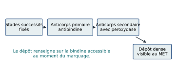
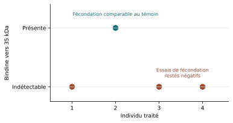
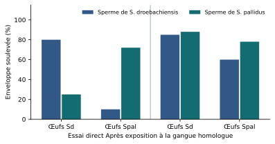
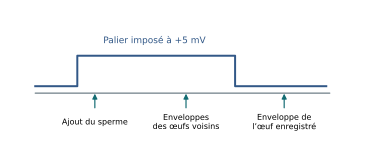
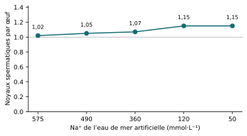
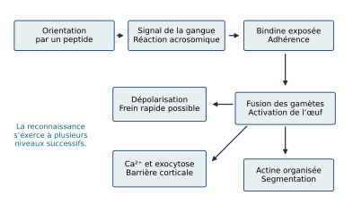

# ENS de Lyon — Second concours, Biologie-biochimie 2022 · Corrigé guidé

*Corrigé rédigé par IA, non officiel.*

**Rédaction** · GPT-6.2 Astra Ultra · vitesse non renseignée

## I. Synthèse sur la reproduction des Mammifères

### Question 1 — Cycle des Mammifères, méiose et fécondation

> [!INDICATION]
> Suivre séparément le nombre de jeux de chromosomes et la quantité d’ADN au cours des deux divisions.

#### Solution

**Introduction.** Chez les Mammifères, l’organisme adulte est diploïde. Comment conserver le nombre chromosomique de l’espèce d’une génération à la suivante tout en formant des descendants génétiquement différents ? Deux événements complémentaires, la méiose et la fécondation interne, assurent cette alternance.

**Former les gamètes.** Dans les gonades, les cellules précurseures de la lignée germinale se multiplient par mitose. Une phase S précède la méiose : les chromosomes se dupliquent et possèdent chacun deux chromatides sœurs. Pour une cellule qui entre dans la première division, la ploïdie reste $2n$ et la quantité d’ADN passe de $2C$ à $4C$. En prophase I, les homologues s’apparient en bivalents et des échanges réciproques entre chromatides non sœurs créent des combinaisons nouvelles d’allèles : c’est le brassage intrachromosomique. En métaphase I, chaque bivalent s’oriente indépendamment des autres ; en anaphase I, les homologues se séparent tandis que les chromatides sœurs restent ensemble. La première division produit des cellules $n,2C$ et réalise un brassage interchromosomique. Une deuxième division, sans réplication intermédiaire, sépare les chromatides sœurs et donne des produits $n,C$.

Chez le mâle, chaque spermatocyte I peut donner quatre spermatides, qui se différencient en spermatozoïdes. Chez la femelle, les divisions sont asymétriques : l’ovocyte conserve presque tout le cytoplasme, les autres produits étant des globules polaires. Chez de nombreux Mammifères, dont l’humain, l’ovocyte I est arrêté en prophase I puis reprend la première division avant l’ovulation. L’ovocyte II est ovulé en métaphase II ; l’entrée du spermatozoïde déclenche l’achèvement de la seconde division.

**Réunir deux patrimoines haploïdes.** La fécondation est **interne**, habituellement dans l’oviducte. Après sa maturation fonctionnelle dans les voies génitales femelles, un spermatozoïde franchit les enveloppes de l’ovocyte ; la réaction acrosomique participe à cette progression. Les membranes gamétiques se reconnaissent et fusionnent. L’activation de l’ovocyte déclenche notamment une réaction corticale qui contribue à empêcher la polyspermie. Les génomes haploïdes paternel et maternel sont réunis dans le zygote, rétablissant $2n$. Les premières mitoses de segmentation conservent cette ploïdie. Le développement embryonnaire puis fœtal et la croissance conduisent à un nouvel individu capable, à maturité, de produire des gamètes.

**Conclusion.** Une seule réplication suivie de deux séparations chromosomiques réduit la ploïdie ; la rencontre des gamètes la rétablit. L’orientation indépendante des bivalents, les échanges entre homologues et la rencontre de deux gamètes rendent chaque descendance génétiquement singulière.

## II. Rôle de la bindine chez les Oursins

### Question 2 — Où apparaît la bindine ?

> [!INDICATION]
> Le marquage est réalisé avant l’inclusion et la préparation des coupes. Qu’est-ce qui est accessible à l’anticorps ?

#### Solution

Les cellules fixées à différents stades sont mises en présence de l’anticorps antibindine de lapin, puis d’un anticorps secondaire anti-lapin portant une peroxydase. Le produit sombre de la réaction enzymatique situe l’antigène en microscopie électronique à transmission. Avant la réaction acrosomique, le premier cliché ne présente pas de marquage externe. À l’ouverture de la vésicule puis à l’extension, le dépôt apparaît au pôle antérieur et **recouvre le processus acrosomique**. L’absence de signal initial s’explique par une bindine enfermée dans une vésicule intacte et inaccessible aux anticorps ; elle ne prouve pas son absence dans le spermatozoïde.

### Question 3 — Reconnaissance entre gamètes

> [!INDICATION]
> Dans les quatre puits, identifier les deux couples œufs–bindine de même espèce avant de comparer l’agglutination.

#### Solution

Les œufs dépourvus de gangue s’agglutinent surtout avec la bindine de leur propre espèce, dans les combinaisons a et c. Les combinaisons croisées b et d ne donnent pas d’amas comparables. La bindine exposée sur le processus acrosomique peut donc reconnaître des partenaires à la surface de l’œuf et participer à l’**adhérence préférentielle des gamètes de même espèce**. Ce test mesure une agglutination. Il ne démontre ni une fusion membranaire ni l’identité du récepteur.

### Question 4 — Principe de CRISPR

> [!INDICATION]
> Distinguer le système naturel, la reconnaissance de la cible et ce qu’un changement de séquence permet de conclure.

#### Solution

Les systèmes CRISPR-Cas participent à une mémoire immunitaire adaptative chez des bactéries et des archées. Un ARN associé à une protéine Cas reconnaît une séquence nucléique complémentaire. Dans l’édition fondée sur Cas9, cette reconnaissance oriente la coupure d’un ADN cible ; la réparation par la cellule peut produire de petites insertions ou délétions susceptibles d’interrompre une fonction. Un individu traité peut conserver un allèle fonctionnel ou être mosaïque. Le traitement annoncé n’établit donc à lui seul ni le génotype effectif ni l’absence de la protéine étudiée.

### Question 5 — Contrôler le phénotype des spermatozoïdes

> [!INDICATION]
> Comparer des grandeurs de même unité, examiner la dispersion et distinguer le nombre de cellules du nombre de donneurs.

#### Solution

La longueur moyenne du flagelle est voisine de **45,6 µm** chez les témoins et de **45,4 µm** dans le groupe étudié. Les fréquences moyennes de battement sont respectivement **31,9 et 32,2 Hz**, avec des dispersions qui se recouvrent. Les têtes sont de dimensions comparables, avec une longueur moyenne un peu plus faible dans le groupe traité (environ 4,3 contre 4,8 µm). Ces données écartent une anomalie motrice majeure visible et fournissent un contrôle indispensable pour interpréter ensuite un défaut de fécondation. L’échantillon de donneurs est limité et la figure ne fournit aucun test démontrant l’équivalence de tous les paramètres.

### Question 6 — Comparer les quatre donneurs

> [!INDICATION]
> Lire toute la courbe de fécondation, puis rechercher un individu qui se comporte différemment des trois autres.

#### Solution

Pour les témoins, la proportion d’œufs fécondés augmente avec la concentration de spermatozoïdes et atteint presque 100 %. Les échantillons 1, 3 et 4 restent près de 0 % même dans la partie du graphe où leur témoin féconde presque tous les œufs. **Le n° 2 fait exception** : sa courbe atteint le même plateau que le témoin et peut même être légèrement décalée vers des concentrations plus faibles. La provenance « traitée » ne prédit donc pas à elle seule le phénotype. Il faut comparer la présence réelle de bindine.

### Question 7 — Comparer fécondation et immunodétection

> [!INDICATION]
> Lire séparément le témoin de chargement, la bande attendue vers 35 kDa et la bande supplémentaire de l’autre espèce.

#### Solution

Un western blot sépare des protéines, généralement selon leur masse apparente sur gel dénaturant, puis les transfère sur membrane et détecte la protéine visée par un anticorps. La **tubuline** est détectée dans chaque extrait ; elle contrôle le dépôt et le transfert, dont les intensités peuvent toutefois varier. Chez *H. pulcherrimus*, la bande de bindine vers **35 kDa** est présente chez les témoins et chez l’individu traité **2**, mais indétectable chez 1, 3 et 4. Le profil concorde avec les courbes de fécondation. Pour le n° 2, on peut vérifier la séquence de l’allèle de bindine et refaire la détection sur une préparation indépendante avec un second anticorps ; cela distingue expression résiduelle, absence d’inactivation ou mosaïcisme d’un problème de détection. Chez *S. purpuratus*, le signal supplémentaire vers **49 kDa** pourrait correspondre à un précurseur, à une forme modifiée ou à une autre protéine reconnue. La masse apparente seule ne suffit pas pour choisir entre ces hypothèses.

### Question 8 — Rôle de la bindine

> [!INDICATION]
> Rassembler trois preuves indépendantes : localisation, reconnaissance entre espèces et concordance entre protéine et fertilité.

#### Solution

La bindine devient accessible sur le processus après la réaction acrosomique. La bindine purifiée favorise l’agglutination des œufs de la même espèce. Chez les donneurs dont les spermatozoïdes restent mobiles mais dépourvus de signal bindine, la fécondation échoue ; l’individu exprimant la protéine reste fertile. Les résultats étayent un **rôle nécessaire dans la reconnaissance et l’adhérence qui permettent la fécondation** dans ces essais. Ils ne suffisent pas à lui attribuer à elle seule la fusion des deux membranes.

## II. Rôle de la gangue gélatineuse

### Question 9 — Lire les trajectoires

> [!INDICATION]
> Avec une seconde d’exposition, chaque trait retrace un déplacement. Comparer sa forme et la densité de traces autour du point d’injection.

#### Solution

Avant l’ajout, les spermatozoïdes d’*Arbacia punctulata* tracent de petites trajectoires souvent courbes ou circulaires, distribuées dans le champ. Après l’apparition locale du resact, les trajectoires se réorientent et se concentrent progressivement dans une même zone voisine du point d’apport ; des amas de traces deviennent visibles entre les images successives. Cette réponse directionnelle à un gradient chimique correspond à un **chimiotactisme positif**. Une simple accélération de la nage n’expliquerait pas l’accumulation localisée.

### Question 10 — Spécificité du signal attractif

> [!INDICATION]
> Le type de spermatozoïdes et le temps d’observation sont identiques ; seul le peptide change.

#### Solution

Le resact du même oursin produit une accumulation nette de spermatozoïdes d’*A. punctulata* au point marqué ; le speract de *S. purpuratus* n’y produit pas d’agrégation comparable. La réponse au resact est donc sélective dans cette comparaison et peut guider des gamètes vers les œufs appropriés. Le test ne mesure pas la réponse des spermatozoïdes de *S. purpuratus* à leur propre speract : il ne démontre pas à lui seul un chimiotactisme réciproque dans les deux espèces.

### Question 11 — Les polysaccharides de la gangue

> [!INDICATION]
> Les triplets comparent la provenance du polysaccharide pour un type de spermatozoïdes donné.

#### Solution

Dans les trois combinaisons homologues étudiées à Rio, la proportion de spermatozoïdes effectuant la réaction acrosomique est de l’ordre de **30 à 40 %**. Avec les polysaccharides des deux autres espèces, elle reste proche du bruit de fond. La composition des polysaccharides sulfatés fournit donc un signal d’activation fortement spécifique chez ces trois espèces. Dans une même baie et pendant la même période de reproduction, ce filtre prézygotique réduit les rencontres gamétiques improductives et contribue à l’isolement reproductif.

### Question 12 — Comparer les deux ensembles d’espèces

> [!INDICATION]
> Le temps se lit au niveau des nœuds de l’arbre, pas sur la seule longueur graphique des noms terminaux.

#### Solution

Le premier ensemble réunit trois genres différents, *Lytechinus*, *Echinometra* et *Arbacia*. La séparation des lignées remonte à plusieurs dizaines de millions d’années au moins et, pour *Arbacia*, le diagramme indique plus de 200 Ma. Le second rassemble trois espèces du même genre *Strongylocentrotus* ; son ancêtre commun est beaucoup plus récent, de l’ordre de quelques millions d’années sur l’arbre. Les deux premières espèces, *S. droebachiensis* et *S. pallidus*, sont les plus proches parentes. L’orthographe *S. droebachiensis* est celle des graphiques de l’épreuve. Une proximité phylogénétique rend possible une reconnaissance croisée, sans la garantir.

### Question 13 — Comparer les fécondations croisées

> [!INDICATION]
> Identifier qui fournit le spermatozoïde et qui fournit l’œuf. L’ordonnée est la proportion d’œufs dont l’enveloppe se soulève.

#### Solution

Dans le panneau A, les couples homologues *S. droebachiensis* et *S. pallidus* atteignent approximativement **80 %** et **70–75 %**. Les croisements réciproques sont plus faibles et asymétriques (environ 10 % et 25 %). Dans le panneau B, après contact préalable avec la gangue de l’espèce du spermatozoïde, les proportions croisées augmentent fortement : près de 90 % des œufs de *S. droebachiensis* avec du sperme de *S. pallidus* et environ 60 % dans l’autre sens. Les œufs de *S. purpuratus* restent presque toujours négatifs avec les deux spermes étudiés. La reconnaissance de la gangue contribue donc à une première barrière entre les espèces proches ; un obstacle supplémentaire est probable au contact des œufs de *S. purpuratus*. Le soulèvement de l’enveloppe ne renseigne pas sur la viabilité des hybrides.

### Question 14 — Distinguer réaction acrosomique et fécondation

> [!INDICATION]
> Comparer la figure 14 à la figure 13 à deux niveaux successifs du processus.

#### Solution

Le fucane de *S. droebachiensis* active surtout les spermatozoïdes de cette espèce (environ 45 %) et très peu ceux des autres. Les fucanes de *S. pallidus* et *S. purpuratus* provoquent des réactions croisées marquées, notamment chez les spermatozoïdes de ces deux espèces (environ 20–40 %). Chez *S. droebachiensis* et *S. pallidus*, les réponses différentes aux gangues expliquent une part de la différence entre croisements directs et spermatozoïdes déjà activés. Pour les œufs de *S. purpuratus*, une activation acrosomique possible ne suffit pas à expliquer l’échec de fécondation. On peut envisager une incompatibilité plus tardive de la bindine et de son partenaire ovulaire, ou d’une étape de fusion ; la figure ne teste pas directement ces hypothèses.

## II. Blocage de la polyspermie et développement

### Question 15 — Dépolarisation et monospermie

> [!INDICATION]
> Repérer le signe atteint après le premier saut et distinguer différence de potentiel et délai du signal.

#### Solution

Le potentiel de repos est voisin de −70 mV. Dans A, après le contact fécondant, la dépolarisation atteint une valeur positive, autour de **+12 mV** ; dans B et C elle reste en moyenne autour de **−20 mV**, malgré une nette élévation. L’enveloppe se forme dans les trois cas et les différences de délai ne sont pas significatives. C présente un second saut, qui pourrait correspondre à un nouvel événement d’entrée et donc à une polyspermie, compatible avec son développement ultérieur anormal. Le tracé ne dénombre pas les spermatozoïdes ; B montre aussi qu’un premier plateau négatif n’entraîne pas systématiquement ce défaut.

### Question 16 — Effet du potentiel imposé

> [!INDICATION]
> Les œufs voisins constituent un témoin de la capacité des spermatozoïdes à féconder pendant l’enregistrement.

#### Solution

Lorsque le potentiel de l’œuf enregistré est maintenu à +5 mV, les enveloppes de fécondation apparaissent sur les œufs voisins, mais pas encore sur cet œuf. Après relâchement de la contrainte électrique, l’enveloppe apparaît également sur lui. La compétence du sperme et celle de l’œuf demeurent donc compatibles avec la fécondation. Un potentiel positif **peut constituer un frein réversible à la fécondation** dans cette expérience de *S. purpuratus*. L’indicateur mesuré est le soulèvement de l’enveloppe, en aval du contact gamétique.

### Question 17 — Compter les noyaux spermatiques

> [!INDICATION]
> Chercher l’ADN marqué à l’intérieur du contour de l’œuf et comparer le contraste de phase de ce même œuf.

#### Solution

Chez *Paracentrotus lividus*, l’exemple à 575 mM Na⁺ montre un noyau spermatique marqué à l’intérieur et une enveloppe de fécondation soulevée. Dans l’exemple à 50 mM, **deux noyaux spermatiques** sont visibles à l’intérieur ; l’enveloppe est peu ou pas nettement soulevée sur le cliché correspondant. Une polyspermie est donc possible dans cette seconde condition, même sans enveloppe nettement visible. Deux exemples ne donnent pas la fréquence de cet événement.

### Question 18 — Évaluer la représentativité des images

> [!INDICATION]
> Passer d’un exemple aux 180 œufs suivis et vérifier ce qui a été compté directement.

#### Solution

Les moyennes sont proches de l’unité : **1,02** à 575 mM contre **1,15** à 50 mM, avec des valeurs intermédiaires de 1,05, 1,07 et 1,15 selon le milieu. La baisse de sodium s’accompagne au plus d’une augmentation modeste de la moyenne ; elle ne rend pas la polyspermie massive ou obligatoire. Sans distribution individuelle ni test statistique rapporté, ces moyennes ne donnent pas la proportion exacte d’œufs polyspermiques. Les clichés c/c′ établissent que deux noyaux peuvent réellement être présents et que le soulèvement de l’enveloppe est un indice imparfait. Leur caractère illustratif ne doit pas les faire prendre pour le comportement de la majorité.

### Question 19 — Développement après fécondation

> [!INDICATION]
> L’eau de mer naturelle et l’eau de mer artificielle à concentration usuelle ne sont pas strictement équivalentes.

#### Solution

En eau de mer naturelle, les embryons présentent des divisions régulières à 2 h, une progression de la segmentation à 4 h et des formes larvaires différenciées à un jour. En eau artificielle à 575 mM Na⁺, ils se divisent aussi, mais leur développement à un jour diffère de celui des larves en eau naturelle. À 50 mM, beaucoup restent sphériques ou très peu divisés à 2 et 4 h et ne développent pas la morphologie larvaire du témoin. Le milieu pauvre en sodium perturbe donc fortement la segmentation et le développement. D’après Q18, ces anomalies beaucoup plus fréquentes qu’une polyspermie manifeste ne peuvent pas être attribuées à celle-ci seule.

### Question 20 — Actine et premières divisions

> [!INDICATION]
> Examiner la symétrie du cortex puis la persistance du marquage, pas seulement son intensité maximale.

#### Solution

Dans le milieu à 575 mM, l’actine devient transitoirement plus marquée au cortex, avec une répartition relativement régulière, puis le signal cortical s’atténue. À 50 mM, le marquage forme un épais croissant asymétrique qui persiste jusqu’à 30–40 min. Le milieu perturbe la réorganisation du cortex après fécondation. Une distribution anormale de l’actine et de la tension corticale peut compromettre la formation du sillon de division et la cytocinèse. Cette observation fournit une explication possible des défauts de segmentation sans établir que l’actine en est l’unique cause.

## II. Conclusion documentaire

### Question 21 — Modèle final de la fécondation

> [!INDICATION]
> Construire une chronologie avec deux questions distinctes : quel spermatozoïde reconnaît l’œuf et comment l’entrée d’un suivant est-elle limitée ?

#### Solution

Les peptides de la gangue peuvent attirer sélectivement les spermatozoïdes. Ses polysaccharides sulfatés déclenchent une réaction acrosomique dont la spécificité varie selon les espèces. Sur le processus acrosomique, la bindine participe à la reconnaissance de la surface de l’œuf et à l’adhérence. La fusion engage ensuite l’activation de l’œuf. Une dépolarisation peut fournir un frein électrique rapide dans les conditions étudiées chez *S. purpuratus*. La libération de Ca²⁺ dans le cytosol et l’exocytose des granules corticaux modifient et soulèvent l’enveloppe vitelline, constituant une protection durable. Les mesures de noyaux chez *P. lividus* nuancent l’idée d’une prévention de la polyspermie entièrement dépendante du sodium. Enfin, la bonne organisation de l’actine participe à la première segmentation. Les expériences sur plusieurs espèces soutiennent ce modèle d’ensemble avec des variations de mécanisme et d’efficacité.

