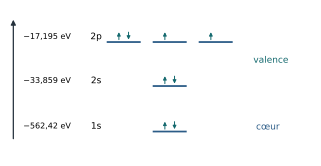
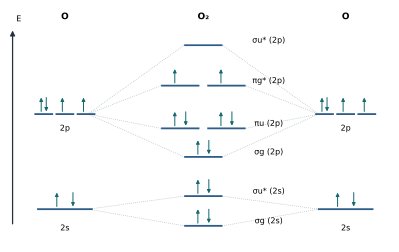
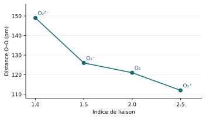
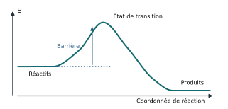
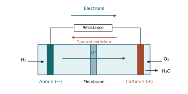
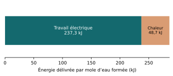

# ENS de Lyon — Second concours, Chimie 2022 · Corrigé partiel brut

*Corrigé rédigé par IA, non officiel.*

**Rédaction** · GPT-6.2 Astra Ultra · vitesse non renseignée

**Couverture.** Les questions 1 à 34 et 47 sont intégralement traitées (35 sur 49). La question 39 est limitée à la définition générale d’un réactif de Grignard. Les questions 35 à 38, 40 à 46 et 48 à 49, portant sur la voie de synthèse de la ritterazine B, sont hors de cette édition.

**Documents de la session.** Le sujet officiel compte 49 questions numérotées, suivies d’une page de données. Le rapport évoque aussi les spectroscopies RX et RMN. Le document de 15 pages publié pour cette session ne contient pas de questions supplémentaires sur ces spectroscopies.

## A1. Atome d’oxygène

### Question 1 — Électrons de l’oxygène

La première couche contient deux électrons. La deuxième contient deux électrons $2s$ et quatre électrons $2p$. L’atome neutre possède donc **huit électrons**, d’où $Z=8$ et la configuration fondamentale $1s^2\,2s^2\,2p^4$.

### Question 2 — Les cinq orbitales atomiques

De bas en haut, $1s$ est à $-562{,}42\ \mathrm{eV}$, $2s$ à $-33{,}859\ \mathrm{eV}$, et $2p_x,2p_y,2p_z$ à $-17{,}195\ \mathrm{eV}$. Les deux électrons de cœur occupent $1s$ avec des spins opposés. Parmi les six électrons de valence, deux occupent $2s$ et quatre occupent les trois orbitales $2p$. La règle de Hund impose d’occuper d’abord séparément les trois orbitales dégénérées avec des spins parallèles. Le quatrième électron s’apparie dans l’une d’elles. Le choix de cette case parmi les trois est arbitraire.

### Question 3 — Spin et magnétisme de l’atome

Les deux électrons célibataires de $2p$ ont des spins parallèles. Le spin électronique total est $S=1$ et la multiplicité $2S+1=3$ (**état triplet**). L’atome possède un moment magnétique permanent et est **paramagnétique**.

### Question 4 — Degré d’oxydation courant

La couche $2s^2 2p^4$ est à deux électrons de l’octet. Dans un bilan formel de liaison avec des éléments moins électronégatifs, attribuer les électrons de liaison à O conduit couramment au degré **−II**. Dans la deuxième période, l’attraction exercée par le noyau sur les électrons de valence augmente globalement vers la droite. O est plus électronégatif que C. Un oxyde ionique et une liaison C–O covalente polarisée peuvent donc tous deux comporter un oxygène de degré formel −II.

### Question 5 — Gain et perte d’un électron

La première ionisation est $\mathrm{O(g)\to O^+(g)+e^-}$ à partir de l’état fondamental. Elle exige $1313{,}9\ \mathrm{kJ\,mol^{-1}}$. L’affinité électronique positive désigne ici l’énergie **libérée** quand $\mathrm{O(g)+e^-\to O^-(g)}$, soit $141\ \mathrm{kJ\,mol^{-1}}$. L’attachement a donc un bilan énergétique de $-141\ \mathrm{kJ\,mol^{-1}}$ avec cette convention. Gagner un premier électron est favorable pour l’atome isolé, en perdre un est très coûteux. La fixation d’un deuxième électron sur l’anion constitue une transformation distincte.

### Question 6 — Noyaux des isotopes

Les trois noyaux renferment huit protons. Le noyau $^{16}_{8}\mathrm O$ contient **8 neutrons**, $^{17}_{8}\mathrm O$ en contient **9**, et $^{18}_{8}\mathrm O$ en contient **10**. Les abondances naturelles interviennent dans une masse atomique moyenne, pas dans cette décomposition.

## A2. Bixbyite

### Question 7 — Électroneutralité de la bixbyite

Dans $\mathrm{Mn_2O_3}$, l’oxygène est à $-\mathrm{II}$. Pour le manganèse, $2x+3(-2)=0$ donne $x=+3$. Le solide est donc un **oxyde de manganèse(III)**.

### Question 8 — Cohésion du cristal

L’annexe donne $\chi(\mathrm{Mn})=1{,}55$. L’oxygène, situé entre N et F dans la deuxième période, est nettement plus électronégatif que Mn. La case O ne porte pas de valeur numérique dans le tableau imprimé. Le modèle ionique décrit la cohésion principale par les attractions électrostatiques entre ions formels $\mathrm{Mn^{3+}}$ et $\mathrm{O^{2-}}$ de charges opposées. Les liaisons Mn–O peuvent également présenter une contribution covalente.

### Question 9 — Population de la maille

Il faut compter les centres des sphères dans les trois dimensions. Un centre à un sommet compte pour $1/8$, sur une arête pour $1/4$, sur une face pour $1/2$ et à l’intérieur pour 1. Certaines sphères de la vue suivant $a$ se superposent en profondeur. Dans la maille cubique conventionnelle de la bixbyite, les deux familles de sites du manganèse ont des multiplicités 8 et 24. On obtient **32 Mn**. La population d’oxygène est **48 O**, en accord avec le rapport $48/32=3/2$. Cela fait $Z_{\rm maille}=16$ unités $\mathrm{Mn_2O_3}$.

### Question 10 — Masse volumique cristalline

La masse molaire d’une unité de formule est $M=2(54{,}9)+3(16{,}0)=157{,}8\ \mathrm{g\,mol^{-1}}$. Une maille a pour masse $16M/N_A=4{,}19\times10^{-21}\ \mathrm g$. Son volume vaut $(9{,}411\times10^{-8}\ \mathrm{cm})^3=8{,}34\times10^{-22}\ \mathrm{cm^3}$. Avec le paramètre de maille donné, on trouve **$\rho=5{,}03\ \mathrm{g\,cm^{-3}}$**, soit environ $5{,}03\times10^3\ \mathrm{kg\,m^{-3}}$.

## B1. Molécule de dioxygène

### Question 11 — Diagramme orbitalaire du dioxygène

Chaque atome fournit $2s,2p_x,2p_y,2p_z$. Les combinaisons des deux $2s$ donnent $\sigma_g(2s)$ et $\sigma_u^*(2s)$. Les deux $2p_z$ donnent une paire sigma, les orbitales $2p_x$ et $2p_y$ deux paires pi. Pour $\mathrm{O_2}$, l’ordre d’énergie croissante est
$$
\sigma_g(2s)<\sigma_u^*(2s)<\sigma_g(2p_z)<\pi_u(2p_x)=\pi_u(2p_y)<\pi_g^*(2p_x)=\pi_g^*(2p_y)<\sigma_u^*(2p_z).
$$
Les deux orbitales de chaque paire pi sont dégénérées. Le dessin place les niveaux dans cet ordre, indépendamment de l’écart réel entre leurs énergies.

### Question 12 — Configuration moléculaire

Les quatre électrons issus des orbitales $2s$ occupent $\sigma_g(2s)^2\,\sigma_u^*(2s)^2$. Les huit suivants occupent successivement $\sigma_g(2p_z)^2$, puis $\pi_u(2p_x)^2\,\pi_u(2p_y)^2$ et enfin $\pi_g^*(2p_x)^1\,\pi_g^*(2p_y)^1$. Les deux derniers occupent chacun une orbitale antiliante avec des spins parallèles. La dernière $\sigma_u^*(2p_z)$ est vide.

### Question 13 — Indices de liaison

Le dioxygène contient huit électrons liants et quatre antiliants. Son indice est donc $I=(8-4)/2=2$. En retirant un électron antiliant, $\mathrm{O_2^+}$ atteint $(8-3)/2=2{,}5$. L’ajout d’un électron donne $I=(8-5)/2=1{,}5$ pour $\mathrm{O_2^-}$. L’ajout de deux électrons donne $I=(8-6)/2=1$ pour $\mathrm{O_2^{2-}}$.

### Question 14 — Longueurs O–O

Du peroxyde au superoxyde, au dioxygène puis au cation dioxygényle, l’indice augmente de $1$ à $1{,}5$, puis $2$ et $2{,}5$. Les distances correspondantes sont **149, 126, 121 et 112 pm**. La dépopulation des orbitales antiliantes renforce la liaison et rapproche les deux noyaux. La tendance est monotone, sans relation de proportionnalité imposée.

### Question 15 — Magnétisme du dioxygène

La configuration comprend **deux électrons célibataires**, un dans chacune des $\pi_g^*$. Le fondamental est triplet avec $S=1$. Un échantillon de dioxygène est **paramagnétique**.

### Question 16 — Une représentation de Lewis du biradical

On écrit **•O–O•**, avec deux doublets non liants sur chaque O et les deux électrons célibataires de spins parallèles. La liaison simple contient deux électrons, les quatre doublets en contiennent huit et les célibataires deux. Chaque O conserve une charge formelle nulle. Ce dessin rend visible le biradical. L’indice orbitalaire de la molécule reste égal à deux, ce qu’un seul dessin de Lewis ne reproduit pas en même temps que le spin.

### Question 17 — Orbitales frontières et réactivité

Les $\pi_g^*$ sont des orbitales frontières à demi occupées. Elles peuvent accueillir de la densité électronique venant d’un partenaire donneur. Le dioxygène se comporte alors en **accepteur d’électrons**, de caractère électrophile, comme dans la formation du superoxyde. Les mêmes orbitales contiennent déjà un électron, si bien qu’une interaction donneuse ou radicalaire est possible avec un partenaire approprié. La seule occupation ne fixe pas la vitesse. La conservation du spin peut notamment ralentir la réaction du dioxygène triplet avec un substrat à électrons appariés.

### Question 18 — Bilan de combustion du méthane

L’équation pour une mole de méthane est $\mathrm{CH_4(g)+2\,O_2(g)\to CO_2(g)+2\,H_2O(l)}$. Elle conserve un atome de carbone, quatre d’hydrogène et quatre d’oxygène de chaque côté.

### Question 19 — Signe de l’enthalpie

$\Delta_r H^\circ=-891\ \mathrm{kJ\,mol^{-1}}$ est négatif. La réaction est **exothermique**. Pour une mole de méthane consommée à pression constante dans les conditions du bilan, le système peut céder environ $891\ \mathrm{kJ}$ au milieu extérieur en l’absence de travail utile.

### Question 20 — Profil d’énergie

Les produits sont plus bas en énergie que les réactifs. Entre les deux, le chemin réactionnel doit franchir une **barrière d’activation** élevée au regard de l’agitation thermique. Le nombre de systèmes qui la franchissent par unité de temps peut donc être faible malgré le bilan exothermique. Le sommet du profil schématique représente une configuration de transition. Le tracé à une bosse illustre le principe sans attribuer à la combustion un mécanisme élémentaire unique.

## B2. Pile à combustible

### Question 21 — Nom des électrodes

Une **anode** est le siège d’une oxydation, qui fournit des électrons. Une **cathode** est le siège d’une réduction, qui en consomme. Dans la pile débitant en générateur, l’anode sera la borne négative et la cathode la borne positive.

### Question 22 — Demi-équations dans la pile

À l’anode, $\mathrm{H_2(g)\to 2H^+(aq)+2e^-}$. À la cathode, $\tfrac12\mathrm{O_2(g)}+2\mathrm{H^+(aq)}+2e^-\to\mathrm{H_2O(l)}$. L’addition élimine les charges intermédiaires et donne le bilan d’une mole de dihydrogène vers une mole d’eau.

### Question 23 — Sens des déplacements

Du côté $\mathrm{H_2}$ se trouve l’**anode négative** et du côté $\mathrm{O_2}$ la **cathode positive**. Les électrons passent dans le circuit extérieur de l’anode à la cathode, à travers la résistance. Le courant conventionnel extérieur circule de la cathode à l’anode. Dans la membrane, les protons migrent de l’anode, qui les forme, vers la cathode, qui les consomme. Cette dernière direction résulte du bilan des deux demi-équations. La flèche courbe imprimée dans la figure 2 pointe dans le sens opposé.

### Question 24 — Enthalpie de formation de l’eau

Pour $\mathrm{H_2(g)}+\tfrac12\mathrm{O_2(g)}\to\mathrm{H_2O(l)}$, l’enthalpie standard de réaction est $\Delta_f H^\circ(\mathrm{H_2O(l)})-\Delta_f H^\circ(\mathrm{H_2})-\tfrac12\Delta_f H^\circ(\mathrm{O_2})$. Les deux termes des corps simples sont nuls par convention. À 298 K on obtient donc **$-286\ \mathrm{kJ\,mol^{-1}}$**.

### Question 25 — Chaleur échangée

À pression constante, avec pour seul travail celui des forces de pression, $Q_p=\Delta H$. Pour la transformation considérée à température fixée, dans les conditions où l’on emploie $\Delta_rH^\circ$, **$Q_p=\xi\Delta_rH^\circ$**. Cette quantité est la chaleur algébriquement reçue par le système. Pour un avancement positif la réaction cède de la chaleur à l’extérieur.

### Question 26 — Potentiel d’électrode

Pour $\mathrm{Ox}+n e^-\to\mathrm{Red}$, la convention rapportée à l’électrode standard à hydrogène donne $\Delta_rG^\circ_{\rm red}=-nFE^\circ$. Le signe s’inverse si l’on renverse la demi-équation. Pour $2\mathrm H^++2e^-\to\mathrm H_2$, $E^\circ=0$ et le terme conventionnel vaut zéro. Pour $\tfrac12\mathrm O_2+2\mathrm H^++2e^-\to\mathrm{H_2O}$, $E^\circ=1{,}23\ \mathrm V$ et le terme vaut environ $-237\ \mathrm{kJ\,mol^{-1}}$ par mole d’eau. Un potentiel d’électrode isolé dépend de la référence. Sa différence entre les deux électrodes correspond à une grandeur mesurable.

### Question 27 — Tension et énergie libre

La force électromotrice à vide vaut $e^\circ=E^\circ_{\rm cathode}-E^\circ_{\rm anode}$, en employant pour les deux couples leurs potentiels de **réduction**. Pour l’équation (1), deux électrons transitent à travers le circuit par mole d’eau formée. D’où **$\Delta_rG^\circ=-2Fe^\circ$**. Une tension positive correspond bien à une réaction de pile spontanée dans le sens écrit.

### Question 28 — Enthalpie libre, enthalpie et entropie

Par définition $G=H-TS$. Pour les états standard à une même température, **$\Delta_rG^\circ=\Delta_rH^\circ-T\Delta_rS^\circ$**. La température se mesure en kelvins et les deux termes énergétiques doivent avoir la même unité.

### Question 29 — Entropie et énergie libre à 298 K

On trouve $\Delta_rS^\circ=70-131-205/2=-163{,}5\ \mathrm{J\,K^{-1}\,mol^{-1}}$. L’entropie diminue en consommant des gaz pour former un liquide. À $298\ \mathrm K$, $T\Delta_rS^\circ=-48{,}7\ \mathrm{kJ\,mol^{-1}}$. Ainsi $\Delta_rG^\circ=-286-(-48{,}7)=\mathbf{-237{,}3\ \mathrm{kJ\,mol^{-1}}}$.

### Question 30 — Force électromotrice standard

Avec $F\simeq96\,485\ \mathrm{C\,mol^{-1}}$, $e^\circ=-\Delta_rG^\circ/(2F)=237\,300/(2\times96\,485)=\mathbf{1{,}23\ \mathrm V}$. Le résultat recoupe la soustraction directe des potentiels de l’annexe, $1{,}23-0{,}00\ \mathrm V$.

### Question 31 — Travail électrique récupérable

À température $T$ et pression constantes, le premier principe donne $\Delta H=Q-W_{\rm él}$ si $W_{\rm él}$ est compté positivement à la sortie. Pour un thermostat à $T$, le second principe donne $\Delta S=Q/T+S_{\rm créée}$, avec $S_{\rm créée}\geq0$. En éliminant $Q$, on obtient $W_{\rm él}=-\Delta G-TS_{\rm créée}\leq-\Delta G$. Dans les conditions standard considérées, pour l’avancement $\xi$, cela devient **$W_{\rm él}\leq-\xi\Delta_rG^\circ$**.

### Question 32 — Limite réversible

L’égalité exige **$S_{\rm créée}=0$**, donc un fonctionnement réversible. Elle correspond à la limite d’un courant tendant vers zéro, avec des gradients et surtensions négligeables et sans dissipation ohmique. La tension aux bornes tend alors vers la force électromotrice à vide.

### Question 33 — Efficacité maximale de conversion

Le rapport $\eta_{\rm th}=(-\Delta_rG^\circ)/(-\Delta_rH^\circ)=237{,}3/286$ vaut **$0{,}830$**, soit environ **83 %**. Pour une mole d’eau liquide formée à 298 K, la pile réversible peut livrer environ 237 kJ de travail électrique pour une diminution d’enthalpie de 286 kJ. Le solde d’environ 49 kJ est cédé sous forme de chaleur en fonctionnement réversible isotherme. Les irréversibilités diminuent le travail livré.

## C. Stéréochimie et notions indépendantes

### Question 34 — Compter les centres stéréogènes sur le dessin

Sur la structure finale, **23 centres distincts portent une configuration explicitement indiquée** par les liaisons en coin ou hachurées, 12 dans la moitié gauche et 11 dans la moitié droite de la figure 3. Les deux liaisons stéréochimiques issues d’un même atome ne doivent pas faire compter cet atome deux fois. Le carbone à deux méthyles identiques à l’extrémité droite est exclu. Une particularité du dessin mérite d’être signalée si l’on compte tous les centres *possibles* du graphe tel qu’imprimé. Dans la moitié gauche, le carbone de jonction à trois liaisons simples situé immédiatement au-dessus de la jonction porteuse d’un méthyle et adjacent au cycle à cinq chaînons possède un H implicite et trois chemins distincts. Aucun coin ne fixe sa configuration. Le dessin imprimé présente donc **un vingt-quatrième site tétraédrique potentiellement stéréogène**, en plus des 23 centres explicitement configurés.

### Question 39 — Reconnaître la famille de Grignard (notion seule)

Un réactif de Grignard est un **halogénure d’organomagnésium**, de formule générale $\mathrm{R{-}Mg{-}X}$, où X est un halogène. La liaison C–Mg est polarisée vers le carbone. Seule cette identification générique est traitée ici.

### Question 47 — Polarité d’une liaison silicium–oxygène

Si se trouve dans la troisième période et le groupe 14, O dans la deuxième période et le groupe 16. L’électronégativité croît globalement vers le haut et vers la droite. O attire donc davantage le doublet de liaison. La liaison est polarisée **$\mathrm{Si}^{\delta+}{-}\mathrm{O}^{\delta-}$**.
