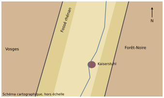
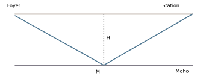
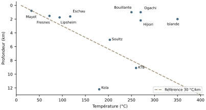
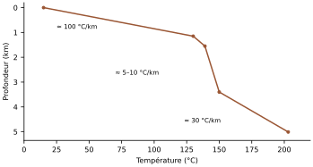

# ENS de Lyon, second concours 2022 — Géosciences · Corrigé brut

*Corrigé rédigé par IA, non officiel. Signalez toute erreur.*

**Rédaction** · GPT-6.2 Astra Ultra · vitesse non renseignée

## I — Cartographie et évolution tectonique

### Question I.1 — Schéma structural

Sur une carte orientée, dessiner une bande approximativement NNE-SSO entre deux faisceaux de failles parallèles. Regrouper les affleurements en socle varisque et couverture mésozoïque des épaulements, remplissage cénozoïque du fossé, alluvions récentes du Rhin et volcanisme miocène du Kaiserstuhl. Les Vosges sont à l'ouest, la Forêt-Noire à l'est. Les bandes de terrains n'ont pas toutes la même largeur et le massif volcanique forme une petite fenêtre émergée dans la plaine.

### Question I.2 — Compartiments et reliefs

Le fossé rhénan est un graben continental. Ses failles normales principales plongent vers le bassin et abaissent les compartiments de toit centraux par rapport aux compartiments de mur bordiers. Des blocs internes sont découpés et parfois basculés. Les Vosges et la Forêt-Noire sont les épaules du rift. Le relief relatif résulte des rejets normaux et d'une surrection des épaulements, favorisée par les réponses flexurale et isostatique à l'étirement et à la dénudation. La seule érosion ne crée pas le système de failles.

### Question I.3 — Histoire depuis la fin du Paléozoïque

Après l'orogenèse varisque, les reliefs paléozoïques sont érodés. Au Trias, les grès et conglomérats continentaux sont suivis de dépôts carbonatés ou évaporitiques, puis de marnes. Au Jurassique s'accumulent notamment marnes, calcaires et grande oolithe. La surface d'érosion au-dessus des terrains jurassiques indique une lacune avant le remplissage cénozoïque. À l'Éocène supérieur et surtout à l'Oligocène, l'extension ouvre le fossé, abaisse les compartiments centraux et fournit sur les bords des produits détritiques dont les conglomérats de rive. Aux dépôts fluviaux, lacustres et évaporitiques s'ajoute une incursion marine au Rupélien. Au Miocène (environ 19–16 Ma), le Kaiserstuhl s'édifie au-dessus d'un conduit magmatique. Sables et argiles continentaux miocènes et pliocènes sont localement érodés. Les graviers et alluvions quaternaires du Rhin, largement alimentés depuis les Alpes, recouvrent la plaine. La sismicité actuelle signale une réactivation de certaines fractures.

## II — Sismicité

### Question II.1 — Mécanisme et trajet réfléchi

La projection du mécanisme au foyer présente un domaine central en dilatation et des lobes compressifs latéraux. Elle correspond à une composante dominante de **faille normale**, compatible avec l'extension transversale au fossé. Les deux plans nodaux sont possibles tant que d'autres observations n'identifient pas la faille rompue. Dans la coupe simplifiée, le foyer proche de la surface émet une onde P descendante, réfléchie en $M$ au Moho puis remontante vers le sismomètre. Le contraste d'impédance $Z_P=\rho v_P$ au passage croûte-manteau produit un écho et une onde transmise. Pour une interface horizontale, les angles d'incidence et de réflexion sont égaux.

### Question II.2 — Profondeur du Moho

Avec un foyer de profondeur négligeable et un Moho horizontal à $H$, la réflexion se situe à mi-distance horizontale. Chaque branche vaut $v_Pt/2$ et a une projection horizontale $D/2$, d'où
$$H=\tfrac12\sqrt{(v_Pt)^2-D^2}.$$
Pour B, $D=234{,}5\ \mathrm{km}$ et $t=38{,}3\ \mathrm s$ donnent $H_B=24{,}03\ \mathrm{km}$. Pour C, $208{,}7\ \mathrm{km}$ et $34{,}2\ \mathrm s$ donnent $H_C=23{,}09\ \mathrm{km}$. On retient **environ 24 km**, soit l'ordre de 25 km retenu par le jury. L'écart entre les deux vaut près de 1 km. Le calcul soustrait deux grands carrés voisins. Ainsi une erreur de $0{,}05\ \mathrm s$ sur le temps modifie $H_B$ d'environ $0{,}8\ \mathrm{km}$. Une variation latérale de vitesse, le relief du Moho ou les premières centaines de mètres de profondeur du foyer ajoutent des incertitudes systématiques. L'écart entre les estimations n'est pas à lui seul une erreur statistique complète.

## III — Structure thermique

### Question III.1 — Températures des forages

Placer les onze couples du tableau sur des axes communs. Une droite de référence raisonnable près de la surface est $T\simeq10+30z$, en degrés Celsius pour $z$ en kilomètres. KTB (260 °C à 9,1 km) et Le Mayet (33 °C à 0,8 km) sont proches de cette échelle. Kola (180 °C à 12,2 km) est plus froid. En Alsace, Eschau, Lipsheim et Soultz sont plus chauds que cette droite. Les sites volcaniques japonais, antillais et islandais atteignent jusqu'à 250–350 °C entre 1 et 2 km. Les moyennes entre un site et la surface ne décrivent pas toujours le gradient local.

### Question III.2 — Gradients de Soultz et Moho

Lecture des segments de la figure 3, avec une précision de l'ordre de plusieurs degrés par kilomètre. De la surface à environ 1 km, la température monte d'environ 15 à 120 °C, soit **environ 100 °C/km**. Entre environ 1,5 et 3,5 km, elle passe d'environ 138 à 151 °C, soit **5 à 10 °C/km**. Entre environ 3,5 et 5 km, elle passe de quelque 155 à 200 °C, soit **environ 30 °C/km**. Ces pentes reflètent notamment la conductivité des formations et la circulation hydrothermale dans les fractures. Le flux profond est compatible avec un manteau chaud sous une lithosphère amincie. La croûte granitique peut également produire de la chaleur radiogénique. Extrapoler le gradient superficiel donnerait plus de 2 000 °C au Moho, incompatible avec une croûte essentiellement solide. Prolonger à titre indicatif le gradient profond depuis $200\,°\mathrm C$ à 5 km jusqu'à $24\ \mathrm{km}$ donne $200+19\times30\simeq770\,°\mathrm C$. La gamme **700 à 800 °C** est raisonnable et rejoint le rapport du jury. C'est une estimation indirecte.

### Question III.3 — Temps de diffusion

En appliquant la diffusivité **fournie** $\alpha=10^{-3}\ \mathrm{m^2\,s^{-1}}$ à $H\simeq24\,000\ \mathrm m$, on trouve $t=H^2/\alpha=5{,}76\times10^{11}\ \mathrm s\simeq1{,}8\times10^4$ ans, ou près de 20 ka pour 25 km. Il s'agit d'un temps caractéristique et non d'une date d'arrivée franche de la chaleur. Pour une roche crustale, une valeur usuelle est plutôt d'ordre $10^{-6}\ \mathrm{m^2\,s^{-1}}$. Le même calcul donnerait alors environ **18 Ma**. La valeur choisie modifie donc fortement l'interprétation. Le modèle ignore en outre advection par les fluides, production interne, changements de conductivité et géométrie du rift.

### Question III.4 — Comparaison avec l’âge du rift

L'ouverture principale date de l'Éocène terminal et de l'Oligocène, soit de plusieurs dizaines de millions d'années. Avec le paramètre imposé, le délai de 20 ka est plus court de trois ordres de grandeur. Une impulsion unique contemporaine de l'ouverture se serait largement résorbée. Le gradient encore élevé appelle alors un apport maintenu, renouvelé ou redistribué. En prenant une diffusivité rocheuse plus réaliste, le délai d'environ 18 Ma devient comparable à une fraction importante de l'histoire du fossé. L'argument chronologique seul sépare moins nettement chaleur héritée et apport récent.

### Question III.5 — Tomographie de l’Eifel

Une colonne large d'environ une centaine de kilomètres montre des vitesses P plus faibles que la référence, de quelques pour cent, jusqu'à plusieurs centaines de kilomètres de profondeur. Un manteau plus chaud et éventuellement partiellement fondu peut produire ce déficit. La forme allongée est compatible avec une remontée mantellique sous l'Eifel et avec une alimentation thermique postérieure à l'ouverture du rift. Le profil est situé **au nord du fossé étudié**. Il n'établit ni une continuité de toute la colonne sous Strasbourg ni une activité constante depuis l'Oligocène. Composition, fluides et résolution tomographique influencent aussi l'interprétation.

## IV — Géothermie et mécanique des roches

### Question IV.1 — Potentiel géothermique

Le gradient alsacien permet d'atteindre une température utile à quelques kilomètres. Les fractures et les aquifères permettent une circulation d'eau susceptible de transférer cette chaleur. Des régions volcaniques ou extensives comme l'Islande, Bouillante en Guadeloupe, l'arc japonais ou le rift est-africain offrent d'autres exemples. Une ressource exploitable dépend à la fois de la température et de la circulation du fluide.

### Question IV.2 — Origine de la sismicité induite

Une fracture peut déjà porter une contrainte de cisaillement due au champ tectonique. L'eau sous pression réduit la contrainte normale effective qui maintient ses lèvres en contact, $\sigma'_n=\sigma_n-p$ dans le modèle de Terzaghi. Une augmentation de la pression interstitielle facilite un glissement lorsque la résistance frictionnelle, schématisée par $c+\mu\sigma'_n$, devient insuffisante. Dans un diagramme de Mohr en contraintes effectives, une hausse uniforme de $p$ déplace le cercle vers les faibles contraintes normales, à rayon inchangé si les contraintes totales sont fixes. La rupture libère l'énergie élastique déjà accumulée dans la roche. Les contrastes thermiques peuvent également modifier les contraintes. Ce mécanisme explique le déclenchement de microséismes observés au voisinage de certains projets.

## V — Pétrologie et géochimie

### Question V.1 — Nature et accès à la croûte inférieure

La croûte inférieure continentale associe notamment des roches mafiques de type gabbro métamorphisé, des amphibolites et granulites, ainsi que des gneiss de composition plus felsique. Sa composition varie d'un domaine à l'autre. Dans le fossé actuel elle demeure enfouie sous la croûte supérieure et le remplissage sédimentaire. L'amincissement mesuré ne suffit pas à exhumer jusqu'à la surface la base crustale. L'affleurement canadien illustre une croûte profonde anciennement métamorphisée puis exhumée.

### Question V.2 — Conditions de pression et température

Avec $H\simeq24\ \mathrm{km}$, $g\simeq9{,}8\ \mathrm{m\,s^{-2}}$ et une densité moyenne de colonne $\rho\simeq2\,800$ à $3\,000\ \mathrm{kg\,m^{-3}}$, la pression lithostatique $\rho gH$ vaut environ $0{,}66$ à $0{,}71\ \mathrm{GPa}$, c'est-à-dire environ 7 kbar. Placer une zone autour de $(750\,°\mathrm C,0{,}7\ \mathrm{GPa})$ sur la grille, en gardant la gamme 700–800 °C.

### Question V.3 — Minéraux, faciès et fusion

À environ 0,7 GPa et 700–800 °C, on se situe au passage du haut faciès amphibolite au domaine granulite. Dans une roche mafique plutôt sèche, l'association clinopyroxène, orthopyroxène et plagioclase est plausible, avec amphibole résiduelle du côté plus frais ou hydraté. Dans un gneiss felsique, quartz et feldspaths dominent, avec d'autres minéraux selon la composition. La grille indique que le solidus hydraté peut être dépassé. Une anatexie locale est donc envisageable pour des lithologies fertiles avec de l'eau. Le solidus sec plus élevé rend la fusion d'une roche sèche moins probable à ces températures.

### Question V.4 — Affinité des laves du Kaiserstuhl

Le diagramme montre de nombreux produits pauvres en silice, riches en alcalins à silice donnée, depuis des termes basanitiques, néphélinitiques et téphritiques jusqu'aux phonolites plus différenciées. Le volcan comporte également des carbonatites, à décrire séparément du classement silicaté par le TAS. C'est un volcanisme alcalin, souvent sous-saturé en silice, compatible avec un rift continental. De faibles degrés de fusion partielle d'un manteau enrichi concentrent dans le liquide les éléments incompatibles tels que K et Na. La cristallisation fractionnée modifie ensuite le liquide. La teneur en volatils et une source métasomatisée peuvent intervenir, en particulier pour les magmas carbonatés.

### Question V.5 — Source des liquides

La faible silice, la signature alcaline et le xénolite de péridotite riche en olivine sont cohérents avec une origine mantellique des liquides primitifs, liée à une remontée et une fusion partielle. Le magma a pu arracher des fragments au manteau lithosphérique pendant son ascension. Une enclave renseigne sur les roches traversées. Elle ne prouve pas à elle seule que la roche précise observée soit la source du liquide ni la présence obligatoire d'un point chaud.

[Sujet officiel](https://banques-ecoles.fr/cms/wp-content/uploads/2022/08/2c2022_ST.pdf) · [Rapport du jury](https://banques-ecoles.fr/cms/wp-content/uploads/2022/08/22_2cc_rap_eST.pdf)
