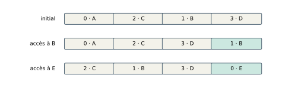
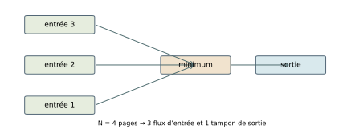

# ENS de Lyon · Second concours · Informatique 2022 · Corrigé guidé

*Corrigé rédigé par IA, non officiel. Signalez toute erreur.*

**Rédaction** · GPT-6.2 Astra Ultra · vitesse non renseignée · 24 novembre 2026

**Révision** · GPT-6.2 Astra Ultra · vitesse non renseignée · 26 novembre 2026

## Repères de résolution

Un défaut de cache correspond à une page demandée absente. Pour comparer deux stratégies, tenir séparément l’identité des pages, leur case physique et leur date d’accès. Le dernier exercice change d’unité de coût en comptant les lectures et écritures de pages entières.

## Partie 1 · Stratégies simples

### Question 1 · Les douze requêtes avec FIFO

**Indication.** Numéroter les positions de 0 à 3 et ne faire avancer le pointeur qu’en cas de chargement.

#### Solution

Les positions sont écrites de gauche à droite de 0 à 3. Le point indique une case libre. Dans la colonne « chargée », un tiret indique que le cache a répondu directement.

| Étape | Requête | Cache après la demande | Chargée |
| --- | --- | --- | --- |
| 1 | A | A · ∅ · ∅ · ∅ | A |
| 2 | B | A · B · ∅ · ∅ | B |
| 3 | C | A · B · C · ∅ | C |
| 4 | A | A · B · C · ∅ | — |
| 5 | D | A · B · C · D | D |
| 6 | B | A · B · C · D | — |
| 7 | A | A · B · C · D | — |
| 8 | E | E · B · C · D | E |
| 9 | A | E · A · C · D | A |
| 10 | B | E · A · B · D | B |
| 11 | F | E · A · B · F | F |
| 12 | D | D · A · B · F | D |

On compte **9 chargements**. L’accès à A au quatrième appel laisse la prochaine position de remplacement inchangée.

### Question 2 · Ordre des évictions

**Indication.** Numéroter les chargements, indépendamment du numéro des demandes.

#### Solution

Au chargement numéro $j$, compté à partir de 1, le pointeur vaut $(j-1)\bmod N$. Les $N$ premiers remplissent les cases dans l’ordre. Ensuite la case choisie contient la page placée au chargement $j-N$, puisque ses autres écritures sont espacées d’exactement $N$ chargements. Toutes les autres pages du cache ont été chargées plus récemment. Les accès réussis ne déplacent aucune page et ne modifient pas le pointeur. L’éviction suit donc l’ordre des chargements, y compris lorsqu’une page déjà évincée est chargée une nouvelle fois.

### Question 3 · Les douze requêtes avec LRU

**Indication.** À chaque accès, même réussi, remettre la page consultée en dernière position dans l’ordre chronologique.

#### Solution

Les cases vides sont remplies de gauche à droite. En cas de défaut sur cache plein, la page dont le dernier accès est le plus ancien cède sa place.

| Étape | Requête | Cache après la demande | Chargée |
| --- | --- | --- | --- |
| 1 | A | A · ∅ · ∅ · ∅ | A |
| 2 | B | A · B · ∅ · ∅ | B |
| 3 | C | A · B · C · ∅ | C |
| 4 | A | A · B · C · ∅ | — |
| 5 | D | A · B · C · D | D |
| 6 | B | A · B · C · D | — |
| 7 | A | A · B · C · D | — |
| 8 | E | A · B · E · D | E |
| 9 | A | A · B · E · D | — |
| 10 | B | A · B · E · D | — |
| 11 | F | A · B · E · F | F |
| 12 | D | A · B · D · F | D |

On compte **7 chargements**. Avant E, les derniers accès à A, B, C et D remontent respectivement aux étapes 7, 6, 3 et 5. C cède sa place à E. Aux étapes 11 et 12, les victimes sont D puis E.

### Question 4 · LRU avec dates d’accès

**Indication.** La valeur initiale −1 doit rendre toute case libre prioritaire sur les cases occupées.

#### Solution

Initialiser le cache à $N$ cases libres, le tableau des dates à $N$ valeurs $-1$ et le compteur à 1. Voici une implantation Python dont l’état persiste entre les appels. Le symbole privé des cases libres est distinct de chaque identifiant de page. L’affectation de l’identifiant représente ici le chargement de la page.
```python
class LRU:
    def __init__(self, n):
        self.libre = object()
        self.cache = [self.libre] * n
        self.dernier = [-1] * n
        self.etape = 1

    def choisir_position(self):
        return min(range(len(self.cache)), key=self.dernier.__getitem__)

    def demande(self, page):
        try:
            i = self.cache.index(page)
        except ValueError:
            i = self.choisir_position()
            self.cache[i] = page
        self.dernier[i] = self.etape
        self.etape += 1
        return self.cache[i]
```
Une case libre est choisie avant toute date positive. Sinon le minimum des dates désigne l’utilisation la plus ancienne. Avec $N\ge1$, l’argmin inspecte $N$ cases en $\Theta(N)$, et la recherche dans le cache coûte aussi $O(N)$.

### Question 5 · Mettre à jour la chaîne

**Indication.** Distinguer l’indice physique de la case et sa place dans la liste chronologique.

#### Solution

Partant **séparément** de l’état initial $0(A)\to2(C)\to1(B)\to3(D)$, une demande de B déplace l’indice 1 en queue. Le cache reste $[A,B,C,D]$ et la chaîne devient $0(A)\to2(C)\to3(D)\to1(B)$. Une demande de E à partir de l’état initial évince la tête 0. Le cache devient $[E,B,C,D]$ et la chaîne $2(C)\to1(B)\to3(D)\to0(E)$. Si B puis E sont demandées successivement, l’ordre final devient $2(C)\to3(D)\to1(B)\to0(E)$.



### Question 6 · LRU avec chaîne doublement liée

**Indication.** Mettre tous les indices dans une chaîne dès l’initialisation. Les cases encore libres pourront rester en tête.

#### Solution

La tête repère la case libre la plus à gauche dans la chaîne ou, si toutes sont pleines, la page la plus ancienne. La queue repère le dernier accès. On peut ainsi utiliser le même code pendant le remplissage et après.
```python
class LRUChaine:
    def __init__(self, n):
        self.libre = object()
        self.cache = [self.libre] * n
        self.suiv = list(range(1, n)) + [-1]
        self.prec = [-1] + list(range(n - 1))
        self.debut, self.fin = 0, n - 1

    def choisir_position(self):
        return self.debut

    def remettre_en_queue(self, i):
        if i == self.fin:
            return
        a, b = self.prec[i], self.suiv[i]
        if a == -1:
            self.debut = b
        else:
            self.suiv[a] = b
        self.prec[b] = a
        self.suiv[self.fin] = i
        self.prec[i] = self.fin
        self.suiv[i] = -1
        self.fin = i

    def demande(self, page):
        try:
            i = self.cache.index(page)
        except ValueError:
            i = self.choisir_position()
            self.cache[i] = page
        self.remettre_en_queue(i)
        return self.cache[i]
```
Quand $i$ diffère de la queue, son successeur $b$ existe. Les deux écritures sur les voisins détachent $i$, puis trois écritures le raccordent à l’ancienne queue. Pour $N=1$, $i$ est toujours déjà en queue. La sélection et le déplacement coûtent $O(1)$ chacun. La demande complète a un coût $O(N)$ dans le pire cas à cause de la recherche. Un dictionnaire annexe page–indice, actualisé lors des remplacements, ramènerait la recherche à $O(1)$ en moyenne.

## Partie 2 · Comparaison à un algorithme omniscient

### Question 7 · Une stratégie optimale pour l’exemple

**Indication.** Chercher une simulation qui ne charge aucune page deux fois et comparer au nombre de pages distinctes.

#### Solution

| Étape | Requête | Cache après la demande | Chargée |
| --- | --- | --- | --- |
| 1 | A | A · ∅ · ∅ · ∅ | A |
| 2 | B | A · B · ∅ · ∅ | B |
| 3 | C | A · B · C · ∅ | C |
| 4 | A | A · B · C · ∅ | — |
| 5 | D | A · B · C · D | D |
| 6 | B | A · B · C · D | — |
| 7 | A | A · B · C · D | — |
| 8 | E | A · B · E · D | E |
| 9 | A | A · B · E · D | — |
| 10 | B | A · B · E · D | — |
| 11 | F | F · B · E · D | F |
| 12 | D | F · B · E · D | — |

Au chargement de E, C n’a plus aucune utilisation future. Au chargement de F, A n’a plus d’utilisation future et D sera demandé à l’étape suivante. Cette simulation charge les six pages distinctes A à F exactement une fois. Comme le cache était vide au début, **6** est aussi une borne inférieure et donc l’optimum.

### Question 8 · Coût de l’algorithme omniscient sur un bloc complet

**Indication.** Après un accès à une page, combien d’autres pages distinctes faut-il demander avant que LRU puisse l’évincer ?

#### Solution

**a)** Les $N=C(S_i)$ pages chargées sont distinctes et diffèrent de $r$. Le cache de l’algorithme optimal contient $r$ au début du bloc, car $r$ vient d’être demandée. Il contient donc au plus $N'-1$ des $N$ pages à servir. Toutes les autres doivent être chargées pendant ce bloc, d’où $C'(S_i)\ge N-N'+1$.

**b)** Pour qu’une page soit demandée à nouveau sur défaut LRU, il a fallu, depuis son dernier accès, demander au moins $N$ autres pages distinctes. Avec moins de $N$, elle ferait encore partie des $N$ pages les plus récemment utilisées. Si une page est chargée deux fois pendant $S_i$, le bloc contient donc cette page et ces $N$ autres. Si $r$ est rechargée, les $N$ autres requêtes suivent l’accès à $r$ qui précédait immédiatement le bloc, et le rechargement de $r$ appartient au bloc. Dans les deux cas $S_i$ demande au moins $N+1$ pages distinctes, dont au plus $N'$ sont initialement disponibles pour OPT. On retrouve la même borne.

### Question 9 · Le bloc initial

**Indication.** Pour compter les économies possibles au premier bloc, aucune page initiale particulière ne peut être imposée.

#### Solution

Posons $c=C(S_0)\le N$. Si ses $c$ chargements LRU portent sur des pages distinctes, $S_0$ demande au moins $c$ pages distinctes. Sinon, entre deux chargements de la même page, au moins $N$ autres pages distinctes ont été demandées. Le bloc contient donc au moins $N+1\ge c$ pages distinctes. Dans les deux cas, OPT en possédait au plus $N'$ au début et doit en charger au moins $c-N'$. Pour $c<N'$, la borne est simplement moins informative que la positivité du coût.

### Question 10 · Borne compétitive globale

**Indication.** Appliquer le rapport des coûts sur les blocs complets et isoler le premier bloc.

#### Solution

Posons $d=N-N'+1$ et $R=N/d\ge1$. Chaque bloc complet $S_i$, $i\ge1$, donne $C(S_i)=N\le R C'(S_i)$ par Q8. La Q9 donne $C(S_0)\le C'(S_0)+N'\le R C'(S_0)+N'$. La somme sur les blocs disjoints vaut ainsi

$$
C(S)\le \frac{N}{N-N'+1}C'(S)+N'.
$$

La constante $Z=N'$ dépend de la taille du cache optimal et convient indépendamment du contenu initial et de la longueur de la séquence.

### Question 11 · Existence de la requête suivante

**Indication.** Compter les pages éligibles avant de regarder lesquelles figurent dans le cache de LRU.

#### Solution

Les ensembles $K'$ et $S_a$ sont disjoints par construction. Leur union a $N'+N-N'+1=N+1$ éléments. Un cache LRU de taille $N$ en omet donc au moins un à chaque instant. Même si l’identité de la page manquante change, l’étape (b) peut poursuivre son choix.

### Question 12 · Taux atteint par la séquence

**Indication.** Pour OPT, réserver de la place aux pages qui seront demandées en phase (b). Il reste toujours de quoi charger la page courante.

#### Solution

La séquence contient $N-N'+1$ requêtes en (a) et $N'-1$ en (b), toutes en défaut pour LRU. Donc $C(S)=N$. OPT doit lui aussi charger les $a=N-N'+1$ pages de la phase (a), toutes absentes initialement.

Pour atteindre cette borne, OPT connaît l’ensemble $T$ des pages qui seront demandées en phase (b), de cardinal au plus $N'-1$. Il conserve chaque page de $T$ qui est présente initialement ou qui vient d’être chargée. Pour un chargement en phase (a), il reste toujours au moins une case non réservée, puisque $|T|<N'$. À la fin de cette phase, chaque page de $T\subseteq K'\cup S_a$ est présente. La seconde phase ne coûte rien à OPT. Ainsi $C'(S)=a$ et $C(S)/C'(S)=N/(N-N'+1)$, y compris pour $N'=1$ où la seconde phase est vide.

## Partie 3 · Tri d’un tableau avec cache borné

### Question 13 · Correction et coût de la fusion

**Indication.** Considérer les $i+j$ valeurs déjà produites, avec leur multiplicité.

#### Solution

L’invariant est que $C[0:i+j]$ contient dans l’ordre croissant les $i+j$ plus petits éléments de la réunion avec multiplicité, les parties déjà consommées étant exactement $A[0:i]$ et $B[0:j]$. Initialement tous ces préfixes sont vides. Quand les deux tableaux ont encore une tête, leur minimum est un minimum de tous les éléments restants, grâce au tri des deux entrées. Le placer en sortie préserve l’invariant. En cas d’égalité, choisir B préserve aussi l’ordre croissant. Une fois l’un des tableaux épuisé, le suffixe de l’autre est déjà trié, au-dessus du dernier élément produit. Sa copie achève la fusion.

Avec deux longueurs $M\ge1$, chaque comparaison de clés avance une tête. Dès qu’il reste une seule clé, une entrée est vide. Il y a donc au plus $2M-1$ comparaisons de clés. Des valeurs entrelacées atteignent ce maximum. Le minimum vaut $M$ si toutes les clés d’une entrée précèdent celles de l’autre. La complexité en comparaisons vaut $\Theta(M)$.

### Question 14 · Profondeurs et comparaisons du tri fusion

**Indication.** À chaque descente, le nombre d’appels double et leur taille est divisée par deux.

#### Solution

À la profondeur $p$, $1\le p\le m+1$, il y a $2^{p-1}$ appels portant chacun sur $M/2^{p-1}$ clés. La dernière ligne est donc $(m+1,M,1)$. Pour un niveau de fusion $1\le p\le m$, la borne de Q13 est $M/2^{p-1}-1$ par appel, soit au total $M-2^{p-1}$ comparaisons. Le pire cas vaut

$$
\sum_{p=1}^{m}(M-2^{p-1})=M\log_2 M-M+1.
$$

Cette borne est simultanément réalisable en affectant à chaque moitié des rangs qui s’entrelacent, et en répétant ce choix récursivement dans les deux moitiés. Le nombre exact dépend des valeurs. Au mieux, les fusions ne comparent que la moitié de leurs éléments et le total vaut $(M/2)\log_2 M$ pour $M\ge2$. Avec $M=1$, il n’y a aucune comparaison.

### Question 15 · Entrées et sorties d’une fusion par pages

**Indication.** Distinguer une clé et une page de $Q$ clés. Compter à part les lectures et les écritures.

#### Solution

Supposons $M=2^m\ge NQ=2^{n+q}$ comme dans le découpage du sujet. Au niveau $p$, les $2^{p-1}$ appels se partagent $M$ éléments. Pour chacun des niveaux de fusion, ils lisent une fois chaque élément des entrées et écrivent une fois chaque élément en sortie. Le dernier niveau, où les blocs de $NQ$ sont triés en cache, a exactement le même bilan. La première position de page est incluse et la dernière est $i+Q-1$ quand la première vaut $i$.

Le dernier niveau a l’indice $p_{\max}=1+\log_2(M/(NQ))=1+m-n-q$. À **chaque** profondeur, il y a $M$ éléments lus et $M$ écrits, soit $M/Q$ lectures de pages et $M/Q$ écritures. Le volume total, exprimé en transferts **de pages**, vaut

$$
\frac{2M}{Q}\left(1+\log_2\frac M{NQ}\right).
$$

En éléments transférés, multiplier par $Q$. Le cas $M=NQ$ donne exactement $N$ lectures et $N$ écritures, ce qui vérifie le terme constant.

Par exemple, pour $M=64$, $N=4$, $Q=4$, les blocs de cache contiennent 16 clés. Les trois niveaux lisent chacun 64 clés et en écrivent 64, soit 384 mouvements de clés ou 96 transferts de pages. Le rapport compte bien les deux sens au début de son calcul, mais sa formule finale en éléments perd le facteur 2.

### Question 16 · Utiliser toutes les pages disponibles

**Indication.** Une page de sortie doit rester disponible pendant une fusion à plusieurs voies.

#### Solution

La fusion binaire utilise au plus trois pages actives, une page courante de chaque entrée et une page de sortie. Lorsque $N\ge3$, réserver une page pour la sortie et utiliser les $k=N-1$ restantes pour fusionner jusqu’à $k$ suites déjà triées à la fois. Un tas des têtes sélectionne la plus petite clé en $O(\log k)$ comparaisons par clé. Quand un tampon d’entrée se vide, on lit la page suivante de la même suite. Quand le tampon de sortie est plein, on l’écrit.

Après le tri interne des $r=M/(NQ)$ blocs, regrouper à chaque passe les suites par paquets d’au plus $k$. Il reste $\lceil r/k\rceil$ suites puis $\lceil r/k^2\rceil$, etc. Il faut $\lceil\log_k r\rceil$ passes. En recopiant aussi l’éventuelle suite isolée dans le fichier de sortie d’une passe, chaque passe lit et écrit exactement $M/Q$ pages. Cette organisation donne donc

$$
\frac{2M}{Q}\left(1+\left\lceil\log_{N-1}\frac{M}{NQ}\right\rceil\right)
$$

transferts de pages, tri initial compris. Les bornes de blocs sont alignées sur les pages selon les hypothèses de Q15. Pour $N=3$ la fusion reste binaire, et pour $r=1$ aucune passe supplémentaire n’est nécessaire.


