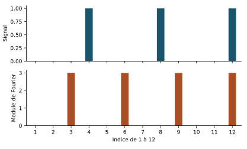

# ENS de Lyon, second concours — Mathématiques 2022 · Corrigé guidé

*Corrigé rédigé par IA, non officiel. Signalez toute erreur.*

**Rédaction** · GPT-6.2 Astra Ultra · vitesse non renseignée

On note $A^*$ l’adjointe complexe et $A^{\mathsf T}$ la transposée réelle. Les normes des entrées, des vecteurs et de l’opérateur sont distinguées dans chaque partie.

## I. Un principe d’incertitude

### Question I.1

> [!INDICATION]
> Majorer chaque ligne puis appliquer la matrice à un vecteur de la base canonique.

#### Solution

Si $m=\max_{i,j}|a_{ij}|$, alors $|(Ax)_i|\le\sum_j m|x_j|=m\|x\|_1$, donc $\|A\|_{1,\infty}\le m$. Choisissons $(i_0,j_0)$ réalisant le maximum. Pour $x=e_{j_0}$, $\|x\|_1=1$ et $\|Ax\|_\infty\ge|a_{i_0j_0}|=m$. Ainsi la norme vaut $m$. Cette expression est positive, s’annule exactement pour la matrice nulle, est absolument homogène et vérifie l’inégalité triangulaire coefficient par coefficient.

### Question I.2

> [!INDICATION]
> Combiner deux bornes pour l’opérateur et son adjoint, sans diviser par une norme.

#### Solution

La question 1 donne $\|A^*\|_{1,\infty}=\|A\|_{1,\infty}\le1$. D’où $\|Ax\|_\infty\le\|x\|_1$ et $k\|x\|_\infty\le\|A^*Ax\|_\infty\le\|Ax\|_1$. Le produit de ces deux inégalités positives donne $k\|x\|_\infty\|Ax\|_\infty\le\|x\|_1\|Ax\|_1$.

### Question I.3

> [!INDICATION]
> Remplacer une somme des valeurs absolues par le nombre de termes non nuls fois le maximum.

#### Solution

Pour tout $y$, $\|y\|_1\le|\operatorname{Supp} y|\|y\|_\infty$. Appliquer cette borne à $x$ et à $Ax$ dans I.2. Si $x\ne0$, alors $Ax\ne0$, sinon $0=\|A^*Ax\|_\infty\ge k\|x\|_\infty$. Les deux normes infinies sont donc positives et se simplifient, donnant le produit des cardinaux au moins égal à $k$.

### Question I.4a

> [!INDICATION]
> Lire le coefficient du terme de rang l dans la somme de rang j.

#### Solution

Pour $1\le j,\ell\le n$, $(F_n)_{j\ell}=\exp(-2i\pi j\ell/n)$. Avec les indices du sujet, le caractère constant correspond à l’indice $n$.

### Question I.4b

> [!INDICATION]
> Prendre le produit scalaire hermitien de deux colonnes.

#### Solution

Le coefficient $(j,\ell)$ de $F_n^*F_n$ vaut $\sum_{r=1}^n e^{2i\pi r(j-\ell)/n}$. Sur la diagonale il vaut $n$. Hors diagonale, la raison est une racine $n$-ième de l’unité distincte de $1$, donc la somme géométrique est nulle. Ainsi $F_n^*F_n=nI_n$.

### Question I.4c

> [!INDICATION]
> Vérifier les deux hypothèses k-Hadamard pour la matrice de Fourier.

#### Solution

Les coefficients de $F_n$ ont module $1$ et $\|F_n^*F_n x\|_\infty=n\|x\|_\infty$. La matrice est $n$-Hadamard. Si $s\ne0$, I.3 impose $|\operatorname{Supp}s|\,|\operatorname{Supp}\widehat s|\ge n$. La contraposée donne le résultat.

### Question I.5a

> [!INDICATION]
> Développer le noyau exponentiel sur le support compact.

#### Solution

La fonction est intégrable et $\int|f|\le2A\|f\|_\infty$. Pour chaque $x$, la série de $e^{-2i\pi xt}$ converge absolument et uniformément en $|t|\le A$, majorée en somme absolue par $e^{2\pi |x|A}$. En intégrant terme à terme, $\widehat f(x)=\sum_{m\ge0} c_m x^m$, où $c_m=(-2i\pi)^m\int_{-A}^A f(t)t^m\,dt/m!$. Comme $|c_m|\le\|f\|_{L^1}(2\pi A)^m/m!$, le rayon est infini.

### Question I.5b

> [!INDICATION]
> D’abord annuler les coefficients, puis approcher la fonction conjuguée par des polynômes.

#### Solution

La transformée est nulle sur un voisinage de zéro. Ses dérivées en zéro, donc les moments $\int f(t)t^m\,dt$, sont nuls. Ainsi $\int_{-A}^A fP=0$ pour tout polynôme complexe. Par approximation de Weierstrass des parties réelle et imaginaire sur le segment, il existe des polynômes convergeant uniformément vers $\bar f$. Le passage à la limite donne $\int_{-A}^A|f|^2=0$ car l’erreur est au plus $\|f\|_{L^1}\|P-\bar f\|_\infty$. La continuité donne $f=0$ sur le segment et le support donne $f=0$ ailleurs.

## II. Exemples de matrices réelles

### Question II.1

> [!INDICATION]
> Tester la condition de minoration sur un vecteur canonique.

#### Solution

Pour $x=e_j$, chaque coordonnée de $A^{\mathsf T}Ae_j$ est un produit scalaire de deux colonnes de $A$, de module au plus $n$. La minoration donne $k\le\|A^{\mathsf T}Ae_j\|_\infty\le n$.

### Question II.2

> [!INDICATION]
> Évaluer le formulaire quadratique du produit de Gram.

#### Solution

$G=A^{\mathsf T}A$ est réelle symétrique, donc diagonalisable en base orthonormée. Si $Gx=\lambda x$ avec $x\ne0$, alors $\lambda\|x\|_2^2=x^{\mathsf T}Gx=\|Ax\|_2^2\ge0$. Toutes les valeurs propres sont positives au sens large.

### Question II.3a

> [!INDICATION]
> La trace de la matrice de Gram est une somme de carrés.

#### Solution

$\operatorname{tr}(A^{\mathsf T}A)=\sum_{i,j}a_{ij}^2\le n^2$ car $|a_{ij}|\le1$.

### Question II.3b

> [!INDICATION]
> Tester un vecteur propre dans la définition.

#### Solution

Pour $Gx=\lambda x$, $x\ne0$, on a $|\lambda|\|x\|_\infty=\|Gx\|_\infty\ge n\|x\|_\infty$. Or $\lambda\ge0$ par II.2, d’où $\lambda\ge n$.

### Question II.3c

> [!INDICATION]
> Préciser les conditions d’égalité dans chacune des deux sommes.

#### Solution

Les $n$ valeurs propres sont au moins $n$ et leur somme est au plus $n^2$. Elles valent donc toutes $n$, et la diagonalisation orthogonale donne $G=nI_n$. L’égalité $\sum a_{ij}^2=n^2$ impose $a_{ij}^2=1$ pour chaque entrée, soit $a_{ij}=\pm1$.

### Question II.4a

> [!INDICATION]
> Retrouver la somme des coordonnées de x à partir de son image.

#### Solution

Posons $S=\sum x_i$ et $y=(2kI+J)x$. On a $y_i=2kx_i+S$ et $\sum_i y_i=(2k+n)S$, d’où $|S|\le n\|y\|_\infty/(2k+n)\le\|y\|_\infty$. Ainsi $2k\|x\|_\infty\le\|y\|_\infty+|S|\le2\|y\|_\infty$. Avec la borne donnée sur les coefficients, cela établit la propriété $k$-Hadamard.

### Question II.4b

> [!INDICATION]
> Choisir trois colonnes de poids deux ayant une coordonnée commune deux à deux.

#### Solution

Prenons $A=J_3-I_3=\left(\begin{smallmatrix}0&1&1\\1&0&1\\1&1&0\end{smallmatrix}\right)$. Ses colonnes ont norme carrée $2$ et produit mutuel $1$. Donc $A^{\mathsf T}A=I_3+J_3$, comme souhaité pour $k=1/2$.

## III. Normes d’opérateur de matrices aléatoires

### Question III.1a

> [!INDICATION]
> Décomposer dans une base orthonormée de vecteurs propres.

#### Solution

Pour $x=\sum c_jv_j$ unitaire et $Av_j=\lambda_jv_j$, $\|Ax\|_2^2=\sum\lambda_j^2c_j^2\le M^2$ et $|x^{\mathsf T}Ax|=|\sum\lambda_jc_j^2|\le M$, où $M=\max|\lambda_j|$. Un vecteur propre associé à une valeur de module $M$ réalise les deux bornes, d’où l’égalité des deux suprema avec $M$.

### Question III.1b

> [!INDICATION]
> Comparer norme spectrale et somme des carrés, puis exploiter le rang dans le cas d’égalité.

#### Solution

Par III.1a, $\|A\|_2^2\le\sum_j\lambda_j^2=\sum_{i,j}a_{ij}^2\le n^2$. Si l’égalité a lieu, toutes les entrées ont module $1$ et une seule valeur propre $\lambda=\pm n$ est non nulle. Ainsi $A=\lambda vv^{\mathsf T}$ pour $v$ unitaire. Les entrées diagonales donnent $|v_i|=1/\sqrt n$. Donc $A=\pm ss^{\mathsf T}$ avec $s\in\{-1,1\}^n$. Réciproquement ces matrices ont bien une valeur propre de module $n$ et les autres nulles.

### Question III.2a

> [!INDICATION]
> Comparer les coefficients des séries entières paires.

#### Solution

On a $(2m)!=2^m m!\prod_{j=1}^m(2j-1)\ge2^m m!$. Comme les puissances paires sont positives, $\cosh t=\sum_{m\ge0}t^{2m}/(2m)!\le\sum_{m\ge0}(t^2/2)^m/m!=e^{t^2/2}$.

### Question III.2b

> [!INDICATION]
> Séparer diagonale et termes symétriques avant d’invoquer l’indépendance.

#### Solution

Écrivons $Z=x^{\mathsf T}Ax=\sum_i\varepsilon_{ii}x_i^2+2\sum_{i<j}\varepsilon_{ij}x_ix_j$. Les signes de cette expression sont indépendants, et $\mathbb E e^{t\varepsilon}=\cosh t$. Ainsi $\mathbb E e^{uZ}=\prod_i\cosh(ux_i^2)\prod_{i<j}\cosh(2ux_ix_j)$.

### Question III.2c

> [!INDICATION]
> Regrouper les termes dans le carré de la somme des carrés.

#### Solution

Par 2a–b la majoration est l’exponentielle de $u^2(\tfrac12\sum_i x_i^4+2\sum_{i<j}x_i^2x_j^2)\le u^2(\sum_i x_i^2)^2=u^2\|x\|_2^4$.

### Question III.2d

> [!INDICATION]
> Appliquer l’inégalité de Markov à une variable positive.

#### Solution

Pour $u>0$, $\mathbb P(Z\ge\alpha\sqrt n)\le e^{-u\alpha\sqrt n}\mathbb E e^{uZ}\le\exp(-u\alpha\sqrt n+u^2\|x\|_2^4)$. Pour $u=0$, le membre de droite vaut $1$ et la majoration reste vraie.

### Question III.2e

> [!INDICATION]
> Minimiser le trinôme de la borne exponentielle.

#### Solution

Pour $x\ne0$, le minimum est atteint en $u=\alpha\sqrt n/(2\|x\|_2^4)$ et donne $\exp(-\alpha^2 n/(4\|x\|_2^4))$. Par symétrie des signes, $-Z$ a la même loi que $Z$. L’union des deux queues donne donc au plus le double de cette borne pour $|Z|$. Pour $x=0$, les deux probabilités sont nulles directement.

### Question III.3a

> [!INDICATION]
> Développer la forme quadratique autour du point du filet le plus proche.

#### Solution

Choisissons $v=v_j$ du filet, $h=x-v$ avec $\|h\|_2\le1/3$. Alors $x^{\mathsf T}Ax=v^{\mathsf T}Av+2h^{\mathsf T}Av+h^{\mathsf T}Ah$. Par Cauchy–Schwarz et définition de la norme d’opérateur, les deux derniers termes ont pour somme des modules au plus $(2/3+1/9)\|A\|_2=7\|A\|_2/9$. Le premier est borné en module par $M_A$.

### Question III.3b

> [!INDICATION]
> Passer au supremum dans l’inégalité déterministe.

#### Solution

Par III.1a, $\|A\|_2\le7\|A\|_2/9+M_A$, soit $M_A\ge2\|A\|_2/9$. L’événement $\{\|A\|_2\ge t\}$ est inclus dans $\{M_A\ge2t/9\}$, donc les probabilités sont ordonnées dans le sens demandé.

### Question III.3c

> [!INDICATION]
> Compenser le nombre exponentiel de points du filet par la queue exponentielle.

#### Solution

En prenant $t=\alpha\sqrt n$, l’union sur les $N\le7^n$ vecteurs unitaires et III.2e donnent $\mathbb P(\|A\|_2\ge\alpha\sqrt n)\le2\,7^n\exp(-\alpha^2 n/81)$. Il suffit de choisir $\alpha>9\sqrt{\log7}$, par exemple $\alpha=18$, pour obtenir une limite nulle.
