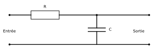
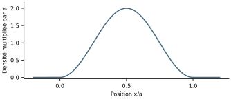
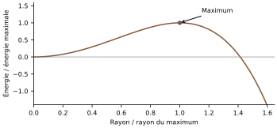

# ENS de Lyon, second concours 2022 — Physique · Corrigé brut

*Corrigé rédigé par IA, non officiel. Signalez toute erreur.*

**Rédaction** · GPT-6.2 Astra Ultra · vitesse non renseignée

## A — Questionnaire de physique

### Question A1 — Filtre passe-bas

Placer une résistance en série entre l'entrée et la sortie, et un condensateur entre la sortie et la masse. Sans charge, $H(j\omega)=1/(1+jRC\omega)$. La sortie suit l'entrée aux basses fréquences et s'atténue aux hautes.

### Question A2 — Gaz de van der Waals

Pour $N$ moles dans le volume total $V$, l'équation est $(P+aN^2/V^2)(V-Nb)=NRT$, où $a$ et $b$ sont les paramètres molaires du gaz.

### Question A3 — Relation de Bernoulli

Pour un fluide parfait incompressible en régime stationnaire dans le champ de pesanteur, $P+\rho v^2/2+\rho gz$ est constant le long d'une ligne de courant.

### Question A4 — Équation de Maxwell-Ampère

Dans le vide avec sources, $\nabla\times\mathbf B=\mu_0\mathbf j+\mu_0\varepsilon_0\partial_t\mathbf E$.

### Question A5 — Milieu dispersif

Un milieu est dispersif si la vitesse de phase $\omega/k$ dépend de la fréquence. Des composantes spectrales distinctes acquièrent alors des phases relatives différentes au cours de la propagation.

### Question A6 — Distribution de Boltzmann

Dans un gaz parfait isotherme soumis à un champ de pesanteur uniforme, la densité de particules de masse $m$ suit $n(z)=n(0)e^{-mgz/(k_BT)}$. Les positions élevées sont défavorisées par leur énergie potentielle.

### Question A7 — Interféromètre de Michelson

Le défilement de $N_f$ franges lors de la translation d'un miroir donne son déplacement $d=N_f\lambda/2$ en incidence normale. L'aller-retour double la différence de marche.

### Question A8 — Effet de peau

Dans un conducteur soumis à un courant alternatif, la densité de courant se concentre près de la surface. Dans un bon conducteur plan de conductivité $\sigma_e$ et perméabilité $\mu$, sa profondeur caractéristique est $\delta=\sqrt{2/(\mu\sigma_e\omega)}$. Un fil épais présente ainsi une résistance alternative croissante.

### Question A9 — Pompage optique

Une lumière auxiliaire excite les atomes ou ions du milieu actif. La relaxation vers le niveau supérieur de la transition laser y accumule une population qui permet l'inversion requise pour l'amplification stimulée.

### Question A10 — État fondamental du puits infini

Pour des parois en $0$ et $a$, la densité vaut $|\psi_1(x)|^2=(2/a)\sin^2(\pi x/a)$ à l'intérieur et zéro à l'extérieur. Elle s'annule aux parois, admet un maximum $2/a$ en $a/2$, et son intégrale vaut un.

## B — L’horloge de glace

### Question B1 — Flottaison interfaciale

Comme $\rho_1=890<\rho_{\rm sol}=920<\rho_2=950$ en $\mathrm{kg\,m^{-3}}$, la glace coulerait dans la seule huile légère et remonterait dans la seule huile lourde. À l'équilibre son poids est compensé par les poussées des deux huiles sur les volumes déplacés.

### Question B2 — Masse du système lié

Entre deux détachements, l'eau fondue reste accrochée. La masse $m=m_{\rm sol}+m_{\rm liq}$ est donc constante, en supposant l'absence de dissolution ou d'évaporation.

### Question B3 — Descente durant la fonte

À masse donnée, l'eau liquide est plus dense que la glace. La fusion réduit le volume total de l'ensemble. À répartition inchangée entre les deux huiles, la poussée diminue. La descente déplace une fraction du volume vers l'huile lourde et permet de rééquilibrer le poids.

### Question B4 — Remontée au détachement

La goutte immergée dans l'huile lourde a un poids apparent positif $(\rho_{\rm liq}-\rho_2)gV_{\rm goutte}$. Sa disparition réduit brusquement la charge apparente du glaçon. Au même enfoncement, la poussée sur la glace excède alors son poids et la glace remonte vers une position d'équilibre correspondant à son nouveau rayon.

### Question B5 — Rayonnement d’un corps noir

La loi de Stefan-Boltzmann donne $p_{\rm CN}=\sigma T^4$ en watts par mètre carré, avec $T$ en kelvins.

### Question B6 — Échange radiatif net

Avec les hypothèses radiatives du sujet, la sphère reçoit et absorbe $4\pi R^2\sigma T_a^4$ et émet $4\pi R^2\sigma T_f^4$. Le bilan algébrique entrant vaut $P_\sigma=4\pi R^2\sigma(T_a^4-T_f^4)>0$.

### Question B7 — Linéarisation

Pour $T_a=T_f+\Delta T$, le premier ordre donne $p_\sigma=P_\sigma/(4\pi R^2)\simeq4\sigma T_f^3\Delta T$. Employer la température moyenne dans le coefficient ne change pas cet ordre de développement.

### Question B8 — Valeur du flux radiatif

$4\sigma(273\ \mathrm K)^3(20\ \mathrm K)=92\ \mathrm{W\,m^{-2}}$. La loi non linéarisée donne $103\ \mathrm{W\,m^{-2}}$. On retiendra $10^2\ \mathrm{W\,m^{-2}}$.

### Question B9 — Loi thermique de Newton

Le flux entrant reçu par le solide vaut $p_h=h(T_2-T_1)$, où $T_1$ est la température de surface du solide et $T_2$ la température du liquide ambiant.

### Question B10 — Valeur du flux convecto-diffusif

$p_h=500\times20=10^4\ \mathrm{W\,m^{-2}}$, soit environ cent fois le flux radiatif.

### Question B11 — Place de la conduction

Dans l'huile, le transport jusqu'à la surface combine advection et conduction à travers la couche limite. Le coefficient $h$ de la loi de Newton représente déjà cet échange global. Lui ajouter un terme conducteur calculé dans la même couche compterait deux fois le même transfert. Le modèle suppose en outre la glace et la goutte isothermes à $T_f$, sans gradient thermique interne à résoudre.

### Question B12 — Puissance reçue par le glaçon

Le flux dominant $h\Delta T$ est uniforme dans ce modèle et la sphère présente une aire $4\pi R^2$. En négligeant l'aire masquée par la petite goutte et le rayonnement d'environ 1 %, $P\simeq4\pi R^2h\Delta T$.

### Question B13 — Croissance de la goutte

À température de fusion constante, $P=L_f\,dm_{\rm liq}/dt$. Avec $dm_{\rm liq}=\rho_{\rm liq}dV_{\rm goutte}$, il vient $dV_{\rm goutte}/dt=P/(\rho_{\rm liq}L_f)$.

## Énergie de la goutte suspendue

### Question B14 — Coût interfacial

Une demi-sphère de rayon $r$ présente une interface eau-huile d'aire $2\pi r^2$. Le remplacement du disque de contact glace-huile par un disque glace-eau ne change pas l'énergie en vertu de l'hypothèse donnée. D'où $E_\gamma=2\pi\gamma r^2$.

### Question B15 — Énergie pesanteur et poussée

La pesanteur effective est gouvernée par $\Delta\rho=\rho_{\rm liq}-\rho_2>0$. En prenant le plan d'attache comme origine et l'axe vers le haut, le barycentre de la demi-boule est à $z_G=-3r/8$. On le vérifie en intégrant $z\pi(r^2-z^2)$ de $-r$ à zéro et en divisant par $2\pi r^3/3$. L'énergie relative au même volume d'huile est donc $E_g=\Delta\rho g(2\pi r^3/3)z_G=-\pi\Delta\rho gr^4/4$. Une estimation d'ordre de grandeur suffit à cette question et donne $E_g\sim-\Delta\rho gr^4$.

### Question B16 — Énergie totale

$E(r)=2\pi\gamma r^2-\pi\Delta\rho gr^4/4$. Elle croît d'abord, atteint un maximum à un rayon positif, puis décroît dans le prolongement mathématique de ce modèle. À petite taille, la création d'interface domine. Au-delà du maximum, la gravité effective favorise la croissance vers le bas. Ce critère énergétique schématise la perte de tenue de la goutte.

### Question B17 — Rayon de décrochage

$E'(r)=4\pi\gamma r-\pi\Delta\rho gr^3$. Le maximum correspond à $r_{\max}=2\sqrt{\gamma/(\Delta\rho g)}$ avec le barycentre exact choisi ci-dessus. L'échelle robuste est la longueur capillaire $\ell_c=\sqrt{\gamma/(\Delta\rho g)}$. Un modèle caractéristique du bras de levier modifie le préfacteur numérique, comme l'autorise le sujet.

### Question B18 — Valeur et convention pour la suite

$\ell_c=\sqrt{0{,}030/(50\times10)}=7{,}7\ \mathrm{mm}$ et donc $r_{\max}\simeq15{,}5\ \mathrm{mm}$ dans le modèle de la demi-boule exacte. La forme et l'accrochage réels déterminent le préfacteur et limitent la précision de cette prédiction. Pour toutes les questions suivantes on utilise la **valeur expérimentale imposée de 5 mm**.

### Question B19 — Temps de formation de la première goutte

Avec $R\simeq R_1$, le débit volumique de la question 13 est constant. Le volume hémisphérique au décrochement est $V_g=2\pi r_{\max}^3/3$. Ainsi
$$t_1=\frac{\rho_{\rm liq}L_f V_g}{4\pi R_1^2h\Delta T}=\frac{\rho_{\rm liq}L_f r_{\max}^3}{6h\Delta T R_1^2}.$$

### Question B20 — Première durée

Avec $R_1=0{,}020\ \mathrm m$ et $r_{\max}=0{,}005\ \mathrm m$, la goutte a une masse de $0{,}262\ \mathrm g$. Sa formation consomme environ $87{,}4\ \mathrm J$, pour une puissance de $50{,}3\ \mathrm W$. D'où $t_1\simeq1{,}74\ \mathrm s$, une échelle de quelques secondes.

### Question B21 — Variation de rayon pendant un cycle

La fraction de masse perdue par la glace vaut $f=(\rho_{\rm liq}/\rho_{\rm sol})(r_{\max}/R_1)^3/2\simeq0{,}00849$. La fraction de volume de glace perdue est la même. Donc $(R_2-R_1)/R_1=(1-f)^{1/3}-1\simeq-f/3\simeq-0{,}00284$. Le rayon change d'environ $0{,}057\ \mathrm{mm}$ durant ce cycle et la puissance proportionnelle à $R^2$ varie de moins de 1 %.

### Question B22 — Volume de glace perdu

La conservation de masse impose $\rho_{\rm sol}\delta V_{\rm glaçon}=-\rho_{\rm liq}V_g$. D'où $\delta V_{\rm glaçon}=-(\rho_{\rm liq}/\rho_{\rm sol})2\pi r_{\max}^3/3$. Sa valeur absolue vaut $0{,}285\ \mathrm{cm^3}$ environ, légèrement plus que le volume liquide $0{,}262\ \mathrm{cm^3}$.

## Limite continue et flottaison

### Question B23 — Variation de volume au premier ordre

$V_{n+1}-V_n=(4\pi/3)[(R_n+\delta R_n)^3-R_n^3]\simeq4\pi R_n^2\delta R_n$. Le nombre $\delta R_n$ est négatif.

### Question B24 — Durée d’un cycle ultérieur

Le sujet imprime une différence de rayons après $\delta t_n$ ; une durée est la différence des **instants** de détachement. Si $R_n$ désigne le rayon au début de la formation de la goutte $n$, sa durée est $\Delta t^{(n)}=\rho_{\rm liq}L_f r_{\max}^3/(6h\Delta T R_n^2)$. L'intervalle entre les libérations de $n$ et $n+1$ utilise donc le rayon de départ $R_{n+1}$. Au premier ordre du passage continu, ce simple décalage d'indice n'affecte pas le résultat. Les intervalles s'allongent lorsque la sphère rétrécit.

### Question B25 — Équation continue

Pour un même cycle, $4\pi R_n^2\delta R_n\simeq-\rho_{\rm liq}V_g/\rho_{\rm sol}$ et $\Delta t^{(n)}=\rho_{\rm liq}L_fV_g/(4\pi R_n^2h\Delta T)$. Le quotient annule $V_g$ et $R_n^2$, donnant $dR/dt=-h\Delta T/(\rho_{\rm sol}L_f)$.

### Question B26 — Bilan direct

À la surface de fusion, l'épaisseur de glace perdue par seconde vaut $-\dot R$. Par unité d'aire, le bilan latent s'écrit $\rho_{\rm sol}L_f(-\dot R)=h\Delta T$. On retrouve directement l'équation précédente, indépendamment de la façon dont l'eau se rassemble en gouttes.

### Question B27 — Évolution du rayon

Si les températures et $h$ restent constants, $R(t)=R_1-[h\Delta T/(\rho_{\rm sol}L_f)]t$ jusqu'à l'annulation de ce rayon. La vitesse de recul de l'interface vaut $3{,}25\times10^{-5}\ \mathrm{m\,s^{-1}}$.

### Question B28 — Temps de fusion complète

$t_{\rm fusion}=R_1\rho_{\rm sol}L_f/(h\Delta T)=615\ \mathrm s$, soit **10 min 15 s**. Les premières gouttes se forment bien plus vite que ce temps global. La toute fin du processus échappe à l'approximation de petites gouttes relativement au glaçon.

### Question B29 — Choix du cylindre

Pour conserver initialement la même masse de glace, identifier le volume du cylindre de hauteur $2R_c$ à celui de la sphère de rayon $R_1$. On obtient $2\pi R_c^3=4\pi R_1^3/3$, donc $R_c=(2/3)^{1/3}R_1\simeq1{,}75\ \mathrm{cm}$. Durant la phase, les rapports demandés décrivent l'enfoncement relatif avec les dimensions instantanées du modèle.

### Question B30 — Masse volumique moyenne

Le volume du mélange de phases est $V=(m-m_{\rm liq})/\rho_{\rm sol}+m_{\rm liq}/\rho_{\rm liq}$. En posant $f=m_{\rm liq}/m$, on trouve $1/\rho^*=(1-f)/\rho_{\rm sol}+f/\rho_{\rm liq}$. La densité moyenne augmente au cours de la fonte.

### Question B31 — Position de flottaison

La poussée vaut $g\pi R_c^2[\rho_1z_1+\rho_2(2R_c-z_1)]$. L'équilibre avec $2g\pi R_c^3\rho^*$ donne $z_1/R_c=2(\rho_2-\rho^*)/(\rho_2-\rho_1)$. En intégrant les pressions sur les faces supérieure et inférieure on obtient la même relation et la pression $P_i$ s'annule.

### Question B32 — Déplacement durant la première goutte

Au début, $\rho^*=920\ \mathrm{kg\,m^{-3}}$ est la moyenne des deux densités d'huile. On trouve $z_1(0)/R_c=1$. À l'instant du premier détachement, $f=0{,}00849$ donne $\rho^*=920{,}63\ \mathrm{kg\,m^{-3}}$ puis $z_1(1)/R_c=0{,}979$. La fraction de hauteur présente dans l'huile légère diminue. En utilisant le rayon initial pour l'échelle de déplacement, la diminution de $z_1$ est de l'ordre de $0{,}36\ \mathrm{mm}$. La goutte détachée, le glaçon retrouve le rapport un pour la glace seule.

[Sujet officiel](https://banques-ecoles.fr/cms/wp-content/uploads/2022/08/2c2022_phy.pdf) · [Rapport du jury](https://banques-ecoles.fr/cms/wp-content/uploads/2022/10/22_2c_rap_ephy.pdf)
