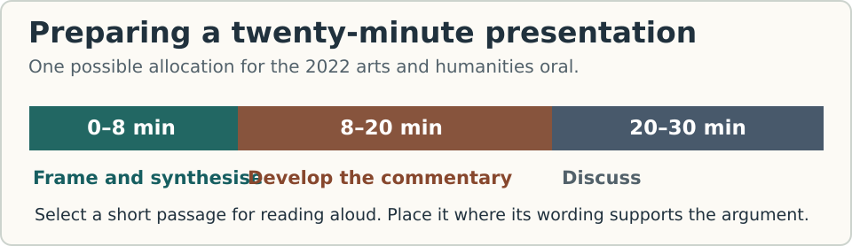

# ENS de Lyon — Anglais oral 2022 · Corrigé brut

*Corrigé rédigé par IA, non officiel.*

**Rédaction** · GPT-6.2 Astra Ultra · vitesse non renseignée

Le fascicule identifie **183 billets**. En presse, on compte 23 références en Lettres et arts, 47 en LV1, 24 en LV2 et 42 en Sciences humaines. S’y ajoutent 17 extraits d’Ishiguro, 14 billets sur Moore et 16 passages de Shakespeare. Le rapport compte 43 candidats en Sciences humaines. Rien ne permet d’attribuer un titre supplémentaire à partir de cet effectif. Pour la presse, le fascicule donne titres et références, parfois les pages du tirage. Sans fac-similé de la coupure, le commentaire porte sur les éléments identifiables de l’article. Les repères littéraires sont ceux des éditions du programme.

Les identifiants suivent l’ordre du fascicule dans chaque série. Chaque réponse propose en anglais un argument à partir du billet. Les développements en fin de volume montrent comment passer d’une analyse resserrée à une prise de parole suivie.

## Forme de l’oral

En presse, le candidat présente le document, en synthétise le mouvement, choisit des lignes à lire et développe un commentaire. En littérature, l’explication suit un extrait délimité ou un poème entier. La discussion avec le jury permet de reprendre un choix de mot, un enchaînement ou un fait de civilisation.

## Lettres et arts · Presse

#### LA01 · Rupert Murdoch waited years for a pliant government – now he’s got one

The Guardian · 16/02/2022 · [Référence du jury, p. 2](https://www.ens-lyon.fr/sites/default/files/2022-11/Anglais2022_0.pdf#page=2)

A newspaper proprietor does not need to give ministers orders to exert influence. Ministers who anticipate a hostile front page may adjust a policy before any conversation takes place. Jane Martinson’s February 2022 Guardian column calls the Johnson government “pliant”, a word that assigns responsibility to politicians as well as to Rupert Murdoch. The test of that claim is whether decisions about broadcasting and competition can be explained in public on grounds that would apply to rival owners too.

#### LA02 · Yorkshire cricket is in disgrace but the fight to tackle workplace racism is nationwide

The Guardian · 29/11/2021 · [Référence du jury, p. 2](https://www.ens-lyon.fr/sites/default/files/2022-11/Anglais2022_0.pdf#page=2) · [Publication ou reprise consultée](https://www.theguardian.com/commentisfree/2021/nov/27/yorkshire-cricket-disgrace-racism-workplace-employers)

When Azeem Rafiq described his experiences at Yorkshire, the immediate question was what one cricket club had allowed. Charlene Brown’s Guardian column of November 2021 changes the scale of the inquiry. A workplace can advertise a complaints procedure while making a complainant’s future depend on the goodwill of the people being challenged. Behind the exceptional publicity of an athlete’s testimony lies an ordinary employment question. Who can safely report misconduct, and who has the power to remedy it?

#### LA03 · Scrapping the BBC licence fee is an act of cultural vandalism

The Times · 18/01/2022 · [Référence du jury, p. 2](https://www.ens-lyon.fr/sites/default/files/2022-11/Anglais2022_0.pdf#page=2)

A licence fee is an unusual way of paying for a public conversation. It links viewers to the BBC without making each programme depend on advertisers or an annual government grant. Calling abolition “cultural vandalism” in January 2022 asks readers to consider what would be difficult to rebuild, including local reporting and programmes for small audiences. A serious defence must also explain why a fixed household charge should fall on viewers with very different incomes.

#### LA04 · The reality of Brexit appears to be protectionism and secret subsidies

The Times · 10/02/2022 · [Référence du jury, p. 2](https://www.ens-lyon.fr/sites/default/files/2022-11/Anglais2022_0.pdf#page=2)

One promise of Brexit was that an independent trading country could expose British firms to more competition. The Times’s February 2022 headline sets that promise beside protection and subsidies. Independence gives ministers the freedom to lower barriers and the freedom to favour a domestic producer. When the terms of support are confidential, taxpayers cannot weigh the jobs preserved against the cost or against opportunities denied to rivals. Sovereignty alone leaves those economic choices open.

#### LA05 · Let the legal challenges over Rwanda migrant plan begin

The Times · 21/04/2022 · [Référence du jury, p. 2](https://www.ens-lyon.fr/sites/default/files/2022-11/Anglais2022_0.pdf#page=2)

The plan announced in April 2022 proposed sending some people who reached Britain to Rwanda for their asylum claims to be considered there. The prospect of litigation raises a practical question about ministerial power. A court can ask whether a person has had a fair opportunity to explain the danger of removal and whether safeguards operate in practice. A government’s promise that a scheme will deter future journeys does not answer either question about an individual case.

#### LA06 · The Observer view on the future of the British monarchy

The Observer · 20/02/2022 · [Référence du jury, p. 2](https://www.ens-lyon.fr/sites/default/files/2022-11/Anglais2022_0.pdf#page=2) · [Publication ou reprise consultée](https://www.theguardian.com/commentisfree/2022/feb/20/the-observer-view-on-the-future-of-the-monarchy)

The Observer’s February editorial appeared during Elizabeth II’s jubilee year. Public affection for a particular queen can sustain an institution without settling what its powers and duties should be under her successor. The monarchy claims continuity through a family, so the conduct of relatives also becomes a public issue. A plausible argument about its future should distinguish ceremonies many people value from questions about public money, access to ministers and how accountability works for an unelected office.

#### LA07 · Make no mistake, the ‘Colston Four’ verdict undermined the rule of law

The Telegraph · 08/01/2022 · [Référence du jury, p. 2](https://www.ens-lyon.fr/sites/default/files/2022-11/Anglais2022_0.pdf#page=2)

Four defendants were acquitted in Bristol after Edward Colston’s statue had been pulled down during a protest. The Telegraph headline treats the verdict as a danger to the rule of law. One can understand the concern that damage might be judged according to a cause’s popularity. Yet juries are themselves part of the law, and their acquittals do not create binding precedents. A dispute about what a statue commemorates therefore became a second dispute about who may interpret this verdict.

#### LA08 · 'Partygate' is a scandal. But there are more fundamental reasons why Boris Johnson must go

The Telegraph · 07/02/2022 · [Référence du jury, p. 2](https://www.ens-lyon.fr/sites/default/files/2022-11/Anglais2022_0.pdf#page=2)

In February 2022 the immediate charge against Boris Johnson concerned gatherings held while the public lived under restrictions. This Telegraph headline accepts the seriousness of Partygate but argues that a prime minister should be judged on a broader record. The distinction matters because replacing one leader might satisfy a demand for accountability while leaving the same policies intact. Conversely, a policy disagreement does not excuse a leader from explaining whether those who made restrictions applied them to themselves.

#### LA09 · Priti Patel's ex-border boss calls for the Home Office stripped of visa powers with new Department of Immigration set up amid chaotic refugees scheme

The Mail On Sunday · 24/04/2022 · [Référence du jury, p. 2](https://www.ens-lyon.fr/sites/default/files/2022-11/Anglais2022_0.pdf#page=2)

In April 2022 people fleeing Ukraine were waiting for permission to join families or sponsors in Britain. A former border official’s proposal to transfer visa powers out of the Home Office asks whether two responsibilities fit comfortably together. A department rewarded for controlling entry may have little incentive to process urgent applications promptly. Creating another department could clarify responsibility, but only if it also acquired trained staff, access to records and the authority to decide difficult cases.

#### LA10 · The NHS and the BBC must accept reform or they don't deserve to survive

The Daily Telegraph · 19/01/2022 · [Référence du jury, p. 2](https://www.ens-lyon.fr/sites/default/files/2022-11/Anglais2022_0.pdf#page=2)

The NHS and the BBC both reach people who might otherwise be poorly served, yet a medical service and a broadcaster answer to different needs. The Telegraph’s January 2022 challenge invites readers to decide what “survive” means. A funding arrangement or management structure can change while universal access remains a guiding principle. The harder question is how to tell whether a reform improves treatment or journalism for the public, rather than simply making an institution cheaper to run.

#### LA11 · Johnson will be gone in 2022 if he can’t polish his image

The Independent · 28/12/2021 · [Référence du jury, p. 2](https://www.ens-lyon.fr/sites/default/files/2022-11/Anglais2022_0.pdf#page=2) · [Publication ou reprise consultée](https://www.the-independent.com/independentpremium/voices/boris-johnson-by-elections-covid-b1982789.html)

*Le titre de publication de The Independent emploie « in the new year » et « polish up his image » et nomme Boris Johnson. Le billet du jury abrège.*

Writing in late December 2021, The Independent made Johnson’s survival conditional on restoring his public image. The link runs through Conservative MPs. A leader who once seemed able to win voters can become a liability to colleagues defending marginal seats. Yet “polish” suggests superficial repair, while disputes over honesty may concern whether assurances can be trusted at all. A forecast made before the year began should be assessed against the evidence then available to those MPs.

#### LA12 · After a year of fractious relations, the government has to ensure the UK-EU relationship works better in 2022

The Independent · 01/01/2022 · [Référence du jury, p. 2](https://www.ens-lyon.fr/sites/default/files/2022-11/Anglais2022_0.pdf#page=2) · [Publication ou reprise consultée](https://www.independent.co.uk/voices/editorials/brexit-boris-johnson-eu-trade-b1985076.html)

A year into the post-Brexit trading relationship, formal agreements still required daily cooperation. January 2022 brought practical questions about Northern Ireland, checks on goods and businesses trying to plan across borders. The Independent’s call for a better relationship makes an important distinction. Neither side had to reverse the referendum to make procedures easier to understand or disputes easier to settle. Yet politicians who had won support by stressing separation faced a domestic cost when cooperation required a visible compromise.

#### LA13 · The time is coming, Mr Sunak, when your country will need you

London Evening Standard · 11/02/2022 · [Référence du jury, p. 2](https://www.ens-lyon.fr/sites/default/files/2022-11/Anglais2022_0.pdf#page=2) · [Publication ou reprise consultée](https://www.standard.co.uk/comment/rishi-sunak-boris-johnson-partygate-tory-leadership-b982061.html)

Addressing Rishi Sunak as “Mr Sunak” makes a newspaper column sound like a personal appeal. In February 2022 he was Chancellor, with public recognition from the pandemic and responsibility for responding to rising household costs. Telling him that his country will “need” him casts political ambition as duty. But an appeal to national need does not specify whose bills should be reduced, which taxes should rise or how a future prime minister would reconcile competing demands.

#### LA14 · What the Supreme Court decision in Alabama means for racial gerrymandering

The Washington Post · Amber Phillips · 08/02/2022 · [Référence du jury, p. 2](https://www.ens-lyon.fr/sites/default/files/2022-11/Anglais2022_0.pdf#page=2) · [Publication ou reprise consultée](https://www.washingtonpost.com/politics/2022/02/08/what-supreme-court-decision-alabama-means-racial-gerrymandering/)

In February 2022 the Supreme Court allowed Alabama to use its congressional map for the approaching election while litigation continued. Black residents made up roughly a quarter of the state’s population, yet had an effective opportunity to elect a preferred candidate in only one of seven districts. The procedural timing matters. An interim decision can determine which representatives voters return for a full term even though the justices have yet to settle the underlying voting-rights question.

#### LA15 · Who is, and isn’t, MAGA is no longer Trump’s to decide

The Washington Post · James Hohmann · 16/05/2022 · De : pp. 1-2 · [Référence du jury, p. 2](https://www.ens-lyon.fr/sites/default/files/2022-11/Anglais2022_0.pdf#page=2) · [Publication ou reprise consultée](https://www.washingtonpost.com/opinions/2022/05/15/maga-pennsylvania-mastriano-oz-barnette/)

James Hohmann’s May 2022 headline asks who owns a political identity once supporters have adopted it. Trump could endorse a Republican candidate, but local activists could still regard a rival as better expressing their understanding of “Make America Great Again”. A primary thus tested two loyalties, one to a person and another to a movement’s preferred manner and policies. Counting the fortunes of endorsed candidates alone would miss the influence of Trump’s language on his rivals.

#### LA16 · Senate confirms Ketanji Brown Jackson to Supreme Court, making her the first Black woman to serve as a justice

CNBC · Kevin Breuninger · 07/04/2022 · De : p. 1 · [Référence du jury, p. 3](https://www.ens-lyon.fr/sites/default/files/2022-11/Anglais2022_0.pdf#page=3)

In April 2022 the Senate confirmed Ketanji Brown Jackson, the first Black woman chosen to serve on the Supreme Court. She was confirmed before Justice Stephen Breyer’s retirement took effect. That distinction matters when discussing the immediate consequences. Replacing Breyer left the balance between the Court’s conservative and liberal blocs broadly intact. The appointment nonetheless changed who could see someone with a background like their own at the highest level of the federal judiciary.

#### LA17 · Texas voting law builds on long legacy of racism from GOP leaders

The Conversation · Chris Lamb · 15/09/21 · De : p. 1 · [Référence du jury, p. 3](https://www.ens-lyon.fr/sites/default/files/2022-11/Anglais2022_0.pdf#page=3)

Chris Lamb’s historical argument invites readers to compare the language of Texas voting rules with the people most affected by them. A restriction on voting hours or methods can be written in general terms while falling more heavily on citizens whose jobs, transport or neighbourhoods leave fewer alternatives. Historical parallels warrant investigation, but they do not establish intent by themselves. Evidence about legislative choices, rejected alternatives and actual access would help connect past political strategies with a particular modern law.

#### LA18 · Critical race theory and feminism are not taking over our universities

The Conversation · Maïka Sondarjee · 01/05/2022 · De : p. 1 · [Référence du jury, p. 3](https://www.ens-lyon.fr/sites/default/files/2022-11/Anglais2022_0.pdf#page=3)

“Taking over” is a sweeping claim about universities. Maïka Sondarjee’s May 2022 intervention asks what would count as proof. A well-publicised campus dispute, an optional seminar and a compulsory course are quite different pieces of evidence. To assess the claim one would need to examine curricula, employment and funding across disciplines and institutions. One might then debate how particular theories are taught without turning the existence of feminist scholarship or research on race into evidence of institutional domination.

#### LA19 · Purdue Pharma Is Dissolved and Sacklers Pay \$4.5 Billion to Settle Opioid Claims

The New York Times · Jan Hoffman · 17/09/2021 · De : pp. 1-2 · [Référence du jury, p. 3](https://www.ens-lyon.fr/sites/default/files/2022-11/Anglais2022_0.pdf#page=3)

*L’article concerne l’approbation du plan de faillite de 2021. La formulation au présent du billet ne constitue pas une confirmation que ce plan est devenu définitif.*

The 2021 Purdue Pharma bankruptcy settlement promised billions from the Sackler family to resolve opioid claims. A settlement offered communities resources on a timetable that years of separate lawsuits might not provide. It also raised a question about the price of closure when family members sought protection from further civil claims without themselves entering bankruptcy. For people who had lost relatives, compensation, public disclosure and individual accountability could matter in different ways. The reported agreement was one stage in contested proceedings.

#### LA20 · The Long Shadow of Sandy Hook

The New York Times · Robert Kolker · 08/03/2022 · De : p. 1 · [Référence du jury, p. 3](https://www.ens-lyon.fr/sites/default/files/2022-11/Anglais2022_0.pdf#page=3)

A decade after Sandy Hook, a community’s public name had become inseparable from an event that occurred in a single morning. Robert Kolker’s title directs attention to what happens afterwards. Children grow up, families make different decisions about publicity, and strangers may expect residents to speak with a single voice. Responsible reporting can record those lasting changes while allowing people to decide which experiences remain private. A familiar national reference can conceal the variety of lives within the town.

#### LA21 · Of Course the Constitution Has Nothing to Say About Abortion

The New Yorker · Jill Lepore · 04/05/2022 · De : pp. 1-2 · [Référence du jury, p. 3](https://www.ens-lyon.fr/sites/default/files/2022-11/Anglais2022_0.pdf#page=3) · [Publication ou reprise consultée](https://www.newyorker.com/news/daily-comment/why-there-are-no-women-in-the-constitution)

Jill Lepore wrote in May 2022, after a draft Supreme Court opinion became public. Her title turns constitutional silence into a historical question. Women had no formal part in drafting the Constitution and little political power in the institutions that adopted it. Taking the absence of an explicit word as the end of an argument risks overlooking how later amendments changed citizenship and liberty. The historical inquiry concerns both the rights a text names and the people empowered to name them.

#### LA22 · Biden says ‘we have to act’ after Texas school shooting

AP News · Zeke Miller and Chris Megerian · 25/05/2022 · De : pp. 1-2 · [Référence du jury, p. 3](https://www.ens-lyon.fr/sites/default/files/2022-11/Anglais2022_0.pdf#page=3) · [Publication ou reprise consultée](https://www.gpb.org/news/2022/05/24/watch-biden-says-we-have-act-after-texas-school-shooting)

After the deaths at a school in Uvalde in May 2022, Joe Biden used a presidential address to demand action. The first-person plural offered grieving listeners a language of shared responsibility, but it left open who could make a binding decision. The president, Congress, states and school authorities hold different powers. An oral commentary can examine the distance between a national moment of mourning and the institutional work needed to agree a policy and evaluate its effects.

#### LA23 · A Texas Court Halted Melissa Lucio's Execution

Time · Sanya Mansoor · 28/04/2022 · De : p. 1 · [Référence du jury, p. 3](https://www.ens-lyon.fr/sites/default/files/2022-11/Anglais2022_0.pdf#page=3) · [Publication ou reprise consultée](https://time.com/6171393/melissa-lucio-execution-texas/)

*Time complète le titre du billet par « Here’s What to Know About Her Case ».*

A Texas court halted Melissa Lucio’s scheduled execution in April 2022 and sent claims about the evidence back for review. A stay has a precise purpose. It allows a court time to examine disputed testimony or possible errors before an irreversible sentence is carried out. It does not itself settle guilt, innocence or the final sentence. The case therefore raises a question about the legal system’s capacity to correct itself when new scrutiny arrives very late.

## Langues vivantes · Explication littéraire

### Kazuo Ishiguro

Édition de référence et texte de travail. [Programme officiel](https://www.enseignementsup-recherche.gouv.fr/fr/bo/21/Hebdo37/ESRS2127855A.htm) · [Notice de l’éditeur](https://penguinrandomhousesecondaryeducation.com/book/?isbn=9780307576187)

#### IS01 · The Remains of the Day · Pages 5-7

A butler begins the story of his proposed holiday by admitting that he has made mistakes. As soon as he admits them, Stevens reduces their size, imagines alarming explanations, and finds relief in a problem for which his training has given him a solution. Miss Kenton’s letter can now enter his account as evidence that the house needs more staff. The reasoning is persuasive in a way that complicates any judgement about his motives. We learn enough about the human damage a bad roster can do to believe that he takes genuine responsibility for the people working beneath him. Recalling his first meeting with Farraday in a stripped house also gives the administrative details a melancholy setting. He can explain exactly how a household becomes unmanageable, while leaving the personal consequences of its dispersal for us to infer.

#### IS02 · The Remains of the Day · Pages 14-16

The difficulty begins when Stevens realises that mentioning Miss Kenton has given his employer an opportunity to tease him. He can no longer withdraw the allusion or explain it without looking as if a denial were necessary. The geometry of the encounter matters. One man is waiting for permission to travel. The other is free to turn that wait into a joke. Stevens’s comparisons between American informality and English household custom offer a dignified way of describing the discomfort. They also spare him the embarrassment of asking exactly what Farraday has detected. The passage moves from a particular exchange towards a general inquiry into the appropriate servant’s response to banter. A smile can be rehearsed, but it cannot tell him whether a response is expected. The delicacy of his analysis measures the cost to a subordinate of an employer’s friendly intentions.

#### IS03 · The Remains of the Day · Pages 24-26

Beyond the familiar countryside, Stevens briefly imagines the motorist’s freedom as the unease of losing sight of land. Trees hide the very places that the journey promises to reveal, and the moving car makes it difficult to know whether he is going in the right direction. Stopping opens the narrative to another intelligence. The older man by the footpath judges a landscape by what one can see after walking uphill. Stevens attempts to decline in terms of an absurdly orderly itinerary, as though seeing the finest prospect too early might compromise his professional standards. The stranger’s appraisal of his physical fitness proves a better spur than any abstract promise of beauty. The route that Stevens later presents as an encounter with national greatness begins in this particular exchange, with a stranger’s challenge and the narrator’s touchy awareness of age.

#### IS04 · The Remains of the Day · Pages 36-38

Stevens presents a story his father used to repeat as a rare form of professional reflection. The father never needed to state a doctrine of service because the repeated anecdote could embody one. In its colonial setting an English household appears to maintain its standards under highly improbable circumstances. The arrival of a tiger barely interrupts the employer’s dinner. A discreet exchange and an assurance about the removal of all traces give the tale its rhythm and its reward. Discretion is also a principle of selection. The local employees remain nearly invisible to a storyteller who treats the preservation of an imported household order as self-evidently admirable. At the end, Stevens claims that historical accuracy matters less than the father’s ideal. That move makes the story tender evidence about a parent and particularly revealing evidence about the imperial culture supplying the ideal.

#### IS05 · The Remains of the Day · Pages 53-55

Two vacancies arise when senior employees decide to marry. In Stevens’s retrospective account this is primarily a staffing disaster. Before Miss Kenton herself can appear, an extended complaint about marriage has already supplied the vocabulary through which he will judge her career. The father’s appointment makes the entanglement harder to sustain. A relative has just been accommodated inside a system whose well-being supposedly requires the exclusion of personal attachments. The flowers Miss Kenton carries into the pantry then make a very small experiment possible. Can an object have any business in a working room simply because its inhabitant might like it? She sees a cold, dark place that could be made pleasanter. He sees an arrangement of his professional attention that she proposes to disturb. Their incompatible descriptions of a room give the reader an early, concrete measure of the intimacy they might have shared.

#### IS06 · The Remains of the Day · Pages 64-66

Darlington’s conversation with Stevens places an older employee’s failing strength on the same scale as a forthcoming international gathering. The employer hesitates before asking that the father’s duties be reconsidered. Stevens answers by making the errors sound exceptional and manageable. Each man’s circumlocutions register a genuine wish to avoid humiliating the absent man, while ensuring that a painful decision will still be implemented. Only afterwards does the narration supply the fall the employer and his guests witnessed. The household has improvised bedding in the open air, and medical attention appears to return the father swiftly to ordinary activity. By arranging the evidence after the conversation it prompted, Stevens allows the reader to experience his defence before weighing it against what happened. The repeated reassurance about work carries an edge of danger once the reader understands what maintaining that appearance has involved.

#### IS07 · The Remains of the Day · Pages 67-69

The meeting happens in the father’s room, yet the son experiences its scant furniture and uninviting view almost as a first-time visitor. His professional knowledge of the house throws his unfamiliarity with this room into relief. Light and the position of a chair give him a series of details to observe while the words he has come to say remain difficult. The father is already in uniform. Both men can therefore use the forms of service to conduct a family conversation whose consequences are brutally clear. The son speaks of his father in the third person, reduces his duties, and presents a settled administrative decision. At the end the narrator attends closely to the older man’s expression and hands. That precision tells us what the observer can see. It also measures the distance between seeing composure and knowing what it costs.

#### IS08 · The Remains of the Day · Pages 74-76

The initial uncertainty about a date sits beside remarkably precise memories of how a dining room was lit and how a servant could move through it. Stevens knows where a butler can stand when two men want privacy, and when he might become visible again in the course of serving them. That arrangement controls how both he and the reader gain access to Darlington’s thinking about post-war Germany. The recollection moves from the owner’s disturbing impressions of Berlin to the experience of wartime opponents who had imagined being able to share a drink in peacetime. A promise between men gives the grievances following the peace settlement a recognisable moral shape. The servant’s attentive reconstruction conveys the generosity of that starting point. It also shows how much of an international political judgement could pass through an intimate conversation overheard from the edges of a pool of light.

#### IS09 · The Remains of the Day · Pages 84 -86

The new arrivals make it easy for Stevens to put his disagreement with Miss Kenton aside. He has an impressive reason to concentrate on the drawing rooms where ministers and their associates discuss a European settlement. Remarks made in his hearing allow a servant to feel close to political deliberation without requiring anybody to ask for his opinion. The narrative then changes scale with exquisite comic timing. Darlington, who can contemplate an international intervention, cannot bring himself to introduce a private subject with his godson. His agitation is visible in what he does with a reference book. His air of casualness becomes less credible with every unnecessary movement. Stevens’s readiness to rescue an employer from embarrassment also raises a question about the nature of service. The servant can readily be assigned an intimate responsibility even while he is treated as socially absent from weightier conversations.

#### IS10 · The Remains of the Day · Pages 87-89

Stevens clears his throat and chooses an impersonal manner for a conversation that demands unusual personal confidence. His young listener interprets the opening in precisely the wrong context. An attaché case full of notes becomes, for each man, apparent evidence that the other understands him. The young man’s relief and Stevens’s growing discomfort can occupy the same polite exchange because neither names its supposed subject directly. Once the misunderstanding becomes apparent, the narrator describes his obligations as though they left him no room to linger. An unexpected arrival calls him upstairs. A second awkward encounter in the corridor gives the earlier comedy a sharper domestic echo. Miss Kenton answers an inquiry with the distant form that Stevens’s own behaviour has encouraged. The passage follows a professional’s command of decorum through two conversations in which decorum makes communication more difficult.

#### IS11 · The Remains of the Day · Pages 99-101

The thickness of the bedroom doors sets a physical limit to the political account Stevens can offer. He receives fragments of an exchange involving Lewis, then tries to reconstruct the attitude behind them. As the conference grows heated, an impression or a reported remark can easily acquire the substance of knowledge in a narrative told much later. Upstairs, the condition of the father introduces another kind of uncertainty. The son can obtain reports and make short visits, yet his work determines when a conversation is possible. When the bedridden father finally looks at him, his question concerns the conduct of the household below. Their shared professional language allows contact while preserving the distance between them. By placing two partial encounters together, Ishiguro makes the reader attend to the pressure of everything that a capable listener can neither hear through a door nor ask across a bed.

#### IS12 · The Remains of the Day · Pages 113-115

Laughter with a guest gives way to a message delivered by a footman. The evening has several claimants on Stevens, and the passage lets their requests arrive on top of one another. A visiting gentleman welcomes news of a doctor because he hopes for relief from his own discomfort. The same doctor has just been upstairs with Stevens’s father. In the father’s room a woman’s tear-marked apron provides an unstudied sign of grief that no one has to translate into professional terms. Stevens receives condolences and immediately asks the doctor to attend to the distinguished guest. Remembering the night, he invites us to judge the pressure under which he worked. His final pride need not be feigned to be painful. An extraordinary capacity for meeting other people’s demands has supplied the standard by which he can describe what happened to him.

#### IS13 · The Remains of the Day · Pages 121-123

Stevens speaks for a generation of ambitious servants who believed they knew where important decisions were made. Formal assemblies merely ratify a process whose centre he locates in private houses. The wheel makes that distribution imaginable. Its hub is near the people who serve dinner, even when they have no vote or recognised part in the discussion. The account of his own early moves between employers gives the generalisation a personal investment. Choosing the right house may allow a servant to experience advancement as evidence of moral purpose. Stevens anticipates the objection that servants can be attracted to prestige, then cites admired professionals whose employers appear to certify their worth. The argument finally asks an enormous amount of the employer’s character. A servant seeking to benefit humanity has made another man’s judgement the route by which he hopes to reach it.

#### IS14 · The Remains of the Day · Pages 137-139

From the car the inn looks attractive. Inside, Stevens finds himself alone on the edge of a group whose habits he cannot read with the confidence he brings to a formal dinner. A local remark about the noise his room may afford gives him an opening to practise the banter that troubles him at Darlington Hall. He takes time to construct a reply comparing the disturbance with a cock’s call and then measures its effect by the interval before anyone responds. The disproportion between a small joke and the long examination it receives is funny, yet its loneliness is exact. What might have been an evening of casual company turns into a test of professional development. His recourse to a wireless programme based on readers’ letters extends the irony. Spontaneous sociability has become another skill he hopes to acquire through conscientious private study.

#### IS15 · The Remains of the Day · Pages 158-160

The dismissed maids enter the pantry already knowing enough to understand why they have been called. Their work has been satisfactory. Stevens’s insistence on that point exposes the injustice of the decision he administers against them because they are Jewish. Once the interview ends, attention shifts to Miss Kenton’s declaration that she will resign and to Stevens’s increasingly ironic reminders that she has stayed. His observation of a colleague’s compromised position is exact, yet the narrative has remarkably little to say about where the two dismissed women can go. Later Darlington acknowledges a grave mistake and would like to make amends. Even the practical difficulty of locating the women shows what was lost when a household let itself forget them. The return to Miss Kenton after this belated change of heart invites a harsher question about the moment at which disagreement could have helped.

#### IS16 · The Remains of the Day · Pages 184-186

Stevens experiments with the possibility that there were turning points in his relationship with Miss Kenton. His syntax can accommodate a whole series of alternative pasts, including a different response to her flowers or a decision to continue their evening meetings. The abundance of possibilities also gives him a way to question the significance of any one of them. When Miss Kenton learns that her aunt has died, the problem abruptly becomes simple in practical terms. A colleague has suffered a loss. Stevens respects her request to be alone, then recognises outside the room that he has omitted the ordinary expression of sympathy. Another scruple now detains him, the fear that returning would intrude on grief. His prolonged care over what he might say becomes the measure of the distance between genuine concern and the act of making it felt.

#### IS17 · The Remains of the Day · Pages 237-239

Stevens can remember the light showing beneath Miss Kenton’s door more confidently than he can establish what is happening inside. He has heard no crying. Nevertheless he stands outside with a conviction that continues to trouble the later narrator. A bottle must be collected, a tray carried and important visitors served, so the evening supplies an orderly sequence of movements away from the door. Afterwards he stands beneath an arch facing another closed room, this time one in which influential men are discussing Europe. The two thresholds ask an observer to interpret unseen events. He is ready to count nearness to the second as proof of a valuable working life, even as the first keeps returning to memory without explanation. The final declaration of triumph becomes particularly moving because the narrator has recorded, in such detail, the moment his declared interpretation cannot quite contain.

### Marianne Moore

Édition de référence et texte de travail. [Programme officiel](https://www.enseignementsup-recherche.gouv.fr/fr/bo/21/Hebdo37/ESRS2127855A.htm) · [Notice de l’éditeur](https://penguinrandomhousehighereducation.com/book/?isbn=9780143039082)

La comparaison textuelle permet de replacer les images et les mouvements dans les passages. Pour vérifier la disposition des vers et retraits, consulter la page de l’édition prescrite.

#### MO01 · The Pangolin · Pages 117-118 · The Pangolin

A reader encountering this animal for the first time might reach for a familiar shape. Moore offers two within a few lines, a spruce cone and an artichoke. Each brings a different arrangement of overlapping surfaces into focus. Then the creature walks, and the observer has to revise a picture originally assembled from stationary objects. Putting its weight on the edges of its hands preserves the claws it will need later. The analogy with the medieval iron vine extends the reader’s sense of what metal can look like when the animal curls round a tree. Delicacy and protection turn out to be compatible. The encounter with the ants at the close gives the scales a visibly different rhythm as they tremble. Detail by detail, the description earns its admiration for an excellence that can defend itself without seeking a fight.

#### MO02 · England · Pages 46-47 · England

The title seems to promise one country a privileged place. The opening immediately attaches its rivers, towns and churches to a sentence that can take in Italy, Greece, France, the East and finally America. England’s cathedral may give a single voice an impressive echo, yet the diminutive scale of the preceding landscape quietly limits its claim to universal authority. As geographical portraits accumulate, their confident shorthand begins to sound like a museum visitor rapidly judging the inhabitants by the exhibits. America receives a particularly long list of supposed absences. The turn to the pronunciation of a single vowel makes a reader ask how much cultural difference such slight evidence can bear. Before this extract ends, the apparently innocent classification of toadstools has become an exercise in the ethics of inference. A national stereotype can flourish on a resemblance.

#### MO03 · The Staff of Aesculapius · Pages 165-166 · The Staff of Aesculapius

Moore gives a medical emblem a surprisingly active history. The opening associates ancient mastery with experimentation, then follows a modern investigator through uncertainty, qualified hopes and the possibility of only temporary success. The accumulating qualifications make research a form of intellectual persistence. Even a benefit that lasts for a year counts because knowledge can survive the immediate result. As the examples turn towards surgery, an inert support becomes a place where something living can take hold. That change prepares a return to the title. The staff and the image of a creature shedding its skin offer an emblem of renewal whose meaning a reader has now seen worked out in material examples. Ending with a question preserves something of the investigator’s posture in the poem’s own proposal about how symbols acquire their force.

#### MO04 · Critics and Connoisseurs · Pages 38-39 · Critics and Connoisseurs

The opening claim makes taste sound most poetic when nobody is watching it being exercised. A child’s effort to balance a toy can consequently rival the accomplished design of an imperial floor covering. But the two animal episodes trouble any easy celebration of natural discrimination. The Oxford swan surveys its watery territory like a battleship and eventually accepts the very food the observer offers. Its fastidiousness has an audience and a possible price. The ant, painstakingly followed through changes of direction and burden, returns to its starting point. At the moment the speaker includes an unnamed human observer among the creatures she has seen, the descriptions become disconcertingly personal. A reader who has enjoyed judging these animals may have acquired the manner of the connoisseur under scrutiny. Even effort and experience require some account of what they have achieved.

#### MO05 · When I buy pictures · Pages 48 · When I buy pictures

The first sentence corrects the assertion made by the title. Looking can confer an imaginary possession that no purchase has taken place to guarantee. Pleasure in an ordinary mood becomes the test the speaker sets her collection. She then puts that test under pressure by gathering objects with surprisingly little in common. A box with attenuated hounds, a square of patterned floor and an artichoke rendered in several blues make the eye change its scale and its expectations. The bird in the jury’s gloss matters because its legs can become a way of seeing the strokes of a sign. At the close, a quotation voices a demanding criterion for the objects that have given pleasure. The owner who began by buying and then corrected herself ends up owing something to the forces and makers in the things she sees.

#### MO06 · The Pangolin · Pages 118-120 · The Pangolin

The tail seems to offer an entire workshop in a single appendage. One comparison follows another because its successive uses cannot be seen in a motionless outline. The poem turns from that versatile object to a word with a comparable range of functions. Grace can name an ease of movement, a social quality, a period allowed for payment or a religious gift. The monks and the carved animals on their buildings make the transition from workmanship to devotion imaginable without making the two identical. In the final movement the observer surveys the human animal, whose inventions so often resemble arrangements that other creatures already employ. Humanity also possesses an extraordinary capacity for discouragement and for laughing at its own mistakes. The return of sunlight at the end gives a tired worker a fresh beginning. Grace has become an experience in time.

#### MO07 · New York · Pages 54 · New York

The city first appears through its stock of furs. Pelts retain colours, textures and movements associated with living creatures, even as their arrangement produces a marketable spectacle. The jury’s note locates the shift in the wholesale trade from St Louis to New York. A word drawn from Elizabethan dress likewise makes a piece of beaver skin carry an earlier fashion into the modern city. These overlapping geographies unsettle an easy contrast between a supposedly wild interior and a cultivated commercial centre. The word for an Indigenous person in the opening belongs to this troubling history of looking and trading. In the latter movement, repeated exclusions strip away picturesque frontier scenery and the pride of acquisition. Henry James’s phrase, identified in Moore’s note, leaves an open question for the busy observer. What kind of experience can survive a habit of turning everything visible into property?

#### MO08 · Marriage · Pages  62-63 · Marriage

Before Adam and Eve can enter, the speaker interrupts herself over what to call marriage. The difficulty arises at the junction of a public promise and a private undertaking. No single institutional term quite measures the distance between the two. The first couple might seem to provide the ideal authorities on the matter. Once introduced, however, Eve has intellectual accomplishments, artistry and an evident desire for time alone. The visitor who proposes that they be alone together converts her request into a verbal paradox and neatly enacts the problem the definition had raised. Quoted voices continue to crowd into Eden until it becomes difficult to assign any verdict securely to the poet. The extract closes on a tradition capable of absolving Adam. Its clever formulation leaves the reader to notice whose conduct the tradition felt responsible for defending.

#### MO09 · Marriage · Pages  67-69 · Marriage

The husband begins with an imagined monarch embarrassed by a wife’s appearance. This puts an absurd object beside a grand claim about male dignity and gives the reader little reason to trust his scale of values. The wife’s turns at speech do not restore an impartial standpoint. The sequence of retorts allows each partner to borrow the other’s vocabulary and turn an apparent advantage back on its owner. The exchange about artists and fools can succeed as repartee while failing as conversation. When each faces a portrait of self-love, a symmetry of phrasing comes up against an earlier discrepancy between rights and obligations. The distinction matters for reading the close. The intellectual feat of holding opposites together does not require the participants to erase their difference. Achieving that perception would take a kind of attention their polished replies seldom grant.

#### MO10 · Virginia Britannia · Pages 107-108 · Virginia Britannia

On the shore of the former English colony, a similar colour can briefly bring a bird, a soldier and a flower into the same field of vision. Their histories soon diverge. A deer has impressed a church brick, and a butterfly passes near an inscribed tomb. These small movements interrupt the account the settlers chose to leave in stone. The passage then places heraldry and headgear associated with colonists beside marks of Indigenous authority. Asking whose ornaments look strange quietly changes the position from which the reader surveys the encounter. Powhatan and the named place associated with his power make clear that the English did not arrive on an empty coast. Near the cut, a cultivated green looks almost English. That small qualification keeps the labour of making Virginia resemble another country, and the lives preceding Jamestown, present in the view.

#### MO11 · Virginia Britannia · Pages 108-109 · Virginia Britannia

For a few words the Virginian in the opening instruction might be a person. The subject resolves into a mockingbird whose ability to imitate other species makes its identity strangely hard to pin down by sound alone. Against sculpted figures and patterned brick, the motionless bird almost passes for a work of art. The pansies in turn acquire feathers and eyes through comparisons that refuse to keep living categories tidy. The account of riders, working animals and an African American expression then draws a social history into this apparently decorative scene. The river name preserves another history that the cultivated garden cannot enclose. By the time the passage catalogues flowers according to their scent, the observer has changed criteria repeatedly. A garden capable of producing elaborate distinctions among colours can still obscure the human work and coercion in its history.

#### MO12 · Virginia Britannia · Pages 110-111 · Virginia Britannia

Virginia’s claims to historical precedence open onto a catalogue that allows a frog, a pot and a wall built by Jefferson to occupy neighbouring spaces. The proximity tests the scale on which people claiming distinction expect to be judged. A strangling plant then supplies a comparison for imperial possession. The pronoun that includes the observer is ethically important. Criticism of appropriation does not reserve a place of innocence for the person describing it. The passage also questions an account that reduces an Indigenous ruler to cruelty or physical strength, even as its historical vocabulary bears the marks of that reductive tradition. In the final landscape a sparrow’s delighted trust and the merging silhouettes of trees lead the eye away from monuments. Clouds diminish the town’s assertions. A child’s view of the sky leaves grandeur available on a scale its would-be owners cannot command.

#### MO13 · To a Giraffe · Pages  215 · To a Giraffe

It takes an unexpectedly long conditional question to reach the animal in the title. Before a giraffe has eaten a leaf, the speaker has put several prohibitions on trial, including objections to being personal or literal and the demand for an innocent eye. The high leaves make an ingenious test. If these rules govern where one can feed, the perfect practitioner would need an extraordinarily long neck. The giraffe’s silence makes the ornate reasoning that introduces it still funnier. The voice then revises its estimate of an attractive creature mid-sentence, enacting the exactness it has been trying to prescribe. The reference to Homer and the closing theological formulation change the scale once more. The consolation they offer retains conditions. A poem that repeatedly finds a better word models an engagement with imperfection that could continue beyond its ending.

#### MO14 · Nevertheless · Pages 125-126 · Nevertheless

The title sounds like a reply to an objection whose wording has dropped away. A damaged strawberry supplies the opening evidence, its seeds giving the fragmented surface a resemblance to two very different animals. Examples follow in which a visible loss can coexist with a continuing capacity to grow. Roots outlast frost, and a piece of prickly pear suspended on wire sends a root down across a remarkable gap. The turn to a first-person assertion about victory makes these observations available as moral analogies. Yet the tendril that knots itself many times tightens a binding as well as demonstrating vigour. The poem’s compact opposition between the weak and the strong has that complication behind it. Its final question returns to a cherry on a slight stem. Wonder about the passage of sap gives an abstract virtue a material form a reader can picture.

### William Shakespeare

Édition de référence et texte de travail. [Programme officiel](https://www.enseignementsup-recherche.gouv.fr/fr/bo/21/Hebdo37/ESRS2127855A.htm) · [Scènes et répliques](https://www.folger.edu/explore/shakespeares-works/twelfth-night/read/)

#### TN01 · Twelfth Night · I.1 et I.2.1-5

Orsino can afford to order a spectacle of his own unhappiness. Musicians must play while he imagines desire as an appetite curable by excess. His sudden change of mind makes the players’ interruption audible. The hunting joke then gives the lover two incompatible parts, the aristocrat pursuing game and the creature pursued by its own desires. When news of Olivia arrives, he counts her years of mourning as evidence of how much love she could eventually give him. She has yet to speak. The cut to the coast changes what a question can do. Viola asks strangers where she has landed and whether her brother might have survived. Beside the Duke’s ability to summon sound and messengers, the newcomer’s dependence on a sailor’s answer gives the comedy a second, much less secure beginning.

#### TN02 · Twelfth Night · I.2.1-61

The first thing Viola asks for is a country’s name. Knowing that she is in Illyria has little value until somebody can tell her what happened to Sebastian. She imagines a world of the dead for him, then allows a repeated word of possibility to reopen his fate. The Captain supplies the one thing she cannot produce for herself, a witness’s account. His comparison with a musician carried safely on a dolphin gives the wreck a shape that can sustain hope. The conversation becomes practical almost at once. A household closed by Olivia’s bereavement obliges Viola to consider the Duke instead. She treats the Captain’s face as a possible guarantee of discretion while arranging to make her own appearance misleading. An alliance made in uncertainty gives the heroine her first foothold in the comedy.

#### TN03 · Twelfth Night · I.3.1-57

Maria already knows how an evening with Sir Toby will go. She warns him about Olivia’s objection to his hours and company. Each time she uses the language of good conduct, Toby hears a chance for wordplay, even turning proper bounds into a question of clothes. The cost of the jokes becomes apparent when he defends Sir Andrew as a suitor. Andrew’s money sounds more convincing than any personal accomplishment that his sponsor can name. Then the proposed suitor arrives and furnishes a test of both competing descriptions. He misunderstands Toby’s direction to approach Maria and takes a verb for part of her name. On stage, a pause before the attempted greeting can let the audience see him trust precisely the adviser who makes him look foolish. The household servant proves the best judge of the gentleman’s social competence.

#### TN04 · Twelfth Night · I.5.27-80

Feste’s appeal to wit sounds like a performer steadying himself before an audition. Olivia has ordered him removed. He answers by treating her order as a question about which person in the room deserves his professional title. The exchange becomes a miniature examination. Olivia must concede that her dead brother is in heaven, which allows Feste to expose an inconsistency in her argument for mourning. Her willingness to entertain the proof matters more than its logical ingenuity. A bereaved woman has briefly chosen to play. Malvolio’s intervention changes the stakes by asking whether an employee so dependent on a patron’s laughter possesses any wit of his own. Olivia’s rebuke protects Feste, yet his final gratitude also acknowledges just how much a fool needs someone entitled to defend him. A performance of freedom reveals its terms of employment.

#### TN05 · Twelfth Night · I.5.137-204

The veil gives Olivia the pleasures of both concealment and direction. She can choose her position and watch a messenger struggle to discover which woman should hear Orsino’s speech. Cesario has learnt an address by heart, but rehearsal offers little protection against a listener who asks unexpected questions. The embarrassment is particularly sharp because an actor playing Viola must deliver the lines of a woman playing a male envoy trying to recite somebody else’s part. Once the attendants withdraw, the encounter acquires the privacy that an embassy should scarcely need. Olivia’s unveiling resembles the presentation of a commissioned portrait. Her questions about beauty force Cesario to look at the painting, so to speak, and answer in the moment. The distant lover provided a script. His chosen messenger has brought Olivia a far more interesting partner in conversation.

#### TN06 · Twelfth Night · I.5.197-253

Olivia’s threatened catalogue of her own features is a practical joke on the poetic habit of listing a woman’s beauties. The joke gives her a way of declining the role allotted to her by Orsino’s courtship. Yet her attention changes when Cesario begins to imagine how a rejected lover might behave. A shelter built beside her gate and a name called out into the night give the hypothetical suitor a body and a voice. Olivia asks about the messenger’s family, as though social origin had abruptly become relevant. She even offers payment and receives an unexpectedly proud refusal. Once alone, she goes back over the visitor’s separate qualities much as she had catalogued her own features. The earlier inventory was deliberate and mocking. This one catches a woman discovering how much she noticed before admitting that she was looking.

#### TN07 · Twelfth Night · II.3.74-136

Maria tries to stop a noise that has already travelled through the house. When Malvolio arrives, he speaks with the borrowed authority of its owner. His complaint has some force. The company really have disturbed the household, and Toby’s rank allows a guest liberties that a servant could scarcely take. The revellers answer him in snatches of song, turning his attempt at orderly conversation into a performance in which he cannot choose his part. Toby’s celebrated defence of festivities wins the immediate encounter but leaves Maria exposed to the steward’s warning about her employment. After he goes, her proposal to imitate Olivia’s writing shifts the balance. The servant whom the men had largely ignored now directs the next entertainment. The anticipated laughter depends upon a private fact she knows about Malvolio, his ardent wish to recognise himself in signs of distinction.

#### TN08 · Twelfth Night · II.4.1-64

Orsino asks for yesterday’s music. He wants a remembered feeling to arrive on command, yet the first delay leaves time for a curious exchange with Cesario. When the Duke asks about the person the page loves, Viola can tell the truth about complexion and age while withholding the one piece of information that would make her answers intelligible. The actor can direct a reply quite openly at Orsino. His confident advice about the fading of women’s beauty then becomes especially painful to someone he assumes to be a boy. Feste’s eventual song narrows the room’s attention to a lover imagining a burial without witnesses. Viola is already the unrecognised witness to Orsino’s desire. The song supplies an occasion to hear solitude together, although the Duke still assumes that his own predicament explains everyone else’s.

#### TN09 · Twelfth Night · II.5.68-131

Malvolio recognises what he thinks is Olivia’s handwriting before he has worked out the letter’s meaning. That order of operations makes the trap unusually persuasive. A familiar seal and familiar habits of penmanship appear to settle authorship, leaving him free to concentrate on a more flattering puzzle. The letters that might stand for his name resist the arrangement he requires. He changes the rules of interpretation as he goes, while the concealed spectators can comment on each adjustment without being overheard. In performance, the audience can follow both a private reader’s mounting excitement and a group obliged to suppress its noise. The instructions on dress and conduct then promise physical proof of a fantasy produced on paper. Even the unhappy signature at the end can look like encouragement once the reader has decided who is addressing him.

#### TN10 · Twelfth Night · III.1.1-58

Viola opens a conversation by asking whether the clown earns his living through music. Feste redirects it towards a dwelling near a church. Neither party has misunderstood the words. The joke exploits the ease with which an ordinary preposition can change the subject. Their exchanges about names, corrupt words and who serves whom repeatedly frustrate Viola’s effort to place this stranger socially. Money accomplishes what classification cannot. A coin permits Feste to invent a story about its possible companion, and his verbal ingenuity becomes a means of extracting payment. After he leaves, Viola considers the labour concealed by a jester’s apparent spontaneity. He must judge the person, the occasion and the limits of a joke. She has just experienced the accuracy of that judgement herself, even while her disguise gives her reasons to distrust any claim to read appearances.

#### TN11 · Twelfth Night · III.1.78-137

Olivia has the garden door shut before she tries to undo the misunderstanding created by her ring. The enclosure gives her a measure of privacy, while the audible clock imposes a limit on what she can say. Cesario’s assertion of service to Orsino becomes the occasion for a quick argument about whether the messenger must therefore also belong to Olivia. Ordinary courtesy keeps producing implications that neither speaker can safely accept. When Olivia ventures a confession, Viola answers with pity, a feeling whose difference from love neither can negotiate away. The difficulty deepens because the audience knows that Cesario and Olivia each love someone who cannot hear the full meaning of their words. As Olivia tries to bring the visitor back, the attempt to conceal passion becomes one more way of telling the audience where to look for it.

#### TN12 · Twelfth Night · III.4.17-73

Malvolio enters with a laugh and a costume already designed for him by an absent writer. What looks to him like the fulfilment of an intimate agreement appears to Olivia a startling failure to recognise an unhappy occasion. An actor can sustain the smile long enough for dutiful self-display to become visibly painful. The cross-gartering is uncomfortable as well as conspicuous. Olivia’s questions spring from concern, yet each one supplies him with an opportunity to repeat another fragment of the letter. Once she has gone, his private commentary turns even her instruction to have him looked after into a sign of favour. The performance opens a gap between knowing how the trick works and enjoying its success. For the audience, the same face can register an employee’s humiliating mistake and the elation of someone persuaded that he is loved.

#### TN13 · Twelfth Night · III.4.251-323

Toby tells each unwilling duellist that the other insists on fighting. An audience supplied with both accounts can watch a contest take shape out of two people’s entirely compatible wish to leave. Antonio’s entrance changes the weight of that mistake. Seeing Sebastian’s face, he places himself beside Viola with a courage grounded in an actual history of care. The officers who recognise him give the interruption consequences that Toby’s trick had seemed to exclude. His request to recover his purse now reaches the one person on stage who could honestly deny having received it. The money that Viola freely offers him cannot repair a breach of recognition. His departure with the officers leaves the audience to distinguish two forms of mistaken belief, the fiction deliberately sold by a practical joker and the terrible conclusion reached by a faithful friend.

#### TN14 · Twelfth Night · V.1.295-373

Fabian’s wish to delay the rest of the explanations briefly promises the orderly conclusion a comedy ordinarily supplies. Attention returns to Malvolio, who enters with a document and asks Olivia to account publicly for his humiliation. She reads the handwriting more accurately than he did. That discovery can identify the plotters but cannot give him back the circumstances in which he read the letter. Fabian appeals to the audience’s laughter as a reason for reconciliation. Malvolio’s exit with a threat leaves that appeal unsettled. Orsino delegates the work of bringing him round and looks forward to marriage, while the Captain needed to recover Viola’s clothes is still elsewhere. Finally Feste sings through a succession of ordinary ages and disappointments. The repeated weather gives the people leaving the theatre a measure of time quite different from the promised wedding day.

#### TN15 · Twelfth Night · V.1.86-145

Orsino greets Olivia almost as a divinity and rapidly discovers that his own page commands more of her attention than he does. Praise gives way to an attempt to stage a sacrifice in which Cesario’s loss would punish them both. Viola’s willingness to follow him sounds to Olivia like faithlessness, while the audience hears a declaration addressed to the person Viola has loved throughout. The arrival of the priest seems to promise precisely the independent evidence that such a dispute needs. He can testify to a ceremony, its parties as he understood them, and even its recency. He cannot distinguish the face before him from its identical counterpart. Shakespeare gives the witness impeccable sincerity at the instant when it is least able to settle the question. Olivia’s appeal to a binding public form only sharpens the private misunderstanding.

#### TN16 · Twelfth Night · V.1.200-257

Orsino’s first count of what he sees sounds like an impossible piece of arithmetic. Costume, voice and features match, yet two people occupy the same space. Antonio’s intervention gives that visual surprise an emotional cost. His apparently ungrateful friend can now become two different people, only one of whom could have recognised him. The twins themselves proceed more cautiously than the spectators might like. A birthplace, a family name and a mark on their father’s brow serve as private tests of identity. Viola even postpones the embrace until her change of clothes and the Captain’s testimony can confirm her account. Orsino’s swift return to the subject of marriage is therefore slightly premature. His future wife is still the page he has chosen to address on stage, and the clothes that should end that difficulty remain outside the scene.

## Langues vivantes · Presse en LV1

#### LV101 · Apple, Amazon among Texas companies that promise to help employees get abortions despite trigger law

Houston Chronicle · 03/05/2022 · [Référence du jury, p. 6](https://www.ens-lyon.fr/sites/default/files/2022-11/Anglais2022_0.pdf#page=6)

In May 2022, before the Supreme Court issued its final abortion ruling, large employers were already considering travel benefits for workers in Texas. A trigger law could make access depend on crossing a state border. A travel benefit might ease the financial burden for someone with a permanent job, paid leave and confidence in the employer’s privacy arrangements. A contractor living in the same town might face an entirely different prospect. Geography and employment status would both shape access.

#### LV102 · At last, Biden signs federal anti-lynching law 124 years in the making

Houston Chronicle · 01/04/2022 · [Référence du jury, p. 6](https://www.ens-lyon.fr/sites/default/files/2022-11/Anglais2022_0.pdf#page=6) · [Publication ou reprise consultée](https://www.houstonchronicle.com/opinion/editorials/article/Editorial-At-last-Biden-signs-federal-17049818.php/)

The Houston Chronicle’s “at last” makes the time taken to pass the Emmett Till Antilynching Act part of the news. An early federal bill had been introduced in 1898. Repeated failure reflected political resistance to federal intervention when state and local authorities did not protect Black Americans. The 2022 law gave federal prosecutors a specific hate-crime provision. Its adoption also recognised generations who had documented violence and sought legislation without living to see it passed.

#### LV103 · What Justice Ketanji Brown Jackson means for the country

Politico · 07/04/2022 · [Référence du jury, p. 6](https://www.ens-lyon.fr/sites/default/files/2022-11/Anglais2022_0.pdf#page=6)

Ketanji Brown Jackson brought to the Supreme Court experience as a federal public defender as well as a judge. That matters separately from her historic position as the first Black woman confirmed to the Court. Someone who has represented defendants has seen procedural decisions from a side less familiar on the bench. Biography cannot tell us how a justice will vote, but it can influence which questions she asks lawyers and which consequences receive attention during deliberation.

#### LV104 · The aristocrats at the heart of British democracy

Financial Times · George Parker · 13/11/2021 · [Référence du jury, p. 6](https://www.ens-lyon.fr/sites/default/files/2022-11/Anglais2022_0.pdf#page=6)

In 2021 a small group of hereditary peers still sat in Britain’s second chamber after the removal of most hereditary members in 1999. The resulting arrangement poses a puzzle for a parliamentary democracy. A vacancy could be filled by a by-election while eligibility remained tied to an inherited title. Election and inheritance could therefore coexist without providing equal access to office. Defenders of individual peers’ expertise still need to explain why that expertise should be recruited through this particular route.

#### LV105 · How a tragedy unfolded

Financial Times · Judd Webber · 29/01/2022 · [Référence du jury, p. 6](https://www.ens-lyon.fr/sites/default/files/2022-11/Anglais2022_0.pdf#page=6) · [Publication ou reprise consultée](https://www.ft.com/content/a54c3f33-7924-4ad9-b82a-2d91f6584948)

*La graphie de l’autrice est Jude Webber. L’article du Financial Times du 29 janvier 2022 porte en ligne le titre « Amnesty row clouds Bloody Sunday 50th anniversary in Northern Ireland ». « How a tragedy unfolded » reste le libellé du fascicule du jury. L’identité de la coupure papier exacte n’est pas attestée.*

At the fiftieth anniversary of Bloody Sunday, families in Derry had already lived through decades of official inquiries as well as the loss of relatives. The Saville Inquiry established that the shootings were unjustified, and a British prime minister apologised in 2010. In January 2022 proposed limits on prosecutions for Troubles-era events raised a separate question. An official account can correct the public record without satisfying a family’s wish for a particular death to be examined in court.

#### LV106 · The Biden Administration is Failing on Its Top Priority: Climate

Newsweek · 14/02/2022 · [Référence du jury, p. 6](https://www.ens-lyon.fr/sites/default/files/2022-11/Anglais2022_0.pdf#page=6)

Calling climate the Biden administration’s “top priority” in February 2022 sets its own promises as the standard of judgement. Rejoining an international agreement was within the president’s reach. Changing the way Americans generate electricity or travel involved legislation, regulators, states and private investment. That division of responsibility explains some delays, but it cannot by itself demonstrate progress. One would need to compare decisions about infrastructure and energy with a credible timetable for reducing emissions.

#### LV107 · Could 2022 possibly be the final year of the union?

The Herald (Glasgow) · 02/01/2022 · [Référence du jury, p. 6](https://www.ens-lyon.fr/sites/default/files/2022-11/Anglais2022_0.pdf#page=6)

The Glasgow Herald’s New Year question asks readers to imagine an abrupt end to a centuries-old union. Brexit had exposed a division between Scotland’s vote to remain in the EU and the result for the UK as a whole. Yet support for another independence referendum, legal authority to hold one and a majority for leaving were three separate matters. A forecast about 2022 needed to explain how all three could align within a single year.

#### LV108 · Britain’s descent into culture wars has been rapid, but it needn’t be terminal

The Conversation · Bobby Duffy · 12/05/2022 · [Référence du jury, p. 6](https://www.ens-lyon.fr/sites/default/files/2022-11/Anglais2022_0.pdf#page=6)

Bobby Duffy’s May 2022 headline treats the language of culture war as something that can spread faster than the underlying disagreements. Two respondents may take different views about a statue or a curriculum without seeing one another as enemies. Politicians, campaigners and media platforms have reasons to emphasise the angriest exchanges. A useful test is to compare what people say they believe with what they imagine people on the other side believe. The gap can itself sustain hostility.

#### LV109 · We identified 39,000 Indigenous Australian objects in UK museums. Repatriation is one option, but takes time to get right

The Conversation · Maria Nugent, Gaye Sculthorpe, Howard Morphy · 01/12/2021 · [Référence du jury, p. 6](https://www.ens-lyon.fr/sites/default/files/2022-11/Anglais2022_0.pdf#page=6) · [Publication ou reprise consultée](https://www.thetimes.com.au/world/12000-we-identified-39-000-indigenous-australian-objects-in-uk-museums-repatriation-is-one-option-but-takes-time-to-get-right?tmpl=component)

Cataloguing 39,000 Indigenous Australian objects in British museums changes who can ask questions about them. A community cannot request access to an object it has no means of locating. Repatriation may require establishing where an item came from, consulting those entitled to speak for it and agreeing how sensitive information should be recorded. Respecting that work can take time. Delay is harder to defend when a museum has not even made the existence of its holdings known.

#### LV110 · London needs its own Conservative Party

The Times · Gareth Bacon · 13/05/2022 · [Référence du jury, p. 6](https://www.ens-lyon.fr/sites/default/files/2022-11/Anglais2022_0.pdf#page=6)

After the May 2022 local elections, Gareth Bacon proposed a more distinct Conservative identity for London. The city elects borough councils and a mayor and faces particular pressures over housing costs, transport and policing. A local party might speak more credibly to people who find a national campaign remote from those concerns. It would still depend on decisions about funding and planning taken at Westminster. Changing a party label alone would do little to resolve that tension.

#### LV111 · Monarchy can be a bulwark against tyranny

The Times · 14/02/2022 · [Référence du jury, p. 6](https://www.ens-lyon.fr/sites/default/files/2022-11/Anglais2022_0.pdf#page=6)

A constitutional monarch can embody the state without giving an elected prime minister possession of all its symbols. That is the strongest reading of the Times headline about tyranny. Its limit appears when one asks what the monarch could actually do in a constitutional crisis without abandoning political neutrality. Courts, Parliament, elections and public officials provide more visible checks. A defence of monarchy therefore needs to explain how restraint, convention and symbolism complement institutions that can enforce limits directly.

#### LV112 · Too many climate protesters want Cop26 to fail

The Times · 09/11/2021 · [Référence du jury, p. 6](https://www.ens-lyon.fr/sites/default/files/2022-11/Anglais2022_0.pdf#page=6)

During COP26 in Glasgow, critics warned that governments might celebrate a declaration while emissions kept rising. The Times’s claim that some protesters wanted the conference to fail turns a dispute over adequacy into a claim about motives. A campaigner can welcome an improvement and still think that portraying it as sufficient will postpone stronger action. Evaluating such a charge requires evidence about the protesters’ demands and conduct, as well as the practical commitments delegates had secured.

#### LV113 · Eton up north, for free? Yes really. The public school is launching three sixth forms. Don’t get excited if you’re middle class

The Times · 14/03/2022 · [Référence du jury, p. 6](https://www.ens-lyon.fr/sites/default/files/2022-11/Anglais2022_0.pdf#page=6)

The announcement of Eton-backed state sixth forms in northern England borrowed the name of a school famous for its fees and exclusivity. A free sixth form could widen access to specialist teaching for pupils whose families could never pay those fees. Yet applicants who are already confident and well advised may remain better placed to secure selective places. The test is what happens to local pupils and neighbouring schools once the excitement attached to the Eton name has passed.

#### LV114 · The Supreme Court guaranteed Asian Americans citizenship 124 years ago. We're still fighting for Americanness

San Francisco Chronicle · 27/03/2022 · [Référence du jury, p. 6](https://www.ens-lyon.fr/sites/default/files/2022-11/Anglais2022_0.pdf#page=6) · [Publication ou reprise consultée](https://www.sfchronicle.com/opinion/article/the-supreme-court-guaranteed-asian-americans-17030176.php)

In United States v. Wong Kim Ark in 1898, the Supreme Court recognised the US citizenship of a man born in San Francisco to Chinese parents. That ruling answered a legal question about birthright citizenship. The Chronicle headline, written 124 years later, asks why Asian Americans could still find their belonging treated as conditional. A passport gives an enforceable status, but it does not prevent a stranger from asking where an American is “really” from.

#### LV115 · How two California judges just helped make the next Buffalo shooting even more likely

San Francisco Chronicle · 20/05/2022 · [Référence du jury, p. 6](https://www.ens-lyon.fr/sites/default/files/2022-11/Anglais2022_0.pdf#page=6) · [Publication ou reprise consultée](https://www.sfchronicle.com/opinion/openforum/article/How-two-California-judges-just-helped-make-the-17188171.php)

Duncan Hosie’s May 2022 commentary connects a federal appeals ruling on California’s age restrictions with a national argument about preventing violence after Buffalo. The headline makes a prediction about risk. Evaluating it requires separating three questions: what the judges held, what kinds of future regulation the reasoning might affect, and what evidence links a rule to public safety. A decision in one jurisdiction is not an explanation of an event that took place elsewhere.

#### LV116 · This British ‘bill of rights’ is constitutional butchery that will make us all less free

The Guardian · 11/05/2022 · [Référence du jury, p. 6](https://www.ens-lyon.fr/sites/default/files/2022-11/Anglais2022_0.pdf#page=6) · [Publication ou reprise consultée](https://www.theguardian.com/commentisfree/2022/may/11/british-bill-of-rights-human-rights-act-government)

The May 2022 proposal for a British bill of rights was presented as a way to take greater national control of rights protection. Shami Chakrabarti’s description of “constitutional butchery” asks who might lose a practical remedy in the process. A person can possess a freedom in principle and still be unable to challenge a public authority effectively. Comparing names and declarations tells us less than comparing who could bring a case, before which court and with what possible result.

#### LV117 · I study crowds – that’s why I know the police and crime bill will make us less safe

The Guardian · Stephen Reicher · 18/02/2022 · [Référence du jury, p. 6](https://www.ens-lyon.fr/sites/default/files/2022-11/Anglais2022_0.pdf#page=6)

Social psychologist Stephen Reicher’s argument about policing starts from how people in crowds interpret authority. If demonstrators who disagree among themselves all experience policing as arbitrary, a shared sense of injustice can change how the group behaves. In February 2022 that possibility mattered to the debate about wider powers over protest. Giving officers more discretion can help them respond to a particular danger, but unclear thresholds may also undermine the cooperation on which public safety depends.

#### LV118 · Kinder Scout 90 years on: UK’s national parks still largely white and middle class

The Guardian · Anita Sethi · 24/04/2022 · [Référence du jury, p. 6](https://www.ens-lyon.fr/sites/default/files/2022-11/Anglais2022_0.pdf#page=6) · [Publication ou reprise consultée](https://www.theguardian.com/travel/2022/apr/24/kinder-scout-90-years-on-uks-national-parks-still-largely-white-and-middle-class)

The Kinder Scout trespass of 1932 challenged exclusion from upland England. Ninety years later, Anita Sethi asked who actually uses national parks after the legal barriers have eased. A right of access does little for someone without affordable transport, time off or confidence that they will be welcome. Measuring success only by the number of hectares open would therefore miss an important part of the original question. A public landscape can remain socially selective without a locked gate.

#### LV119 · This jubilee is not like any other: we look back but can also see the future

The Guardian · Martin Kettle · 04/06/2022 · [Référence du jury, p. 6](https://www.ens-lyon.fr/sites/default/files/2022-11/Anglais2022_0.pdf#page=6) · [Publication ou reprise consultée](https://www.theguardian.com/commentisfree/2022/jun/04/jubilee-future-celebrations-empire-nation-britain)

A platinum jubilee celebrates a remarkable length of service, but that same duration makes succession difficult to overlook. Writing in June 2022, Martin Kettle could see a country publicly rehearsing the story of one reign while imagining another whose character was still uncertain. Different generations remembered different parts of Elizabeth II’s reign, and Commonwealth countries had different reasons for attending or questioning the celebrations. A shared calendar of ceremonies did not entail a shared account of Britain’s past.

#### LV120 · Nationalize Baby Formula Production

Jacobin · 19/05/2022 · [Référence du jury, p. 7](https://www.ens-lyon.fr/sites/default/files/2022-11/Anglais2022_0.pdf#page=7) · [Publication ou reprise consultée](https://jacobin.com/2022/05/baby-formula-shortage-nationalization-biden-buttigieg-capitalism)

The American infant-formula shortage in May 2022 exposed the danger of depending on a few large producers for an essential product. Jacobin’s call for public production follows a specific logic: redundant capacity can be socially valuable even when keeping it idle is commercially unattractive. Public ownership would still require rigorous safety inspections, reliable ingredients and a distribution network. Comparing proposals means asking which institution could preserve a reserve while remaining answerable when the product is unsafe or unavailable.

#### LV121 · Young People Don’t Need Climate Lectures from Barack Obama

Jacobin · 17/11/2021 · [Référence du jury, p. 7](https://www.ens-lyon.fr/sites/default/files/2022-11/Anglais2022_0.pdf#page=7) · [Publication ou reprise consultée](https://jacobin.com/2021/11/cop26-climate-change-youth-obama-elections)

Barack Obama urged young people at the Glasgow climate summit to sustain political pressure. Jacobin’s headline asks what authority former officeholders retain when they offer encouragement to those who will live with the consequences of earlier decisions. A former president can draw attention to a cause, yet praise for young campaigners can sound like a transfer of responsibility. The sharper question concerns which decisions he could influence in office and which tools young organisers themselves possess.

#### LV122 · Passing the ‘anti-woke’ bill is last feather on the Florida Legislature’s racist cap

Miami Herald · 11/03/2022 · [Référence du jury, p. 7](https://www.ens-lyon.fr/sites/default/files/2022-11/Anglais2022_0.pdf#page=7)

Fabiola Santiago’s March 2022 column places Florida’s legislation on classroom and workplace discussions of race within a longer record. Supporters spoke of protecting individuals from being blamed for historical wrongs. Critics worried that uncertain definitions and threatened penalties would discourage teachers from addressing discrimination at all. A historian can ask students to examine evidence of unequal institutions without assigning inherited personal guilt. Whether the law leaves that distinction workable matters more than the slogan chosen to advertise it.

#### LV123 · Here is a hard historical truth: Slavery powerfully shaped Harvard

The Washington Post · 26/04/2022 · [Référence du jury, p. 7](https://www.ens-lyon.fr/sites/default/files/2022-11/Anglais2022_0.pdf#page=7) · [Publication ou reprise consultée](https://www.furman.edu/news/here-is-a-hard-historical-truth-slavery-powerfully-shaped-harvard/)

Harvard’s April 2022 reckoning with slavery concerns an institution often presented through the achievements of individuals. Enslaved people worked for members of its community, while wealth connected to slavery helped sustain parts of its development. Naming people and tracing money makes a general admission historically testable. It also alters a present-day question: if an institution claims continuity when celebrating the achievements of former members, what responsibilities accompany continuity when evidence reveals exploitation?

#### LV124 · More than 1 million have died in the overdose crisis, but still the response is scandalously inadequate

The Washington Post · 24/01/2022 · [Référence du jury, p. 7](https://www.ens-lyon.fr/sites/default/files/2022-11/Anglais2022_0.pdf#page=7) · [Publication ou reprise consultée](https://www.washingtonpost.com/opinions/2022/01/24/dopesick-author-on-opioid-crisis/)

The million deaths invoked by the Washington Post in January 2022 extend over many years. A cumulative figure shows the scale of the overdose crisis, but hides changes in the substances involved and gaps between communities. A response can be judged by whether people can obtain effective treatment, stay connected to care and survive long enough to benefit. Annual budgets or announced initiatives alone say little about those outcomes, especially for people without stable housing or regular medical access.

#### LV125 · Conservatives cheering on Elon Musk have been sold a bill of goods

The Washington Post · 19/04/2022 · [Référence du jury, p. 7](https://www.ens-lyon.fr/sites/default/files/2022-11/Anglais2022_0.pdf#page=7)

In April 2022 Elon Musk had offered to buy Twitter. Some American conservatives welcomed the prospect of a different approach to moderation. The Washington Post headline questions what a private owner could actually promise them. A platform still has advertisers, users in several legal jurisdictions and decisions to make about harassment or misleading material. Replacing one set of executives with a celebrated individual might change the decisions while leaving users with no durable right to influence the rules.

#### LV126 · The success of ‘Squid Game’ illustrates the benefits of globalization and free trade

The Washington Post · 05/10/2021 · [Référence du jury, p. 7](https://www.ens-lyon.fr/sites/default/files/2022-11/Anglais2022_0.pdf#page=7) · [Publication ou reprise consultée](https://www.washingtonpost.com/opinions/2021/10/05/world-tv-boom-shows-benefits-of-globalization/)

A Korean-language drama about debt and competition became a worldwide success through an American streaming service. The Washington Post used Squid Game in October 2021 to defend cultural exchange and trade. Distribution across borders allowed viewers to discover work that few national television schedules would have carried. Yet its popularity also raises questions about bargaining power between the people who create a series and the platform that owns the international audience relationship. Both questions belong in an account of globalisation.

#### LV127 · Inside Queer Britain, The UK's First National LGBTQ+ Museum

Huff Post · Ella Braidwood · 05/05/2022 · [Référence du jury, p. 7](https://www.ens-lyon.fr/sites/default/files/2022-11/Anglais2022_0.pdf#page=7)

When Queer Britain opened in London in May 2022, the claim to be a national LGBTQ+ museum concerned more than acquiring a building. Objects from ordinary lives, including letters, badges and photographs, can enter a public historical record in which they were once difficult to find. But a museum based in the capital also has to decide how people elsewhere can shape its collection. National status is a responsibility to seek out histories beyond those easiest to display.

#### LV128 · To Protect Its Reputation, the Court Must Overturn Roe in Full

The National Review · 07/04/2022 · [Référence du jury, p. 7](https://www.ens-lyon.fr/sites/default/files/2022-11/Anglais2022_0.pdf#page=7)

National Review’s April 2022 headline makes the Court’s reputation an argument for overturning Roe. A reader might expect institutional credibility to favour precedent, since the public arranges its affairs around settled decisions. The opposing view is that retaining a decision judges consider constitutionally unsound merely to avoid controversy would itself look political. Neither argument can settle the issue simply by invoking reputation. The legal reasoning has to explain which precedents deserve reconsideration and why this case meets that standard.

#### LV129 · Right-Wing ‘ReAwaken America’ Tour Brought Irreligious Abomination to San Diego

Times of San Diego · 07/04/2022 · [Référence du jury, p. 7](https://www.ens-lyon.fr/sites/default/files/2022-11/Anglais2022_0.pdf#page=7) · [Publication ou reprise consultée](https://timesofsandiego.com/opinion/2022/04/07/right-wing-reawaken-america-tour-brought-irreligious-abomination-to-san-diego/)

A Times of San Diego opinion writer described the ReAwaken America event as “irreligious”, contesting the organisers’ claim to speak through Christian faith. The choice of word makes this an argument within and about religion as well as a dispute between parties. Religious symbols can give a political gathering a sense of common purpose. They can also make disagreement with its political programme sound like disloyalty to a faith shared by many people outside the gathering.

#### LV130 · Brexit is going to damage the PM in 2022 - but not in the way you might expect

The Independent · John Rentoul · 01/01/2022 · [Référence du jury, p. 7](https://www.ens-lyon.fr/sites/default/files/2022-11/Anglais2022_0.pdf#page=7) · [Publication ou reprise consultée](https://www.independent.co.uk/voices/brexit-boris-johnson-immigration-channel-b1985316.html)

*Article de John Rentoul du 1er janvier 2022 publié en ligne sous le titre « Brexiteers are fighting among themselves – exactly what Boris Johnson doesn’t need ».*

John Rentoul’s New Year argument was that finishing Brexit could divide the coalition that had delivered it. Leavers who wanted lower taxes and a smaller state had shared an immediate objective with voters seeking protection for public services and local industries. Once leaving the EU ceased to be the ballot question, those differences again mattered. Johnson could lose political support even if relatively few Leave voters concluded that their referendum choice had been a mistake.

#### LV131 · Quarter of Tory donations come from just 10 people

The Independent · Adam Forrest · 09/08/2021 · [Référence du jury, p. 7](https://www.ens-lyon.fr/sites/default/files/2022-11/Anglais2022_0.pdf#page=7)

In August 2021 The Independent reported that ten people accounted for a quarter of Conservative donations. The concentration matters even if no donor received an explicit favour. A party seeking to keep a few major supporters may hear their priorities more often than those of thousands of smaller contributors. Assessing that risk requires knowing the reporting period, which donations were included and what access followed them. A precise percentage establishes concentration more readily than it establishes influence.

#### LV132 · The bullets fired on Bloody Sunday are still travelling down through generations

The Independent · Leona O'Neill · 30/01/2022 · [Référence du jury, p. 7](https://www.ens-lyon.fr/sites/default/files/2022-11/Anglais2022_0.pdf#page=7)

Leona O’Neill’s phrase about bullets travelling through generations describes the persistence of memory in Derry fifty years after Bloody Sunday. A young person can inherit family stories, silences and distrust of public institutions without having witnessed the shootings. An inquiry may correct an official version of events while leaving the work of rebuilding relationships unfinished. The metaphor is powerful because it links a moment in 1972 to daily life, although descendants should remain free to describe different experiences.

#### LV133 · Home Office culture 'risks another Windrush scandal'

The Independent · Holly Bancroft · 01/04/2022 · [Référence du jury, p. 7](https://www.ens-lyon.fr/sites/default/files/2022-11/Anglais2022_0.pdf#page=7)

The Windrush scandal exposed how people lawfully settled in Britain could lose jobs, benefits or even their homes when officials demanded documents they had never been required to keep. In April 2022 the warning about Home Office culture concerned whether staff could identify and challenge similar errors. Compensation and apologies address injuries already sustained. Preventing another scandal also requires officials to take conflicting evidence seriously and to notice when the same administrative mistake is recurring across cases.

#### LV134 · Genderless passports are absurd

Washington Examiner · 28/10/2021 · [Référence du jury, p. 7](https://www.ens-lyon.fr/sites/default/files/2022-11/Anglais2022_0.pdf#page=7) · [Publication ou reprise consultée](https://www.washingtonexaminer.com/opinion/2637241/genderless-passports-are-absurd/)

In October 2021 the United States announced its first passport bearing an X gender marker. The Washington Examiner’s dismissive headline invites a more exact administrative question. A passport establishes identity and nationality so that an issuing government and border officials can recognise the traveller. To assess an alternative marker, one can ask how databases handle it, what international standards allow and what consequences inconsistent documents have for the holder. Ridicule supplies little evidence about any of those practical issues.

#### LV135 · A degree of elitism is crucial to the BBC's raison d'être

The Daily Telegraph · Ben Lawrence · 07/10/2021 · [Référence du jury, p. 7](https://www.ens-lyon.fr/sites/default/files/2022-11/Anglais2022_0.pdf#page=7)

Ben Lawrence’s defence of a degree of BBC “elitism” rests on an ambiguity in the word. It can describe shutting audiences out or offering demanding work that a purely commercial broadcaster might overlook. A publicly funded orchestra, drama or science programme can be ambitious while remaining widely accessible. The real test is whether the broadcaster helps new audiences encounter such work or assumes that only existing enthusiasts deserve to hear it. Listening figures alone cannot settle that question.

#### LV136 · The NHS model has failed - until we accept that, nothing will change

The Daily Telegraph · Philip Johnston · 13/04/2022 · [Référence du jury, p. 7](https://www.ens-lyon.fr/sites/default/files/2022-11/Anglais2022_0.pdf#page=7)

Philip Johnston’s April 2022 critique framed NHS problems as failures of the model itself. To assess that claim, I would separate funding through taxation, entitlement to care and the organisation of services. A long wait might reflect limited staffing, poor coordination with social care, historic investment or features of the funding system. Comparing waiting times across countries can be informative only if one also asks who qualifies for treatment and what costs patients bear themselves.

#### LV137 · Suella Braverman is right: schools shouldn’t pander to trans pupils

The Spectator · Debbie Hayton · 31/05/2022 · [Référence du jury, p. 7](https://www.ens-lyon.fr/sites/default/files/2022-11/Anglais2022_0.pdf#page=7) · [Publication ou reprise consultée](https://spectator.com/article/suella-braverman-is-right-schools-shouldn-t-pander-to-trans-pupils/)

Debbie Hayton’s Spectator headline uses the verb “pander” to characterise schools’ responses to trans pupils. The word supplies a judgement before identifying the request or the people responsible for responding. A more precise discussion would distinguish everyday courtesies, privacy, school records and a child’s individual welfare. Schools have to protect pupils from bullying while listening to families and applying clear procedures. Public disagreement about policy still leaves adults responsible for how their language affects children at school.

#### LV138 · Could Roe v. Wade be overturned after 49 years?

Los Angeles Times · 21/01/2022 · [Référence du jury, p. 7](https://www.ens-lyon.fr/sites/default/files/2022-11/Anglais2022_0.pdf#page=7) · [Publication ou reprise consultée](https://www.latimes.com/opinion/story/2022-01-21/editorial-will-the-49th-anniversary-of-roe-vs-wade-be-the-last-one-abortion-rights-are-under-assault)

On Roe’s forty-ninth anniversary in January 2022, the Los Angeles Times asked whether the ruling might be overturned. The question was open at the time. The justices had heard argument about Mississippi’s restriction, and lawyers disputed how far an earlier precedent could constrain state law. Readers could examine the questions asked, the composition of the Court and the arguments about reliance. None of those clues amounted to a published decision, whatever later events might suggest to us.

#### LV139 · Why a union victory at a single Starbucks is a good sign for the labor movement

Los Angeles Times · 13/12/2021 · [Référence du jury, p. 7](https://www.ens-lyon.fr/sites/default/files/2022-11/Anglais2022_0.pdf#page=7) · [Publication ou reprise consultée](https://www.latimes.com/opinion/story/2021-12-13/union-victory-starbucks-labor)

In December 2021 employees at one Buffalo Starbucks voted to unionise. The importance of one store did not depend on the number of workers it immediately represented. It could show employees elsewhere that organising in a large chain was possible and give them a local example to contact. An election victory, however, does not itself produce a collective agreement. The time and bargaining needed to achieve one can determine whether that example encourages others or discourages them.

#### LV140 · Attack of the Right-Wing Thought Police

The New York Times · 25/01/2022 · [Référence du jury, p. 8](https://www.ens-lyon.fr/sites/default/files/2022-11/Anglais2022_0.pdf#page=8)

“Thought police” evokes a government trying to control what citizens can think. Applied to US disputes over schools in January 2022, the expression invites a test of how such control might operate. Restricting a book, threatening a teacher with investigation and openly challenging a course at a school-board meeting are different actions. Parents can debate education while still leaving teachers room to examine contested evidence. The democratic question is who decides, by what rule and with what opportunity for appeal.

#### LV141 · Not everyone is cheering the queen’s milestone. Some would rather abolish the monarchy

The New York Times · Stephen Castle · 02/06/2022 · [Référence du jury, p. 8](https://www.ens-lyon.fr/sites/default/files/2022-11/Anglais2022_0.pdf#page=8)

Stephen Castle’s June 2022 report asked Americans watching jubilee celebrations to notice Britons who favoured a republic. Someone could admire Elizabeth II’s conduct and still believe the head of state should be chosen differently. Equally, people could enjoy a local celebration without taking a strong constitutional position. Crowds on a ceremonial route make a striking photograph, but they are a self-selected sample. Public opinion requires evidence about people who stayed home as well as those who attended.

#### LV142 · The government’s ability to control the pandemic is at stake

The New York Times · 06/01/2022 · [Référence du jury, p. 8](https://www.ens-lyon.fr/sites/default/files/2022-11/Anglais2022_0.pdf#page=8)

On 6 January 2022 the Supreme Court was about to hear challenges to federal vaccination requirements affecting large employers and federally funded healthcare facilities. Wendy Parmet’s warning concerned the government’s capacity to act through agencies during a fast-moving emergency. Congress had given different agencies different responsibilities, so two measures with similar public-health aims could rest on distinct legal foundations. The court’s task therefore involved questions about delegated powers as well as the wisdom of a particular health rule.

#### LV143 · What can we learn from Southend West?

UnHerd · Tanya Gold · 03/02/2022 · [Référence du jury, p. 8](https://www.ens-lyon.fr/sites/default/files/2022-11/Anglais2022_0.pdf#page=8) · [Publication ou reprise consultée](https://unherd.com/2022/02/what-can-we-learn-from-southend-west/)

Southend West’s February 2022 by-election followed the killing of its MP, David Amess. Several major opposition parties stood aside, yet smaller parties and independent candidates continued to campaign. Tanya Gold’s encounter with the resulting field offers a way to discuss what an election does besides select a likely winner. It can give neglected voices a platform, reveal political eccentricity and allow constituents to express grief or protest. Its result provides an unusually poor measure of national party popularity.

#### LV144 · The Left’s shameful tribalism

UnHerd · Paul Embery · 19/10/2021 · [Référence du jury, p. 8](https://www.ens-lyon.fr/sites/default/files/2022-11/Anglais2022_0.pdf#page=8) · [Publication ou reprise consultée](https://unherd.com/2021/10/the-lefts-destructive-tribalism/?set_edition=en)

Paul Embery wrote about tribalism after the death of Conservative MP David Amess in October 2021. A political opponent can acknowledge another person’s public service without endorsing their voting record. The difficult question is how to identify a wider pattern from reactions to a tragedy. An offensive social-media post establishes that someone wrote it. It cannot by itself establish the character of millions of people who share a broad political label. Criticism of tribal judgement should avoid reproducing it.

#### LV145 · The Taxpayer Con of the Century

The Wall Street Journal · 29/04/2022 · [Référence du jury, p. 8](https://www.ens-lyon.fr/sites/default/files/2022-11/Anglais2022_0.pdf#page=8)

In April 2022 the Wall Street Journal used the language of a “con” in arguing against federal student-debt cancellation. The distributional issue is worth separating from the accusation of dishonesty. A borrower with a small balance who left college without a qualification is in a different position from a high-earning graduate. Taxpayers who never attended college also have competing claims on public money. An assessment should identify who benefits under a specific proposal and what alternative spending it displaces.

#### LV146 · Is Trump’s hold on the Republican Party getting weaker?

Brookings · 08/02/2022 · [Référence du jury, p. 8](https://www.ens-lyon.fr/sites/default/files/2022-11/Anglais2022_0.pdf#page=8) · [Publication ou reprise consultée](https://www.brookings.edu/articles/is-trumps-hold-on-the-republican-party-getting-weaker/)

In February 2022 Brookings asked whether Donald Trump’s hold on the Republican Party was weakening. “Hold” can mean control over nominations, popularity among voters, influence over policy or the ability to punish dissent. These measures need not move together. An endorsed candidate might lose a primary even as the successful rival adopts Trump’s language. Separating those outcomes helps explain how a party leader’s personal authority could decline while the movement he helped create remained influential.

#### LV147 · A campaign is underway to suppress the right to vote. It must be defeated

Chicago Tribune · 08/04/2022 · [Référence du jury, p. 8](https://www.ens-lyon.fr/sites/default/files/2022-11/Anglais2022_0.pdf#page=8)

The Chicago Tribune headline of April 2022 makes two claims. It alleges a coordinated attempt to suppress voting and argues for a response. Both require specific evidence. Registration rules, polling hours and ballot verification can have different effects on different voters, even when written in general terms. Useful reporting would establish which eligible citizens encounter new obstacles, how substantial those obstacles are and what public purpose is claimed for them. Remedies should then address the obstacles the evidence actually shows.

## Langues vivantes · Presse en LV2

#### LV201 · On campus, the next generation of antiabortion activists is optimistic about what’s to come

The Boston Globe · Laura Krantz · 19/05/2022 · [Référence du jury, p. 8](https://www.ens-lyon.fr/sites/default/files/2022-11/Anglais2022_0.pdf#page=8) · [Publication ou reprise consultée](https://www.bostonglobe.com/2022/05/19/metro/campus-next-generation-antiabortion-activists-is-optimistic-about-whats-next/)

Reporting from campuses in May 2022, Laura Krantz encountered young abortion opponents who saw a possible Supreme Court reversal as the result of decades of organising. Their optimism complicates an easy assumption that all younger Americans shared one position. It also needs to be read at the scale of the reporting. Students who join an activist group can explain its priorities, but they are not a representative sample of their generation. The pending ruling still had no final published text.

#### LV202 · Great Replacement Theory? Try language of death wielded by opportunistic right-wing figures

USA Today · Rex Huppke · 16/05/2022 · [Référence du jury, p. 8](https://www.ens-lyon.fr/sites/default/files/2022-11/Anglais2022_0.pdf#page=8)

Rex Huppke’s May 2022 column challenges the treatment of a racist conspiracy theory as an ordinary argument about population change. Calling neighbours a threat simply because of their ancestry turns demographic description into accusation. Public figures who circulate such claims may reach audiences far beyond those who invented them. A responsible report can investigate the rhetoric and its effects without repeating its false premise as an open question or treating an entire community as a political instrument.

#### LV203 · Uvalde, Buffalo Shootings Expose the Myth of the ‘Good Guy With a Gun

US News & World Report · Susan Milligan · 27/05/2022 · [Référence du jury, p. 8](https://www.ens-lyon.fr/sites/default/files/2022-11/Anglais2022_0.pdf#page=8)

After the killings in Buffalo and Uvalde, Susan Milligan questioned the claim that the presence of an armed protector guarantees public safety. That promise treats crowded, confusing emergencies as if roles and outcomes were predictable. A policy argument must compare evidence from many cases, including harms prevented and harms that a particular intervention could not prevent. A memorable slogan makes certainty sound possible. Families and communities are entitled to an honest account of what the evidence can establish.

#### LV204 · Rail ticket experience should mirror Amazon Fresh style retail

The Yorkshire Times · Tony Lodge · 23/05/2022 · [Référence du jury, p. 8](https://www.ens-lyon.fr/sites/default/files/2022-11/Anglais2022_0.pdf#page=8)

Tony Lodge’s comparison with Amazon Fresh asks why buying a train journey should require passengers to understand a bewildering series of ticket types. A system that recognises a journey and charges a clear fare could make occasional travel easier. Yet rail passengers include children, people without payment cards and travellers who need assistance when a service fails. The comparison with a shop works only if convenience comes with an understandable price and a reliable way to challenge an incorrect charge.

#### LV205 · It’s Trump’s Party, and He’ll Lie if He Wants To

The New York Times · Jamelle Bouie · 20/05/2022 · [Référence du jury, p. 8](https://www.ens-lyon.fr/sites/default/files/2022-11/Anglais2022_0.pdf#page=8)

Jamelle Bouie’s May 2022 headline borrows the sound of a party song and gives “party” a second meaning. The joke makes a serious point about who gets to establish facts within the Republican Party. If candidates are rewarded for repeating an unsubstantiated claim about the 2020 election, refusing to repeat it can look like disloyalty. The effect may outlast any single speech because primaries, endorsements and party appointments can shape the incentives facing the next candidate.

#### LV206 · How Can I Teach When I’m Not Allowed to Shut Down Trolls?

The New York Times · Kwame Anthony Appiah · 26/04/2022 · [Référence du jury, p. 8](https://www.ens-lyon.fr/sites/default/files/2022-11/Anglais2022_0.pdf#page=8)

The question put to Kwame Anthony Appiah concerns a teacher’s responsibility when someone deliberately derails discussion. A class cannot test an unpopular argument if other participants are intimidated or the same interruption consumes all available time. Equally, calling someone a troll can become a shortcut for avoiding a difficult objection. A defensible classroom rule would describe conduct, give reasons for intervention and apply across viewpoints. That would protect both a speaker’s opportunity to contribute and everyone else’s opportunity to learn.

#### LV207 · The SNP sink hole will push up your cost of living in any event

The Scotsman · Brian Monteith · 30/05/2022 · [Référence du jury, p. 8](https://www.ens-lyon.fr/sites/default/files/2022-11/Anglais2022_0.pdf#page=8)

Brian Monteith’s May 2022 Scotsman column places the Scottish government within a debate about the cost of living. Households experience one bill, even when different institutions influence its components. Energy markets, UK-wide taxes and benefits, local charges and devolved spending can all matter. Assigning responsibility to the SNP therefore requires showing which decision it controlled and how that decision altered a household’s circumstances. A vivid “sink hole” image does less explanatory work than tracing one such chain carefully.

#### LV208 · Given chance to avoid jail and criminal charges, mentally ill, addicted and homeless people in L.A. pass

Los Angeles Times · Kevin Rector · 20/05/2022 · [Référence du jury, p. 9](https://www.ens-lyon.fr/sites/default/files/2022-11/Anglais2022_0.pdf#page=9)

A Los Angeles offer of diversion from criminal proceedings may look obviously preferable to prosecution. Kevin Rector’s report asks what the offer looks like to the person receiving it. Someone without stable housing may have to keep appointments, trust unfamiliar officials or agree to conditions they cannot realistically meet. Declining a programme does not establish indifference to help. To evaluate the scheme, reporters should ask who actually receives an offer and what material support makes participation possible.

#### LV209 · The Buffalo shooting brings back a lifelong question: Why do they hate us so much?

Los Angeles Times · Sandy Banks · 20/05/2022 · [Référence du jury, p. 9](https://www.ens-lyon.fr/sites/default/files/2022-11/Anglais2022_0.pdf#page=9) · [Publication ou reprise consultée](https://www.latimes.com/california/story/2022-05-20/the-buffalo-shooting-brings-back-a-lifelong-question-why-do-they-hate-us-so-much)

Sandy Banks responds to Buffalo with a first-person question extending across her lifetime. The shift from the news event to “us” shows how racist violence affects people who were nowhere near it. An ordinary trip to the shops can acquire a new meaning through identification with the victims. The column’s perspective also challenges a familiar habit of coverage: devoting so much attention to the perpetrator that victims and the communities living with the consequences disappear from view.

#### LV210 · Revealed: Rishi Sunak’s millionaire wife avoids tax through non-dom status

The Independent · Anna Isa · 07/04/2022 · [Référence du jury, p. 9](https://www.ens-lyon.fr/sites/default/files/2022-11/Anglais2022_0.pdf#page=9) · [Publication ou reprise consultée](https://www.independent.co.uk/news/uk/politics/rishi-sunak-akshata-murthy-non-dom-wife-tax-b2052251.html)

*Anna Isaac (le relevé écrit « Anna Isa »). Article daté en ligne du 6 avril 2022 à 21 h 04 BST et le jury donne le 7 avril.*

In April 2022 The Independent reported on the non-domiciled status of Akshata Murty, the Chancellor’s wife. Under the tax rules then in force, domicile and residence were different concepts, with consequences for some overseas income. The report raised a political question separate from whether the arrangements were lawful. A Chancellor asking households to bear higher costs faced scrutiny when his family had access to options unavailable to most taxpayers. An accurate account must distinguish lawful tax choices from an accusation of evasion.

#### LV211 · The police bill is an unprecedented assault on our freedom – Priti Patel must be stopped

The Independent · Donnachadh McCarthy · 14/12/2021 · [Référence du jury, p. 9](https://www.ens-lyon.fr/sites/default/files/2022-11/Anglais2022_0.pdf#page=9) · [Publication ou reprise consultée](https://www.the-independent.com/climate-change/opinion/priti-patel-police-bill-climate-crisis-b1975018.html)

Donnachadh McCarthy’s December 2021 argument concerned proposed policing powers affecting public protest. Ministers could reasonably say that noise or obstruction imposes costs on people who did not choose to take part. Critics could reply that visibility and disruption have often been essential to a protest’s effectiveness. The difficult issue is the threshold for intervention, who applies it and whether a decision can be challenged in time for the demonstration to matter. A remedy after the occasion may be inadequate.

#### LV212 · Patel clashes with Truss on clearing visa backlog

The Times · Steven Swinford · 06/04/2022 · [Référence du jury, p. 9](https://www.ens-lyon.fr/sites/default/files/2022-11/Anglais2022_0.pdf#page=9)

The April 2022 visa backlog placed Ukrainians waiting for safety or reunion with relatives between departments with different responsibilities. A disagreement involving the Home Secretary and Foreign Secretary might reveal genuine uncertainty over staffing, security checks or overseas processing. It could also obscure the experience of applicants repeatedly asked for the same information. Judging performance requires following an application from start to finish. Counting forms received by one department tells us little about how quickly a family can travel.

#### LV213 · Biden vows to ‘continue to push’ for gun laws after visiting Uvalde

The Washington Post · Ellen Nakashima and Paulina Villegas · 30/05/2022 · [Référence du jury, p. 9](https://www.ens-lyon.fr/sites/default/files/2022-11/Anglais2022_0.pdf#page=9)

After visiting families in Uvalde in May 2022, Biden said he would continue pressing for gun legislation. The verb “push” acknowledges a limit to the presidential role. A visit can focus public attention and a president can propose and negotiate, while Congress controls whether a federal bill passes. Families in mourning also have different views and should not be treated as interchangeable political witnesses. The report’s challenge is to cover their loss without making promises the president cannot deliver alone.

#### LV214 · Minority rule is the real reason Roe v. Wade is dead

The Washington Post · Paul Waldman · 03/05/2022 · [Référence du jury, p. 9](https://www.ens-lyon.fr/sites/default/files/2022-11/Anglais2022_0.pdf#page=9)

On 3 May 2022 the public had seen a draft opinion concerning Roe, not a final ruling. Paul Waldman’s headline interpreted the likely outcome through the institutions that select Supreme Court justices. Presidents are chosen through the Electoral College and federal judges confirmed by a Senate with equal representation for states of very different populations. As a result, a judicial majority can develop without corresponding to a national popular majority. That argument about representation is distinct from interpreting the constitutional text.

#### LV215 · A marathon, not a sprint’: how Chris Smalls defied Amazon to form a union

The Guardian · Gloria Oladipo · 10/04/2022 · [Référence du jury, p. 9](https://www.ens-lyon.fr/sites/default/files/2022-11/Anglais2022_0.pdf#page=9) · [Publication ou reprise consultée](https://www.theguardian.com/us-news/2022/apr/10/chris-smalls-amazon-union-staten-island)

Chris Smalls and his colleagues organised an independent union at Amazon’s Staten Island warehouse, winning a recognition vote in April 2022. Their campaign depended on repeated conversations between people who knew the workplace, across different shifts and languages. Calling it a marathon draws attention to labour that a photograph of election-night celebrations cannot show. It also looks forward: winning the vote establishes a bargaining representative, while obtaining and enforcing a first contract requires another sustained effort.

#### LV216 · Angela Rayner hits out at ‘sexism and misogyny’ in politics

The Guardian · Heather Stewart · 25/04/2022 · [Référence du jury, p. 9](https://www.ens-lyon.fr/sites/default/files/2022-11/Anglais2022_0.pdf#page=9) · [Publication ou reprise consultée](https://www.theguardian.com/politics/2022/apr/24/angela-rayner-hits-back-at-claims-of-basic-instinct-tactics-to-distract-pm)

In April 2022 Angela Rayner challenged reporting that sexualised her conduct in Parliament. The episode illustrates how anonymous political gossip can turn a woman answering government questions into an object of scrutiny for how she sits or dresses. A newspaper cannot justify publishing an allegation simply by saying that another MP made it. Editors still choose what to verify and amplify. Examining that choice shifts attention back to professional responsibility and to whose political work readers actually learn about.

#### LV217 · The truth is out: Britain’s immigration system is racist, and always has been. Now let’s fix it

The Guardian · Diane Abbott · 30/05/2022 · [Référence du jury, p. 9](https://www.ens-lyon.fr/sites/default/files/2022-11/Anglais2022_0.pdf#page=9) · [Publication ou reprise consultée](https://www.theguardian.com/commentisfree/2022/may/30/britain-immigration-system-racist-laws)

Diane Abbott’s May 2022 intervention drew on historical research into Britain’s immigration system in the aftermath of Windrush. The word “always” invites careful periodisation. Post-war citizens of the empire and Commonwealth encountered changing nationality laws, entry controls and increasingly demanding proof of status. A rule may appear racially neutral while its historical design or administration places particular communities at risk. A persuasive account follows those changes and identifies what a present-day reform would have to alter.

#### LV218 · The Guardian view on the platinum jubilee: an old order is passing

The Guardian · 02/06/2022 · [Référence du jury, p. 9](https://www.ens-lyon.fr/sites/default/files/2022-11/Anglais2022_0.pdf#page=9) · [Publication ou reprise consultée](https://www.theguardian.com/commentisfree/2022/jun/02/the-guardian-view-on-the-platinum-jubilee-an-old-order-is-passing)

The Guardian’s jubilee editorial speaks of an old order passing while its most recognisable figure is still alive. That timing avoids treating constitutional change as something that starts only with a succession. Religion, empire, family structures and the media had already changed profoundly during Elizabeth II’s reign. Ceremonies can offer continuity while obscuring how differently participants understand the nation they are celebrating. The editorial’s question is which of those understandings a future settlement will accommodate.

#### LV219 · England’s care system is failing children. This new overhaul is based on a middle-class fantasy

The Guardian · Rebekah Pierre · 23/05/2022 · [Référence du jury, p. 9](https://www.ens-lyon.fr/sites/default/files/2022-11/Anglais2022_0.pdf#page=9) · [Publication ou reprise consultée](https://www.theguardian.com/commentisfree/2022/may/23/children-social-care-review-england-communities)

Rebekah Pierre’s criticism of England’s care review asks what assumptions lie behind an appeal to family and community support. A relative may be willing to help a child but lack spare space, secure employment or money for transport. Children with experience of care are well placed to describe where plans that look convincing on paper break down. Judging reform requires asking what resources accompany new expectations and whether children themselves can influence decisions about where they live.

#### LV220 · Johnson will win this vote, but what about the next one? His days are numbered

The Guardian · Martin Kettle · 20/04/2022 · [Référence du jury, p. 9](https://www.ens-lyon.fr/sites/default/files/2022-11/Anglais2022_0.pdf#page=9) · [Publication ou reprise consultée](https://www.theguardian.com/commentisfree/2022/apr/20/boris-johnson-vote-partygate-cost-of-living-crisis-prime-minister)

Martin Kettle wrote on 20 April, before the Commons considered whether to refer Johnson’s statements on lockdown gatherings to the privileges committee. His forecast distinguished a division in Parliament from the longer question of a leader’s survival. MPs can vote with a government today while privately calculating the electoral cost of continuing to do so. A reader should therefore examine what incentives were visible when the forecast was made and distinguish the prediction from the vote that actually followed.

#### LV221 · Elon Musk is wrong: research shows content rules on Twitter help preserve free speech from bots and other manipulation

The Conversation · Filippo Menczer · 09/05/2022 · [Référence du jury, p. 9](https://www.ens-lyon.fr/sites/default/files/2022-11/Anglais2022_0.pdf#page=9)

Filippo Menczer’s reply to Elon Musk distinguishes the freedom to express something from the power to manufacture its apparent popularity. Automated amplification can make a small group look like a public majority and crowd other users out of a conversation. Rules that constrain coordinated manipulation may therefore improve ordinary people’s chances of being heard. The difficulty is designing transparent enforcement and appeals so that a legitimate group acting together is not automatically mistaken for an artificial campaign.

#### LV222 · Can COP26 really save the planet?

BBC News · David Shukman · 31/10/2021 · [Référence du jury, p. 9](https://www.ens-lyon.fr/sites/default/files/2022-11/Anglais2022_0.pdf#page=9) · [Publication ou reprise consultée](https://www.bbc.com/news/science-environment-59078198)

David Shukman’s question appeared as COP26 opened, when the summit’s final language was still unknown. A climate conference cannot cut emissions by declaration alone. It can bring national governments together to strengthen commitments, compare progress and negotiate finance for countries with fewer resources. Its practical value depends on whether policies and investment change afterwards. A useful answer should distinguish the temperature goal, the emissions pathway needed to reach it and the means available to negotiators in Glasgow.

#### LV223 · Devolution is making the United Kingdom chronically miserable

The Economist · 02/04/2022 · [Référence du jury, p. 9](https://www.ens-lyon.fr/sites/default/files/2022-11/Anglais2022_0.pdf#page=9)

Devolution lets different parts of the UK choose different policies, yet a resident can be governed simultaneously by a local council, a devolved administration and Westminster. The Economist’s April 2022 argument points to the frustration that can arise when each claims credit for success and blames another for failure. More uniformity is one possible response; clearer assignments of money and responsibility are another. The two remedies would have quite different effects on the ability of voters to choose local priorities.

#### LV224 · Disney’s “Don’t Say Gay” stance wasn’t the first time it betrayed its LGBTQ fans

Vox · Alex AbadSantos · 16/03/2022 · [Référence du jury, p. 9](https://www.ens-lyon.fr/sites/default/files/2022-11/Anglais2022_0.pdf#page=9)

Alex Abad-Santos’s March 2022 Vox commentary placed Disney’s response to Florida’s education bill alongside its earlier relationship with LGBTQ audiences. A company can invite fans to recognise themselves in its stories while avoiding a public position that might upset political partners. Employees and viewers may then judge a statement against casting decisions, political donations and conduct in the state where the company operates. Representation in a film and influence in a legislature are distinct forms of power.

## Sciences humaines · Presse

#### SH01 · Johnson's ‘Brexit freedoms bill’ won’t set us free. But it will reward his supporters

The Guardian · George Monbiot · 02/02/2022 · [Référence du jury, p. 10](https://www.ens-lyon.fr/sites/default/files/2022-11/Anglais2022_0.pdf#page=10)

George Monbiot’s February 2022 objection to the proposed Brexit freedoms bill turns on who gains discretion when an inherited rule can be changed more easily. A standard governing food, employment or the environment may look like a cost to a regulated firm and a protection to someone with less bargaining power. Calling its removal a freedom settles neither question. The distributional case would require identifying a particular rule, its beneficiaries and the parliamentary scrutiny available before replacement.

#### SH02 · Green growth’ doesn't exist- less of everything is the only way to avert catastrophe

The Guardian · George Monbiot · 29/09/2021 · [Référence du jury, p. 10](https://www.ens-lyon.fr/sites/default/files/2022-11/Anglais2022_0.pdf#page=10) · [Publication ou reprise consultée](https://www.theguardian.com/commentisfree/2021/sep/29/green-growth-economic-activity-environment)

“Green growth” assumes that an economy can produce more value while its total environmental damage falls. Monbiot’s September 2021 objection turns on the difference between using fewer resources per pound of output and using fewer resources overall. Efficiency can improve while expanding production consumes the savings, and imports can shift damage overseas. A fair test would examine absolute changes across an economy’s full consumption footprint, then ask how reductions could be shared without depriving poorer households of necessities.

#### SH03 · People are stressed’: Apple workers set to begin first in-person union election

The Guardian · Michael Sainato · 06/06/2022 · [Référence du jury, p. 10](https://www.ens-lyon.fr/sites/default/files/2022-11/Anglais2022_0.pdf#page=10) · [Publication ou reprise consultée](https://www.theguardian.com/us-news/2022/jun/06/apple-store-union-election-towson-maryland)

In June 2022 employees at an Apple store in Towson, Maryland, were preparing for an in-person union election. The familiar Apple brand draws attention to the distance between designing an innovative product and organising work on a busy shop floor. Employees can value a company’s products and still want a collective voice over pay or scheduling. At the date of Michael Sainato’s report the ballot lay ahead, so enthusiasm among organisers could not yet be treated as the workforce’s decision.

#### SH04 · Abortion and guns may awaken a slumbering giant for Democrats

The Guardian · Robert Reich · 01/06/2022 · [Référence du jury, p. 10](https://www.ens-lyon.fr/sites/default/files/2022-11/Anglais2022_0.pdf#page=10) · [Publication ou reprise consultée](https://www.theguardian.com/commentisfree/2022/jun/01/abortion-guns-midterms-election-democrats-voter-turnout)

Robert Reich’s June 2022 prediction concerned whether abortion and gun policy might bring previously disengaged Democratic voters to the polls. An opinion majority does not translate automatically into turnout, particularly in a midterm election. A voter can favour a policy while choosing a candidate for reasons connected with prices, jobs or local issues. The metaphor of a sleeping giant assumes people already share a political identity. The empirical question is which citizens would register, participate or change their vote.

#### SH05 · Biden: Republicans’ Disney law shows ‘far right has taken over party

The Guardian · Richard Luscombe · 22/04/2022 · [Référence du jury, p. 10](https://www.ens-lyon.fr/sites/default/files/2022-11/Anglais2022_0.pdf#page=10) · [Publication ou reprise consultée](https://www.theguardian.com/us-news/2022/apr/22/biden-desantis-florida-republicans-disney)

In April 2022 Florida lawmakers acted against Disney’s special governing arrangements after the company opposed an education law. Biden characterised the episode as evidence that the Republican Party’s far right had gained control. His argument drew force from an apparent tension between a party associated with business autonomy and a state willing to penalise a company after public criticism. Evaluating it requires distinguishing a principled objection to Disney’s privileges from the timing and selective application of that objection.

#### SH06 · My father, the child refugee, helped to change Britain. That’s why we need more compassion

The Guardian · Matthew Reisz · 23/03/2022 · [Référence du jury, p. 10](https://www.ens-lyon.fr/sites/default/files/2022-11/Anglais2022_0.pdf#page=10) · [Publication ou reprise consultée](https://www.theguardian.com/commentisfree/2022/mar/23/child-refugee-karel-reisz-films)

Matthew Reisz’s father, the filmmaker Karel Reisz, came to Britain as a child refugee from Nazi-occupied Europe. His later contribution to British cinema gives a particular life to an argument about compassion in March 2022. Yet the case for refuge would become precarious if it depended on predicting which child might become culturally distinguished. The story is powerful both for what one newcomer eventually achieved and for what officials at the moment of arrival could never have known.

#### SH07 · The empty shelves crisis isn’t just down to Covid and Brexit- it’s been decades in the making

The Guardian · Felicity Lawrence · 17/09/2021 · [Référence du jury, p. 10](https://www.ens-lyon.fr/sites/default/files/2022-11/Anglais2022_0.pdf#page=10)

Empty shelves in September 2021 made supply chains visible precisely when they stopped functioning quietly. Felicity Lawrence’s longer perspective asks why a shock from Brexit or the pandemic had so little slack to absorb it. Retailers had reasons to minimise inventories, suppliers to compete on cost and firms to rely on tightly scheduled transport. Those choices can lower prices in ordinary times while making several companies vulnerable to the same interruption. Resilience has a cost whose benefits are easily overlooked until shortages occur.

#### SH08 · Johnson hopes Putin’s war will save him, but don’t be fooled- 'Partygate' still matters

The Guardian · Owen Jones · 29/03/2022 · [Référence du jury, p. 10](https://www.ens-lyon.fr/sites/default/files/2022-11/Anglais2022_0.pdf#page=10) · [Publication ou reprise consultée](https://www.theguardian.com/commentisfree/2022/mar/29/boris-johnson-putins-war-partygate-ukraine-no-10)

Owen Jones’s March 2022 column addresses an argument about timing. Russia’s invasion of Ukraine demanded urgent decisions from the British government, but it did not settle whether ministers had obeyed domestic lockdown rules. People who had forgone family visits had reasons to ask that question independently of their judgement of foreign policy. A government can be required to provide continuity in a crisis while Parliament and investigators continue ordinary scrutiny. Suspending all accountability creates its own long-term political risk.

#### SH09 · Royal or otherwise, sex abuse stories have a grim familiarity in the wielding of male power

The Guardian · Sonia Sodha · 16/01/2022 · [Référence du jury, p. 10](https://www.ens-lyon.fr/sites/default/files/2022-11/Anglais2022_0.pdf#page=10)

Sonia Sodha’s January 2022 headline places reporting about the royal family within a wider question about unequal power. Wealth, status and access to influential institutions can make it harder for someone to be heard when making a complaint. Reporting must still distinguish allegations, denials, settlements and findings of fact. Respect for that distinction is compatible with asking who can afford representation, whose account first receives a hearing and how an institution handles complaints against prominent figures.

#### SH10 · Sheryl Sandberg’s influence reaches all of us. But it’s a troubling legacy

The Guardian · Stephanie Hare · 05/06/2022 · [Référence du jury, p. 10](https://www.ens-lyon.fr/sites/default/files/2022-11/Anglais2022_0.pdf#page=10) · [Publication ou reprise consultée](https://www.theguardian.com/commentisfree/2022/jun/05/sheryl-sandberg-influence-reaches-us-all-but-its-troubling-legacy)

As Sheryl Sandberg prepared to leave her senior role at Meta in June 2022, two accounts of her influence became possible. Her public writing invited women to seek leadership in existing organisations. Her business work helped build a platform financed by targeted advertising whose effects reached people with no interest in management advice. A judgement about her legacy must therefore look beyond the visibility of one successful executive to the incentives built into the company she helped direct.

#### SH11 · No one should have to bear the online abuse I received while fighting ‘upskirting

The Guardian · Gina Martin · 08/02/2022 · [Référence du jury, p. 10](https://www.ens-lyon.fr/sites/default/files/2022-11/Anglais2022_0.pdf#page=10) · [Publication ou reprise consultée](https://www.theguardian.com/commentisfree/2022/feb/08/online-abuse-upskirting-law)

Gina Martin campaigned for the law to recognise non-consensual upskirting and described the online abuse that followed her public work. Her February 2022 piece raises a second issue alongside the legal reform. If the personal cost of advocating a change becomes severe, fewer people may be willing to describe their experiences publicly. Platforms and news organisations therefore have reasons to consider how they host discussion and protect participants while preserving room for good-faith disagreement about legislation.

#### SH12 · A wounded PM and ailing economy force England to ‘go Swedish ’on Covid

The Guardian · Larry Elliott · 02/01/2022 · [Référence du jury, p. 10](https://www.ens-lyon.fr/sites/default/files/2022-11/Anglais2022_0.pdf#page=10) · [Publication ou reprise consultée](https://www.theguardian.com/business/2022/jan/02/a-wounded-pm-and-ailing-economy-forces-england-to-go-swedish-on-covid)

Larry Elliott’s January 2022 shorthand about England “going Swedish” invited comparison between managing Covid through recommendations and imposing new restrictions. The comparison needs boundaries. Sweden itself used public-health rules, and Britain’s devolved governments could make different choices from England. A prime minister’s authority, pressure on hospitals and the economic cost of further closures all affected the decision. Describing the policy as imitation can obscure the reasons the same recommendation might produce different behaviour in different societies.

#### SH13 · There are solutions to the food crisis. But ploughing up Britain isn’t one of them

The Guardian · George Monbiot · 16/03/2022 · [Référence du jury, p. 10](https://www.ens-lyon.fr/sites/default/files/2022-11/Anglais2022_0.pdf#page=10) · [Publication ou reprise consultée](https://www.theguardian.com/commentisfree/2022/mar/16/food-crisis-britain-prices-russia-ukraine-rewilding)

Russia’s invasion of Ukraine intensified concern about grain supplies in March 2022. Monbiot questioned the inference that Britain should respond by ploughing more land. A food crisis can arise from disrupted trade, unaffordable prices and the use of crops for animal feed as well as from the total area cultivated. Expanding cultivation has costs for soils and wildlife. A careful proposal should ask how much food would actually reach people and how quickly it could do so.

#### SH14 · After the failure of Cop26, there’s only one last hope for our survival

The Guardian · George Monbiot · 14/11/2021 · [Référence du jury, p. 10](https://www.ens-lyon.fr/sites/default/files/2022-11/Anglais2022_0.pdf#page=10) · [Publication ou reprise consultée](https://www.theguardian.com/commentisfree/2021/nov/14/cop26-last-hope-survival-climate-civil-disobedience)

After Glasgow, Monbiot argued that rapid changes in public expectations could break a political deadlock on climate. The idea of a social tipping point is that conduct once treated as ordinary can lose legitimacy faster than earlier trends would suggest. Nonviolent civil mobilisation might help bring such a shift about, but the analogy with earlier changes in attitudes is not a guarantee. The difficult step is translating changed expectations into decisions about energy, housing and transport.

#### SH15 · British curry: A dish that defines Queen Elizabeth’s reign?

Christian Science Monitor · Shafi Musaddique · 03/06/2022 · [Référence du jury, p. 10](https://www.ens-lyon.fr/sites/default/files/2022-11/Anglais2022_0.pdf#page=10) · [Publication ou reprise consultée](https://www.csmonitor.com/layout/set/amphtml/World/Europe/2022/0603/British-curry-A-dish-that-defines-Queen-Elizabeth-s-reign)

A history of British curry during Elizabeth II’s reign can be told through restaurant kitchens as well as royal ceremonies. South Asian migrants, many from what is now Bangladesh, built businesses that changed what Britons ate and how they understood a night out. The word “British” can recognise that shared history, yet it can also smooth away differences in cuisine and experience. A dish may become familiar to the majority before the people serving it enjoy equal recognition.

#### SH16 · Is the party over for Boris Johnson?

The Conversation UK · Paul Whiteley, University of Essex · 12/01/2022 · [Référence du jury, p. 10](https://www.ens-lyon.fr/sites/default/files/2022-11/Anglais2022_0.pdf#page=10)

In January 2022 “is the party over?” carried an obvious double meaning as Boris Johnson faced questions about lockdown gatherings. British voters cannot directly remove a prime minister between elections, but governing-party MPs can withdraw their confidence. Their judgement can change before a general election if they fear damage to their own seats or to the authority of government. The title therefore asks a question about party organisation as well as personal survival, at a moment when the outcome remained uncertain.

#### SH17 · Levelling up: why UK cities are less competitive than their European counterparts

The Conversation UK · Michael Parkinson · 15/03/2022 · [Référence du jury, p. 10](https://www.ens-lyon.fr/sites/default/files/2022-11/Anglais2022_0.pdf#page=10)

Michael Parkinson’s comparison of British and continental European cities asks what national “levelling up” promises mean at city level. A mayor charged with improving productivity may have limited authority over transport, skills or long-term investment. Comparing cities by headline output alone can conceal differences in municipal powers, boundaries and funding arrangements. A convincing comparison would match similar urban areas and ask what their leaders can actually decide, for how long and with which reliable sources of revenue.

#### SH18 · Why the four-day week is not the solution to modern work stress

The Conversation UK · Abigail Marks, Newcastle University · 14/09/2021 · [Référence du jury, p. 10](https://www.ens-lyon.fr/sites/default/files/2022-11/Anglais2022_0.pdf#page=10)

A four-day working week can mean cutting hours with full pay, compressing the original hours into four days or expecting five days’ output in less time. Abigail Marks’s September 2021 caution gains force once those arrangements are distinguished. An extra day away can help, but constant availability or intensified workloads may leave stress unaffected. A fair trial would record total hours, work taken home and employees’ control over their time as well as productivity and satisfaction.

#### SH19 · Ukraine: the UK is failing to meet its obligations under the 1951 Refugee Convention

The Conversation UK · Catherine Briddick · 09/03/2022 · [Référence du jury, p. 10](https://www.ens-lyon.fr/sites/default/files/2022-11/Anglais2022_0.pdf#page=10) · [Publication ou reprise consultée](https://www.rsc.ox.ac.uk/news/ukraine-the-uk-is-failing-to-meet-its-obligations-under-the-1951-refugee-convention)

Catherine Briddick’s March 2022 discussion of Ukrainians seeking protection asks how an emergency admission scheme relates to refugee law. A visa route may let some people travel safely, yet sponsorship requirements and paperwork can leave others unable to reach it. The Refugee Convention’s protections include safeguards against return to danger and, under specified conditions, penalties for irregular entry. Assessing a state’s obligations requires looking at what happens to an individual seeking protection as well as how many visas are issued.

#### SH20 · A mass drowning exposes how Britain fails to manage migrants

The Economist · 24/11/2021 · [Référence du jury, p. 11](https://www.ens-lyon.fr/sites/default/files/2022-11/Anglais2022_0.pdf#page=11)

The deaths during a Channel crossing in November 2021 raised questions that a dispute about which country was to blame could not resolve. Rescue services had immediate duties, while governments faced longer questions about safe access to asylum procedures and cooperation across the border. Describing the event as a failure of management should not reduce the people involved to a flow on a chart. Their routes, family connections and opportunities for lawful travel help explain why apparently dangerous choices were made.

#### SH21 · Devolution is making the United Kingdom chronically miserable. Here is how to fix it

The Economist · 02/04/2022 · [Référence du jury, p. 11](https://www.ens-lyon.fr/sites/default/files/2022-11/Anglais2022_0.pdf#page=11)

The Economist’s April 2022 headline pairs a constitutional diagnosis with a promise of repair. Devolution was designed to let nations within the UK make different choices. Conflict arises when responsibility for a public service is devolved while the money or accompanying policy depends on Westminster. A reform could give local administrations more fiscal control, clarify shared rules or establish more dependable negotiations. These options distribute political risk differently. They should be judged by whether voters can identify who made a decision.

#### SH22 · The harm Prince Andrew does to the crown

The Economist · 05/01/2022 · [Référence du jury, p. 11](https://www.ens-lyon.fr/sites/default/files/2022-11/Anglais2022_0.pdf#page=11)

The Economist’s January 2022 headline asks why allegations concerning Prince Andrew could damage the Crown even though another person held the constitutional office. Monarchy links a family’s public status to the state, and family members can appear at public events with authority derived from that connection. An institution may therefore need to reconsider public duties without treating an allegation as a judicial finding. Separating those decisions helps explain both the political pressure and the need for accurate legal language.

#### SH23 · The Northern Ireland protocol is under threat. Again

The Economist · 13/11/2021 · [Référence du jury, p. 11](https://www.ens-lyon.fr/sites/default/files/2022-11/Anglais2022_0.pdf#page=11)

The Northern Ireland protocol attempted to reconcile Brexit with an open land border on the island of Ireland. Keeping Northern Ireland aligned with certain EU goods rules shifted some checks to movements from Great Britain, which unionists saw as affecting their place within the UK. The Economist’s “again” captures the recurring nature of the dispute in November 2021. A technical concession might reduce disruption for traders while leaving a political objection about consent or identity unresolved.

#### SH24 · The world economy's shortage problem

The Economist · 09/10/2021 · [Référence du jury, p. 11](https://www.ens-lyon.fr/sites/default/files/2022-11/Anglais2022_0.pdf#page=11)

In autumn 2021, an economy reopening after lockdown did not automatically return to its earlier pattern of demand. Spending shifted towards goods, shipping containers were in the wrong places, and a shortage of one component could interrupt production of a finished item. Higher prices might eventually encourage extra capacity, but ships, factories and trained workers cannot appear immediately. The episode explains why plentiful purchasing power can coexist with empty shelves, and why one bottleneck may affect several apparently unrelated industries.

#### SH25 · Don’t ditch standard English. Teach it better

The Economist · 02/10/2021 · [Référence du jury, p. 11](https://www.ens-lyon.fr/sites/default/files/2022-11/Anglais2022_0.pdf#page=11)

The Economist’s October 2021 title asks schools to teach standard English more effectively. Mastering a widely expected written register can give students access to exams, employment and audiences beyond their community. It need not require teachers to present pupils’ home dialects as defective forms of speech. A teacher can compare how a speaker changes register between settings, explain the conventions of formal writing and discuss why particular accents or varieties have acquired social prestige.

#### SH26 · If Abortion Is Illegal, Will Every Miscarriage Be a Potential Crime?

Mother Jones · Cecilia Nowell · 06/05/2022 · [Référence du jury, p. 11](https://www.ens-lyon.fr/sites/default/files/2022-11/Anglais2022_0.pdf#page=11)

Cecilia Nowell’s May 2022 question concerns the consequences of criminal suspicion after pregnancy loss. Miscarriage is common, and outward circumstances alone do not establish that someone has committed an offence. Even where a statute contains exceptions, uncertainty about how it will be enforced can affect the willingness of patients to seek care or speak openly to professionals. The policy question concerns burdens of proof, privacy and trust as much as the words legislators use to describe their intention.

#### SH27 · Progressives take a leaf out of the conservative playbook to target school boards

NPR · Danielle Kurtzleben · 31/05/2022 · [Référence du jury, p. 11](https://www.ens-lyon.fr/sites/default/files/2022-11/Anglais2022_0.pdf#page=11) · [Publication ou reprise consultée](https://www.opb.org/article/2022/05/31/progressives-take-a-leaf-out-of-the-conservative-playbook-to-target-school-boards/)

NPR’s account of progressive organisers targeting school-board elections in May 2022 describes a transfer of political technique. Conservatives had mobilised supporters around local education disputes. Their opponents could recruit candidates, attend meetings and treat previously low-profile elections as politically consequential too. This might broaden participation, but national organisations can also import conflicts that dominate local concerns. The practical test is whether the resulting board can govern a particular district and explain its decisions to the families it serves.

#### SH28 · California lawmakers ramp up efforts to become a sanctuary state for abortion rights

NPR · April Demboskvi · 02/06/2022 · [Référence du jury, p. 11](https://www.ens-lyon.fr/sites/default/files/2022-11/Anglais2022_0.pdf#page=11) · [Publication ou reprise consultée](https://www.nprillinois.org/2022-06-02/california-lawmakers-ramp-up-efforts-to-become-a-sanctuary-state-for-abortion-rights)

*April Dembosky (le relevé écrit « Demboskvi »), reportage KQED/NPR repris le 2 juin 2022.*

As a possible reversal of Roe approached in June 2022, California legislators considered how the state could support residents and patients travelling from elsewhere. “Sanctuary” suggests protection, but a legal entitlement alone does not create appointments, accommodation or the means to travel. It also raises questions about how one state responds to investigations or demands originating in another. A useful account distinguishes the symbolic declaration, the services a state funds and the limits of its authority outside its borders.

#### SH29 · Can the SEC stand up to the richest man on the planet?

NPR · David Gura · 04/06/2022 · [Référence du jury, p. 11](https://www.ens-lyon.fr/sites/default/files/2022-11/Anglais2022_0.pdf#page=11) · [Publication ou reprise consultée](https://www.ideastream.org/news/npr-news/2022-06-04/can-the-sec-stand-up-to-the-richest-man-on-the-planet)

David Gura’s question about the Securities and Exchange Commission and Elon Musk concerns equal enforcement. A market regulator depends on timely, accurate information being available to ordinary investors as well as powerful ones. A fine that would deter most people may have little effect on someone exceptionally wealthy. Yet a regulator still has to establish a breach according to law. Credible enforcement needs both enough resources to investigate a powerful individual and procedures that do not depend on public popularity.

#### SH30 · More books are banned than ever before, as Congress takes on the issue

Washington Post · Hannah Natanson · 07/04/2022 · [Référence du jury, p. 11](https://www.ens-lyon.fr/sites/default/files/2022-11/Anglais2022_0.pdf#page=11)

Hannah Natanson’s April 2022 report connects a congressional debate with local disputes over books. A challenge, a temporary removal pending review and a permanent ban are different events. A claim about record numbers therefore depends on consistent definitions and on whether reporting of challenges has changed. Behind the totals lies a question about access: removing a title from a school library may matter particularly to a pupil who cannot readily obtain it anywhere else.

#### SH31 · Supreme Court’s conservatives critical of tuition program excluding religious teaching

Washington Post · Robert Barnes · 09/12/2021 · [Référence du jury, p. 11](https://www.ens-lyon.fr/sites/default/files/2022-11/Anglais2022_0.pdf#page=11) · [Publication ou reprise consultée](https://www.washingtonpost.com/politics/courts_law/supreme-court-religious-schools/2021/12/08/7a93e5dc-585c-11ec-a808-3197a22b19fa_story.html)

In December 2021 the justices heard arguments about a Maine programme paying tuition for some pupils whose towns lacked public secondary schools. The dispute concerned eligibility when families wished to use those funds at schools offering religious instruction. One argument emphasised equal access to a public benefit. Another stressed what the state had undertaken to fund and its wish to provide a secular education. At the hearing stage, pointed questions from judges did not themselves constitute a binding decision.

#### SH32 · Pence draws cheers, few protests at U-Va. after debate over speech

Washington Post · Hawes Spencer & Susan Svrluga · 12/04/2022 · [Référence du jury, p. 11](https://www.ens-lyon.fr/sites/default/files/2022-11/Anglais2022_0.pdf#page=11) · [Publication ou reprise consultée](https://www.washingtonpost.com/education/2022/04/12/mike-pence-university-of-virginia/)

Mike Pence’s April 2022 appearance at the University of Virginia drew public discussion about speech before it took place. The Washington Post’s account of applause and relatively few protesters illustrates a reporting difficulty: controversy in advance may be more visible than the mixed reactions in the room. An audience is also self-selecting. Defending a person’s right to appear, declining to attend and agreeing with that person are three different positions that campus coverage can easily collapse.

#### SH33 · Help Wanted: Adjunct Professor, Must Have Doctorate. Salary: \$0'

The New York Times · Anemona Hartocollis · 07/04/2022 · [Référence du jury, p. 11](https://www.ens-lyon.fr/sites/default/files/2022-11/Anglais2022_0.pdf#page=11)

A UCLA advertisement for an unpaid adjunct position requiring a doctorate made a familiar academic career bargain unusually visible. An affiliation can confer prestige, professional contacts and a place to teach, but those benefits cannot pay rent. Treating unpaid teaching as a step towards future employment favours applicants who already have independent means. Even if an individual arrangement suits someone, the public advertisement raises a wider question about the value universities assign to teaching and the conditions under which academic credentials earn a living.

#### SH34 · America’s Human Sacrifices

The New York Times · Maureen Dowd · 28/05/2022 · [Référence du jury, p. 11](https://www.ens-lyon.fr/sites/default/files/2022-11/Anglais2022_0.pdf#page=11)

Maureen Dowd’s title after Uvalde uses the language of sacrifice to challenge the way repeated deaths can become politically familiar. The phrase directs attention away from claims that each incident is an inexplicable exception and towards the costs a society appears prepared to tolerate. It also risks making people sound like symbols. A commentary can sustain the moral argument by remembering particular lives and clearly distinguishing preventable risks, contested policy choices and the grief that no headline can adequately express.

#### SH35 · Did Trump Start a Political Earthquake With These Voters?

The New York Times · Ross Douthat · 15/12/2021 · [Référence du jury, p. 11](https://www.ens-lyon.fr/sites/default/files/2022-11/Anglais2022_0.pdf#page=11)

Ross Douthat’s December 2021 question concerned the Republican gains among Hispanic voters visible in the 2020 election. Calling them an earthquake would imply a lasting realignment, a stronger claim than a change between two elections. Differences in region, age, occupation and pandemic experience complicate any account of a single Latino vote. To decide whether a durable shift had begun, one would need to follow turnout and individual choices across elections as candidates and circumstances changed.

#### SH36 · Gunman in \_\_\_\_\_ Kills \_\_\_\_\_

The New York Times · Alex Kingsbury · 27/05/2022 · [Référence du jury, p. 11](https://www.ens-lyon.fr/sites/default/files/2022-11/Anglais2022_0.pdf#page=11) · [Publication ou reprise consultée](https://www.nytimes.com/2022/05/27/opinion/editorials/american-mass-shootings-texas.html)

*Le titre publié comprend deux blancs intentionnels, « Gunman in \_\_\_\_\_ Kills \_\_\_\_\_ », Alex Kingsbury, 27 mai 2022. La disparition des blancs dans le relevé ne signale pas une localité ou un nombre à inventer.*

Alex Kingsbury left blanks in the headline of his May 2022 opinion piece. The reader recognises the shape of a news story before learning a place or a number. That formal choice criticises the ease with which repeated school and community tragedies can be fitted into a familiar account. There is an ethical tension in the device: interchangeable words expose a pattern, while the people bereaved are never interchangeable. The argument asks what reporting should do after recognising the repetition.

#### SH37 · Social Media Companies Want to Co-opt the First Amendment. Courts Shouldn’t Let Them

The New York Times · Jameel Jaffer and Scott Wilkens · 09/12/2021 · [Référence du jury, p. 11](https://www.ens-lyon.fr/sites/default/files/2022-11/Anglais2022_0.pdf#page=11) · [Publication ou reprise consultée](https://knightcolumbia.org/blog/social-media-companies-want-to-co-opt-the-first-amendment-courts-shouldnt-let-them)

Jameel Jaffer and Scott Wilkens asked in December 2021 how the First Amendment should apply to social-media businesses. Decisions about which speech to publish carry expressive interests, yet a company may also invoke speech rights to resist regulation of business practices or disclosure. Saying a platform is like a newspaper settles little until one specifies the particular obligation at issue. Protecting editorial judgement and requiring transparency about a service’s operation can raise quite different constitutional questions.

#### SH38 · The Zelensky-Churchill Comparison? It’s Not Completely Ridiculous

The New York Times · Andrew Marr · 23/03/2022 · [Référence du jury, p. 11](https://www.ens-lyon.fr/sites/default/files/2022-11/Anglais2022_0.pdf#page=11)

Andrew Marr’s March 2022 comparison of Volodymyr Zelensky and Winston Churchill concerns public leadership under attack and the political work of language. A leader addressing citizens and foreign audiences must sustain morale while making clear what outside assistance is needed. Churchill’s speeches supply an accessible historical reference for British listeners. The comparison reaches a limit when it erases differences in each country’s institutions, alliances and position in the conflict. An analogy can illuminate a rhetorical task without predicting its outcome.

#### SH39 · Biden cancels all remaining student loan debt from Corinthian Colleges

Politico · Michael Stratford · 06/01/2022 · [Référence du jury, p. 11](https://www.ens-lyon.fr/sites/default/files/2022-11/Anglais2022_0.pdf#page=11) · [Publication ou reprise consultée](https://www.axios.com/2022/06/01/biden-student-debt-corinthian-colleges)

*« 06/01/2022 » correspond ici au 1er juin, date de l’annonce de l’effacement des prêts Corinthian, et non au 6 janvier.*

The US Education Department announced in June 2022 that it would discharge remaining federal loans for people who had attended Corinthian Colleges. The collapsed chain had faced findings concerning misleading recruitment claims. Treating former students as a group could provide relief to people who did not know how to make an individual application or could no longer obtain their records. The rationale is distinct from cancelling debt for all graduates: it concerns what a public lender should do when a school has misled borrowers.

#### SH40 · West Point expected to be ordered to take down portrait of Robert E. Lee

Politico · Lara Seligman · 06/03/2022 · [Référence du jury, p. 11](https://www.ens-lyon.fr/sites/default/files/2022-11/Anglais2022_0.pdf#page=11) · [Publication ou reprise consultée](https://www.politico.com/news/2022/06/03/west-point-expected-to-be-ordered-to-take-down-portrait-of-robert-e-lee-00037115)

*« 06/03/2022 » correspond ici au 3 juin. L’adresse de Politico datée est donnée par le lien de l’article HistoryNet du 6 juin.*

West Point’s portrait of Robert E. Lee presented a particular problem for a military academy. Lee had been its superintendent before leading Confederate forces against the United States. A portrait can record that a person existed or invite cadets to admire him as a model. Those are different institutional choices. In June 2022 reports anticipated a recommendation that the display be removed. A historical exhibit could discuss both parts of Lee’s record even if the academy ceased to honour him in that setting.

#### SH41 · Truth Was Never the Point

Slate · Ronnell Andersen Jones & Lyrissa Lidsky · 01/06/2022 · [Référence du jury, p. 12](https://www.ens-lyon.fr/sites/default/files/2022-11/Anglais2022_0.pdf#page=12) · [Publication ou reprise consultée](https://slate.com/news-and-politics/2022/06/johnny-depp-amber-heard-defamation-scotus.html)

*Graphie de la première autrice : RonNell Andersen Jones. La chronique concerne le procès Depp–Heard.*

After the Depp-Heard verdict in June 2022, legal scholars writing in Slate asked what a highly publicised defamation trial can accomplish beyond determining liability. A party may gain public attention or impose significant costs through litigation even before a jury reaches a verdict. Online spectators can select moments that appear decisive while overlooking the standards the court actually applied. The title invites a distinction between the stated purpose of a suit, the strategic uses of bringing it and the reliability of public judgement.

#### SH42 · Why cellphone privacy matters in a post-Roe world

PBS · Susan Landau · 26/05/2022 · [Référence du jury, p. 12](https://www.ens-lyon.fr/sites/default/files/2022-11/Anglais2022_0.pdf#page=12) · [Publication ou reprise consultée](https://www.pbs.org/newshour/health/why-cellphone-privacy-matters-in-a-post-roe-world)

*PBS News reprend The Conversation et crédite Susan Landau, 26 mai 2022.*

Susan Landau’s May 2022 discussion of phone privacy appeared while Roe still stood and a draft ruling had raised questions about its future. A device used for ordinary communication also creates records held by companies, sometimes far removed from the setting in which the information was supplied. When laws differ between states, those records can take on consequences a user never anticipated. The issue is therefore broader than individual caution and includes limits on collection, retention, sale and government access.

## Deux exemples développés

### LV1 18 · Who gets to walk on Kinder Scout?

Anita Sethi's report for *The Guardian* takes a ninetieth anniversary as an occasion to investigate who can use a national park. In 1932 working people trespassed on Kinder Scout to contest the restrictions on access to the moors. In 2022 the Kinder in Colour walk returned to the same landscape. Calling both events walks makes their differences more revealing. The earlier walkers confronted an explicit restriction. The later walkers could enter legally. They asked who had the means to get there and who could expect to be treated as belonging there.

Consider the choice of a starting point. Edale has a railway station. A publicly accessible path is of limited use to someone who cannot get to it without a car. The organisers translated a political principle into the first practical decision of the day. Sethi makes that link unusually tangible because she is on the walk herself. She meets a family climbing a mountain for the first time. The family has a reason for being there that any visitor might share. Making the event accessible has allowed an ordinary pleasure to become part of someone's actual experience.

The article also changes the scale of the evidence. A low proportion of national park visitors from ethnic minorities raises a question about use. A separate observation about the composition of park boards concerns who makes decisions. Simply combining the two findings would be a mistake. Boards and visitors are different populations. Considered together, though, they suggest how an authority might overlook an obstacle that is obvious to people who live with it, such as the assumption that walkers can arrive by car. Evidence about governance adds a question of accountability to a discussion often framed as individual lifestyle.

Sethi's own history brings a further dimension to the word “access”. On a train someone had told her to go back to where she came from. Walking in the north of England, the region she comes from, takes that demand literally and exposes its false premise. Her account draws strength from the fact that she can speak as a participant. It would lose that strength if her experience were offered as the experience of every visitor of colour. The interviews preserve the distinction by allowing people to describe fellowship, healing or simply enjoying a day outdoors in their own terms. The right to enter is a necessary beginning. The freedom to decide what to do there is a more demanding test of a national landscape.

**Question.** Why retain both the train journey and the station? **Answer.** The first shows how a public setting can make someone feel unwelcome. The second shows organisers using public transport to widen participation. The link lets us discuss the power of practical choices without assuming that infrastructure alone changes attitudes.

**Question.** What would you ask the park authority to find out? **Answer.** I would compare transport links from different neighbourhoods and ask visitors and non-visitors about cost and welcome. A count of visitors alone cannot tell us which barrier prevented someone from making a first visit.

L’article publié permet d’étudier la scène d’Edale. Le rapport du jury, pages 38–39, confirme que l’accès à la nature, les classes sociales et les minorités ont été discutés à l’oral. [Article d’Anita Sethi](https://www.theguardian.com/travel/2022/apr/24/kinder-scout-90-years-on-uks-national-parks-still-largely-white-and-middle-class)

### Kazuo Ishiguro, *The Remains of the Day*, pp. 67–69

Stevens has a message to deliver to his father. The household has decided that the older man’s duties must be reduced. We already have sound practical reasons for that decision. What the reader has yet to discover is how a father and son who depend upon the same professional language can discuss the possibility that one of them no longer belongs in the profession. Ishiguro gives the son an excellent eye for the room in which this conversation takes place. For once, however, looking closely brings very little assurance that he understands what he sees.

Stevens begins with a surprising admission about how rarely he has entered the room. He can usually direct a reader around Darlington Hall with the authority of someone who knows what any room is for. Here the first comparison that occurs to him is a prison cell. He immediately begins to qualify the impression, supplying physical reasons for the effect of confinement. It matters that his father has already opened the curtains. The son cannot simply draw them and convert a dark private interior into a space he knows how to manage. The old man is shaved and wearing his uniform. He has made himself ready for the very working day that his visitor is about to redefine.

The chair in this sparsely furnished room gives both men something to do. Its place and the father’s position in relation to it allow Stevens to describe a succession of small physical adjustments. When the father is standing, the observer hesitates over what his posture proves. Illness is one possible explanation, the room’s dimensions another. Such caution would be an excellent habit in a witness. It leaves a son curiously dependent upon physical evidence when another kind of question might permit a different intimacy. The father, meanwhile, asks him to get to the point. Both men invoke the work still to be done, though only one of them knows what that work will now entail.

Stevens then addresses his father in the third person and reports a decision whose institutional wording leaves scarcely any room for an agent. The specificity of the restrictions matters. Carrying a laden tray is precisely the kind of ordinary action through which the older man’s authority has been visible for years. At the close Stevens observes the man’s hands resting quietly on the chair. Those hands are still capable of doing exactly what the son can see them doing. Beyond that point, the narrative gives us no independent access to the father’s response. The ending lets us feel the cost of this form of accuracy. Stevens can vouch for the appearance of composure while leaving his father’s experience, and much of his own, on the far side of it.

**Examiner.** Could the third-person address express affection or respect as well as emotional distance?

**Candidate.** Certainly. It belongs to an established form of address between these two men, and its persistence could be a way of preserving continuity during a painful change. What makes it striking here is its fit with the administrative decision that follows. A son can preserve a respectful custom and still use it to deliver a judgement in terms that make answering it unusually difficult.

**Examiner.** If you read the last sentence aloud, which feature would you bring out?

**Candidate.** I would allow a pause between the father’s expression and the son’s observation of the hands. The gaze moves as though one more piece of evidence might settle the question of feeling. It cannot. An actor’s hands could be completely still because the person feels calm or because considerable effort is going into keeping them still. The pause leaves both readings available.

[Liste du jury, p. 4](https://www.ens-lyon.fr/sites/default/files/2022-11/Anglais2022_0.pdf) · [Éditions prescrites au Bulletin officiel](https://www.enseignementsup-recherche.gouv.fr/fr/bo/21/Hebdo37/ESRS2127855A.htm)

## Sources du concours

Les parties orales du rapport vont des pages 26 à 47. Le jury consacre les pages 30–34 aux trois œuvres et les pages 38–39 à des exemples de problématiques entendues. [Liste officielle des billets](https://www.ens-lyon.fr/sites/default/files/2022-11/Anglais2022_0.pdf) · [Rapport du jury](https://www.ens-lyon.fr/sites/default/files/2022-11/Anglais%202022.pdf)
