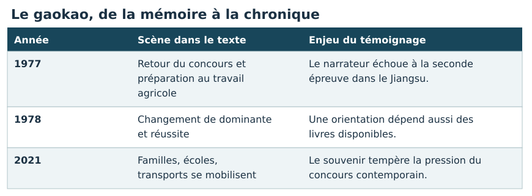

# ENS de Lyon · Séries LA/LV/SH (A/L) · Chinois oral 2022 — Corrigé guidé

*Corrigé rédigé par IA, non officiel. Signalez toute erreur.*

**Rédaction** · GPT-6.2 Astra Ultra · vitesse non renseignée

Neuf billets de langues vivantes sont recensés. L’explication de LV1 comporte quatre passages, dont le quatrième, imprimé sous forme d’image, est de Yu Hua. Les quatre adresses des textes hors programme de LV1 ont été consultées. En LV2, seul le titre du journal de Fang Fang est fourni. Aucun candidat en lettres et arts ni en sciences humaines. Le jury fait lire puis traduire cinq ou six lignes de son choix ; les lignes désignées ne sont pas publiées.

## Langues vivantes · Explication d’un texte d’auteur (LV1)

Les bornes sont celles du fascicule. Pour les trois passages de 章诒和, l’ouvrage et son cadre ont pu être identifiés. Seules les expressions figurant sur la feuille sont ici traduites et expliquées comme appartenant avec certitude au passage. [Notice de l’ouvrage](https://www.megbook.com.tw/mall/detail.jsp?proID=1851523)

### 1. 章诒和，《杨氏女》，pp. 12–13

De « 迎面而來的是 » à « 杨婉芳怎么忘记？ ». *迎面而來的是* suspend l’identification : « Ce qui venait à sa rencontre, c’était… ». *怎么忘记* est ici une interrogation rhétorique : « Comment Yang Wanfang pourrait-elle l’oublier ? »

开头有一个很具体的方向：有什么人或事物正对着人物而来。“是”字在这里使读者等待后面的答案。结尾所提出的问题却属于记忆。已经过去的事，为什么仍然能像眼前发生的一样逼近杨婉芳？从相遇的空间转到记忆的时间，是这两处文字之间可以确定的张力。说“她没有忘记”，只给一个结果；问“怎么忘记”，还让读者体会到遗忘对她为什么不可能。讲解时应根据手中原文说明究竟是谁在看、谁在回忆。杨婉芳和杨芬芳名字相近，并非同一个人。

**追问：这句话是作者自己在问吗？** 不宜只凭问号判断。第三人称叙述也可以贴近人物意识，让叙述者的声音带上人物自己的感受。

### 2. 章诒和，《杨氏女》，pp. 150–152

De « 劳改中队都 » à « 章雨荷又愣了 ». *劳改中队* désigne une unité du camp de rééducation par le travail pénal. Le dernier mouvement peut se rendre par « Zhang Yuhe resta de nouveau interdite ». La romancière 章诒和 et le personnage 章雨荷 ont des noms distincts.

这里有两个尺度。一开始，“中队”把人物放进一个有编制、有规则的集体里，“都”提示某种共同情况。结尾却只剩下一个有名字的人的反应。动词“愣”不同于明确地说赞成或反对，它让理解停顿了一下。“又”告诉我们，这种停顿先前发生过。分析这类叙述，最有意思的是找出集体已经习以为常的事，怎样在一个观察者眼中重新变得难以理解。这样讲，无须把一次沉默武断地归结为恐惧或抗议。

**追问：法语里的 *de nouveau* 可以省去吗？** 如果省去，就容易把反应读成孤立的偶发事件，漏掉它同前文之间的联系。

### 3. 章诒和，《杨氏女》，pp. 18–19

De « 这次进门 » à « 不敢往下想了 ». Traductions de travail : « Cette fois-ci, en entrant… » et « Elle n’osait plus poursuivre cette pensée » (sujet à identifier sur le feuillet).

“这次”意味着进门的动作可以同以前的经验比较，哪怕门本身并没有变化。人在空间上越过了一个界限，在心理上却到达了另一个界限。“不敢”说的是不敢继续，并不是不能思考，也不是已经知道结局；句末的“了”让这种状态的出现格外明显。三个片段的结尾值得比较：杨婉芳无法忘记，章雨荷再次愣住，这里的人物不敢再想下去。三处都写到了意识受阻，却分别涉及过去的记忆、眼前的意外和对下一步的想象。

**追问：比较三个结尾会不会离开本题？** 可以用一句话作比较，然后回到本段，找出从进门到停止思考之间，叙述视点发生变化的地方。单凭两端文字无法重建中间发生的事。

### 4. 余华，《活着》，pp. 181–182

De « 我不忍心看它 » à « 我看它年纪比你爹还大。 ». *不忍心* exprime la peine : « Je n’avais pas le cœur à regarder ça / à le regarder. » Le pronom renvoie au bœuf dans la scène. La dernière voix plaisante : « À mon avis, il est encore plus vieux que ton père. » [Extrait et réplique finale](https://dfiles.jiajiaoban.com/ohr/2020/11/09/202646_5fa93586cf55d.pdf)

老牛快要被宰了，福贵却愿意把它买下来。从能干多少活、还能活几年这两个方面算，这桩买卖都不划算。福贵的“不忍心”用另一种方式衡量这头牛：它能够同一个失去许多亲人的人一起活下去。旁人用夸张的年龄比喻打趣他，给这件事留下了乡村交谈的语气。与其直接宣称老人善良，余华不如让读者听到不同人物怎么谈同一头牛。一边是判断牲口的年龄，一边是承认另一个生命也会怕死。幽默没有取消悲凉，反而使这次选择听起来朴素、可信。

**追问：为什么用第一人称讲买牛？** 动机是在福贵的叙述中慢慢显出来的，他还能把别人的笑话原样带进自己的回忆，使声音不局限于一个人。

## Langues vivantes · Analyse hors programme (LV1)

### 1. “润” RUN

Le cahier porte « 2021 年 06 月 08 日 03:19 来源：华西都市报 ». Le lien mène à une page intitulée *最新的网络流行语“润”是什么意思？*, publiée le 11 mai 2022 sur 网易号 sous le crédit 熙熙攘攘利来利往. La date et le crédit divergent. [Page désignée par le lien officiel](https://www.163.com/dy/article/H74FEFB80552H74Z.html)

一个原本表示滋润的汉字怎样获得了出走的意思？文章先摆出网民的例句，再从拼音 *rùn* 同英语 *run* 的字形相近来解释这个双语玩笑。两种语言的发音并不完全相同。汉语里“日子过得滋润”的联想，又给这个词添上一层对生活的期待。从上海封控时期的讨论，到人们拿诗句和商业名称开玩笑，材料既有现实焦虑，也有转发时的戏谑。讲解时要分清搜索、发帖和实际迁移三个层次。网上的说法可以反映一种处境，却很难直接换算成离境人数。

**追问：“润”一定等于“移民”吗？** 脱离当前处境是共同语感，但有人真在考虑移居，也有人只用它自嘲。判断要依据上下文。

### 2. 金陵未醉人，《又是一年高考时》

Billet publié sur 新浪博客 le 7 juin 2021 ; la date du 8 juin fournie par le jury est celle de la consultation. *又是* signifie « voici de nouveau… ». [Texte original](https://blog.sina.com.cn/s/blog_5487f7d00102zo7e.html)

文章从二〇二一年高考第一天写起。家长、学校和交通部门围绕考生行动，考试仿佛成了社会共同的节日，又像一场全家都要应对的考验。作者转而回忆自己一九七七年的处境：恢复高考的消息来得突然，农村知青要一面参加劳动，一面用手边仅有的课本复习。个人记忆纠正了把恢复考试写成个人立即成功的简单故事。他第一次复试没有通过，第二年换考文科，才取得足够的分数。写出偶然与犹豫，也就写出了制度变化要怎样经过一个具体的人才能产生后果。

**追问：标题里的“又”只表示每年重复吗？** 它还给今天和四十多年前的考试建立了联系。同样是升学，两代考生面对的资源和社会期待并不相同。

### 3. 《中国承诺“碳中和”对全球气候行动意味着什么？》

Le dossier renvoie au site *中外对话* aujourd’hui repris sur *对话地球*. *碳中和* signifie « neutralité carbone ». [Texte publié et contributions des spécialistes](https://dialogue.earth/zh/3/67248/)

这是一组对政策承诺的解释和回应。中国提出二〇三〇年前二氧化碳排放达到峰值，争取二〇六〇年前实现碳中和。达峰是排放量从上升转向下降的转折点；中和则意味着剩余排放与清除量达到净平衡。两者之间的三十年左右，正是需要解释的部分。受访者有人强调国际信号，有人追问能源投资、煤电和近期规划。把不同说法并置，可以看出外交承诺既能提前改变投资预期，也可能因缺少眼前的措施而落空。材料呈现的是目标和条件，不能把多年后的结果写成已经发生的事实。

**追问：标题为什么问“对全球”意味着什么？** 排放影响跨越国界；一个重要排放国改变预期，还会影响其他国家怎样提出各自的目标和评价合作的可能。

### 4. 陈·慧玲、潘·毅、马克·塞尔登，《苹果背后的生与死》，2016年4月15日

Jenny Chan, Pun Ngai et Mark Selden publient une enquête sur les travailleurs des fournisseurs d’Apple. [Article original](https://dialogue.earth/zh/1/43148/)

文章从苹果因消费者的数字隐私而受到关注写起，然后把视线移到生产手机的工人。这一安排提出一个尖锐的问题：一家企业在消费者面前谈权利时，供应链中的人能不能同样被看见？作者研究富士康等代工企业，指出低价、大批量、短交货期怎样把压力从品牌方传到工厂和工人。更换供应商能分散品牌风险，却未必消除共同的采购条件。消费者很容易看见手机的设计，很难看见决定工时和议价能力的组织关系。题目中的“背后”既是生产空间，也是公共注意力的盲点。

**追问：为什么不能简单说是某一家工厂的问题？** 作者追踪的是下单、定价与交货这一连串关系。只看厂内制度，会遗漏品牌在供应链中施加影响的能力。

> [!INDICATION]
> Le jury demande de poursuivre l’analyse au-delà des premiers paragraphes. Dans l’article sur le climat, attribuer chaque appréciation au spécialiste qui la formule. Dans l’enquête sur Apple, faire entendre le déplacement du point de vue, de l’acheteur vers l’atelier.

## Langues vivantes · Analyse hors programme (LV2)

### 方方，《武汉封城日记》

Le fascicule ne précise ni le jour ni les bornes de l’entrée retenue. Une collection d’entrées datées permet de préparer la forme du journal. Aucun des épisodes de cette collection ne peut être désigné comme celui de l’épreuve. [Entrées du 25 janvier au 18 février 2020](https://chinadigitaltimes.net/chinese/636210.html)

“封城”是公共管理的措施，“日记”却把时间切成一个人在城中度过的一天又一天。方方的写作把这两个尺度放在一起。交通和活动空间受限以后，日常小事会取得新的分量，信息能够从亲友、邻居、网络转述等不同渠道进入同一篇记录。分析时首先要区别“我看见”“我听说”和事后的判断。正因为日记在事情发生时书写，它可以保留当时的不确定性，也不能充当整个城市的统计调查。它的公共意义正在这里：把抽象的疫情放回居民所能知道、担心和互相帮助的具体范围。

**追问：没有指定日期时，怎样举例才严谨？** 可以说明某个日期的材料是另外查到的比较文本。真正讲考题时，必须先读出题纸上的日期与叙述线索，不能替考官选一篇。

> [!INDICATION]
> Pour la traduction des cinq ou six lignes, relever qui parle, les marques d’ouï-dire et la date avant de choisir les temps français. Une traduction du titre serait « Journal du confinement de Wuhan ». La sélection de lignes faite par le jury demeure inconnue.

[Fascicule officiel des sujets](https://www.ens-lyon.fr/sites/default/files/2022-11/Chinois2022_0.pdf) · [Rapport du jury](https://www.ens-lyon.fr/sites/default/files/2022-11/Chinois%202022.pdf)
