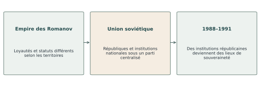

# L’État face aux peuples de la Russie et de l’URSS de 1853 à 1991 · Composition d’histoire 2022 · Corrigé guidé

*Corrigé rédigé par IA, non officiel. Signalez toute erreur.*

**Rédaction** · GPT-6.2 Astra Ultra · vitesse non renseignée

La composition commune de six heures commence avec la guerre de Crimée et s’achève avec la disparition de l’URSS. Le rapport de la discipline, aux pages 2 à 21, distingue les catégories sociales et nationales et invite à considérer les initiatives venues des populations.

## Introduction

> [!INDICATION]
> Préciser les sens de « peuples » et d’« État » avant de choisir une périodisation.

#### Proposition de réponse

Le 23 août 1989, une chaîne humaine traverse l’Estonie, la Lettonie et la Lituanie cinquante ans après le pacte germano-soviétique, pour dénoncer les conditions dans lesquelles les trois pays ont ensuite été incorporés à l’Union soviétique. Les manifestants agissent au nom de peuples qu’ils jugent privés de souveraineté. Ils interviennent cependant dans des républiques dont les institutions et les frontières ont jusqu’alors fonctionné dans le cadre soviétique. La contestation d’un État peut ainsi s’appuyer sur des formes de représentation que cet État organise lui-même.

En 1853, l’Empire des Romanov rassemble des sujets de langues, confessions et statuts divers, unis en principe par la fidélité au souverain. En 1991, quinze républiques sont membres d’une Union qui prétend avoir fait naître un peuple soviétique. Entre ces dates, « peuple » peut désigner les catégories populaires, une communauté nationale ou le détenteur proclamé de la souveraineté. L’État englobe les institutions, les fonctionnaires, les autorités provinciales et les moyens de contrainte qui font exister un ordre politique. Il ne se confond ni avec un monarque ni avec le cercle dirigeant du Parti. Comment l’empire puis l’Union transforment-ils des différences en principes de gouvernement, et dans quelles conditions leurs sujets ou citoyens retournent-ils ces principes contre le centre ?

## I. De la guerre de Crimée à 1917, réformer et étendre un empire de statuts inégaux

> [!INDICATION]
> Articuler la question sociale, la conquête et les conflits de nationalités au moyen de situations localisées.

#### Proposition de réponse

La guerre de Crimée de 1853–1856 révèle les difficultés militaires, de communication et de mobilisation de l’Empire. Sous Nicolas Ier, l’association de l’orthodoxie, de l’autocratie et de la narodnost’, souvent traduite par « nationalité » ou « esprit national », érige la fidélité au souverain en principe d’unité. Mais cette formule ne décrivait pas une population uniformément russe et orthodoxe. Le grand-duché de Finlande dispose de ses institutions. Certaines élites baltes germanophones servent le tsar. Le royaume de Pologne est soumis à des rapports de force différents. Ces relais permettent de gouverner à moindre coût tout en maintenant des arrangements locaux inégaux.

L’émancipation des serfs en 1861 sous Alexandre II est une réforme de la société impériale autant qu’une réponse aux limites révélées par la défaite. Des millions de sujets acquièrent la liberté personnelle. Les modalités de répartition des terres, les charges de rachat et le poids des communautés rurales limitent néanmoins l’autonomie économique espérée. Les zemstvos créés en 1864 associent une partie des élites locales à l’administration de questions comme la santé et l’enseignement, avec une représentation inégalitaire et une implantation géographique partielle. Les acteurs locaux acquièrent des compétences et des lieux de discussion sans contrôler le gouvernement. En Pologne, l’insurrection de 1863 suscite au contraire répression, confiscations et un resserrement administratif. Le même pouvoir sait réformer la condition paysanne et combattre une revendication nationale.

L’avancée en Asie centrale étend les différences à gouverner. La prise de Tachkent en 1865 puis le gouvernement général du Turkestan créé en 1867 placent des populations musulmanes sous une administration façonnée par la conquête. Les règles et les relais retenus n’y sont pas ceux de la Russie centrale. Dans les régions occidentales, les mesures de russification et les discriminations, notamment contre les Juifs, tendent à identifier plus étroitement loyauté politique, langue et origine. Les pratiques restent inégales. L’État recourt aussi au recensement de 1897, dont les catégories de langue et de confession rendent certaines différences visibles tout en les simplifiant. Les mouvements ouvriers, paysans et nationaux ne se confondent pas. Ils se rencontrent pourtant dans la révolution de 1905, qui conduit à la création d’une Douma aux pouvoirs limités. La guerre de 1914 intensifie les déplacements, les soupçons envers des populations classées comme ennemies et les demandes de participation. En 1917, le lien dynastique cède, sans qu’un accord existe sur la forme politique qui lui succédera.

## II. De 1917 à 1945, reconnaître les nations et construire un centre soviétique coercitif

> [!INDICATION]
> Comparer une politique de participation et une opération de contrainte sans supposer que l’une efface immédiatement l’autre.

#### Proposition de réponse

Février 1917 ouvre une concurrence entre gouvernement provisoire, soviets, organisations sociales et pouvoirs nationaux de plusieurs périphéries. Après Octobre, les bolcheviks invoquent le droit des peuples à disposer d’eux-mêmes. La Finlande obtient son indépendance, tandis qu’en Ukraine et dans le Caucase, révolutions et guerre civile opposent plusieurs projets d’État. L’Armée rouge et des communistes locaux contribuent à rétablir le contrôle bolchevique sur une partie importante des anciens territoires impériaux. La violence et les alliances locales comptent autant que les proclamations. On ne peut déduire de la carte des anciennes conquêtes une reconstitution automatique de l’Empire.

En 1922, l’URSS réunit d’abord les républiques de Russie, d’Ukraine, de Biélorussie et la fédération transcaucasienne. La Constitution de 1924 donne à cette construction une forme fédérale. Dans les années 1920, la korenizatsiia, ou politique d’indigénisation, promeut des cadres issus des populations locales, l’usage de langues nationales et leur enseignement. Des frontières, des administrations, des carrières et des institutions culturelles donnent aux appartenances une consistance politique nouvelle. Staline, ancien commissaire du peuple aux nationalités, participe à ces débats avant de dominer le Parti. Le centre entend enraciner le régime dans les périphéries. Les élites qui s’y forment traduisent, négocient ou infléchissent localement ses priorités. Le monopole du Parti empêche toutefois la souveraineté affichée des républiques de s’exercer librement.

À partir de la fin des années 1920, collectivisation forcée et réquisitions transforment la relation entre l’État et les campagnes. Les catégories sociales imposées d’en haut légitiment les déportations de paysans désignés comme koulaks. En Ukraine, la famine de 1932–1933 prend une gravité exceptionnelle, aggravée par les prélèvements et la répression des déplacements. Au Kazakhstan, la sédentarisation brutale et les prélèvements désorganisent profondément les sociétés pastorales. Les mécanismes et les expériences régionales doivent être distingués. Les grandes purges frappent aussi les cadres nationaux que la politique précédente avait mis en avant. La Seconde Guerre mondiale mobilise des citoyens de toutes les républiques dans un combat commun, tout en renforçant la suspicion politique envers des groupes entiers. Les Tchétchènes et les Ingouches, puis les Tatars de Crimée, sont déportés en 1944 sous une accusation collective. Une citoyenneté soviétique commune peut donc coexister avec la punition d’une population définie par son appartenance.

## III. De 1945 à 1991, la fédération centralisée fournit les cadres de sa propre contestation

> [!INDICATION]
> Suivre ce qui passe du statut culturel à l’exercice de la souveraineté politique.

#### Proposition de réponse

La victoire de 1945 procure au régime une puissante légitimité et un récit commun de sacrifice. L’Union sortie de la guerre comprend les États baltes annexés en 1940 et reconquis sur l’Allemagne. Leur situation ne doit pas être confondue avec celle de la Pologne de l’après-guerre, État placé sous domination soviétique mais extérieur à l’Union. À l’intérieur, la généralisation de l’éducation, la mobilité professionnelle et la langue russe comme langue de promotion multiplient les expériences partagées. L’industrialisation peut aussi provoquer des déplacements de main-d’œuvre qui modifient l’équilibre démographique de certaines républiques. Participer à une société soviétique et transmettre une langue ou une mémoire nationale restent des pratiques compatibles.

Après la mort de Staline, la dénonciation du culte de la personnalité en 1956 et le retour autorisé de certains peuples déportés ouvrent des marges de revendication très inégales. La république autonome tchétchéno-ingouche est rétablie en 1957. Les Tatars de Crimée, eux, doivent encore organiser pétitions et mobilisations pour obtenir un retour collectif. Les citoyens invoquent la légalité soviétique et la réparation de décisions du passé. Dans les décennies suivantes, la stabilité des dirigeants locaux et la représentation des nationalités dans les administrations peuvent consolider le pouvoir central autant qu’elles consolident des réseaux républicains. La proclamation d’une communauté historique nouvelle, le « peuple soviétique », n’annule pas ces institutions ni les inégalités dans l’accès aux ressources.

À partir de 1985, les réformes de Gorbatchev ouvrent le débat public et la compétition électorale. Des conflits autrefois contenus deviennent visibles, comme les revendications antagonistes autour du Haut-Karabakh à partir de 1988. Le centre affronte des mobilisations qui s’opposent aussi entre elles. Les fronts populaires baltes mobilisent l’histoire des annexions et les institutions républicaines. La Lituanie proclame le rétablissement de son indépendance en mars 1990. La Russie elle-même déclare sa souveraineté en juin. Cette dernière décision, sous l’impulsion d’Eltsine, retire à l’Union l’évidence d’un centre russe naturellement solidaire du pouvoir soviétique. Au référendum de mars 1991, une majorité des votants dans les républiques participantes souhaite une Union renouvelée, alors que plusieurs républiques ne participent pas officiellement. L’échec du putsch d’août accélère les déclarations d’indépendance. Le vote ukrainien du 1er décembre, puis l’accord des dirigeants russe, ukrainien et biélorusse le 8, conduisent à la disparition de l’Union à la fin de décembre. Cette issue résulte d’une conjoncture et de décisions identifiables, autant que d’héritages anciens.

## Conclusion

> [!INDICATION]
> Expliquer à la fois la durée de l’édifice et l’issue de 1991.

#### Proposition de réponse

Ni la pluralité des peuples ni la force du centre n’expliquent seules cent quarante ans de gouvernement. L’Empire russe gouvernait grâce à des statuts différenciés et des loyautés personnelles qu’il a aussi cherché à homogénéiser. L’Union soviétique a transformé ces différences en territoires, institutions et catégories nationales tout en revendiquant une légitimité sociale universelle. En 1991, des élites, des électeurs et des mouvements concurrents ont pu réclamer un pouvoir souverain au nom de ces républiques. L’État avait longtemps tiré parti des médiations locales. Quand le Parti a perdu son monopole et que la république de Russie a contesté le centre soviétique, ces médiations ont changé de fonction.
