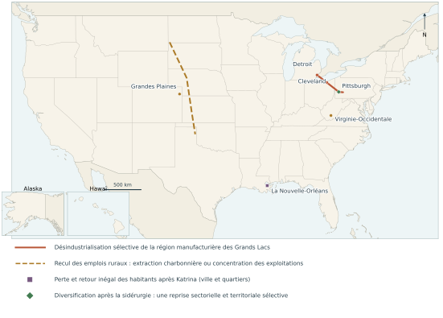

# Les territoires en déclin des États-Unis d’Amérique · Composition de géographie 2022 · Corrigé brut

*Corrigé rédigé par IA, non officiel. Signalez toute erreur.*

**Rédaction** · GPT-6.2 Astra Ultra · vitesse non renseignée

La composition de cinq heures est accompagnée d’un fond des États-Unis avec des cartouches pour l’Alaska et Hawaï. Le rapport de Lyon traite la composition aux pages 2 à 7. Les données mobilisées dans la proposition s’arrêtent à la session 2022.

## Introduction

Detroit comptait près de 1,85 million d’habitants au recensement de 1950 et environ 639 000 en 2020. La différence se voit dans les espaces libres entre certaines maisons et dans les équipements devenus trop grands pour le nombre d’usagers. Elle ne signifie pourtant pas que toute la région des Grands Lacs ait perdu dans les mêmes proportions ses habitants, ses emplois et sa capacité de décision. À quelques kilomètres de limites municipales en grande partie fixes, la croissance d’une banlieue peut avoir accompagné la perte de population du centre. La maille d’observation change le diagnostic.

Le déclin désigne une trajectoire négative attestée par comparaison avec un état antérieur, ou un recul relatif dans un ensemble qui progresse. Un territoire pauvre peut être en croissance, tandis qu’une métropole encore riche peut perdre des fonctions de commandement. Le sujet demande d’étudier comment ces trajectoires modifient l’emploi, la population, les ressources publiques et l’appropriation des lieux. Pourquoi des reculs aussi durables touchent-ils certains espaces d’un pays globalement en croissance démographique, et comment les choix des habitants, des entreprises et des pouvoirs publics les infléchissent-ils ?

## I. Identifier des trajectoires dont les indicateurs et les périmètres diffèrent

Entre les recensements de 2010 et 2020, l’Illinois, le Mississippi et la Virginie-Occidentale ont perdu des habitants, tandis que la population des États-Unis augmentait. Cette liste ne suffit pas à cartographier le déclin. Un État peut présenter une légère progression totale tout en comprenant des comtés qui perdent des jeunes actifs et des bourgs qui ferment leurs commerces. À l’inverse, la perte d’une part de la population nationale constitue un recul relatif même si les effectifs locaux restent stables. Il faut préciser la période, la variable et l’unité spatiale avant de réunir plusieurs lieux sous le même nom.

Dans les anciennes régions manufacturières des Grands Lacs, des pertes d’emplois industriels puis de population se sont accumulées sur plusieurs décennies. À Detroit, les changements de localisation des usines et la mécanisation comptent autant que la concurrence des constructeurs étrangers. Le départ d’habitants et d’activités vers les banlieues, soutenu par l’automobile, le crédit immobilier et l’équipement routier, précède en partie les fermetures les plus récentes. Les discriminations dans l’accès au crédit et au logement n’ont pas distribué également la possibilité de partir. Les pertes à l’intérieur des limites de la ville-centre et la recomposition de l’aire métropolitaine décrivent donc deux processus liés mais différents.

La carte sélectionne également des terrains ruraux. Dans une partie des Grandes Plaines, le regroupement des exploitations et la mécanisation permettent de continuer à produire avec moins de travailleurs. Le volume produit ne baisse pas nécessairement en même temps que la population locale. La disparition d’une école ou l’allongement du trajet vers un médecin peuvent rendre le recul perceptible même là où une exploitation voisine a accru sa production. Dans certains bassins charbonniers de Virginie-Occidentale, l’emploi minier se contracte sous l’effet combiné de la mécanisation, de la transformation des marchés de l’énergie et de l’épuisement de certains sites. Les données à l’échelle de l’État ne suffisent pas à décrire la trajectoire de chaque vallée.

## II. Le déclin s’entretient par des mécanismes économiques et politiques localisés

Une fermeture industrielle touche des sous-traitants, des commerces proches et les recettes des collectivités. Ces effets se cumulent lorsque les emplois et les actifs les plus mobiles peuvent quitter la juridiction qui reste chargée des bâtiments, des réseaux d’eau et des services. À Detroit, la faillite municipale de 2013 marque une crise financière d’une collectivité particulière. Elle n’équivaut ni à la disparition de l’automobile dans le Michigan ni à la faillite de tous les habitants. La répartition des ressources entre communes d’une même agglomération limite la possibilité de financer ensemble des coûts dont l’origine est régionale. La friche industrielle et la vacance résidentielle expriment cette histoire foncière et fiscale autant qu’elles témoignent d’un désinvestissement privé.

Dans les campagnes, une boucle différente peut se former. Lorsque les emplois se raréfient, une partie des jeunes adultes part pour étudier ou travailler. Le vieillissement peut alors réduire le nombre de naissances et le volume de clientèle des commerces. Une fermeture de service complique la vie des ménages restants, mais tous ne peuvent ni ne souhaitent partir. La propriété du logement, les liens familiaux et l’attachement au lieu modifient les choix. Les comtés agricoles proches d’une métropole, ceux qui accueillent des retraités et ceux qui sont éloignés des centres d’emploi ne suivent pas une trajectoire unique. Colorier des « Grandes Plaines en déclin » sous forme d’aplat uniforme serait donc trompeur.

Une catastrophe peut enfin précipiter des évolutions antérieures et répartir inégalement les possibilités de retour. À La Nouvelle-Orléans, l’ouragan Katrina et les inondations de 2005 ont forcé de nombreux départs. La ville comptait environ 485 000 habitants en 2000 et 384 000 en 2020. Ce bilan masque la chute immédiate, la reconstruction puis la reprise partielle. Les ressources financières des familles, les conditions d’assurance, la situation des logements et les politiques de reconstruction ont différencié le retour entre quartiers. Le littoral du golfe ne peut être désigné dans son ensemble comme en déclin à partir de cette seule trajectoire urbaine.

## III. Refaire un territoire après le recul ne produit pas nécessairement un retour à l’état ancien

Pittsburgh illustre la possibilité d’un redéploiement après les pertes de la sidérurgie. Universités, hôpitaux et activités de recherche offrent des compétences et des employeurs différents. Certaines friches proches des cours d’eau ont reçu de nouveaux usages. Mais la croissance de secteurs qualifiés ne remplace pas poste pour poste les emplois disparus dans les anciennes vallées industrielles. Les nouveaux salariés n’habitent pas forcément les mêmes quartiers et n’ont pas toujours le même profil de formation. Il faut donc pouvoir dire à la fois qu’une économie se diversifie et qu’un territoire ou un groupe social continue de porter le coût de sa spécialisation passée.

Dans les villes en contraction durable, démolir un bâtiment vacant peut réduire un risque et rendre une parcelle disponible. Réunir des services ou réaffecter un terrain à un jardin peut améliorer l’usage quotidien d’un espace. Ces mesures butent cependant sur l’entretien des grandes infrastructures et sur la crainte des habitants de voir leur quartier abandonné. Mesurer une politique au seul nombre d’habitants qu’elle « ramène » négligerait la qualité des services pour ceux qui restent. Dans les petites villes rurales, conserver une desserte ou partager un service entre plusieurs bourgs peut ainsi représenter une amélioration réelle malgré un effectif démographique encore décroissant.

Le terme même de déclin devient un enjeu. Il peut ouvrir l’accès à des financements ou faire connaître une injustice, mais aussi dévaloriser un quartier et décourager un investissement. Les projets de reconversion touristique ou patrimoniale d’anciens lieux d’extraction donnent parfois une nouvelle valeur à des paysages considérés jusque-là comme obsolètes. Ils ne recréent pas nécessairement des emplois aussi nombreux ou stables. Un bilan territorial doit donc articuler durée, échelle, nombre et qualité des emplois, état du bâti, accès aux services et capacité des habitants à définir les priorités.

## Conclusion

Il existe aux États-Unis plusieurs géographies du déclin. Les villes industrielles, certaines campagnes agricoles, les bassins d’extraction et des quartiers touchés par une catastrophe ne partagent ni la même chronologie ni les mêmes mécanismes. La division du territoire en collectivités aux ressources inégales, les possibilités de mobilité et les politiques publiques déterminent en partie la durée et l’intensité des reculs. Une reprise de l’emploi dans une métropole peut ainsi coexister avec le maintien d’inégalités dans ses quartiers. C’est en suivant ces trajectoires différenciées que l’on peut expliquer le déclin sans l’ériger en destin pour les habitants.
