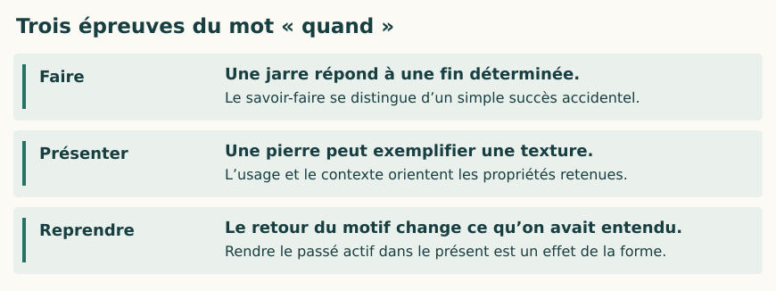

# Quand y a-t-il art ? · Lyon 2022 · Corrigé guidé

*Corrigé rédigé par IA, non officiel. Signalez toute erreur.*

**Rédaction** · GPT-6.2 Astra Ultra · vitesse non renseignée

**Révision (tour 1)** · GPT-6.2 Astra Ultra · vitesse non renseignée · 26 novembre 2026

## Préparer la dissertation

**Conserver la forme de la question.** Comparez ces trois demandes : quand un potier sait-il faire, quand une pierre fonctionne-t-elle comme œuvre, quand un motif revient-il autrement dans une mélodie ? La première demande un seuil, la deuxième des conditions et une histoire, la troisième la forme d’un temps vécu. Si vous répondez partout par une date ou par le seul nom d’un lieu, vous perdrez deux des trois problèmes.

**Éprouver un critère à l’aide d’un second exemple.** Quelqu’un propose que montrer un objet suffise à faire art. Comparez alors la pierre dans un musée de géologie et dans une exposition d’art. Toutes deux sont montrées et toutes deux signifient quelque chose. Précisez la fonction de chacune avant d’introduire Goodman. Pour Duchamp, restituez la séquence de 1917 : soumission, refus d’exposition, photographie. Un autre récit, celui d’un urinoir consacré en étant admis au musée, ruinerait l’argument.

**Faire progresser la dernière partie.** Inventez deux auditeurs dont l’un a manqué la première occurrence d’un motif musical. Lors de sa reprise ils entendent au même moment les mêmes notes. Expliquez pourquoi leur présent n’a pas la même épaisseur. Ce test établit quelque chose que ne pouvait pas encore montrer le déplacement d’une pierre. Le rapport de la composition 2022 invite à prendre au sérieux la double dimension du « quand », conditions de reconnaissance et temporalité propre à l’art.

## Sujet

« Quand y a-t-il art ? » Composition commune de la Banque d’épreuves littéraires, six heures, session 2022. La garde LCU 172 nomme les ENS Paris-Saclay, de Lyon et de Paris.

**Vérifier la double portée d’une date.** En 1895, Durand-Ruel réunit vingt des *Cathédrales* de Monet. Dites ce dont cette date marque le début. Chaque toile existe déjà. L’accrochage donne cependant au public une occasion nouvelle de comparer les lumières sur un même édifice. Vous pouvez ainsi expliquer ce que l’histoire de l’exposition change à l’expérience des œuvres, puis ce que les œuvres permettent à leur tour de changer dans l’histoire du regard.

## Introduction

Un pianiste répète dans une salle encore vide. Un accord maladroit l’arrête ; il reprend la phrase autrement. Dans le couloir, quelqu’un qui n’est jamais entré dans la salle s’immobilise pour écouter. À quel moment y a-t-il eu art ? Dès que le pianiste a touché l’instrument, lorsque les notes ont formé une phrase ou lorsque quelqu’un est devenu sensible à ce qu’elle faisait entendre ? La même suite de sons peut apprendre à délier les doigts, signaler qu’un instrument est bien accordé ou donner à éprouver une attente que sa dernière note change en surprise. Il semble donc insuffisant de chercher parmi ses qualités sensibles une propriété qui annoncerait infailliblement la présence de l’art. Mais si cette présence dépend de circonstances, n’importe quelle circonstance pourrait-elle la produire ? Nous examinerons d’abord ce que l’art doit à un savoir-faire, puis les conditions dans lesquelles une chose commence à fonctionner comme œuvre. Reste à savoir si l’art, en se produisant à certains moments, peut aussi transformer le temps dans lequel il paraît.

## I. Quand la réussite d’un faire devient sensible

Nous parlons de l’art du potier ou du médecin. L’usage a une raison précise. Dans l’*Éthique à Nicomaque*, Aristote distingue la production de l’action dont la fin réside dans l’exercice même. Celui qui produit sait faire advenir quelque chose qui pourrait aussi ne pas être. Une jarre tient debout, reçoit le liquide et garde un col assez étroit pour le verser. Ces réussites supposent une conduite capable de s’ajuster à la résistance d’une terre déterminée. La chance peut bien réussir une forme une fois ; il y a art lorsqu’un agent sait reprendre cette opération dans des circonstances différentes, en comprendre suffisamment la raison et répondre de l’écart entre le résultat et la fin poursuivie. Le « quand » désigne d’abord un seuil de maîtrise. On a une première réponse qui donne un contenu à l’idée de technique.

Pourquoi alors réserver plus volontiers le nom d’œuvre à certaines productions ? La forme de telle jarre attire l’attention sur la façon dont le ventre s’élargit puis se resserre. Il se peut que le même profil permette au vase de conserver l’équilibre. Mais cette solution pratique n’épuise pas la question que le spectateur découvre en la regardant : comment une masse pesante peut-elle paraître s’élever d’un mouvement aussi continu ? Dans l’expérience des beaux-arts, les rapports entre les parties peuvent appeler un examen que la simple réussite de l’usage n’aurait jamais exigé. Kant aide à distinguer les deux jugements. Pour juger celle-ci, je compare la chose à un concept de son usage. Lorsque sa forme me plaît par le jeu qu’elle occasionne entre mes facultés, je peux demander à d’autres de regarder encore, sans pouvoir leur imposer une règle garantissant leur plaisir. Cela explique pourquoi il ne suffit pas de définir l’art par le beau. Un paysage naturel prête lui aussi à ce jugement. Une œuvre peut d’autre part chercher à heurter ; ce qu’elle donne à reprendre importe davantage que le signe agréable ou déplaisant de son effet.

La distinction a aussi une limite historique. Le potier pouvait avoir voulu ensemble la commodité du versement et la beauté de la courbe sans se représenter son œuvre sous notre catégorie de beaux-arts. À l’inverse, l’intention de produire un objet d’exposition ne lui donne pas d’avance la moindre puissance à nos yeux. Il faut donc se demander à quelles conditions cette manière de prendre la forme au sérieux se détermine dans un lieu et un temps, jusqu’à faire varier le statut de la même chose.

## II. Quand une chose commence à fonctionner comme œuvre

Goodman imagine une pierre qui, sur un chemin, ne joue aucun rôle particulier et qui, présentée dans une exposition, pourrait servir à exemplifier sa texture ou sa forme. Exemplifier a un sens plus exigeant que posséder. Un échantillon d’étoffe possède une taille et un prix, mais le tailleur s’en sert pour faire connaître la couleur et le tissu que pourra avoir un vêtement de tout autres dimensions. Le choix des propriétés auxquelles l’échantillon renvoie dépend d’un usage réglé. Dans le cas de la pierre, l’installation, le voisinage d’autres œuvres et l’attention qu’ils orientent peuvent faire travailler ses aspérités comme les éléments d’un langage. Ni l’adresse du bâtiment ni la beauté minérale ne suffisent. Une pierre présentée dans un musée de géologie peut exemplifier tout autre chose, par exemple les caractères qui permettent de classer une roche. Lorsque nous parlons d’art à propos de l’exposition, il nous faut déterminer ce que fait effectivement cette présentation.

La *Fontaine* de Duchamp met cette difficulté à l’épreuve. L’urinoir signé « R. Mutt » fut soumis en 1917 à l’exposition new-yorkaise de la Société des artistes indépendants et ne fut pas présenté au public de l’exposition. L’original a disparu ; une photographie et, plus tard, des répliques ont participé à la vie de l’œuvre. On manquerait ce qui s’est joué en imaginant un objet devenu artistique à la seconde où un musée l’aurait admis. Le déplacement, le titre, la signature et le refus ouvrent une question qui peut se transmettre après la disparition de l’objet présenté. Qu’avait-on invité les exposants à faire, lorsqu’on leur avait promis de recevoir leurs œuvres ? Fallait-il avoir façonné de sa main la matière proposée ? La candidature de cet objet a rendu les réponses discutables, et la discussion elle-même a rendu possible une manière nouvelle de relire les opérations déjà accomplies. Il peut s’écouler un temps entre la proposition d’un geste et l’apparition publique de ce qu’il propose.

Doit-on conclure que n’importe quelle chose sera de l’art dès qu’il plaira à quelqu’un de le dire ? La déclaration donne au plus l’occasion d’une enquête. Il faut pouvoir indiquer ce que le déplacement rend perceptible, quels usages il transforme et pourquoi ce sont bien les traits de cette chose, dans cette histoire, qui portent la proposition. Imaginons qu’un objet matériellement identique remplace un équipement défectueux dans les toilettes du musée. Il manquerait précisément l’acte de présentation auquel renvoie la controverse de 1917. L’indiscernabilité matérielle n’impose pas une équivalence de sens. L’histoire rend disponibles des différences que la seule inspection ne pouvait livrer.

## III. Quand une œuvre donne une autre forme au temps

Il subsiste toutefois un défaut dans cette deuxième réponse. Elle pourrait réduire l’art à l’attribution d’un statut par des interprètes. Or une œuvre nous fait parfois découvrir des différences que personne, avant de s’y exposer, n’aurait su formuler. Reprenons l’expérience de la phrase musicale. Deux sons successifs ne font pour l’oreille qu’un son après un autre tant qu’aucune relation ne s’est établie entre eux. Un motif repris un peu plus tard change rétrospectivement la valeur de sa première apparition. Ce qui semblait accessoire était déjà une promesse et cette promesse nous devient sensible après coup. Compter les secondes écoulées renseigne sur la durée de l’exécution. Cela n’explique pas comment elle a composé ensemble l’attente, la reconnaissance et la surprise. Ici l’art ne se contente pas d’occuper un temps disponible. Il produit une articulation du temps dont la description exige d’avoir parcouru l’œuvre.

L’exemple dépasse la seule musique. Dans les séries que Monet consacre à la façade de la cathédrale de Rouen, les variations de lumière font surgir des masses différentes d’une architecture que nous savons identique. Présentées ensemble, les toiles empêchent de choisir trop vite une façade définitive dont les autres seraient des apparences déficientes. Une couleur observée sur l’une permet de découvrir sur l’autre une ombre que nous aurions confondue avec la pierre. Le spectateur peut avancer, revenir, renverser l’ordre du regard. Cet acte de comparaison soustrait la variation à la simple succession des heures et donne à l’instant passé une présence avec laquelle l’instant présent entre en rapport. La série a des dates, ses motifs une histoire. Ce qui s’y découvre ne se laisse pas enfermer dans l’énoncé de ces dates.

L’histoire de leur exposition confirme cette possibilité. En 1895, Durand-Ruel présente ensemble vingt des *Cathédrales*. Les toiles existaient déjà. Leur réunion modifie ce que le visiteur peut faire devant elles : revenir d’un tableau à l’autre, éprouver par contraste une lumière, comprendre que la série elle-même porte une proposition sur le visible. L’événement est double. Une manière historiquement située d’exposer des peintures rend la comparaison possible, puis les œuvres ainsi rapprochées apprennent à leur public à regarder une façade autrement. L’art acquiert une histoire jusque dans les habitudes de perception qu’il transforme.

À ce compte une œuvre rangée dans une réserve cesserait-elle d’être une œuvre ? Il importe de distinguer son statut, qui dure, et ses manières d’advenir, qui peuvent s’interrompre et se reprendre. Une partition survit à sa dernière exécution. Sa notation offre des prises à des musiciens futurs, qui ne pourront cependant produire la musique sans engager leurs corps dans une nouvelle exécution. De même un document qui atteste une performance n’est pas cette performance, mais il peut rendre possible la reprise argumentée de sa proposition. La permanence d’une œuvre tient en partie à ce qu’elle autorise de nouveaux événements sans être réductible à aucun d’entre eux. Cette distinction rend compte à la fois de notre obligation de conserver et de la possibilité qu’une œuvre conservée cesse longtemps de nous parler.

## Conclusion

Il y a art au sens premier lorsque faire cesse d’être une heureuse rencontre et devient la maîtrise raisonnée d’une production. Dans le registre des œuvres, cette maîtrise n’est ni toujours nécessaire à celui qui fait la proposition, ni suffisante. Il y a art lorsque des gestes ou des choses, pris dans une pratique historiquement déterminée, donnent à éprouver et à reprendre une organisation sensible de l’expérience. L’occasion en est datable ; ses effets peuvent revenir autrement et faire entendre, dans un présent, quelque chose d’un autre temps. Le pianiste, l’interprète futur et l’auditeur du couloir ne décrivent donc pas trois instants concurrents où l’art naîtrait une fois pour toutes. Ils participent à des titres différents à l’actualisation d’une même possibilité.

[Énoncé](https://www.ens-lyon.fr/sites/default/files/2022-11/Session-2022_BEL_Composition%20de%20philosophie.pdf) · [Rapport du jury](https://www.ens-lyon.fr/sites/default/files/2022-11/Philosophie%202022.pdf)
